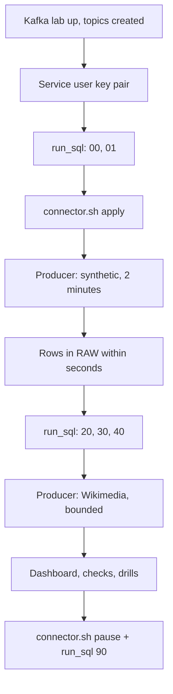

# P14 Solution

Reference implementation for [P14](../README.md). Build your own version first with [07_build_it_yourself.md](../07_build_it_yourself.md); run this one end to end with [QUICKSTART.md](../QUICKSTART.md).

## Layout

```text
06_solution/
  p14.env.example                 copy to p14.env (ignored); read by run_sql.sh and connector.sh
  run_sql.sh                      fills placeholders, runs SQL with the Snowflake CLI
  core/
    00_account_setup.sql          roles, connector service user (key-pair), warehouses, monitor, database
    01_schemas_and_raw.sql        schemas; connector-owned raw table with change tracking
    05_set_connector_key.sql      set or rotate the service user's key
    20_staging.sql                stream + serverless task MERGE (same logic as P04)
    30_mart.sql                   minute dynamic table, live view over RAW, hot pages
    40_ops.sql                    offset integrity, freshness, latency per hop, alert
    50_dashboard_and_ops_queries.sql
    90_pause.sql / 91_resume.sql
  connect/
    p14-snowflake-sink.json       connector config; secrets via ${file:...} references
    connector.sh                  apply | status | pause | resume | restart | delete
  tests/
    data_quality_checks.sql
    failure_drills.md
  teardown.sql
```

Kafka, Kafka Connect, and the producer live in the shared [Kafka lab](../../_shared/kafka_lab/README.md).

## Run Order



## Expected Results

| Check | Expected |
| --- | --- |
| `./connect/connector.sh status` | Connector and three tasks `RUNNING` |
| `SHOW CHANNELS IN TABLE RAW.WIKI_RECENTCHANGE_RAW` | One channel per partition with advancing offset tokens |
| `OPS.V_OFFSET_INTEGRITY` | `DUPLICATE_OFFSETS = 0`; `MISSING_OFFSETS` equals DLQ count |
| `OPS.V_LATENCY_LAST_HOUR` | Kafka-to-connector p95 in seconds; event-to-staging dominated by the 1-minute task |
| `MART.V_LIVE_LAST_5_MINUTES` | Rows for the current minute while the producer runs |

## Design Notes Worth Comparing With Your Version

- **Connector-owned, pre-created table.** Creating it as `P14_CONNECTOR` with `CHANGE_TRACKING = TRUE` lets the owner role build a stream on it; `CREATE TABLE` is revoked afterwards.
- **Service user with `TYPE = SERVICE`.** No password, key-pair only, a single role.
- **Secrets through a Connect config provider.** The private key never appears in the connector config topic or REST responses.
- **`errors.tolerance=all` with a DLQ.** A poison message costs one offset, not the partition.
- **Schematization off.** The raw table stays two `VARIANT` columns; drift shows up in staging, not as connector failures.
- **Downstream identical to P04.** Measured differences between P04, P14, and P15 come from ingestion only.

## Cleanup

1. `./connect/connector.sh delete`
2. `./run_sql.sh teardown.sql`
3. In `_shared/kafka_lab/`: `docker compose down`, and delete `secrets/p14-snowflake.properties`.
4. Delete the service user key files if you no longer need them.
