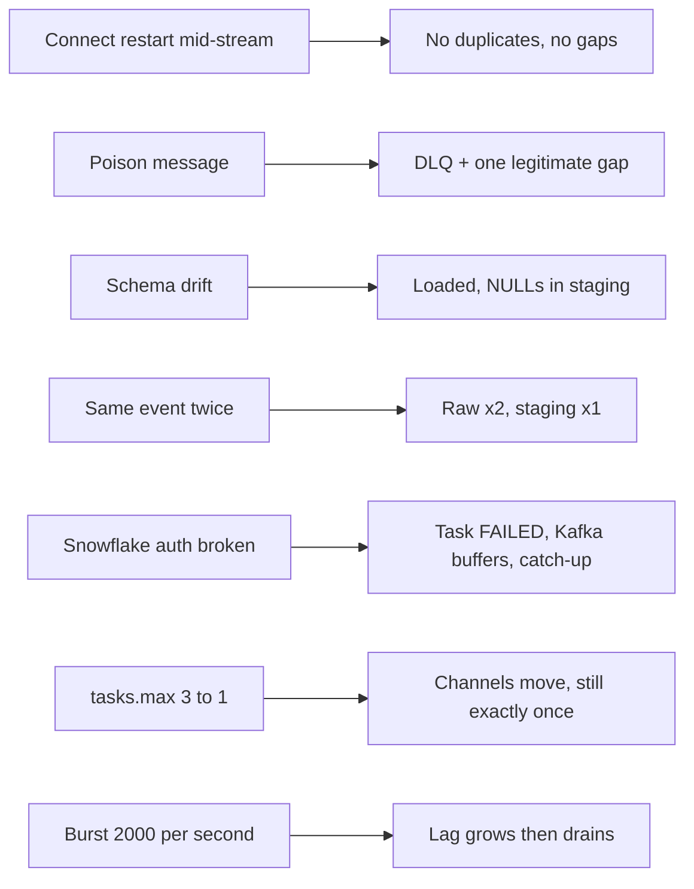

# P14 Failure Drills

Run after the normal pipeline works (milestone M6). Write a prediction before each drill. Commands run from `_shared/kafka_lab/` unless noted.

```bash
LAG="docker compose exec kafka /opt/kafka/bin/kafka-consumer-groups.sh --bootstrap-server kafka:19092 --describe --group connect-p14_wiki_snowflake_sink"
```



## D1 Kafka Connect Restart Mid-Stream

```bash
# producer running with --source synthetic --rate 200
docker compose restart connect
```

- **Observe:** `OPS.V_OFFSET_INTEGRITY`: `DUPLICATE_OFFSETS = 0`, `MISSING_OFFSETS` unchanged; `SHOW CHANNELS` offset tokens continue.
- **Lesson:** each partition writes through a channel whose offset token is committed atomically with the rows. On restart the connector resumes from the token, not from a guess.

## D2 Poison Message

```bash
echo 'this is not json' | kcat -b localhost:9092 -t wiki.recentchange -P -k poison
kcat -b localhost:9092 -t wiki.recentchange.dlq -C -e -f 'headers=%h\nvalue=%s\n'
```

- **Observe:** the DLQ holds the message with error context headers; `MISSING_OFFSETS` rises by one in that partition; the connector stays `RUNNING`.
- **Then:** set `dlq_records = 1` in `tests/data_quality_checks.sql`; the gap check passes.
- **Discuss:** with `errors.tolerance=none`, what would happen to all later messages in that partition?

## D3 Schema Drift

```bash
echo '{"meta":{"id":"drift-1","dt":"2026-11-10T12:00:00Z"},"wiki":"enwiki","title":"Drift","type":"edit","bot":"unknown","namespace":"main","drift_field":{"v":2}}' \
  | kcat -b localhost:9092 -t wiki.recentchange -P -k enwiki:Drift
```

- **Observe:** the row lands in RAW (`VARIANT`); staging has `IS_BOT` and `NAMESPACE` as `NULL` for `drift-1`.
- **Lesson:** schematization off keeps ingestion stable; typing and drift detection live in staging.

## D4 The Same Event Twice

```bash
kcat -b localhost:9092 -t wiki.recentchange -C -o -1 -c 1 -e -f '%s\n' -p 0 \
  | kcat -b localhost:9092 -t wiki.recentchange -P -k replay
```

- **Observe:** RAW has two rows with the same `meta.id` and different offsets; staging has one.
- **Lesson:** Kafka-to-Snowflake is exactly-once per offset, not per business event. The source can still repeat itself.

## D5 Snowflake Authentication Broken

```sql
USE ROLE ACCOUNTADMIN;
ALTER USER P14_KAFKA_SVC UNSET RSA_PUBLIC_KEY;
```

- **Observe:** `./connect/connector.sh status` (from `06_solution/`) shows failing tasks with an authentication error; `$LAG` grows; the freshness alert fires after its threshold.
- **Recover:** set the key again with `./run_sql.sh core/05_set_connector_key.sql`, then `./connect/connector.sh restart`. Lag drains; offset integrity shows no gaps.
- **Discuss:** how long can the connector be down before data is lost? (Topic retention, here 7 days.)

## D6 Rebalance: Fewer Tasks

Edit `connect/p14-snowflake-sink.json` to `"tasks.max": "1"`, then `./connect/connector.sh apply`.

- **Observe:** one task now owns all three partitions; `SHOW CHANNELS` lists the same channels; no duplicates.
- **Revert** to `3` afterwards.

## D7 Burst

```bash
python producer/wiki_to_kafka.py --source synthetic --rate 2000 --duration-minutes 1
```

- **Observe:** `$LAG` rises and drains; `OPS.V_LATENCY_LAST_HOUR` p95 for Kafka-to-connector rises; buffers flush on `buffer.count.records` instead of `buffer.flush.time`.
- **Discuss:** which knob would you change first for sustained volume: tasks, partitions, buffer size, or flush time?

## Drill Log Template

| Drill | Prediction | Observed | Detected by | Time to detect | Recovery | Follow-up change |
| --- | --- | --- | --- | --- | --- | --- |
| D1 | | | | | | |
| D2 | | | | | | |
| D3 | | | | | | |
| D4 | | | | | | |
| D5 | | | | | | |
| D6 | | | | | | |
| D7 | | | | | | |
