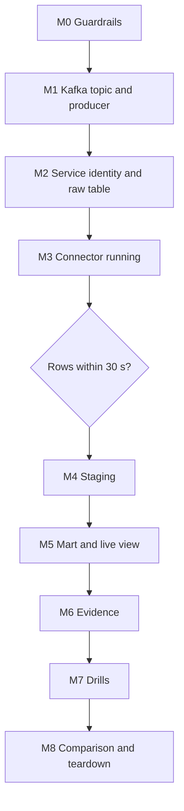

# 7. Build It Yourself

## Brief

The platform team made Kafka the company event bus, and Wikimedia events now flow through it. Community operations wants an incident view that is seconds fresh, and the data team wants Snowflake to be a proper Kafka consumer: exactly once per offset, resilient to outages, and secure. Build it, prove it, and compare it with your P04 numbers.

## Rules

| You may use | Only when stuck | Only after the milestone passes |
| --- | --- | --- |
| [01](01_problem.md) to [04](04_alternative_stacks.md), the [Kafka lab](../_shared/kafka_lab/README.md), `_shared/`, official Snowflake and Kafka documentation | [05_snowflake_step_by_step.md](05_snowflake_step_by_step.md) | [06_solution/](06_solution/README.md) |

You may reuse the Kafka lab and its producer as given; everything in Snowflake and the connector configuration is yours to write.

## Milestone Map

---

## M0 Guardrails

**Deliverables:** project roles, warehouses, monitor, database; pause script that also pauses the connector.

**Acceptance criteria**
- [ ] Nothing owned by `ACCOUNTADMIN`
- [ ] You can explain which P14 costs a resource monitor does not cover

---

## M1 Kafka Topic and Producer

**Deliverables:** topic with a deliberate partition count and retention; DLQ topic; producer running against the lab.

**Acceptance criteria**
- [ ] Auto topic creation is off, and you created both topics explicitly
- [ ] Your key choice is written down with its ordering and skew consequences
- [ ] Producer uses idempotence and `acks=all`, and you can explain what that does and does not protect against

**Hints:** look at the partition distribution in Kafka UI for two different key choices.

---

## M2 Service Identity and Raw Table

**Deliverables:** service user with key-pair authentication; connector role; raw table the connector can write; least-privilege grants.

**Acceptance criteria**
- [ ] The service user has no password and cannot log in interactively
- [ ] The connector role can write into exactly one table and create nothing
- [ ] The raw table supports a stream for staging

**Hints:** who must own a Snowpipe Streaming target table, and who can enable change tracking?

---

## M3 Connector Running

**Deliverables:** connector configuration in Git without secrets; secret supplied at runtime; connector and tasks running.

**Acceptance criteria**
- [ ] `GET /connectors/<name>` output contains no private key
- [ ] One channel per partition is visible in Snowflake
- [ ] A poison message goes to the DLQ and the connector keeps running

**Gate G1:** new records are queryable in Snowflake within 30 seconds while producing. Measure it.

---

## M4 Staging

**Deliverables:** deduplicated typed staging, incremental, same logic as P04.

**Acceptance criteria**
- [ ] The same event at two offsets ends up once in staging
- [ ] Staging keeps partition, offset, and Kafka timestamps for evidence

---

## M5 Mart and Live View

**Deliverables:** minute mart identical to P04; a live view of the last five minutes; dashboard as the reader role.

**Acceptance criteria**
- [ ] The live view's limitations (not deduplicated) are documented in its comment or name
- [ ] The dashboard shows the live view changing between refreshes

---

## M6 Evidence

**Deliverables:** offset integrity per partition; latency per hop; freshness alert; data quality checks; consumer lag observation; credits per running hour.

**Acceptance criteria**
- [ ] Zero duplicate offsets; missing offsets equal DLQ count
- [ ] p95 Kafka-to-Snowflake latency measured and compared with the 30-second target

---

## M7 Drills

**Deliverables:** drills for restart, poison message, drift, duplicate event, broken authentication, rebalance, and burst, each with prediction, observation, detection, and recovery.

**Acceptance criteria**
- [ ] After all drills, offset integrity still shows zero duplicates
- [ ] You know how long Snowflake can be unavailable before data is lost, and why

---

## M8 Comparison and Teardown

**Deliverables:** comparison table P04 vs P14 (latency per hop, credits, components, recovery); one-page note with your recommendation for when to use each; teardown.

**Acceptance criteria**
- [ ] Recommendation is based on measured numbers
- [ ] No `P14_` objects, no running connector, no secret file left behind

---

## Stretch Goals

- **Schema Registry and Avro:** add Schema Registry to the lab, produce Avro, and compare schematization on and off.
- **Triggered staging:** replace the scheduled task with a task triggered by the stream and measure event-to-staging latency and cost.
- **Confluent Cloud:** run the managed Snowflake sink connector and compare operations and cost.
- **Key rotation without downtime:** use `RSA_PUBLIC_KEY_2`, switch the secret, restart, unset the old key.
- **Network policy:** restrict the service user to your IP address.
- **Lag-based alert:** export consumer lag and alert on it instead of on raw freshness.

## Portfolio and Interview

**Resume bullet examples:**
- Integrated Kafka with Snowflake through the Kafka connector and Snowpipe Streaming, reaching p95 Kafka-to-warehouse latency of N seconds with zero duplicate offsets across seven failure drills.
- Designed least-privilege ingestion with a key-pair service user, connector-owned target table, and runtime-injected secrets.

**Questions you should be able to answer:**
1. How do channels and offset tokens give exactly-once per offset, and where does that guarantee end?
2. What happens to records when Snowflake is down for six hours? For eight days?
3. Why is `errors.tolerance=all` with a DLQ safer than the default?
4. Why does the connector role own the raw table, and why revoke `CREATE TABLE`?
5. When would you choose P15's lake-first design instead?
