# P14 Quickstart

Numbered commands from an empty laptop to a running, measured, and paused Kafka-to-Snowflake pipeline using the reference solution. Each step ends with **Done when**; details are in [05_snowflake_step_by_step.md](05_snowflake_step_by_step.md).

```mermaid
flowchart LR
    A[1-2 Install] --> B[3 Snowflake access]
    B --> C[4 Kafka lab]
    C --> D[5 Producer test]
    D --> E[6 Env file and keys]
    E --> F[7 Snowflake setup]
    F --> G[8 Connector]
    G --> H[9 Staging, mart, ops]
    H --> I[10-12 Run, measure, drills]
    I --> J[13 Pause or teardown]
```



## Install

### 1. Workstation and Docker

[Workstation guide](../../../../shared/environments/setup-guide/01_workstation_macos.md) sections 1, 4, 5, 7, 8 (Homebrew, VS Code, Python, Docker with at least 6 GB memory, utilities including `kcat` and `jq`).

**Done when:** `docker run --rm hello-world`, `kcat -V`, `jq --version` work.

### 2. Snowflake CLI

```bash
brew install pipx && pipx ensurepath && pipx install snowflake-cli
```

**Done when:** `snow --version` prints a version.

## Access

### 3. Snowflake trial and your CLI connection

Open a trial ([Snowflake account guide](../../../../shared/environments/setup-guide/accounts/snowflake.md)); add `[connections.p14]` for your own user with key-pair ([Snowflake CLI](../../../../shared/environments/setup-guide/02_cli_tools_and_auth.md#snowflake-cli)).

**Done when:** `snow sql -c p14 -q "SELECT CURRENT_USER()"` succeeds.

## Kafka

### 4. Start the Kafka lab

```bash
cd 16-cloud-databases/01-snowflake/end-to-end-projects/_shared/kafka_lab
cp .env.example .env
curl -s https://repo1.maven.org/maven2/com/snowflake/snowflake-kafka-connector/maven-metadata.xml | grep -o '<release>[^<]*'
# edit .env: SNOWFLAKE_CONNECTOR_VERSION=<that version>
mkdir -p secrets && chmod 700 secrets
docker compose up -d --build
docker compose exec kafka /opt/kafka/bin/kafka-topics.sh --bootstrap-server kafka:19092 --create --if-not-exists --topic wiki.recentchange --partitions 3 --replication-factor 1
docker compose exec kafka /opt/kafka/bin/kafka-topics.sh --bootstrap-server kafka:19092 --create --if-not-exists --topic wiki.recentchange.dlq --partitions 1 --replication-factor 1
```

**Done when:** `curl -s localhost:8083/connector-plugins | jq -r '.[].class' | grep -i snowflake` prints the Snowflake sink class.

### 5. Producer smoke test

```bash
cd producer
python3.12 -m venv .venv && source .venv/bin/activate
pip install -r requirements.txt
python -m pytest -q test_wiki_to_kafka.py
python wiki_to_kafka.py --source synthetic --rate 20 --duration-minutes 1
kcat -b localhost:9092 -t wiki.recentchange -C -c 3 -e -f 'p%p o%o k=%k\n'
```

**Done when:** tests pass and `kcat` prints three records.

## Snowflake

### 6. Env file and service user keys

```bash
cd ../../../P14_kafka_connector_streaming/06_solution
cp p14.env.example p14.env
# edit p14.env: P14_ALERT_EMAIL, SNOWFLAKE_ACCOUNT_IDENTIFIER, WIKI_USER_AGENT
( cd ~/.snowflake/keys \
  && openssl genrsa 2048 | openssl pkcs8 -topk8 -inform PEM -out p14_kafka_svc.p8 -nocrypt \
  && openssl rsa -in p14_kafka_svc.p8 -pubout -out p14_kafka_svc.pub \
  && chmod 600 p14_kafka_svc.p8 )
```

**Done when:** `ls ~/.snowflake/keys/p14_kafka_svc.*` lists both files; `git check-ignore p14.env` prints the name.

### 7. Account setup and raw table

```bash
./run_sql.sh core/00_account_setup.sql core/01_schemas_and_raw.sql
```

**Done when:** `snow sql -c p14 -q "SHOW TABLES IN SCHEMA P14_WIKI_STREAM.RAW"` shows `WIKI_RECENTCHANGE_RAW` owned by `P14_CONNECTOR`.

### 8. Connector

```bash
./connect/connector.sh apply
./connect/connector.sh status
snow sql -c p14 -q "SELECT COUNT(*) FROM P14_WIKI_STREAM.RAW.WIKI_RECENTCHANGE_RAW"
```

**Done when:** connector and 3 tasks are `RUNNING`, and the count equals the records you produced in step 5.

**Gate:** run the producer for one minute and confirm new rows appear within about 30 seconds ([step 3.3](05_snowflake_step_by_step.md#33-prove-seconds-level-ingestion)).

### 9. Staging, mart, ops

```bash
./run_sql.sh core/20_staging.sql core/30_mart.sql core/40_ops.sql
```

**Done when:** `snow sql -c p14 -q "SELECT * FROM P14_WIKI_STREAM.OPS.V_OFFSET_INTEGRITY"` shows `DUPLICATE_OFFSETS = 0` for every partition.

## Run and Measure

### 10. Real stream, bounded

```bash
source ../../_shared/kafka_lab/producer/.venv/bin/activate
set -a; source p14.env; set +a
python ../../_shared/kafka_lab/producer/wiki_to_kafka.py --source wikimedia --duration-minutes 60
```

**Done when:** the producer prints `done: delivered=... failed=0`.

### 11. Dashboard and numbers

Dashboard tiles from `core/50_dashboard_and_ops_queries.sql` as `P14_READER` on `P14_BI_WH`. Then:

```bash
./run_sql.sh tests/data_quality_checks.sql
snow sql -c p14 -q "SELECT * FROM P14_WIKI_STREAM.OPS.V_LATENCY_LAST_HOUR"
```

**Done when:** all checks `PASS`; latency and credits written into [PROGRESS.md](../PROGRESS.md) next to P04.

### 12. Drills

[tests/failure_drills.md](06_solution/tests/failure_drills.md).

**Done when:** seven drill rows filled.

## Stop

### 13. Pause, or tear down at the end

```bash
./connect/connector.sh pause
./run_sql.sh core/90_pause.sql
( cd ../../_shared/kafka_lab && docker compose stop )

# End of project
./connect/connector.sh delete
./run_sql.sh teardown.sql
( cd ../../_shared/kafka_lab && docker compose down && rm -f secrets/p14-snowflake.properties )
```

**Done when:** `snow sql -c p14 -q "SHOW USERS LIKE 'P14_%'"` returns nothing after teardown.
