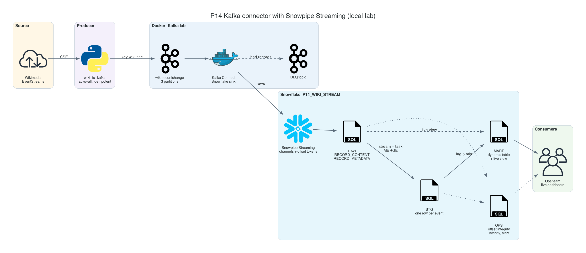
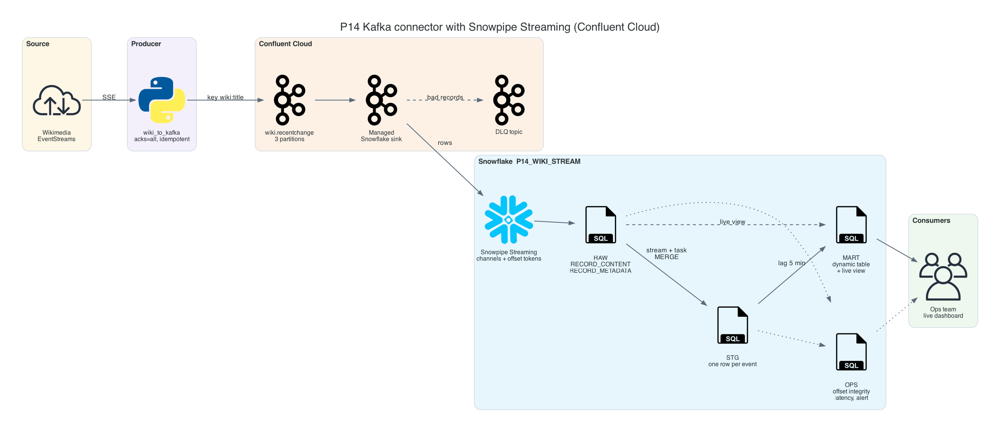
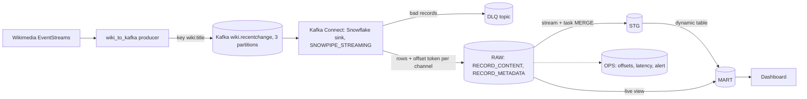

# P14 Kafka Connector with Snowpipe Streaming

Stream the same Wikimedia events as P04 through Kafka and land them in Snowflake within seconds, using the Snowflake Kafka connector in Snowpipe Streaming mode. No files, no storage events: the connector writes rows through streaming channels and commits each Kafka offset together with the data, which gives exactly-once delivery per offset into the raw table.

The downstream layers (staging, mart, ops) intentionally match P04, so the measured difference between the two projects is the ingestion design alone.

## Target Architecture

Own diagram, generated from [assets/architecture.py](assets/architecture.py). Icons: vendor architecture icon sets bundled with the <a href="https://diagrams.mingrammer.com">diagrams</a> library.

Managed variant: Confluent Cloud connector

Own diagram, generated from [assets/architecture.py](assets/architecture.py).

Text version (Mermaid)

### Reference From the Source Article

ProjectPro's IoT project streams events through Azure Event Hubs and Databricks into Snowflake. P14 removes the processing hop and lets Snowflake ingest from Kafka directly; P12 covers the multi-engine variant.

Source: ProjectPro, <a href="https://www.projectpro.io/article/snowflake-projects/1168">13 End-to-End Snowflake Projects That Build Job-Ready Skills</a>. Linked for personal study, not copied into this repository.

## Skills

| Skill | Milestone |
| --- | --- |
| Kafka topics, partitions, keys, idempotent producers | M1 |
| Kafka Connect: workers, connectors, tasks, REST API, config providers for secrets | M2, M3 |
| Snowflake service users with key-pair authentication and least privilege | M2 |
| Snowpipe Streaming: channels, offset tokens, exactly-once per offset | M3, M7 |
| Error handling with `errors.tolerance` and a dead letter queue | M3, M7 |
| Offset integrity checks: duplicates and gaps per partition | M6 |
| Consumer lag, rebalances, catch-up after outages | M7 |
| Comparing streaming and file-based ingestion with measured numbers | M8 |

## Prerequisites

- P04 completed or at least read: P14 reuses its event source and downstream design
- Module [05-confluent-kafka](../../../../05-confluent-kafka/README.md) basics: topics, partitions, offsets, consumer groups
- Docker with at least 6 GB of memory, Snowflake CLI, Python 3.10+: [setup guide](../../../../shared/environments/setup-guide/README.md)
- Snowflake trial ([account guide](../../../../shared/environments/setup-guide/accounts/snowflake.md)); no cloud storage account needed
- [Cost guardrails](../_shared/cost_guardrails.md): Snowpipe Streaming bills while clients are active; pause the connector after each session

## Navigation

| Part | File |
| --- | --- |
| Quickstart: numbered commands from install to teardown | [QUICKSTART.md](QUICKSTART.md) |
| 1. Problem | [01_problem.md](01_problem.md) |
| 2. Architecture and decisions | [02_architecture_decisions.md](02_architecture_decisions.md) |
| 3. Snowflake approach | [03_snowflake_approach.md](03_snowflake_approach.md) |
| 4. Alternative stacks and roadmap | [04_alternative_stacks.md](04_alternative_stacks.md) |
| 5. Step by step on Snowflake | [05_snowflake_step_by_step.md](05_snowflake_step_by_step.md) |
| 6. Solved reference | [06_solution/README.md](06_solution/README.md) |
| 7. Build it yourself | [07_build_it_yourself.md](07_build_it_yourself.md) |

Recommended route: 1, 2, 3, 4, then **7** (build). Use 5 when stuck. Compare with 6 at the end.

## Related Projects

- [P04](../P04_wikimedia_snowpipe_realtime_dwh/README.md): same data through files and Snowpipe.
- [P15](../P15_kafka_lake_snowpipe/README.md): same Kafka topic, written to a lake first, then Snowpipe.
- [Kafka lab](../_shared/kafka_lab/README.md): the shared local Kafka, Connect, and producer.
