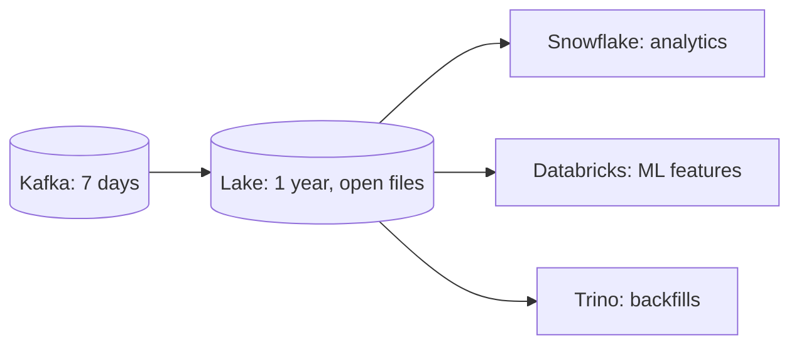

# 1. Problem

## Business Context

P14 delivers Wikimedia events into Snowflake within seconds. Three new requirements now arrive:

1. **Other engines.** The data science team trains models in Databricks and wants the same events without querying Snowflake. The search team wants to backfill an index with Trino.
2. **Long replay.** A bug in staging logic was found three weeks after release. Kafka keeps 7 days; the platform must be able to rebuild any day of the last year.
3. **Decoupling.** If Snowflake ingestion is paused for maintenance or cost reasons, events must still be persisted durably and cheaply.

The decision: Kafka stays the event bus, and the **data lake becomes the system of record** for this topic. Snowflake loads from the lake.



## Source Data

Kafka topic `wiki.recentchange` as in [P14](../P14_kafka_connector_streaming/01_problem.md#source-data). The lake writer stores each record as one JSON line:

```json
{
  "kafka": { "topic": "wiki.recentchange", "partition": 1, "offset": 42017, "timestamp": 1794233101123, "key": "enwiki:Example page" },
  "value": { "meta": { "id": "b6f3...", "dt": "2026-11-09T14:05:01.123Z" }, "wiki": "enwiki", "title": "Example page", "type": "edit" }
}
```

Unparseable values are kept as `"value": null, "value_raw": "<text>"`.

## Functional Requirements

1. Persist every Kafka record to the lake exactly once per offset, in an open format readable by other engines.
2. Name and organize files so that any hour can be found and replayed.
3. Load the lake files into Snowflake automatically.
4. Provide the same deduplicated staging and minute mart as P04 and P14.
5. Prove that no offset is missing and none is duplicated, both in the lake and in Snowflake.
6. Replay any hour from the lake into Snowflake without Kafka.

## Non-Functional Requirements

| Requirement | Target | Measured by |
| --- | --- | --- |
| Freshness | p95 Kafka timestamp to raw at most 3 minutes with 60 s windows | `OPS.V_LATENCY_LAST_HOUR` |
| Exactly-once per offset | 0 duplicate and 0 missing offsets after loads complete | `OPS.V_OFFSET_INTEGRITY` |
| Writer crash safety | Crash between upload and commit causes no duplicates | drill D1 |
| Replay | Any loaded hour reloads with identical counts | `tests/replay_from_lake.sql` |
| File efficiency | Average rows per file and files per hour known; window chosen on evidence | `OPS.V_FILE_STATS_LAST_DAY`, drill D4 |
| Cost | Credits per running hour compared with P04 and P14 | cost queries |

## Out of Scope

- Columnar formats and table formats on the lake (Parquet, Iceberg): stretch goals and module `14-iceberg`
- Lake lifecycle management (tiers, retention policies) beyond a note in the review
- Running Databricks or Trino on the files: covered as an exercise in `04`
