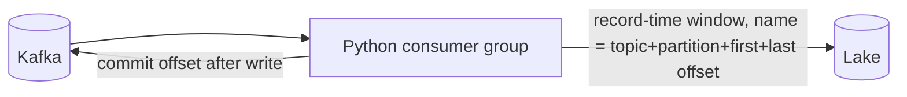
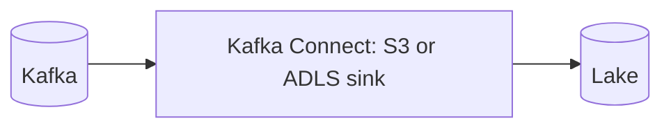
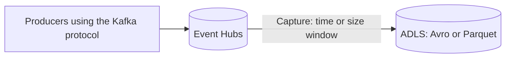
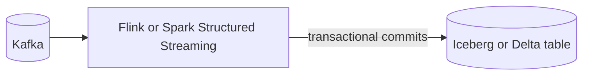
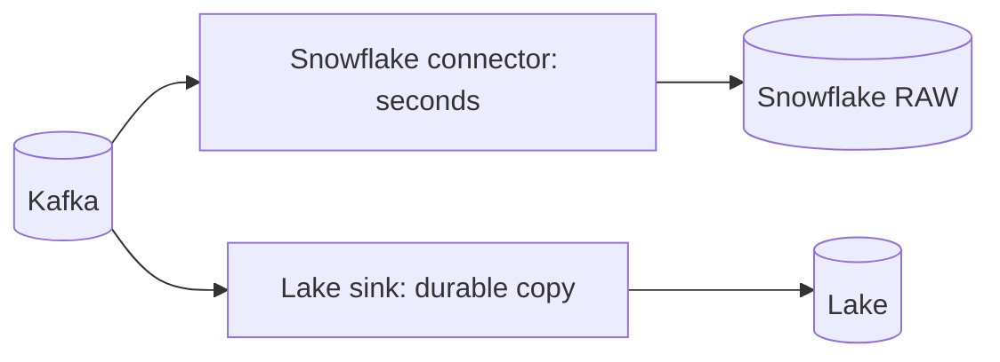
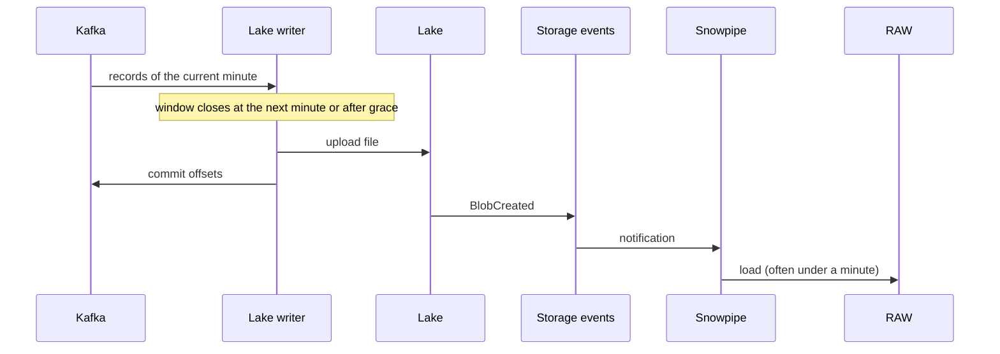

# 2. Architecture and Decisions

## Requirements That Drive the Design

| Driver | Consequence |
| --- | --- |
| Lake is the system of record | Every record lands in storage before Snowflake sees it |
| Other engines read the same data | Open file format, predictable folder layout |
| Replay beyond Kafka retention | Immutable files organized by time; Snowflake can reload any folder |
| Exactly-once per offset in the lake | Deterministic file names, commit offsets only after the write |
| Minutes of latency are acceptable | File windows of about a minute; Snowpipe instead of streaming |
| Fair comparison | Downstream identical to P04 and P14 |

## Options for Getting Kafka Into the Lake

### Option 1: Own lake writer (chosen for the lab)

### Option 2: Kafka Connect object storage sink

### Option 3: Azure Event Hubs Capture

### Option 4: Stream processor writes a table format

### Option 5: Hybrid with P14

## Trade-Offs

| Criterion | 1 Own writer | 2 Connect sink | 3 Event Hubs Capture | 4 Stream processor to table format | 5 Hybrid |
| --- | --- | --- | --- | --- | --- |
| Effort to run | Your code and its deployment | Connect cluster plus connector | Managed | Processing cluster | Both P14 and a sink |
| Exactly-once in lake | Deterministic names plus commit after write | Depends on partitioner and rotation settings | Per capture window | Transactional table commits | As the chosen sink |
| Format | NDJSON (any) | JSON, Avro, Parquet | Avro, Parquet | Iceberg or Delta | Any |
| Snowflake ingestion | Snowpipe on files | Snowpipe on files | Snowpipe on files | External or Iceberg tables, or Snowpipe | Streaming plus files |
| Licensing | Yours | Some sinks are commercial | Event Hubs tier pricing | Open source or managed | Mixed |
| Best for | Learning the mechanics, special layouts | Standard Kafka shops | Azure-native, Event Hubs already used | Lakehouse-first platforms | Seconds and replay both required |

## Why / Why Not

**Why write to the lake first instead of P14's direct path?**
Because the lake is now the record. Files are cheap, open, and outlive Kafka retention; any engine can read them; Snowflake becomes one consumer of the lake instead of the only copy. The price is minutes of latency and file management.

**Why our own writer and not a Connect sink?**
In production you would usually run a maintained sink. Here the goal is to see the three properties every good sink must have: record-time windows, deterministic file names, and commit after write. Once you have written them, you can evaluate any sink by asking whether it has them.

**What makes the writer exactly-once in the lake?**
Two rules. First, file boundaries depend only on the records (Kafka timestamp window and record count), so re-reading the same offsets produces the same file. Second, the file name is `topic+partition+firstOffset+lastOffset`, and the writer never overwrites: if the file exists, it was already written. Offsets are committed after the write, so a crash causes a re-read, never a gap.

**Why record time and not wall-clock time for windows and folders?**
Wall-clock windows depend on when the writer happened to run, so a restart produces different files with overlapping offsets. Record-time windows are a property of the data. As a bonus, folders reflect when events happened, which makes replay by hour meaningful.

**Why NDJSON and not Parquet?**
NDJSON keeps the lab simple, mirrors P04, and every engine reads it. Parquet would reduce size and speed up other engines; it is the first stretch goal. Snowflake loads both.

**Why keep unparseable values instead of a DLQ?**
In a lake-first design, the lake is the complete record. Dropping a record to a separate topic means the lake is no longer complete. `VALUE_RAW` keeps it, ops counts it, staging ignores it.

**Why typed Kafka coordinates in RAW?**
Offset integrity is the reconciliation mechanism. Typed columns make it a simple aggregate instead of a `VARIANT` parse on every check.

**Do we still need manifests like P04?**
No. Kafka offsets are contiguous per partition, so a missing file shows up as missing offsets. The file name itself is the manifest.

**What does window size change?**
Shorter windows mean lower latency, more files, and higher per-file Snowpipe cost; longer windows mean the opposite. Drill D4 measures it instead of guessing.

## Architecture Decision Records

### ADR-001: Lake as system of record, Snowflake loads from it

- **Decision:** all records go to the lake first; Snowpipe auto-ingest loads them.
- **Consequences:** minutes of latency; replay and multi-engine access for free; storage lifecycle becomes a responsibility.
- **Rejected:** direct streaming only (P14) because it gives no durable open copy.

### ADR-002: Deterministic, offset-named files with record-time windows

- **Decision:** one file per partition per record-time window or per maximum record count; name contains first and last offset; never overwrite; idle flush only after the record-time window has closed.
- **Consequences:** idempotent rewrites, no duplicates after crashes; late records with old timestamps create small extra files in historical folders.

### ADR-003: Commit offsets only after a successful write

- **Decision:** manual commits per partition after each file; open batches of revoked partitions are dropped and re-read by the new owner.
- **Consequences:** at-least-once delivery to storage, turned into effectively-once by ADR-002.

### ADR-004: Typed Kafka coordinates and lossless raw

- **Decision:** RAW holds `PAYLOAD`, `VALUE_RAW`, topic, partition, offset, Kafka timestamp, source file, load time.
- **Consequences:** cheap integrity checks; nothing silently dropped.

### ADR-005: Replay by folder with `FORCE = TRUE`

- **Decision:** replay loads a folder into a separate table with `COPY ... FORCE = TRUE`, then compares counts; production backfills merge from there.
- **Consequences:** replay never disturbs the live table or the pipe's load metadata.

## Latency Budget

| Hop | Expected | Controlled by |
| --- | --- | --- |
| Kafka to window close | up to window length plus grace (70 s) | `--window-seconds`, `--grace-seconds` |
| Upload and storage event | seconds | Cloud |
| Snowpipe load | often under a minute, not guaranteed | Snowflake |
| **Kafka to raw p95 target** | **at most 3 minutes** | Sum |
| Raw to staging | up to 60 s plus run | Task schedule |

## Failure Modes

| Failure | Detection | Impact | Recovery |
| --- | --- | --- | --- |
| Writer crash after upload, before commit | Writer logs; none in Snowflake | None | Restart; file exists, skipped |
| Writer down | Consumer lag, raw freshness alert | Lake and Snowflake stale | Restart; catch-up writes historical folders |
| Storage event lost | Missing offsets in integrity view | File not loaded | `ALTER PIPE ... REFRESH PREFIX` |
| Unparseable record | `UNPARSEABLE_VALUES` | Not in staging | Investigate `VALUE_RAW` |
| Late records | Small files in old folders | More files | Acceptable; compaction is a stretch goal |
| Kafka retention expires before writer catches up | Gap between committed offset and earliest available offset | Data loss in lake | Alert on lag well before retention |
| Staging bug found weeks later | Business report | Wrong history | Fix logic, replay folders from the lake |

## Cost Model

| Component | Driver | Notes |
| --- | --- | --- |
| Lake storage | Volume times retention | Cheapest component; lifecycle tiers reduce it further |
| Storage events, queue | Number of files | One event per file |
| Snowpipe | Files and data volume | Fewer, larger files cost less per row |
| Lake writer | Small compute | Runs locally in the lab |
| Staging, mart, alert | As P04 | Identical design |

## Security and Trust Boundaries

- The writer uses your Entra ID identity (or an AWS profile) with write access to one container.
- Snowflake reads through a storage integration limited to `landing/kafka/`.
- Other engines get their own read-only identities on the same container; Snowflake grants are not involved.
