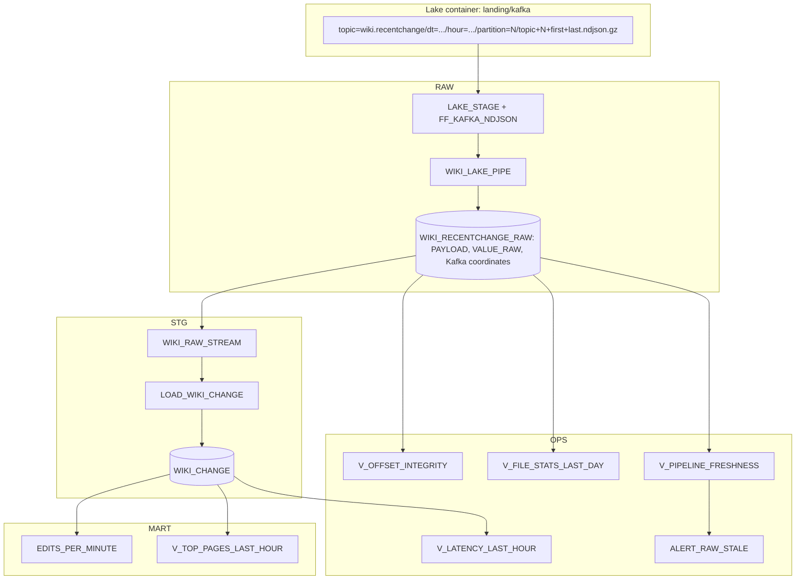
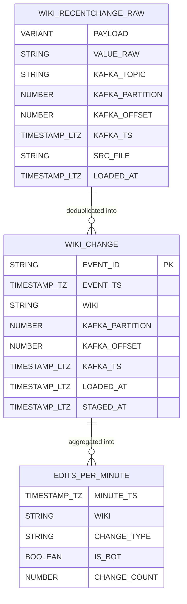

# 3. Snowflake Approach

## Layers and Objects

## Object Inventory

| Object | Type | Purpose |
| --- | --- | --- |
| `P15_AZURE_STORAGE_INT`, `P15_AZURE_QUEUE_INT` | Integrations | Read `landing/kafka/`, receive storage events |
| `RAW.LAKE_STAGE`, `RAW.FF_KAFKA_NDJSON` | Stage, file format | Lake root for Kafka topics |
| `RAW.WIKI_LAKE_PIPE` | Pipe, auto-ingest | Loads one topic's folder, extracts Kafka coordinates in the `COPY` transformation |
| `RAW.WIKI_RECENTCHANGE_RAW` | Table | Payload, raw text for unparseable values, typed coordinates, file and load metadata |
| `STG.*`, `MART.*` | Stream, task, table, dynamic table, view | Same as P04 and P14 |
| `OPS.V_OFFSET_INTEGRITY` | View | Duplicate, missing, and unparseable counts per partition |
| `OPS.V_FILE_STATS_LAST_DAY` | View | Files and rows per hour: the small-file indicator |
| `tests/replay_from_lake.sql` | Script | `COPY ... FORCE = TRUE` into a replay table |

## Feature Choices

| Need | Chosen | Rejected here | Why |
| --- | --- | --- | --- |
| Load lake files continuously | Snowpipe auto-ingest | Scheduled `COPY` | Event-driven, serverless |
| Extract Kafka coordinates | `COPY` transformation into typed columns | Parse `VARIANT` later | Cheap integrity checks, clear schema |
| File reconciliation | Offset contiguity per partition | Producer manifests (P04) | Offsets are a natural, complete sequence |
| Replay | `COPY ... FORCE = TRUE` into a separate table | `ALTER PIPE REFRESH` | `REFRESH` skips files already in load metadata and only looks back 7 days |
| Querying the lake in place | Not used for the pipeline | External tables, Iceberg tables | Stretch goal; compare with module `14-iceberg` |

## Data Model

## What This Project Teaches About Snowflake

- Snowpipe works with **any** file producer; the quality of the files (size, naming, immutability) decides cost and correctness.
- **`COPY` transformations** can turn semi-structured envelopes into typed columns at load time.
- **Load metadata** protects against reloads; **`FORCE = TRUE`** deliberately bypasses it for replay into another table.
- Snowflake can be one consumer of an open lake rather than the only copy of the data.
