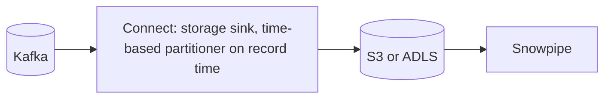
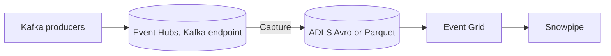
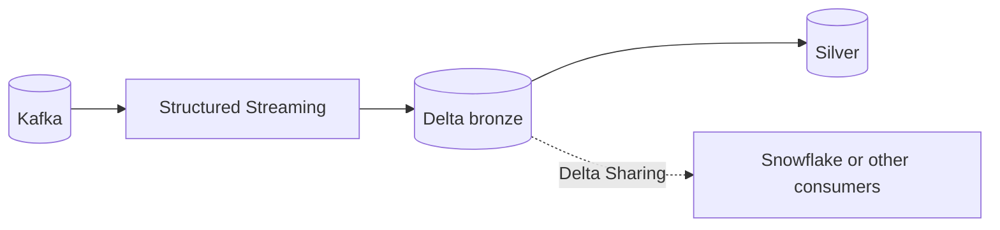
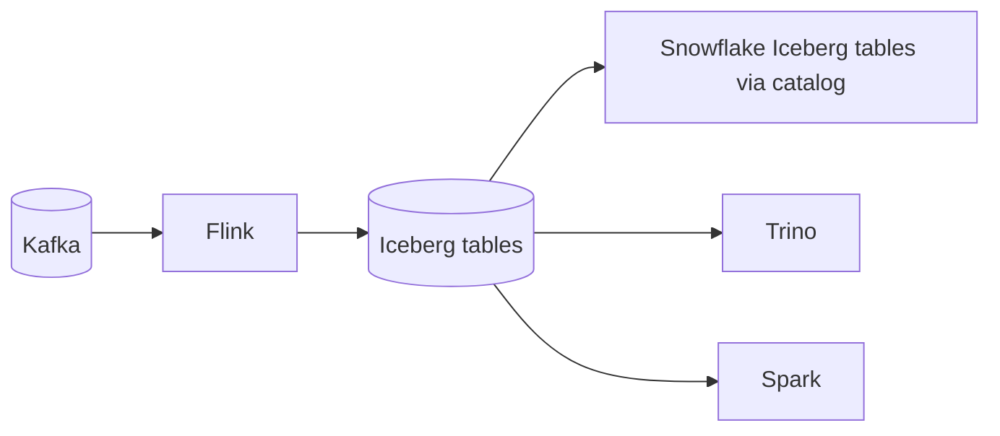
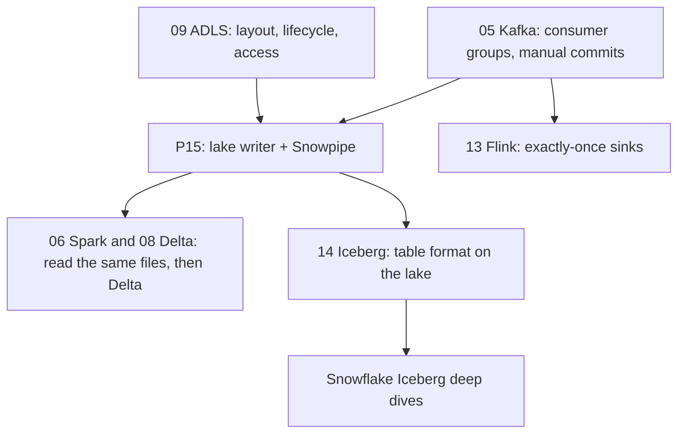

# 4. Alternative Stacks and Roadmap

The problem: Kafka events must land in an open, durable lake exactly once per offset, be loadable into a warehouse, and be replayable long after Kafka retention.

## Component Mapping

| Concern | This project | Kafka Connect sink | Azure-native | Databricks | Open lakehouse |
| --- | --- | --- | --- | --- | --- |
| Kafka to lake | Python lake writer | S3 or ADLS sink connector | Event Hubs Capture | Structured Streaming to Delta | Flink to Iceberg |
| File naming and exactly-once | Offset-named files, commit after write | Partitioner and rotation settings | Capture windows | Checkpoint plus Delta transactions | Checkpoint plus Iceberg commits |
| Format | NDJSON | JSON, Avro, Parquet | Avro, Parquet | Delta (Parquet) | Iceberg (Parquet) |
| Warehouse ingestion | Snowpipe | Snowpipe | Snowpipe | Delta Sharing, or Snowflake external access | Snowflake Iceberg tables |
| Other engines | Read files | Read files | Read files | Delta readers | Any Iceberg engine |

## Kafka Connect Object Storage Sink

- Configure rotation and partitioning on **record time** to get the same determinism as the lake writer.
- Check licenses: some ADLS sinks are commercial for self-managed use.

## Azure Event Hubs Capture

- No code to run for the lake copy; producers keep the Kafka protocol.
- Trade-off: capture windows and file layout are defined by the service; Event Hubs tier pricing applies.

## Databricks: Kafka to Delta

- The table format gives transactions, schema evolution, and time travel on the lake.
- Wins when Databricks is the main processing engine.

## Open Lakehouse: Flink to Iceberg, Snowflake Reads Iceberg

- One copy of the data, many engines, no Snowflake load step for the lake tables.
- Trade-off: catalog operations, compaction, and engine compatibility become your responsibility. See the [Iceberg deep dives](../../learning-materials/deep-dives/iceberg-and-external-tables/README.md).

## When Each Alternative Wins

| Situation | Better choice |
| --- | --- |
| Learning sink mechanics, special layout needs | This project |
| Standard Kafka platform, maintained components preferred | Connect storage sink |
| Azure shop, Event Hubs already in place | Event Hubs Capture |
| Databricks-centric platform | Structured Streaming to Delta |
| Multi-engine lakehouse, avoid copies | Flink to Iceberg, Snowflake reads Iceberg |
| Seconds-level freshness required too | Hybrid: P14 plus a lake sink |

## Learning Roadmap

| Step | Module | Focus |
| --- | --- | --- |
| Consumers | [05-confluent-kafka](../../../../05-confluent-kafka/README.md) | Groups, rebalances, manual commits, retention |
| Lake storage | [09-azure-data-lake-storage](../../../../09-azure-data-lake-storage/README.md) | Layout, lifecycle policies, access control |
| Spark on files | [06-spark-pyspark](../../../../06-spark-pyspark/README.md), [08-delta-lake](../../../../08-delta-lake/README.md) | Reading NDJSON, writing Delta |
| Table formats | [14-iceberg](../../../../14-iceberg/README.md) | Iceberg on the same lake |
| Stream processing | [13-flink](../../../../13-flink/README.md) | Two-phase commit sinks |

### Suggested Exercise

Read one hour of the lake files with Spark or DuckDB and compute edits per wiki. Compare the numbers with `MART.EDITS_PER_MINUTE` for the same hour. If they differ, explain why (hint: duplicates across offsets and unparseable values).
