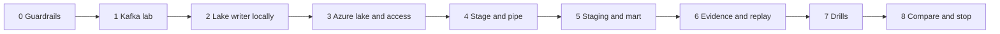

# 5. Step by Step on Snowflake

Every step: **what**, **why**, **verify**, **common errors**. Scripts are in [06_solution](06_solution/README.md).



---

## Phase 0: Guardrails

- **What:** `./run_sql.sh core/00_account_setup.sql core/01_schemas_and_raw.sql` with `p15.env` filled.
- **Why:** roles, monitor, warehouses, database, and a raw table whose Kafka coordinates are typed columns.
- **Verify:** `DESC TABLE P15_WIKI_LAKE.RAW.WIKI_RECENTCHANGE_RAW;`

---

## Phase 1: Kafka Lab

- **What:** start the [Kafka lab](../_shared/kafka_lab/README.md#start) and create `wiki.recentchange` with 3 partitions. The Snowflake connector is not needed for P15; the lab image includes it anyway.
- **Verify:** `kcat -b localhost:9092 -L | grep wiki.recentchange`.

---

## Phase 2: Lake Writer Locally

### 2.1 Understand the batching rules

Read `PartitionBatcher` in [lake_writer.py](06_solution/lake_writer/lake_writer.py):

| Rule | Why |
| --- | --- |
| New file when the Kafka timestamp enters a new window | Boundaries depend on data, not on when the writer runs |
| New file when the batch reaches `--max-records` | Bounded file size |
| Idle flush only after the window has ended plus grace | Even idle flushes produce the same boundary on replay |
| File name `topic+partition+first+last` | Same records always produce the same name |
| Commit offsets after the write | A crash causes a re-read, never a gap |

### 2.2 Run against a local folder

```bash
cd 06_solution/lake_writer
python3.12 -m venv .venv && source .venv/bin/activate
pip install -r requirements.txt
python -m pytest -q test_lake_writer.py
# terminal 1: producer from the Kafka lab, synthetic, 3 minutes
# terminal 2:
python lake_writer.py --sink local --local-dir ./lake_local --duration-minutes 3
find lake_local -name '*.ndjson.gz' | head
```

- **Verify:** one file per partition per minute; names contain contiguous offset ranges; `gunzip -c <file> | head -1 | jq .kafka` shows coordinates.
- **Common errors:** no files after a minute: the window has not closed yet; wait for window plus grace.

---

## Phase 3: Azure Lake and Access

- **What:** `./azure/01_provision.sh`, then `./run_sql.sh azure/10_integrations.sql`, accept both consent URLs, `./azure/02_grant_snowflake_access.sh <storage app> <queue app>`.
- **Why:** same pattern as P04, but the storage integration and the Event Grid filter are scoped to `landing/kafka/`.
- **Verify:** `az eventgrid event-subscription list --source-resource-id <storage id> -o table` shows the `kafka/` prefix filter.
- **Then:** run the lake writer with `--sink azure --azure-account-url https://$P15_STORAGE_ACCOUNT.blob.core.windows.net` for two minutes while the producer runs.

---

## Phase 4: Stage and Pipe

- **What:** `./run_sql.sh azure/11_stage_and_pipe.sql`.
- **Why:** the `COPY` transformation extracts `kafka.topic`, `partition`, `offset`, and `timestamp` into typed columns and keeps `value` and `value_raw`.
- **Verify:**

  ```sql
  SELECT KAFKA_PARTITION, COUNT(*), MIN(KAFKA_OFFSET), MAX(KAFKA_OFFSET)
  FROM P15_WIKI_LAKE.RAW.WIKI_RECENTCHANGE_RAW GROUP BY 1;
  ```

- **Gate:** new files load without `REFRESH`.

---

## Phase 5: Staging and Mart

- **What:** `./run_sql.sh core/20_staging.sql core/30_mart.sql`.
- **Verify:** `SELECT COUNT(*), COUNT(DISTINCT EVENT_ID) FROM P15_WIKI_LAKE.STG.WIKI_CHANGE;` equal.

---

## Phase 6: Evidence and Replay

- **What:** `./run_sql.sh core/40_ops.sql`; then edit the folder in `tests/replay_from_lake.sql` and run it.
- **Verify:**
  - `OPS.V_OFFSET_INTEGRITY`: zero duplicates, zero missing after loads finish
  - `OPS.V_FILE_STATS_LAST_DAY`: files and rows per hour
  - replay counts equal raw counts for the same files
- **Why replay into a separate table:** `ALTER PIPE REFRESH` only considers files from the last 7 days and skips files already in load metadata; `FORCE = TRUE` into another table is a controlled, repeatable backfill.

---

## Phase 7: Drills

[tests/failure_drills.md](06_solution/tests/failure_drills.md): crash before commit, poison message, missed storage event, small files, topic deleted, writer down, second writer.

---

## Phase 8: Compare and Stop

| Metric | P04 | P14 | P15 |
| --- | --- | --- | --- |
| p95 event to raw | | | |
| p95 event to staging | | | |
| Credits per running hour (ingestion) | | | |
| Files per hour | | n/a | |
| Replay window | 7 days of `REFRESH`, plus landing retention | Kafka retention | Lake retention |
| Other engines can read | Landing files | No | Yes |
| Components you operate | | | |

Stop: stop producer and lake writer, `./run_sql.sh core/90_pause.sql`, `docker compose stop` in the Kafka lab. End of project: `./run_sql.sh teardown.sql`, `az group delete --name "$P15_RG" --yes`.
