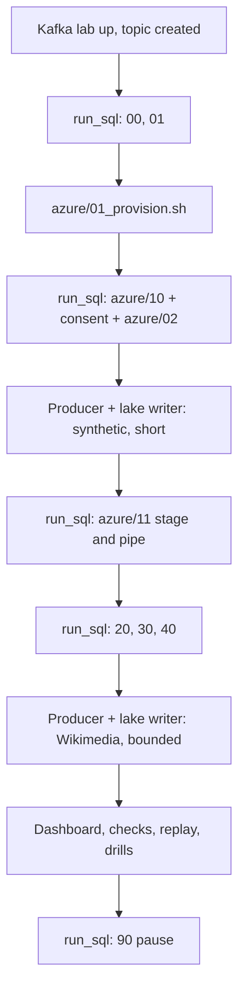

# P15 Solution

Reference implementation for [P15](../README.md). Build your own version first with [07_build_it_yourself.md](../07_build_it_yourself.md); run this one end to end with [QUICKSTART.md](../QUICKSTART.md).

## Layout

```text
06_solution/
  p15.env.example / run_sql.sh    env template and SQL runner (as in P04)
  lake_writer/
    lake_writer.py                Kafka consumer -> files named by offsets -> storage -> commit
    test_lake_writer.py           batching, determinism, idempotent writes
  core/
    00_account_setup.sql          roles, warehouses, monitor, database
    01_schemas_and_raw.sql        file format; raw table with typed Kafka coordinates
    20_staging.sql                stream + serverless task MERGE (same logic as P04, P14)
    30_mart.sql                   minute dynamic table, hot pages
    40_ops.sql                    offset integrity, file stats, freshness, latency, alert
    50_dashboard_and_ops_queries.sql
    90_pause.sql / 91_resume.sql
  azure/                          storage account, queue, Event Grid, integrations, stage, pipe
  aws/                            integration, stage, pipe (provision with the P04 AWS scripts)
  tests/
    data_quality_checks.sql
    replay_from_lake.sql          reload any hour from files with FORCE = TRUE
    failure_drills.md
  teardown.sql
```

Kafka and the producer are in the shared [Kafka lab](../../_shared/kafka_lab/README.md). The lake writer reuses the storage sinks from the P04 producer.

## Run Order (Azure)



## Expected Results

| Check | Expected |
| --- | --- |
| Lake writer output | `wrote kafka/topic=wiki.recentchange/dt=.../partition=N/...+start+end.ndjson.gz` per partition per minute |
| `OPS.V_OFFSET_INTEGRITY` | `DUPLICATE_OFFSETS = 0`, `MISSING_OFFSETS = 0` after files are loaded |
| `OPS.V_FILE_STATS_LAST_DAY` | About one file per partition per window while producing |
| `OPS.V_LATENCY_LAST_HOUR` | Kafka-to-raw p95 of about window length plus upload and Snowpipe time |
| `tests/replay_from_lake.sql` | Raw and replay counts identical |

## Design Notes Worth Comparing With Your Version

- **File names carry offsets.** `topic+partition+firstOffset+lastOffset` makes rewrites idempotent and lets Snowflake detect gaps without manifests.
- **Record-time windows.** Batch boundaries depend on Kafka timestamps and record counts, not on wall-clock flushes, so a re-read after a crash produces the same files.
- **Commit after write.** Offsets are committed only after the file exists in storage.
- **Nothing is dropped.** Unparseable values land in `VALUE_RAW` instead of a DLQ.
- **Typed Kafka coordinates in RAW.** Integrity checks do not need to parse `VARIANT`.
- **Folders follow record time.** Catch-up after an outage writes into historical folders; replay by hour is straightforward.

## Production Alternatives to the Lake Writer

| Platform | Managed option | Notes |
| --- | --- | --- |
| Azure | Event Hubs Capture | Writes Avro or Parquet from Event Hubs (Kafka endpoint) to ADLS on a time or size window; available on specific Event Hubs tiers |
| AWS | Kafka Connect S3 sink connector, or Firehose from MSK | Time-based partitioner on record time gives the same determinism |
| Any | Commercial ADLS Gen2 sink connectors | Check licensing for self-managed use |

The lake writer exists to make the mechanics visible; in production, prefer a maintained sink with the same properties.

## Cleanup

1. Stop the producer and lake writer.
2. `./run_sql.sh teardown.sql`
3. `az group delete --name "$P15_RG" --yes`
4. In `_shared/kafka_lab/`: `docker compose down`.
