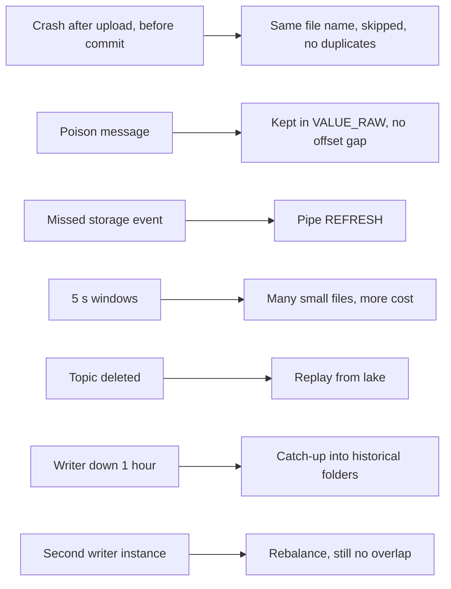

# P15 Failure Drills

Run after the normal pipeline works. Write a prediction before each drill. Lake writer commands run from `06_solution/lake_writer/`; Kafka commands from `_shared/kafka_lab/`.

```bash
SINK="--sink azure --azure-account-url https://$P15_STORAGE_ACCOUNT.blob.core.windows.net"
LAG="docker compose exec kafka /opt/kafka/bin/kafka-consumer-groups.sh --bootstrap-server kafka:19092 --describe --group p15-lake-writer"
```



## D1 Crash Between Upload and Commit

```bash
python lake_writer.py $SINK --duration-minutes 10 --crash-after-upload 3
python lake_writer.py $SINK --duration-minutes 10
```

- **Observe:** the first run exits after uploading its third file without committing. The second run re-reads the same records, forms the same batch, and prints `exists, skipped` for that file name.
- **Expected:** `OPS.V_OFFSET_INTEGRITY` shows `DUPLICATE_OFFSETS = 0`.
- **Lesson:** deterministic file names (topic, partition, first and last offset) make the write idempotent; committing offsets after the write gives at-least-once, and idempotence turns it into effectively-once.

## D2 Poison Message

```bash
echo 'this is not json' | kcat -b localhost:9092 -t wiki.recentchange -P -k poison
```

- **Observe:** the record appears in RAW with `PAYLOAD IS NULL` and the text in `VALUE_RAW`; `UNPARSEABLE_VALUES` rises; no offset gap.
- **Compare with P14:** there the record went to a DLQ topic and left a gap. Which is easier to investigate a month later?

## D3 Missed Storage Event

Delete the Event Grid subscription, let the writer upload a file, recreate the subscription (command in `azure/01_provision.sh`), then:

```sql
ALTER PIPE P15_WIKI_LAKE.RAW.WIKI_LAKE_PIPE REFRESH PREFIX = 'topic=wiki.recentchange/dt=<yyyy-mm-dd>/hour=<hh>/';
```

- **Observe:** `MISSING_OFFSETS` rises while the file is not loaded and returns to zero after `REFRESH`.
- **Lesson:** offset integrity detects missing files without a separate manifest, because offsets are contiguous.

## D4 Small Files

```bash
python lake_writer.py $SINK --duration-minutes 15 --window-seconds 5
```

- **Observe:** `OPS.V_FILE_STATS_LAST_DAY` shows many more files per hour with fewer rows each; Snowpipe credits per row rise; Kafka-to-raw latency drops.
- **Exercise:** run 5, 60, and 300 second windows for equal periods and chart latency against Snowpipe credits.

## D5 Replay Beyond Kafka Retention

```bash
docker compose exec kafka /opt/kafka/bin/kafka-topics.sh --bootstrap-server kafka:19092 --delete --topic wiki.recentchange
```

- **Observe:** the data is gone from Kafka; P14 could not reload it.
- **Recover:** run `tests/replay_from_lake.sql` for an hour that was loaded; raw and replay counts match.
- Recreate the topic afterwards (Kafka lab README).

## D6 Writer Down for an Hour

Stop the lake writer, keep the producer running, then start the writer again.

- **Observe:** `$LAG` grows, then drains quickly; files for the past hour land in the **past** `dt=/hour=` folders because folders follow record time.
- **Discuss:** what does this do to a downstream job that processes "the folder of the last hour" only?

## D7 Second Writer Instance

Start a second `lake_writer.py` in another terminal with the same group.

- **Observe:** partitions are split between instances; revoked partitions drop their open batches; the new owner re-reads from the committed offset.
- **Expected:** no duplicate offsets, because batch boundaries depend only on the records.

## Drill Log Template

| Drill | Prediction | Observed | Detected by | Time to detect | Recovery | Follow-up change |
| --- | --- | --- | --- | --- | --- | --- |
| D1 | | | | | | |
| D2 | | | | | | |
| D3 | | | | | | |
| D4 | | | | | | |
| D5 | | | | | | |
| D6 | | | | | | |
| D7 | | | | | | |
