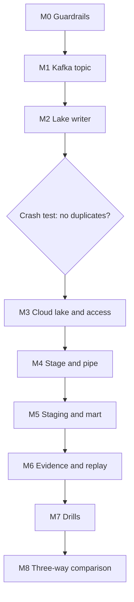

# 7. Build It Yourself

## Brief

The lake is now the system of record for Wikimedia events. Build the path from Kafka to the lake and from the lake to Snowflake so that every offset lands exactly once, any hour can be replayed a year later, and other engines can read the same files. Then compare P04, P14, and P15 with your own numbers and write a recommendation.

## Rules

| You may use | Only when stuck | Only after the milestone passes |
| --- | --- | --- |
| [01](01_problem.md) to [04](04_alternative_stacks.md), the [Kafka lab](../_shared/kafka_lab/README.md), P04 and P14 materials, official documentation | [05_snowflake_step_by_step.md](05_snowflake_step_by_step.md) | [06_solution/](06_solution/README.md) |

Write your own lake writer. You may reuse the P04 storage sinks.

## Milestone Map

---

## M0 Guardrails

- [ ] Roles, warehouses, monitor, database; pause script
- [ ] Raw table design with typed Kafka coordinates, justified in one sentence

## M1 Kafka Topic

- [ ] Topic with deliberate partition count; producer from the Kafka lab running

## M2 Lake Writer

**Deliverables:** consumer group application that writes one file per partition per window, with tests.

**Acceptance criteria**
- [ ] File boundaries depend only on records (timestamps and counts), proven by a unit test that feeds the same records twice
- [ ] File names identify topic, partition, and offset range
- [ ] Offsets are committed only after a successful write
- [ ] Rewriting an existing file is detected and skipped
- [ ] Unparseable values are kept, not dropped
- [ ] Rebalance behavior is defined and documented

**Gate G1:** kill the writer after an upload and before the commit; restart; show zero duplicate offsets.

**Hints:** what happens to boundaries if you flush every N seconds of wall-clock time and the writer restarts in the middle of a window?

## M3 Cloud Lake and Access

- [ ] Storage, events, and Snowflake access scoped to the Kafka prefix only
- [ ] Folder layout documented: what each level means and why it follows record time

## M4 Stage and Pipe

- [ ] Kafka coordinates extracted into typed columns during load
- [ ] New files load without manual commands

## M5 Staging and Mart

- [ ] Same logic as P04 and P14; equal counts of rows and distinct events in staging

## M6 Evidence and Replay

- [ ] Offset integrity: zero duplicates, zero missing after loads finish
- [ ] File statistics per hour
- [ ] Replay of one hour into a separate table with matching counts
- [ ] Latency per hop and credits per running hour recorded

## M7 Drills

- [ ] Crash before commit, poison message, missed event, small files, topic deleted, writer down, second writer
- [ ] Window size experiment: at least three window sizes with latency and Snowpipe credits

## M8 Three-Way Comparison

**Deliverables:** comparison table P04, P14, P15; one-page recommendation: which design for which situation; teardown.

- [ ] Every claim in the recommendation points to a measured number or a drill result
- [ ] No running writer, no `P15_` objects, no Azure resource group left

---

## Stretch Goals

- **Parquet files:** write Parquet instead of NDJSON; compare file size, Snowpipe cost, and Spark read time.
- **Compaction:** merge small files of closed hours into larger ones without breaking idempotency or reloads.
- **Hybrid:** run P14's connector and P15's writer on the same topic; serve live data from P14 and history from P15.
- **Iceberg:** write the lake as an Iceberg table and read it from Snowflake through a catalog integration.
- **Event Hubs Capture:** replace the writer with Capture and compare file layout and determinism.
- **Lifecycle:** add a storage lifecycle policy that moves files older than 30 days to a cooler tier; test replay from it.

## Portfolio and Interview

**Resume bullet examples:**
- Designed a lake-first Kafka ingestion with offset-named, record-time-windowed files and commit-after-write, achieving zero duplicate offsets across crash and rebalance drills.
- Enabled replay of any hour beyond Kafka retention and multi-engine access to the same data; measured latency and cost against direct streaming.

**Questions you should be able to answer:**
1. Why do wall-clock flushes break idempotency, and record-time windows do not?
2. How does a file name act as a manifest?
3. Why replay with `FORCE = TRUE` into a separate table instead of `ALTER PIPE REFRESH`?
4. What is the small-file problem, and how did you choose the window size?
5. When would you run P14 and P15 side by side?
