# P15 Quickstart

Numbered commands from an empty laptop to a running, measured, and paused Kafka-to-lake-to-Snowflake pipeline. Each step ends with **Done when**; details are in [05_snowflake_step_by_step.md](05_snowflake_step_by_step.md).

```mermaid
flowchart LR
    A[1 Install] --> B[2 Accounts]
    B --> C[3 Kafka lab]
    C --> D[4 Env file]
    D --> E[5 Snowflake setup]
    E --> F[6-8 Azure lake and access]
    F --> G[9 Lake writer to Azure]
    G --> H[10 Stage and pipe]
    H --> I[11 Staging, mart, ops]
    I --> J[12-14 Run, measure, replay, drills]
    J --> K[15 Pause or teardown]
```



## Install and Access

### 1. Tools

[Workstation guide](../../../../shared/environments/setup-guide/01_workstation_macos.md) (Python, Docker, `kcat`, `jq`), `brew install azure-cli pipx && pipx install snowflake-cli`.

**Done when:** `docker run --rm hello-world`, `az version`, `snow --version` work.

### 2. Accounts and CLI connections

Snowflake trial on Azure and Azure free account ([Snowflake](../../../../shared/environments/setup-guide/accounts/snowflake.md), [Azure](../../../../shared/environments/setup-guide/accounts/azure.md)); `az login`; `[connections.p15]` in `~/.snowflake/config.toml` ([Snowflake CLI](../../../../shared/environments/setup-guide/02_cli_tools_and_auth.md#snowflake-cli)).

**Done when:** `snow sql -c p15 -q "SELECT CURRENT_REGION()"` returns an `AZURE_` region.

### 3. Kafka lab

Follow [Kafka lab: Start](../_shared/kafka_lab/README.md#start) and create `wiki.recentchange` with 3 partitions. Set up the producer venv as in that README.

**Done when:** `kcat -b localhost:9092 -L | grep wiki.recentchange` shows 3 partitions.

### 4. Env file

```bash
cd 16-cloud-databases/01-snowflake/end-to-end-projects/P15_kafka_lake_snowpipe/06_solution
cp p15.env.example p15.env
# edit: P15_ALERT_EMAIL, P15_STORAGE_ACCOUNT (globally unique), WIKI_USER_AGENT
set -a; source p15.env; set +a
```

**Done when:** `git check-ignore p15.env` prints the name.

## Build

### 5. Snowflake setup

```bash
./run_sql.sh core/00_account_setup.sql core/01_schemas_and_raw.sql
```

**Done when:** `snow sql -c p15 -q "DESC TABLE P15_WIKI_LAKE.RAW.WIKI_RECENTCHANGE_RAW"` lists `KAFKA_PARTITION` and `KAFKA_OFFSET`.

### 6. Azure lake

```bash
./azure/01_provision.sh
# put the printed tenant id into p15.env as AZURE_TENANT_ID, then:
set -a; source p15.env; set +a
```

**Done when:** the script prints the tenant id.

### 7. Integrations and consent

```bash
./run_sql.sh azure/10_integrations.sql
for int in P15_AZURE_STORAGE_INT P15_AZURE_QUEUE_INT; do
  snow sql -c p15 -q "DESC INTEGRATION $int" --format json \
    | jq -r '.[] | select((.property // .PROPERTY) | test("AZURE_CONSENT_URL|AZURE_MULTI_TENANT_APP_NAME"))
             | "\(.property // .PROPERTY) = \(.property_value // .PROPERTY_VALUE)"'
done
```

Open both consent URLs and accept.

**Done when:** you have both app names.

### 8. Grant access

```bash
./azure/02_grant_snowflake_access.sh <storage app name> <queue app name>
```

**Done when:** "Granted" is printed; wait a few minutes before step 10.

### 9. Lake writer to Azure

```bash
cd lake_writer
python3.12 -m venv .venv && source .venv/bin/activate
pip install -r requirements.txt
python -m pytest -q test_lake_writer.py
# terminal 2 (Kafka lab producer venv): python wiki_to_kafka.py --source synthetic --rate 20 --duration-minutes 3
python lake_writer.py --sink azure --azure-account-url "https://$P15_STORAGE_ACCOUNT.blob.core.windows.net" --duration-minutes 3
cd ..
```

**Done when:** the writer prints `wrote kafka/topic=wiki.recentchange/...` lines for each partition.

### 10. Stage and pipe

```bash
./run_sql.sh azure/11_stage_and_pipe.sql
snow sql -c p15 -q "SELECT KAFKA_PARTITION, COUNT(*) FROM P15_WIKI_LAKE.RAW.WIKI_RECENTCHANGE_RAW GROUP BY 1"
```

**Done when:** each partition has rows. **Gate:** run producer and writer two more minutes; new files load without `REFRESH`.

### 11. Staging, mart, ops

```bash
./run_sql.sh core/20_staging.sql core/30_mart.sql core/40_ops.sql
```

**Done when:** `OPS.V_OFFSET_INTEGRITY` shows zero duplicate and zero missing offsets.

## Run and Measure

### 12. Real stream, bounded

Run both for the same duration, in two terminals:

```bash
python wiki_to_kafka.py --source wikimedia --duration-minutes 60
python lake_writer.py --sink azure --azure-account-url "https://$P15_STORAGE_ACCOUNT.blob.core.windows.net" --duration-minutes 62
```

**Done when:** both print `done`.

### 13. Checks, numbers, replay

```bash
./run_sql.sh tests/data_quality_checks.sql
snow sql -c p15 -q "SELECT * FROM P15_WIKI_LAKE.OPS.V_LATENCY_LAST_HOUR"
snow sql -c p15 -q "SELECT * FROM P15_WIKI_LAKE.OPS.V_FILE_STATS_LAST_DAY"
# edit the folder in tests/replay_from_lake.sql to a loaded hour, then:
./run_sql.sh tests/replay_from_lake.sql
```

**Done when:** checks `PASS`, replay counts match, numbers recorded in [PROGRESS.md](../PROGRESS.md) next to P04 and P14.

### 14. Drills

[tests/failure_drills.md](06_solution/tests/failure_drills.md).

**Done when:** seven drill rows filled, including the window-size experiment.

## Stop

### 15. Pause, or tear down at the end

```bash
./run_sql.sh core/90_pause.sql
( cd ../../_shared/kafka_lab && docker compose stop )

# End of project
./run_sql.sh teardown.sql
az group delete --name "$P15_RG" --yes
```

**Done when:** `snow sql -c p15 -q "SHOW WAREHOUSES LIKE 'P15_%'"` returns nothing and the resource group is gone.
