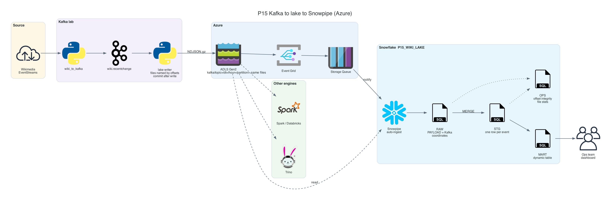
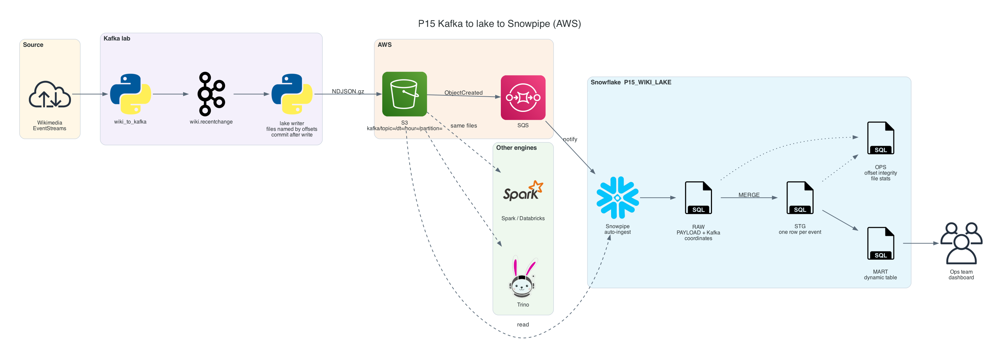
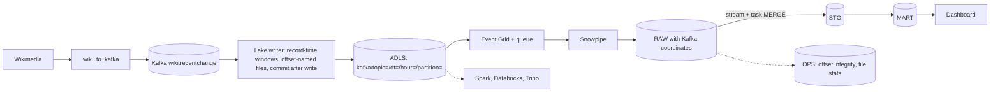

# P15 Kafka to Lake to Snowpipe

Take the same Kafka topic as P14, but write it to the data lake first: a lake writer turns each partition into immutable files named by Kafka offsets, Snowpipe loads them into Snowflake, and the same files stay available for Spark, Databricks, Trino, and for replay long after Kafka retention has expired.

P14 optimized for seconds; P15 optimizes for durability, openness, and replay. Both share the data, the producer, and the downstream design, so the comparison is measured, not argued.

## Target Architecture

Own diagram, generated from [assets/architecture.py](assets/architecture.py). Icons: vendor architecture icon sets bundled with the <a href="https://diagrams.mingrammer.com">diagrams</a> library.

AWS variant

Own diagram, generated from [assets/architecture.py](assets/architecture.py).

Text version (Mermaid)

### Reference From the Source Article

ProjectPro's Kinesis and Airflow pipeline lands streaming data in S3 zones before Snowflake. P15 keeps the lake-first idea with Kafka, adds offset-based idempotency, and removes the scheduler from the ingestion path.

Source: ProjectPro, <a href="https://www.projectpro.io/article/snowflake-projects/1168">13 End-to-End Snowflake Projects That Build Job-Ready Skills</a>. Linked for personal study, not copied into this repository.

## Skills

| Skill | Milestone |
| --- | --- |
| Kafka consumer groups, manual offset commits, rebalances | M2, M7 |
| Sink design: record-time windows, deterministic file names, commit after write | M2 |
| Lake layout for multiple engines and replay | M2, M3 |
| Snowpipe auto-ingest on Kafka-shaped files (reuse of P04 skills) | M4 |
| Offset integrity as file reconciliation | M6 |
| Replay from the lake beyond Kafka retention | M7 |
| Small-file trade-off: window size vs latency vs cost | M7, M8 |

## Prerequisites

- P04 and P14 completed or read: P15 combines their pieces
- Docker, Snowflake CLI, `az` CLI, Python 3.10+: [setup guide](../../../../shared/environments/setup-guide/README.md)
- Snowflake trial and Azure account ([Snowflake](../../../../shared/environments/setup-guide/accounts/snowflake.md), [Azure](../../../../shared/environments/setup-guide/accounts/azure.md))
- [Cost guardrails](../_shared/cost_guardrails.md)

## Navigation

| Part | File |
| --- | --- |
| Quickstart: numbered commands from install to teardown | [QUICKSTART.md](QUICKSTART.md) |
| 1. Problem | [01_problem.md](01_problem.md) |
| 2. Architecture and decisions | [02_architecture_decisions.md](02_architecture_decisions.md) |
| 3. Snowflake approach | [03_snowflake_approach.md](03_snowflake_approach.md) |
| 4. Alternative stacks and roadmap | [04_alternative_stacks.md](04_alternative_stacks.md) |
| 5. Step by step on Snowflake | [05_snowflake_step_by_step.md](05_snowflake_step_by_step.md) |
| 6. Solved reference | [06_solution/README.md](06_solution/README.md) |
| 7. Build it yourself | [07_build_it_yourself.md](07_build_it_yourself.md) |

Recommended route: 1, 2, 3, 4, then **7** (build). Use 5 when stuck. Compare with 6 at the end.

## Related Projects

- [P04](../P04_wikimedia_snowpipe_realtime_dwh/README.md): files and Snowpipe without Kafka.
- [P14](../P14_kafka_connector_streaming/README.md): Kafka directly into Snowflake with Snowpipe Streaming.
- [Kafka lab](../_shared/kafka_lab/README.md): shared Kafka, Connect, and producer.
