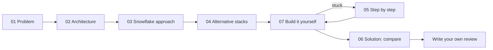
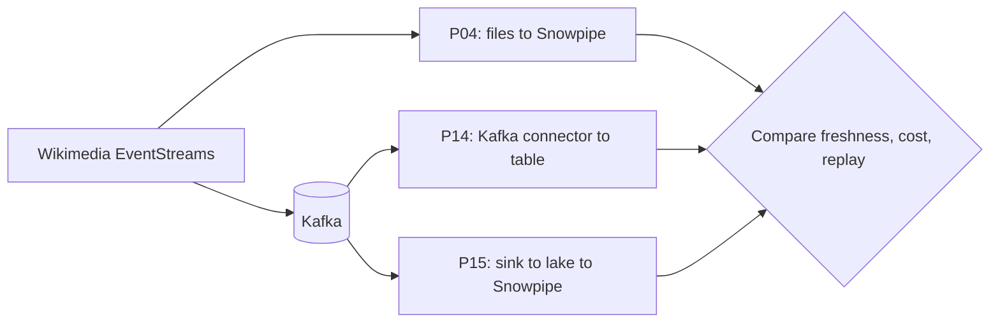
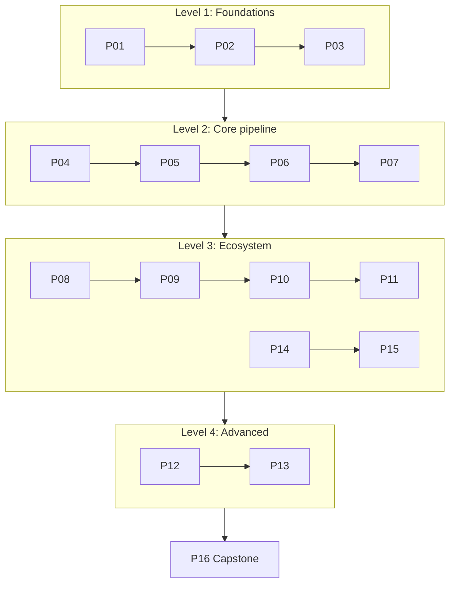

# End-to-End Snowflake Projects

Sixteen end-to-end projects that take Snowflake from first stage to a production-shaped platform. The project ideas start from the ProjectPro overview [13 End-to-End Snowflake Projects That Build Job-Ready Skills](https://www.projectpro.io/article/snowflake-projects/1168). Here they are reordered, separated so each one has a distinct learning focus, rebuilt on free data sources, and extended with architecture decisions, alternative stacks, failure drills, and cost control.

## How These Projects Differ From `pet-projects/`

| | `pet-projects/` | `end-to-end-projects/` |
| --- | --- | --- |
| Goal | Design exercise inside one capability | Working pipeline from source to consumer |
| Account | Optional | Required (trial is enough) |
| Data | Assumed | Real free sources plus a synthetic fallback |
| Solution | Separate reference example | `06_solution/` inside every project |
| Clouds | Not specific | Azure primary, AWS variant for cloud-specific parts |

## Project Anatomy

Every project has the same eight parts:

| File | Purpose |
| --- | --- |
| `README.md` | Overview, target architecture diagram, skills, navigation |
| `QUICKSTART.md` | Numbered commands from install to teardown, each with a "done when" check |
| `01_problem.md` | Business task, data, SLAs, non-functional requirements, success metrics |
| `02_architecture_decisions.md` | Options, trade-offs, why / why not Q&A, ADRs, failure modes, cost model |
| `03_snowflake_approach.md` | How the solution maps to Snowflake objects and features |
| `04_alternative_stacks.md` | Same problem on other platforms, with architecture and a learning roadmap |
| `05_snowflake_step_by_step.md` | Detailed build guide: what, why, how to verify |
| `06_solution/` | Solved reference implementation (`core/`, `azure/`, `aws/`, `tests/`) |
| `07_build_it_yourself.md` | Course-style brief with milestones and acceptance criteria, no solution code |

Diagrams are part of every section, not a separate file.

### Recommended Route Through One Project

Build first, then compare. Read `06_solution/` only after your milestones pass, or when a milestone stays blocked after using `05`.

## Catalog

Status: `ready` means all eight parts exist. `planned` means the project is defined in this catalog and has not been written yet.

| # | Project | Level | Main focus | Data source | Source idea | Status |
| --- | --- | --- | --- | --- | --- | --- |
| P01 | [Cricket JSON medallion](P01_cricket_json_medallion/README.md) | 1 Foundations | Internal stage, `$` notation, `FLATTEN`, task tree | Cricsheet | #10 | ready |
| P02 | [Weather EDA with notebooks](P02_weather_eda_notebooks/README.md) | 1 Foundations | Snowflake Notebooks vs Deepnote, reproducible EDA | Open-Meteo | #2 | ready |
| P03 | [Content analytics in Streamlit](P03_content_analytics_streamlit/README.md) | 1 Foundations | Streamlit in Snowflake, app RBAC, serving layer | Wikimedia Pageviews | #11 | ready |
| P04 | [Wikimedia Snowpipe near-real-time DWH](P04_wikimedia_snowpipe_realtime_dwh/README.md) | 2 Core pipeline | Snowpipe auto-ingest, reconciliation, replay, freshness | Wikimedia EventStreams | #1 | ready |
| P05 | [TPC-H streams and tasks CDC](P05_tpch_streams_tasks_cdc/README.md) | 2 Core pipeline | Streams, tasks, idempotent `MERGE`, dynamic table comparison | `SNOWFLAKE_SAMPLE_DATA` | #9 | ready |
| P06 | [Food delivery dimensional model](P06_food_delivery_dimensional_model/README.md) | 2 Core pipeline | Facts and dimensions, SCD2, delta loads | Synthetic OLTP generator | #12 | ready |
| P07 | [Retail Snowpark pipeline](P07_retail_snowpark_pipeline/README.md) | 2 Core pipeline | Snowpark DataFrame, stored procedures, Python tests | UCI Online Retail II | #13 | ready |
| P08 | [Social feed on Azure](P08_social_feed_azure/README.md) | 3 Ecosystem | Blob, Event Grid, notification integration at volume | Bluesky Jetstream | #4 | ready |
| P09 | [Crypto market with dbt](P09_crypto_market_dbt/README.md) | 3 Ecosystem | dbt models and tests, CI, alerting | Coinbase Exchange candles, FRED | #8 | ready |
| P10 | [GH Archive with Airflow](P10_gharchive_airflow/README.md) | 3 Ecosystem | External orchestration, backfill, unload to archive | GH Archive | #3 | ready |
| P11 | [Global markets to Power BI](P11_global_markets_powerbi/README.md) | 3 Ecosystem | Functions or Lambda, Snowpark, semantic layer | World Bank, ECB FX, WFP food prices | #7 | ready |
| P12 | IoT multi-engine | 4 Advanced | Databricks and Snowflake together, Iceberg as shared layer | GBFS plus sensor simulator | #6 | planned |
| P13 | Healthcare governed ML | 4 Advanced | Masking, row access, tags, classification, Snowpark ML vs SageMaker | Synthea | #5 | planned |
| P14 | [Kafka connector streaming](P14_kafka_connector_streaming/README.md) | 3 Ecosystem | Snowflake Kafka connector, Snowpipe Streaming, DLQ, offsets | Wikimedia EventStreams via Kafka | new | ready |
| P15 | [Kafka to lake to Snowpipe](P15_kafka_lake_snowpipe/README.md) | 3 Ecosystem | Lake writer with offset-named files, replay from lake, small-file trade-off | Wikimedia EventStreams via Kafka | new | ready |
| P16 | Capstone: NYC mobility platform | Capstone | Governed platform, CI/CD, IaC, cost, recovery | NYC TLC, Open-Meteo, taxi zones | new | planned |

P04, P14, and P15 deliberately use the same data. Their `07_build_it_yourself.md` files ask for the same freshness measurement, so you can compare file-based Snowpipe, the Kafka connector, and Kafka-to-lake ingestion on evidence rather than opinion.

## Learning Order

Written so far: P01 to P11, P14, P15. New to Snowflake: start at P01. If you already know basic Snowflake SQL and loading, P04 can be started directly.

## Feature Coverage

| Feature | P01 | P02 | P03 | P04 | P05 | P06 | P07 | P08 | P09 | P10 | P11 | P12 | P13 | P14 | P15 | P16 |
| --- | --- | --- | --- | --- | --- | --- | --- | --- | --- | --- | --- | --- | --- | --- | --- | --- |
| Stages and `COPY INTO` | x | x | x | x | | x | x | x | x | x | x | x | x | | x | x |
| Semi-structured data | x | x | x | x | | | | x | x | x | | x | x | x | x | x |
| Snowpipe auto-ingest | | | | x | | | | x | | | x | x | | | x | x |
| Snowpipe Streaming | | | | | | | | | | | | x | | x | | |
| Streams and tasks | x | | | x | x | x | x | x | | | x | | | | x | x |
| Dynamic tables | | | | x | x | x | | x | | | | | | x | | x |
| Snowpark | | | | | | | x | | | | x | x | x | | | x |
| Notebooks or Streamlit | | x | x | | | | | | | | | | x | | | x |
| dbt | | | | | | | | | x | | | | | | | x |
| External orchestration | | | | | | | | | x | x | x | x | | | | x |
| Governance policies | | | | | | | | | | | | | x | | | x |
| Observability and reconciliation | x | | | x | x | x | x | x | x | x | x | x | | x | x | x |
| Cost guardrails | x | x | x | x | x | x | x | x | x | x | x | x | x | x | x | x |

## Shared Material

- [Setup guide](../../../shared/environments/setup-guide/README.md): tools to install, local services, free cloud accounts, demo hosting (repository-wide); step-by-step [account guides](../../../shared/environments/setup-guide/accounts/README.md) for Snowflake, Azure, AWS, and others
- [How to run a project fast](_shared/how_to_run_a_project.md): the method behind every quickstart, debugging ladder, session routine
- [Kafka lab](_shared/kafka_lab/README.md): local Kafka, Kafka Connect with the Snowflake connector, Kafka UI, and the Wikimedia producer for P14 and P15
- [Conventions](_shared/conventions.md): naming, layers, RBAC pattern, file layout, secrets
- [Cost guardrails](_shared/cost_guardrails.md): what to set before every lab and how to stop spending
- [Azure and AWS mapping](_shared/azure_aws_mapping.md): service equivalents and integration patterns
- [Data sources](_shared/data_sources.md): free sources, access rules, synthetic fallbacks
- [Project template](_shared/project_template.md): the skeleton used for every project
- [Implementation notes](IMPLEMENTATION_NOTES.md) (Ukrainian): per-project summary of decisions, what was verified, and first-run risks

Track your progress in [PROGRESS.md](PROGRESS.md).

## Accuracy Note

Snowflake, Azure, and AWS features, limits, and prices change. Each project names the behavior it depends on; verify current details in official documentation before relying on them in production.
