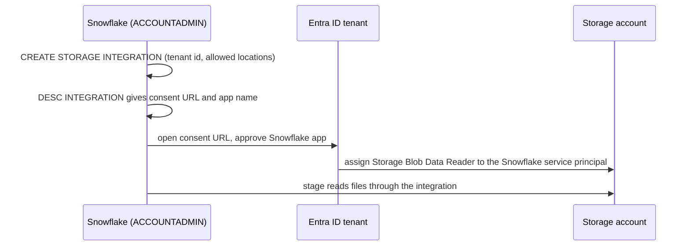
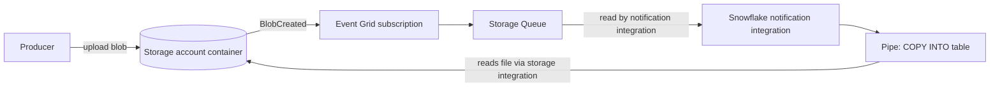
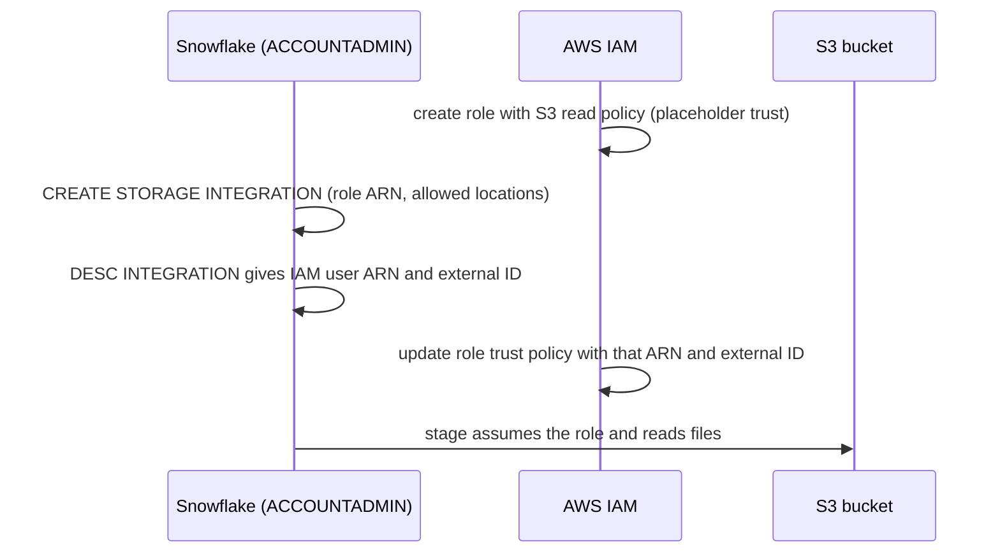
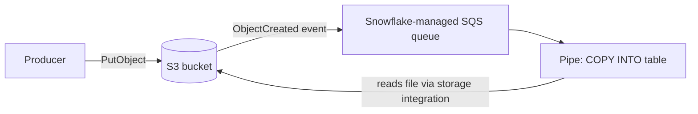

# Azure and AWS Mapping

Azure is the primary cloud for every project. Each `06_solution/` also contains an `aws/` variant. Snowflake logic in `core/` is identical; only the cloud integration differs.

## Choose the Account Cloud First

The cloud and region are chosen when the Snowflake account is created, and the trial account is tied to that choice. Create the account in the same cloud and region as the storage you will load from. Then:

- use the `azure/` scripts if the account runs on Azure
- use the `aws/` scripts if the account runs on AWS

Reading S3 from an Azure-hosted account (or the reverse) works, but adds egress cost and latency. Treat it as a decision to justify, not a default.

## Service Equivalents

| Role in the pipeline | Azure | AWS |
| --- | --- | --- |
| Landing storage | ADLS Gen2 (storage account with hierarchical namespace) or Blob Storage | S3 |
| Snowflake stage URL | `azure://<account>.blob.core.windows.net/<container>/<path>/` | `s3://<bucket>/<path>/` |
| Snowflake access to storage | Storage integration, consent, then RBAC role on the storage account | Storage integration, then IAM role trust with external ID |
| File-arrival events | Event Grid subscription to a Storage Queue | S3 event notification to a Snowflake-managed SQS queue |
| Snowflake object for events | Notification integration (`AZURE_STORAGE_QUEUE`) | None: the pipe exposes an SQS ARN (`notification_channel`) |
| Event streaming | Event Hubs (also exposes a Kafka endpoint) | Kinesis Data Streams or MSK |
| Stream to files | Event Hubs Capture | Kinesis Data Firehose |
| Serverless code | Azure Functions | AWS Lambda |
| Orchestration | Data Factory, Airflow (Managed Airflow or self-run) | MWAA, Step Functions |
| Identity for code | Entra ID, managed identity, `DefaultAzureCredential` | IAM roles, instance or task profiles |
| Secrets | Key Vault | Secrets Manager |
| BI | Power BI | QuickSight |
| Infrastructure as code | Bicep or Terraform | CloudFormation or Terraform |

## Pattern: Snowflake Reads Azure Storage

- The service principal's display name is the part of `AZURE_MULTI_TENANT_APP_NAME` before the underscore.
- Grant `Storage Blob Data Reader` for loading. Grant `Storage Blob Data Contributor` only if Snowflake must unload or purge files.
- Role assignments can take several minutes to propagate. A `LIST @stage` that fails right after granting usually needs a short wait, not a fix.

## Pattern: Snowpipe Auto-Ingest on Azure

- One notification integration and one queue can serve several pipes. Snowflake routes each event to the pipes whose stage path matches the blob path.
- The Snowflake queue service principal needs `Storage Queue Data Contributor` on the queue.
- Filter the Event Grid subscription to `Microsoft.Storage.BlobCreated` and the container prefix to reduce noise and cost.
- Upload with the Blob API (`PutBlob` or `PutBlockList`). If you write through the Data Lake (DFS) API, the creation event fires on the final flush; check current Snowflake guidance before relying on it.

## Pattern: Snowflake Reads S3

## Pattern: Snowpipe Auto-Ingest on AWS

- `SHOW PIPES` returns `notification_channel`, the SQS ARN to target from the bucket notification.
- Pipes in the same account and region usually share that queue. One bucket notification for the landing prefix serves all of them.
- `put-bucket-notification-configuration` **replaces** the bucket's whole notification configuration. Read the existing configuration first if the bucket is shared.

## Security Comparison

| Concern | Azure | AWS |
| --- | --- | --- |
| No secrets in Snowflake | Integration plus consent; no keys or SAS tokens | Integration plus role trust; no access keys |
| Least privilege | Scope role assignment to the storage account or container; restrict `STORAGE_ALLOWED_LOCATIONS` | Scope policy to the prefix; restrict `STORAGE_ALLOWED_LOCATIONS` |
| Confused deputy protection | Tenant-bound consent | `sts:ExternalId` condition in trust policy |
| Network restriction | Storage firewall allowing Snowflake subnets, or private connectivity | Bucket policy with VPC endpoint, or private connectivity |
