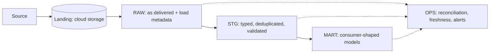
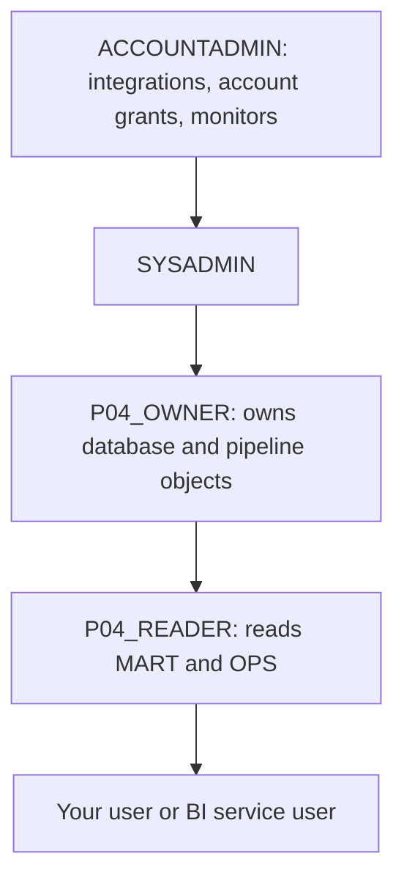

# Conventions

Every end-to-end project follows the same conventions, so that switching projects means switching problems, not habits.

## Snowflake Object Naming

| Object | Pattern | Example |
| --- | --- | --- |
| Database | `P<nn>_<SHORT_NAME>` | `P04_WIKI_RT` |
| Schemas | `RAW`, `STG`, `MART`, `OPS` | `P04_WIKI_RT.STG` |
| Owner role | `P<nn>_OWNER` | `P04_OWNER` |
| Read role | `P<nn>_READER` | `P04_READER` |
| Warehouses | `P<nn>_<PURPOSE>_WH` | `P04_TRANSFORM_WH`, `P04_BI_WH` |
| Resource monitor | `P<nn>_RM` | `P04_RM` |
| Integrations | `P<nn>_<CLOUD>_<PURPOSE>_INT` | `P04_AZURE_STORAGE_INT` |
| Stages | `<SOURCE>_STAGE` | `RAW.LANDING_STAGE` |
| Pipes | `<ENTITY>_PIPE` | `RAW.WIKI_RECENTCHANGE_PIPE` |
| Raw tables | `<ENTITY>_RAW` | `RAW.WIKI_RECENTCHANGE_RAW` |

Unquoted upper-case identifiers avoid case-sensitivity surprises. Everything a project creates starts with its `P<nn>` prefix, so teardown is a short, reviewable list.

## Layers



| Layer | Contract |
| --- | --- |
| Landing | Immutable files, never overwritten, retained for replay |
| `RAW` | Rows exactly as delivered, plus source file name, row number, and load time. No business logic |
| `STG` | Typed columns, one row per business key, rejects are countable |
| `MART` | Shaped for a named consumer, documented grain, stable column names |
| `OPS` | Evidence that the pipeline works: reconciliation, freshness, latency, cost |

Medallion names (bronze, silver, gold) map to `RAW`, `STG`, `MART`. The projects use the functional names because they say what the layer promises.

## RBAC Pattern



- `ACCOUNTADMIN` only for account-level objects: integrations, resource monitors, account privileges such as `EXECUTE TASK`.
- One owner role per project owns every project object. Never build with `ACCOUNTADMIN`.
- Consumers get the reader role, never the owner role.
- Grant the owner role to `SYSADMIN` so the role hierarchy stays connected.

## Landing File Layout

```text
<container-or-bucket>/landing/<entity>/dt=YYYY-MM-DD/hour=HH/<entity>_<UTC timestamp>_<unique id>.<format>[.gz]
<container-or-bucket>/landing/<entity>_manifest/dt=YYYY-MM-DD/hour=HH/<same base name>.json
```

- File names are unique and never reused. Snowpipe will not reload a file name it has already loaded, even if the content changed.
- Partition folders by delivery time, not event time, so a late event never rewrites an old folder.
- A manifest per data file records expected row count and checksum for reconciliation.

## Repository Layout Inside `06_solution/`

```text
06_solution/
  README.md        run order and expected results
  core/            cloud-independent Snowflake SQL, numbered by run order
  azure/           Azure provisioning and cloud-specific Snowflake SQL
  aws/             AWS policies and cloud-specific Snowflake SQL
  producer/        source connectors and generators, if the project has any
  tests/           data quality checks and failure drills
  teardown.sql
```

## Secrets and Data

- Never commit passwords, keys, tokens, tenant IDs, account locators, or connection strings. Placeholders look like `<tenant-id>`.
- Prefer identity-based access: storage integrations in Snowflake, `DefaultAzureCredential` or AWS profiles in Python, key-pair authentication for service users.
- Downloaded and generated data stays out of Git. Commit the script that produces it, not the files.

## SQL Style

- One numbered script per concern, idempotent where possible (`CREATE ... IF NOT EXISTS` or `CREATE OR REPLACE` with a stated reason).
- Every script starts with `USE ROLE`, `USE DATABASE`, and `USE WAREHOUSE` so it can be run on its own.
- Comments explain decisions, not syntax.

## Diagrams and Images

| Kind | Tool | Where |
| --- | --- | --- |
| Target architecture with product icons | Python [`diagrams`](https://diagrams.mingrammer.com) library, shared look in [diagrams/style.py](diagrams/style.py) | `P<nn>_.../assets/architecture.py` renders `architecture_azure.png` and `architecture_aws.png` |
| Flows, sequences, data models, decision trees | Mermaid in Markdown | Inline in each section |
| Original diagrams from articles | Link only, never copied | Inline, with a source caption |

Render icon diagrams (Graphviz required: `brew install graphviz`):

```bash
pip install -r _shared/diagrams/requirements.txt
cd P04_wikimedia_snowpipe_realtime_dwh/assets && python architecture.py
```

Caption every image directly below it:

- own diagram: `Own diagram, generated from assets/architecture.py. Icons: vendor architecture icon sets bundled with the diagrams library.`
- external diagram: `Source: <publisher>, <linked article title>. Linked for personal study, not copied into this repository.`

This repository is public. Third-party images are therefore **linked** (hotlinked with a source caption), not committed. For private offline copies, save them in a `_local_refs/` folder inside a project; that folder is ignored by Git. Vendor icons in own diagrams follow the vendors' published architecture icon guidelines and are used only to identify the product.
