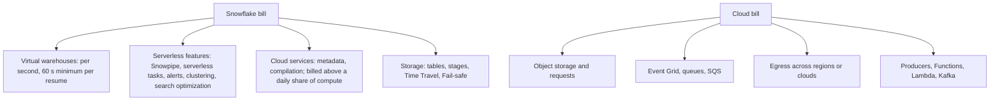

# Cost Guardrails

Read this before the first lab of every project. Most surprise bills in learning accounts come from something small that keeps running: a task every minute, a dynamic table with a short lag, an alert on a warehouse, or a producer left on overnight.

## What Costs Money



The important asymmetry: **resource monitors only control warehouses**. Snowpipe, serverless tasks, and other serverless features are not stopped by a resource monitor. Use Snowflake budgets (Snowsight: Admin, Cost management) to watch serverless spend, and pause serverless objects yourself after a lab.

## The Frequency Trap

A warehouse that is resumed more often than its auto-suspend interval never suspends.

| Pattern | What actually happens on an XS warehouse | Rough daily cost |
| --- | --- | --- |
| Task every 1 minute on a warehouse, `AUTO_SUSPEND = 60` | Warehouse never suspends | about 24 credits |
| Dynamic table `TARGET_LAG = '1 minute'` on a warehouse | Same: refresh every minute keeps it awake | about 24 credits |
| Alert every 5 minutes on an otherwise idle warehouse | 12 resumes per hour, each billed at least 60 s | about 5 credits |
| Serverless task every minute doing 3 s of work | Billed for compute seconds actually used | a small fraction of a credit |

Treat these numbers as an order of magnitude, not a price list. Credit rates for serverless features and per-credit prices depend on edition, region, and current pricing. The lesson holds: **latency targets have a cost**, and every project's `02_architecture_decisions.md` has to show that cost.

## Before Every Lab

```sql
USE ROLE ACCOUNTADMIN;

-- One monitor per project; warehouses only.
CREATE RESOURCE MONITOR IF NOT EXISTS P04_RM
  WITH CREDIT_QUOTA = 5
  FREQUENCY = DAILY
  START_TIMESTAMP = IMMEDIATELY
  TRIGGERS
    ON 80 PERCENT DO NOTIFY
    ON 100 PERCENT DO SUSPEND
    ON 110 PERCENT DO SUSPEND_IMMEDIATE;

CREATE WAREHOUSE IF NOT EXISTS P04_TRANSFORM_WH
  WAREHOUSE_SIZE = XSMALL
  AUTO_SUSPEND = 60
  AUTO_RESUME = TRUE
  INITIALLY_SUSPENDED = TRUE
  STATEMENT_TIMEOUT_IN_SECONDS = 600
  RESOURCE_MONITOR = P04_RM;
```

Checklist:

- [ ] Every warehouse is `XSMALL`, `AUTO_SUSPEND = 60`, attached to the project monitor
- [ ] A statement timeout is set on every warehouse
- [ ] A budget or at least a daily check covers serverless usage
- [ ] Producers run with an explicit duration (`--duration-minutes`), never open-ended
- [ ] Cloud resources live in one resource group or bucket per project, with a cloud budget alert

## After Every Lab

Pause, then verify that nothing is still running.

```sql
ALTER PIPE  RAW.WIKI_RECENTCHANGE_PIPE SET PIPE_EXECUTION_PAUSED = TRUE;
ALTER TASK  STG.LOAD_WIKI_CHANGE SUSPEND;
ALTER DYNAMIC TABLE MART.EDITS_PER_MINUTE SUSPEND;
ALTER ALERT OPS.ALERT_RAW_STALE SUSPEND;
ALTER WAREHOUSE P04_TRANSFORM_WH SUSPEND;

SHOW TASKS IN ACCOUNT;            -- state should be suspended
SHOW DYNAMIC TABLES IN ACCOUNT;   -- scheduling_state should be SUSPENDED
SHOW WAREHOUSES;                  -- state should be SUSPENDED
SELECT SYSTEM$PIPE_STATUS('P04_WIKI_RT.RAW.WIKI_RECENTCHANGE_PIPE');
```

Each project ships its own pause script and `teardown.sql`.

## Where to See What You Spent

`INFORMATION_SCHEMA` table functions are close to real time. `ACCOUNT_USAGE` views are more complete but can lag by up to a few hours.

```sql
-- Warehouses, last 24 hours
SELECT warehouse_name, SUM(credits_used) AS credits
FROM TABLE(INFORMATION_SCHEMA.WAREHOUSE_METERING_HISTORY(
  DATE_RANGE_START => DATEADD('hour', -24, CURRENT_TIMESTAMP())))
GROUP BY warehouse_name;

-- Snowpipe, last 24 hours
SELECT pipe_name, SUM(credits_used) AS credits, SUM(files_inserted) AS files
FROM TABLE(INFORMATION_SCHEMA.PIPE_USAGE_HISTORY(
  DATE_RANGE_START => DATEADD('hour', -24, CURRENT_TIMESTAMP())))
GROUP BY pipe_name;

-- Serverless tasks, last 24 hours
SELECT task_name, SUM(credits_used) AS credits
FROM TABLE(INFORMATION_SCHEMA.SERVERLESS_TASK_HISTORY(
  DATE_RANGE_START => DATEADD('hour', -24, CURRENT_TIMESTAMP())))
GROUP BY task_name;

-- Everything, by service type (lagging view)
SELECT service_type, SUM(credits_used) AS credits
FROM SNOWFLAKE.ACCOUNT_USAGE.METERING_HISTORY
WHERE start_time >= DATEADD('day', -7, CURRENT_TIMESTAMP())
GROUP BY service_type
ORDER BY credits DESC;
```

Record the credits you spent in [PROGRESS.md](../PROGRESS.md). Comparing cost per project is part of the learning.

## Cloud Side

| Cloud | Guardrail | Cleanup |
| --- | --- | --- |
| Azure | Cost Management budget on the project resource group | `az group delete --name <rg>` removes everything in it |
| AWS | AWS Budgets alert; tag resources with `project=p04` | Empty and delete the bucket, delete IAM role and policies |

Keep the Snowflake account and the storage in the **same cloud and region**. Cross-region or cross-cloud loading adds egress charges and latency.
