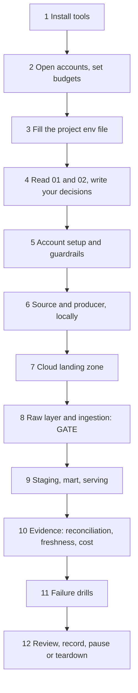

# How to Run a Project Fast

This is the method behind every end-to-end project: how the documents are designed, and the fastest order to work through them. Each project's `QUICKSTART.md` applies it as a numbered list of commands.

## How the Documents Are Designed

| Document | Question it answers | When you read it |
| --- | --- | --- |
| `QUICKSTART.md` | What do I run, in which order? | When you want the reference solution running, or a checklist while building your own |
| `01_problem.md` | What must be true when I am done? | First; it defines "done" in measurable terms |
| `02_architecture_decisions.md` | Why this design and not another? | Before building; again before presenting |
| `03_snowflake_approach.md` | Which objects exist and how do they connect? | While building; it is the map |
| `04_alternative_stacks.md` | How would another platform do it? | After building, to separate principles from products |
| `05_snowflake_step_by_step.md` | How do I build and verify each piece? | When stuck on a milestone |
| `06_solution/` | What does one complete answer look like? | After your milestone passes, to compare |
| `07_build_it_yourself.md` | What must I deliver, and how is it checked? | While building; it is the assignment |

Three design rules run through all of them:

1. **Vertical slice first.** Get one record from the source to the consumer through every layer before improving any layer. Problems at layer boundaries (permissions, notifications, formats) appear early, when they are cheap.
2. **Verify every hop before the next one.** Each step in `05` has a "verify" query or command. A failure is then always in the last thing you changed.
3. **Evidence over impressions.** Requirements are numbers (latency, completeness, cost); the `OPS` layer and the project log hold the proof.

## The Fast Path

| Step | Do | Done when |
| --- | --- | --- |
| 1 | Install what the project's README lists, using the [setup guide](../../../../shared/environments/setup-guide/README.md) | Every tool prints its version |
| 2 | Open the accounts; create budgets and monitors first | A budget alert exists in every account you will use |
| 3 | Copy `06_solution/p<nn>.env.example` to `p<nn>.env` and fill it | `run_sql.sh` stops complaining about missing values |
| 4 | Read `01` and `02`; write three decisions of your own in the project log | You can explain the design without looking |
| 5 | Run the account setup script | Roles, warehouses, monitor, and database exist |
| 6 | Run the producer with a local sink | Files and manifests on disk, tests pass |
| 7 | Provision the cloud landing zone | Files land in the cloud and events appear |
| 8 | Integrations, stage, ingestion | New data loads with **no manual command** |
| 9 | Staging, mart, dashboard | Consumer role sees correct numbers |
| 10 | Evidence views and alert | Every NFR has a measured value |
| 11 | Drills | Each drill has prediction, observation, recovery |
| 12 | Review and stop | Numbers in `PROGRESS.md`; pause or teardown run |

## Working Habits That Save the Most Time

- **Run SQL from files, not from copy-paste.** `06_solution/run_sql.sh` fills placeholders from the env file and runs scripts with the Snowflake CLI. Snowsight worksheets remain useful for exploring results.
- **Use the synthetic source while building.** Switch to the real source only for measurement runs. It is faster to start, never rate-limited, and gives reproducible numbers.
- **Short batch windows while building, realistic ones while measuring.** A 30-second window shows effects quickly; measure with the value from your design.
- **Bound every run.** Producers always take `--duration-minutes`; every session ends with the pause script.
- **Time-box being stuck.** After 30 minutes on one problem, read the matching step in `05`. After another 30, compare with `06`. Note in the log what you missed; that note is the learning.
- **Log as you go.** One line per step: what, result, number. Writing the review afterwards then takes minutes.

## Debugging Ladder

When something does not arrive, walk the path from the source towards the consumer and stop at the first hop that fails.

```mermaid
flowchart LR
    A[Source reachable?] --> B[Files written locally?]
    B --> C[Files in cloud storage?]
    C --> D[Events in queue?]
    D --> E[Stage can LIST?]
    E --> F[Pipe status RUNNING and receiving?]
    F --> G[COPY_HISTORY loaded or failed?]
    G --> H[Stream has data, task ran?]
    H --> I[Dynamic table refreshed?]
    I --> J[Reader role can select?]
```

| Hop | Check |
| --- | --- |
| Source | Run the producer with `--sink local` |
| Cloud storage | `az storage blob list ... --prefix <entity>/` |
| Events | `az storage message peek ...` (messages disappear once Snowflake reads them) |
| Stage | `LIST @stage/<entity>/;` |
| Pipe | `SELECT SYSTEM$PIPE_STATUS('<db>.<schema>.<pipe>');` |
| Load | `COPY_HISTORY` and `VALIDATE_PIPE_LOAD` |
| Staging | `SYSTEM$STREAM_HAS_DATA`, `TASK_HISTORY` |
| Mart | `DYNAMIC_TABLE_REFRESH_HISTORY` |
| Consumer | Run the tile query as the reader role |

## Session Template

Start of session:

1. `set -a; source p<nn>.env; set +a`
2. `./run_sql.sh core/91_resume.sql`
3. Start the producer with a duration.

End of session:

1. Stop the producer.
2. `./run_sql.sh core/90_pause.sql`
3. Run the credits query; write it and your notes into the log.
