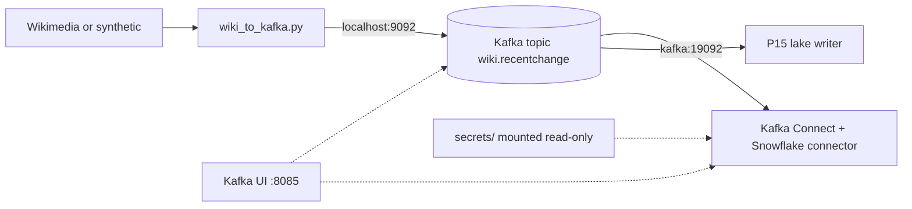

# Kafka Lab (P14, P15)

A local event backbone shared by the Kafka projects: Apache Kafka in KRaft mode, Kafka Connect with the Snowflake Kafka connector, Kafka UI, and a producer that publishes the same Wikimedia events as P04.



| Component | Address | Notes |
| --- | --- | --- |
| Kafka broker | host `localhost:9092`, containers `kafka:19092` | Auto topic creation off: topics are created deliberately |
| Kafka Connect REST | <http://127.0.0.1:8083> | Snowflake connector JAR baked into the image |
| Kafka UI | <http://127.0.0.1:8085> | Topics, consumer groups, connectors |

Do not run this lab together with `shared/docker/local-stacks/kafka`: they use the same ports.

## Start

```bash
cd 16-cloud-databases/01-snowflake/end-to-end-projects/_shared/kafka_lab
cp .env.example .env
curl -s https://repo1.maven.org/maven2/com/snowflake/snowflake-kafka-connector/maven-metadata.xml | grep -o '<release>[^<]*'
# put that version into .env as SNOWFLAKE_CONNECTOR_VERSION, after reading its release notes
mkdir -p secrets && chmod 700 secrets
docker compose up -d --build
docker compose ps
```

Create the topic (3 partitions, 7 days retention from the broker default):

```bash
docker compose exec kafka /opt/kafka/bin/kafka-topics.sh --bootstrap-server kafka:19092 \
  --create --if-not-exists --topic wiki.recentchange --partitions 3 --replication-factor 1
docker compose exec kafka /opt/kafka/bin/kafka-topics.sh --bootstrap-server kafka:19092 \
  --create --if-not-exists --topic wiki.recentchange.dlq --partitions 1 --replication-factor 1
```

**Verify:**

```bash
curl -s localhost:8083/connector-plugins | jq -r '.[].class' | grep -i snowflake
kcat -b localhost:9092 -L | grep wiki
```

The first command must print `com.snowflake.kafka.connector.SnowflakeSinkConnector`.

## Produce Events

```bash
cd producer
python3.12 -m venv .venv && source .venv/bin/activate
pip install -r requirements.txt
python -m pytest -q test_wiki_to_kafka.py

export WIKI_USER_AGENT="kafka-lab/1.0 (you@example.com)"
python wiki_to_kafka.py --source synthetic --rate 20 --duration-minutes 2
python wiki_to_kafka.py --source wikimedia --duration-minutes 30
```

The producer uses `acks=all` and idempotence, so broker retries do not create duplicates. Duplicates can still come from the source (Wikimedia replays after reconnect); downstream deduplicates on `meta.id`.

**Verify:** `kcat -b localhost:9092 -t wiki.recentchange -C -c 3 -f 'p%p o%o k=%k\n'` prints partition, offset, key.

## Secrets for Connectors

Connector configs reference secrets with `${file:/secrets/<file>:<key>}`. Kafka Connect resolves them at runtime, so private keys never land in the `_connect-configs` topic or the REST API output. The `secrets/` folder is ignored by Git and mounted read-only.

## Stop

```bash
docker compose stop          # pause; topics and connector state stay
docker compose down          # remove containers; topics and connector state reset
```

## Using Confluent Cloud Instead

Set `KAFKA_BOOTSTRAP`, `KAFKA_SASL_USERNAME`, and `KAFKA_SASL_PASSWORD` for the producer, and use the managed Snowflake sink connector in Confluent Cloud instead of local Connect. Account setup: [Confluent Cloud guide](../../../../../shared/environments/setup-guide/accounts/confluent_cloud.md).

## Troubleshooting

| Symptom | Fix |
| --- | --- |
| `connect` exits during build | `SNOWFLAKE_CONNECTOR_VERSION` empty or not a published version |
| Image fails on Apple Silicon | Add `platform: linux/amd64` to the `connect` service |
| Producer: `Unknown topic or partition` | Create the topic first; auto-creation is off on purpose |
| Connector `FAILED` | `curl -s localhost:8083/connectors/<name>/status \| jq` shows the stack trace |
