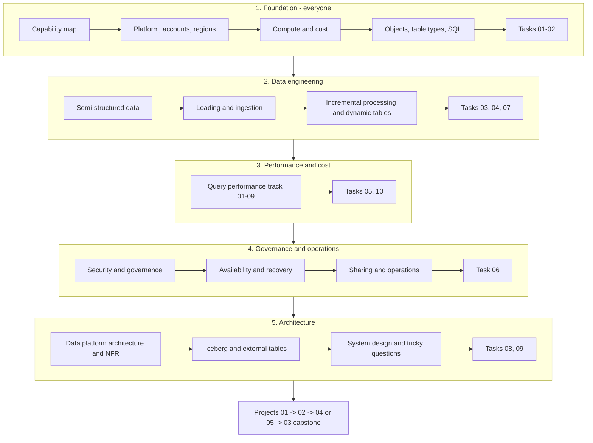
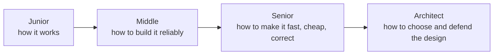
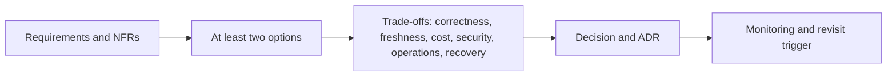

# Learning Paths

Use the capability map to discover the platform. Use these paths to decide what to study first. The paths share material rather than repeating it.

## Recommended Main Route

One shared foundation, then specializations. Specialist topics such as Iceberg come after native tables, ingestion, and governance basics.

## Competencies By Level

| Level | You can... | Evidence of completion |
| --- | --- | --- |
| Junior | navigate accounts, databases, schemas, roles, warehouses; load files with `COPY INTO`; query JSON with `FLATTEN` | tasks 01–03 solved without looking at solutions; project 01 |
| Middle | build a replayable, idempotent pipeline; choose Snowpipe vs batch; use streams, tasks, or dynamic tables; read Query Profile | tasks 04, 05, 07; project 02 or 05 |
| Senior | diagnose performance with evidence; estimate cost of freshness; design dedupe, late-data, and backfill strategies; defend trade-offs | tasks 08, 10; casebook cases explained aloud; tricky questions Part A |
| Architect | design account topology, governance, recovery with tested RPO/RTO, sharing and interoperability; write ADRs with NFRs | task 09; project 03 capstone with ADRs, diagrams, and failure-mode table |

## Path A: New to Snowflake

1. Read the platform and account sections of the capability map.
2. Study [Platform Architecture](architecture/01_platform_account_cloud_region.md) and [Compute and Cost](architecture/02_compute_workload_cost.md).
3. Use the [Object and Table Reference](reference/02_objects_and_table_types.md) and [SQL Functions Reference](reference/01_sql_dates_and_semistructured.md).
4. Work through [Loading and Ingestion](deep-dives/03_data_loading_patterns.md), then the semi-structured data guide.
5. Continue with processing, performance, security, and recovery topics from the map.
6. Study the [Iceberg and External Tables deep-dive](deep-dives/iceberg-and-external-tables/README.md) after the native-table and ingestion foundations.
7. Complete the task sets in order and build at least one guided project.
8. Finish with the production architecture and capstone task.

## Path B: Coming from Another Cloud Database

1. Scan the whole [Capability Map](00_snowflake_capability_map.md), including the availability notes.
2. Mark concepts you already know, Snowflake-specific concepts, and features that are new to you.
3. Use the [Iceberg and External Tables deep-dive](deep-dives/iceberg-and-external-tables/README.md) to compare native tables, external tables, Snowflake-managed Iceberg, and externally managed Iceberg.
4. Compare familiar concepts against Snowflake's storage-compute model, role hierarchy, ingestion options, semi-structured handling, and cost model.
5. Read only the deep dives for meaningful behavior differences, then use architecture guides for account, workload, governance, and recovery decisions.
6. Complete the comparison exercises rather than repeating basic SQL practice.

## Path C: Architecture Decision

1. State requirements and constraints before selecting a Snowflake feature.
2. Open the relevant architecture guide from the capability map.
3. Use the Iceberg/external-table comparison when table format, metadata ownership, or cross-engine access is involved.
4. Compare at least two viable options, including the surrounding-system option when applicable.
5. Record impacts on correctness, freshness, latency, cost, security, operations, and recovery.
6. State assumptions, failure modes, observability, and a way to revisit the decision.

## Suggested Stages

### Beginner

Understand accounts, databases, schemas, roles, warehouses, tables, SQL context, stages, and basic loading. The goal is to navigate and explain a small working setup.

### Data Engineer

Understand replayable ingestion, semi-structured data, incremental processing, query diagnosis, cost controls, and integration boundaries. The goal is to build a repeatable, observable pipeline.

### Architect

Understand account and region topology, workload isolation, least privilege, governance, sharing, continuity, deployment, and operating models. The goal is to defend a design under explicit constraints.

## How to Ask for More Detail

Use one of these modes when studying a capability:

- **Quick reference:** definition, purpose, minimal syntax, example, and one important caveat.
- **Detailed guide:** mental model, step-by-step examples, use cases, limitations, failure modes, and alternatives.
- **Architecture lens:** requirements, placement in the platform, design options, trade-offs, operational consequences, and decision checklist.

For example: "Explain secure views as a detailed guide with practical cases" or "Compare account and region topologies through an architecture lens." The capability map indicates the recommended starting mode; expand a topic when a question comes up.