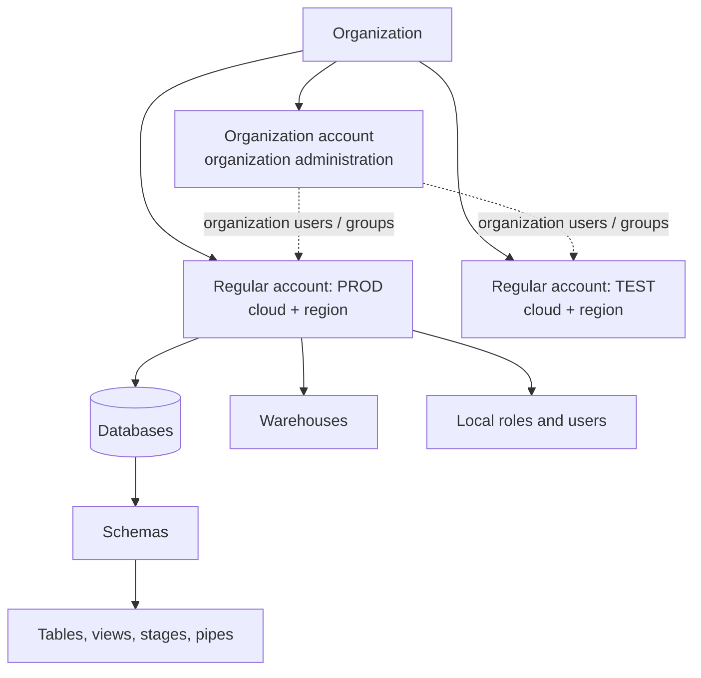
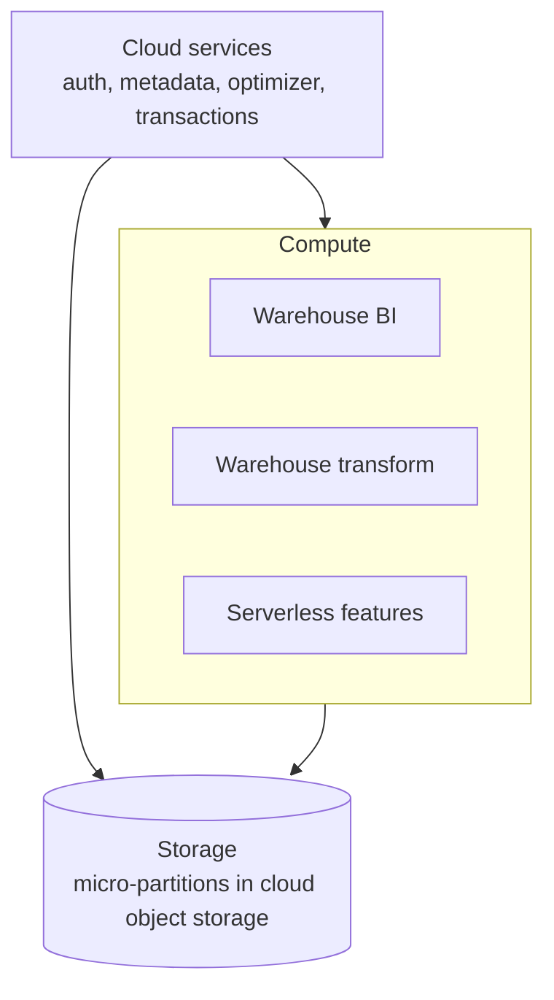
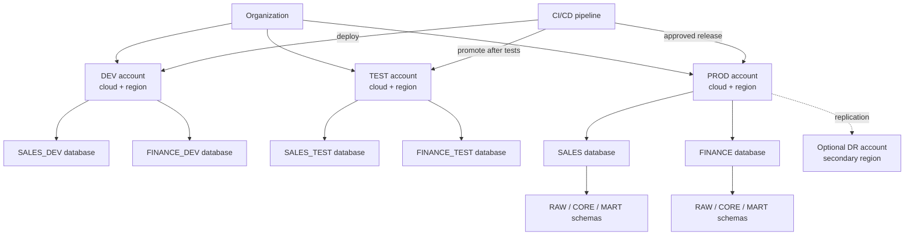
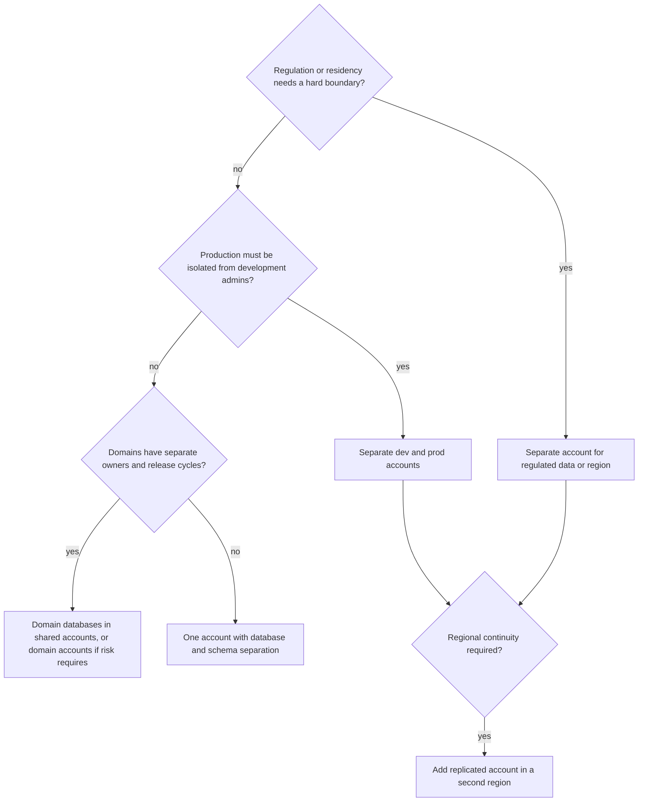

# Platform Architecture: Accounts, Cloud, and Region

## Start with Requirements

Account topology is a security, operations, deployment, and recovery decision. It should follow requirements, not a preference for either maximum centralization or maximum separation.

Capture these constraints first:

- regulatory and data-residency boundaries
- blast-radius and administrator separation
- number of environments, domains, and teams
- sharing and replication requirements
- identity-provider and network boundaries
- deployment ownership and release cadence
- availability objectives, recovery time, and recovery point
- budget and operational capacity

## Platform Mental Model

An organization links the Snowflake accounts owned by a business entity. It provides an administrative view across accounts; it does not merge them into one account or shared database. An account is associated with a cloud provider and region and contains databases, schemas, warehouses, roles, integrations, and policies. Each account has its own account identifier and connection context.

An **organization account** is a special account, at most one per organization, for organization-wide administration and usage capabilities. It is distinct from ordinary workload accounts such as `DEV`, `TEST`, and `PROD`. Organization administrators can use it to manage account lifecycle, organization users and groups, and organization-wide usage data. They can also enable replication for accounts. The replication groups, data selection, schedules, local grants, and failover procedures still need to be designed and operated for the relevant accounts.

An **account** is a Snowflake administrative and security boundary, but it is not inherently an environment or a business domain. Teams choose how accounts map to their environments, domains, regions, and risk boundaries. A **cloud platform** is the provider hosting an account, such as AWS, Azure, or Google Cloud Platform. A **region** is a Snowflake deployment location on that cloud platform. An account is created in a cloud and region; choosing a different region or provider generally means using another account and planning data movement or replication, not simply changing a setting in place.

Each account has an account identifier used by Snowsight, CLI tools, drivers, and integrations. The preferred identifier uses the organization name and account name, for example `acme-prod`; a typical public account URL is `acme-prod.snowflakecomputing.com`. The exact connection URL can differ with account configuration and connectivity options. Use the account's displayed identifier rather than assuming that a person signed in to one account can automatically access another.

Storage and compute are logically separated, while cloud services coordinate account and query behavior. The exact feature set and connectivity options vary by provider, region, account, edition, and release.



Warehouses, roles, users, and integrations are account-level objects; they are not inside a database. Grants connect roles to database objects and warehouses. An organization user can be made available in multiple accounts through organization user groups, but that does not make the user's role assignments or data privileges identical across those accounts.

### Organization and organization account in practice

The organization is the umbrella for administration; ordinary accounts remain distinct. For example, an administrator can use the organization account to see or manage organization-level entities, while developers still connect to the `DEV` account and production workloads connect to `PROD`. Access to one account does not automatically grant access to another.

The organization account can help with:

- viewing and administering accounts across regions and cloud platforms;
- managing account lifecycle and enabling replication for accounts;
- querying organization-level usage views, subject to the applicable privileges and view availability;
- creating organization users and groups for people or services that need a user object in multiple accounts.

Organization users avoid repeatedly defining the same person's or service's basic user identity in every account. The organization administrator creates the user and group, then makes the group available to selected account administrators. Each account administrator imports the group into that account. The account administrator still assigns local roles and grants. For example:

```text
Organization account
└── organization user: data_engineer
    └── group: platform_engineers
        ├── imported into DEV  -> DEV_ENGINEER role and development privileges
        ├── imported into TEST -> TEST_ENGINEER role and test privileges
        └── imported into PROD -> limited PROD_SUPPORT role, if needed
```

This supports a shared identity lifecycle without requiring identical permissions. Import only the groups needed in each account, and use separate service identities for automation. Review authentication requirements and resolve any conflicts with user objects that already exist in an account.

Organization-level features can involve metadata that crosses region boundaries. In organizations that include regulated and non-regulated regions, assess metadata residency and compliance before using organization-level users, usage views, replication, or sharing. Do not put sensitive or regulated data in organization-level user properties.

### Three-layer service model



Because compute is separate from storage, many warehouses can read the same data without copying it, and each can be sized, suspended, and billed independently.

## Common Topologies

| Topology | Useful when | Advantages | Costs and risks |
| --- | --- | --- | --- |
| One account with database/schema separation | Small team, low regulatory separation, limited operations capacity | Fewer accounts and simpler initial sharing | Weaker blast-radius isolation; grants and naming must be disciplined |
| Separate development, test, and production accounts | Production isolation or independent administrators are important | Stronger environment boundary and deployment testing | Cross-account deployment, identity, integrations, monitoring, and cost setup are more involved |
| Accounts by domain or business unit | Domains have independent administrators, compliance needs, risk profiles, or release cycles | Stronger domain autonomy and blast-radius boundaries | Platform controls can be duplicated; cross-domain sharing and central operations become more complex |
| Hybrid: environment accounts plus domain databases/schemas | Domains share platform operations but production must be isolated from non-production | Balances environment isolation with domain-level organization and shared controls | Requires consistent naming, role/grant standards, deployment automation, and clear domain ownership |
| Separate regional accounts | Residency, latency, or regional continuity requires it | Regional control and locality | Replication, global identity, consistency, and cost complexity |

These are patterns, not universal templates. Account capabilities, organization controls, and replication support must be verified for the target deployment.

### Separate accounts by environment

In this model, each environment has its own account, typically in the same organization:

```text
Organization
├── DEV account  (cloud + region)
├── TEST account (cloud + region)
└── PROD account (cloud + region)
```

Each account has its own users, roles, grants, warehouses, integrations, and databases. Names and deployment configuration may be similar, but objects do not become shared just because they have the same name. Code and DDL are deployed to each account through a controlled release process. Data movement between accounts is a separate design decision.

This is useful when production needs a stronger boundary from development and test administrators, or when environments need independent policies and cost controls. It adds account provisioning, deployment, monitoring, and access-management work. A separate account is a stronger boundary than a database or schema, but organization administrators and authorized administrators can still have broad administrative capabilities.

### Accounts by domain or business unit

In this topology, each domain owns one or more accounts instead of representing domains only as databases in shared accounts:

```text
Organization
├── SALES account (cloud + region)
│   ├── development and production workloads, if both are in this account
│   └── SALES databases and schemas
└── FINANCE account (cloud + region)
    ├── development and production workloads, if both are in this account
    └── FINANCE databases and schemas
```

This can fit domains with independent administrators, compliance obligations, release schedules, or a need to contain operational mistakes within a domain. It also means the domain must own or coordinate more account-level concerns: access patterns, integrations, warehouse standards, monitoring, deployment, and cost controls.

If production must also be isolated from development, a single account per domain may not be sufficient. One option is accounts per domain and environment, such as `SALES_DEV`, `SALES_PROD`, `FINANCE_DEV`, and `FINANCE_PROD`. That gives stronger separation but increases the number of accounts and the operational overhead. Another option is a shared `DEV` account and `PROD` account with domain-owned databases or schemas.

### Hybrid topology: environment accounts plus domain databases/schemas

In this model, accounts represent environments, while databases and schemas organize domain data inside each account:



For example, the platform team operates shared environment accounts, while Sales and Finance own their database schemas and access policies. This can reduce duplicated account administration while retaining a distinct production account. The trade-off is that domain isolation inside an account depends on disciplined roles, grants, ownership, and policies; a database name alone is not a security boundary.

### Choosing between domain accounts and the hybrid model

| Question | Favors accounts by domain | Favors environment accounts plus domain databases/schemas |
| --- | --- | --- |
| Do domain administrators need a hard account-level boundary? | Yes | No; centrally administered account is acceptable |
| Are domain-specific regulatory or network controls required? | Often | Only if account-level controls are not required |
| Must production be isolated from development administrators? | Use separate domain-and-environment accounts | Use separate environment accounts |
| Is a central platform team responsible for shared controls? | Can be, but controls repeat across accounts | A natural fit |
| Is minimizing account operations a priority? | Less suitable as account count grows | More suitable, with stronger grant discipline |
| Do domains need independent release and cost ownership? | Strong fit | Possible, but requires agreed ownership and tagging/monitoring practices |

Neither topology is automatically more secure or cheaper. Choose the smallest set of boundaries that meets explicit isolation, compliance, ownership, and recovery requirements.

### Example: production data for testing

Moving production data to test is not the same operation as promoting code to production. Treat these as separate flows:

```text
Code and schema changes:
Git -> DEV account -> TEST account -> approved deployment -> PROD account

Test data:
PROD source data -> minimized and de-identified test dataset -> TEST account
```

#### Promote code and objects through environments

Keep DDL, transformation code, and configuration in version control. Apply the same reviewed migration or deployment artifact to DEV, then TEST, and finally PROD. Use environment-specific configuration for account identifiers, warehouses, integrations, and database names. Do not use production-to-test replication as a substitute for release promotion: a replicated database reflects production state, not the candidate release being tested.

Users, roles, grants, warehouses, integrations, and policies are account-level concerns. Manage and deploy them explicitly per account, through reviewed scripts or infrastructure-as-code where appropriate. Replication capabilities vary by object type and Snowflake Edition; do not assume every object or setting is included.

#### Provide a controlled production-like dataset

First decide whether tests need real production data. Prefer synthetic data when practical. If realistic data is required, create a dedicated, minimized dataset in PROD that contains only the necessary tables, columns, time range, and rows. Remove or irreversibly transform sensitive values before moving it to TEST, and verify that the output contains no prohibited data.

Dynamic masking changes what a query returns for a role; it does not rewrite the stored values. Therefore, copying a production database while relying only on masking can still expose the underlying sensitive values in TEST. Use a transformation that produces safe values before transfer, and govern that output as a separate data product.

After enabling replication for both accounts, a replication group can be configured to include only the approved test-data database. For example, the following illustrates the source-side configuration; use current account identifiers, privileges, and supported syntax for the deployment:

```sql
-- Run in PROD with a role that has the required privileges.
CREATE REPLICATION GROUP prod_test_data_rg
  OBJECT_TYPES = DATABASES
  ALLOWED_DATABASES = PROD_TEST_SAFE
  ALLOWED_ACCOUNTS = myorg.test
  REPLICATION_SCHEDULE = '10 MINUTE';
```

Create the secondary group and refresh it in TEST:

```sql
-- Run in TEST.
CREATE REPLICATION GROUP prod_test_data_rg
  AS REPLICA OF myorg.prod.prod_test_data_rg;

ALTER REPLICATION GROUP prod_test_data_rg REFRESH;
```

The replica in TEST is secondary and read-only. If tests must modify fixtures, copy the approved data into a separate writable test database or schema in TEST. Establish retention and refresh rules, validate row counts and data quality after each refresh, restrict access to the test dataset, and monitor storage and compute costs. Confirm edition and region support before adopting this pattern.

For many deployments, a scheduled export/import or an explicit transformation pipeline is preferable to replication. Replication is useful when maintaining a refreshed copy of a selected database is appropriate; it should not be used merely because it is available.

### Replication, failover, and sharing are different goals

These features can involve multiple accounts in one organization, but solve different problems:

| Goal | Pattern | Result |
| --- | --- | --- |
| Keep a set of objects synchronized in another account | Replication group | Secondary, read-only replicas refreshed on a schedule |
| Recover a workload in another account after an outage | Failover group plus a tested recovery process | Promote supported secondary objects to primary/read-write; redirect clients and validate dependencies |
| Provide another account with governed access to a data product | Secure Data Sharing | Consumer access to shared data; cross-region/cloud sharing requires regional fulfillment/replication steps |
| Promote a code/schema release between DEV, TEST, and PROD | CI/CD or deployment automation | Versioned changes applied and tested per account; not a data replication operation |

Replication is asynchronous, so target data can lag behind the source. Set refresh objectives based on business RPO, monitor actual replication lag, and test recovery to establish RTO. A failover design also needs a client connection strategy, ownership of the promotion decision, protection against writes continuing in the old primary, and a failback runbook. Do not assume that replicating data alone makes an application highly available.

For cross-region sharing, account replication can place the data and share in the consumer's region; then the provider grants the local consumer account access to the replicated share. Consider data residency and legal constraints before replicating to another region or cloud.

Feature support is edition- and object-dependent. Database replication, share replication, and replication groups containing those objects are available across Snowflake editions. Failover groups and replication of account objects other than databases and shares require Business Critical Edition or higher. Check current Snowflake documentation for exact object, region, cloud, and edition support before implementation.
### Choosing a topology



## Cloud and Region Decisions

Select cloud and region based on residency, service availability, existing identity/network standards, data gravity, source/consumer locations, and recovery needs. A region choice can affect integrations, data transfer, latency, replication, sharing, and which features are available. Confirm the current region and edition matrix before promising a capability.

An account is deployed in a particular cloud and region. Separate accounts in the same organization can be in different supported regions or cloud platforms, but moving data between them requires an explicit design such as replication, sharing, or export/import. Consider data residency, replication lag, transfer and storage costs, availability of required integrations, and who will operate each target account.

Cross-region replication does not automatically deliver application failover. Roles, integrations, warehouses, client redirect or other connection behavior, orchestration, consumer cutover, and validation are part of the end-to-end design. Replication and sharing across regulated-region boundaries also require review of which metadata and data may move.

## Trade-Off Method

For each proposed boundary, ask what it isolates and what it makes harder. An additional account may strengthen security and recovery but multiply deployment, monitoring, grants, and support work. A shared account can simplify collaboration but puts more responsibility on role design, policies, and operational discipline.

## Worked Scenario

A company has dev, test, and prod workloads, two domains, one central platform team, and a regulated production dataset. A candidate is separate accounts for each environment, with domain-owned databases or schemas in each account. A test-data process creates a minimized and de-identified dataset in production and makes it available to TEST through a controlled mechanism. CI/CD promotes DDL and code separately from DEV through TEST to PROD. A second-region account is added only if recovery objectives and regional requirements justify the cost and operations.

Before selecting the topology, verify whether the regulated boundary requires a separate account or region, whether the test dataset is safe to transfer, whether deployment automation can promote and roll back changes, what replication features the account editions support, and how clients, integrations, roles, and consumers behave during failover.

### Boundary comparison

| Boundary | Isolates | Does not isolate | Typical owner |
| --- | --- | --- | --- |
| Organization | administrative view and selected organization-wide operations across linked accounts | data, compute, or account-level access boundaries | organization administrators |
| Organization account | organization administration and organization-wide usage/user capabilities | a shared runtime account for DEV/TEST/PROD; automatic local grants | organization administrators |
| Account | account-local admins, network policies, integrations, warehouses, and account-level configuration | isolation from authorized organization/account administrators | platform or domain platform team |
| Database | lifecycle, ownership, and a possible replication unit | account-level roles or compute | database owner / domain team |
| Schema | object grouping and managed-access boundary when grants are configured | security without corresponding grants and policies | schema owner / data product owner |
| Warehouse | compute, cost, and concurrency | data access | workload owner |
| Role | privileges granted to it | compute or data location | security and object owners |

## Decision Checklist

- Which requirement does each account, database, schema, or warehouse boundary satisfy?
- Who administers each boundary, and who owns its data products?
- Is the organization account needed, and which organization-wide operations will it own?
- Do users need organization-level identities across accounts, and which local roles will they receive in each account?
- Are accounts organized by environment, domain/business unit, region, or a justified combination?
- How do code, grants, integrations, policies, and safe test data move between environments?
- Does the cloud/region support required features and connectivity?
- Is the goal replication, failover, sharing, or release promotion? Which mechanism supports that goal?
- What data and metadata may cross a cloud or regional boundary?
- What breaks during account or regional failover, beyond the database itself?
- What are the required RPO/RTO, refresh schedule, and tested recovery procedure?
- What is the smallest topology that meets the documented risk and operating needs?

## Further Reading

- [Introduction to organizations](https://docs.snowflake.com/en/user-guide/organizations)
- [Organization accounts](https://docs.snowflake.com/en/user-guide/organization-accounts)
- [Organization users](https://docs.snowflake.com/en/user-guide/organization-users)
- [Account identifiers](https://docs.snowflake.com/en/user-guide/admin-account-identifier)
- [Replication and failover across multiple accounts](https://docs.snowflake.com/en/user-guide/account-replication-intro)
- [Replicating databases and account objects](https://docs.snowflake.com/en/user-guide/account-replication-config)
- [Business continuity and disaster recovery](https://docs.snowflake.com/en/user-guide/replication-intro)
- [Share data across regions and cloud platforms](https://docs.snowflake.com/en/user-guide/secure-data-sharing-across-regions-platforms)
- [Dynamic Data Masking](https://docs.snowflake.com/en/user-guide/security-column-ddm-intro)
- [Data storage considerations](https://docs.snowflake.com/en/user-guide/tables-storage-considerations)