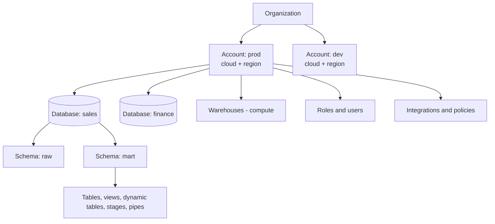
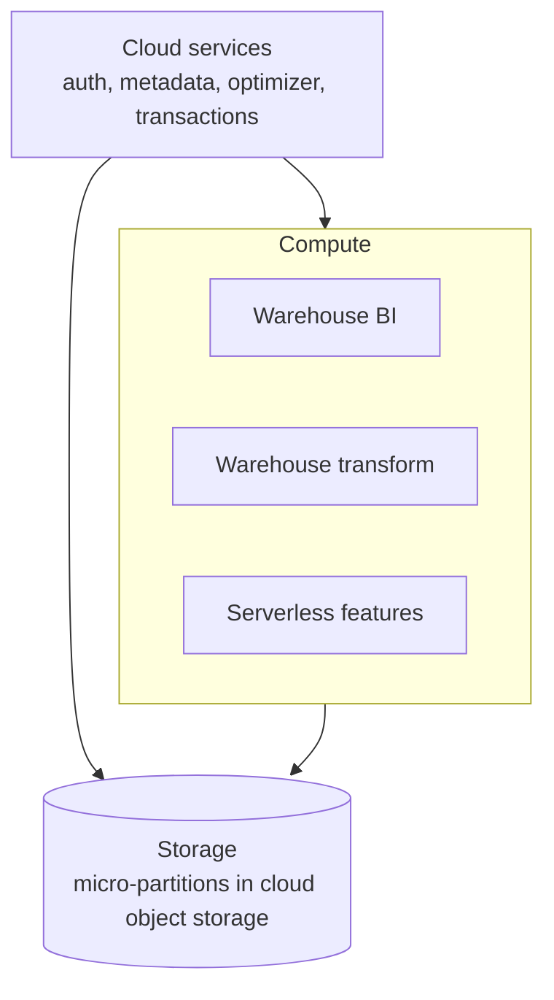
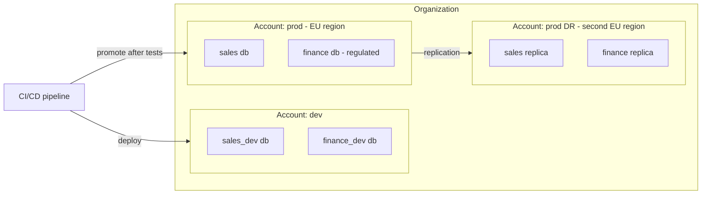
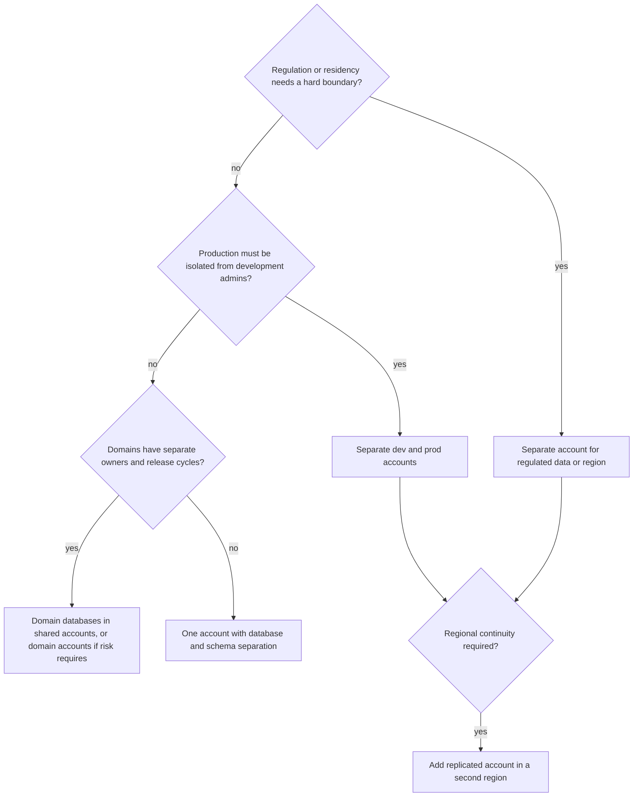

# Platform Architecture: Accounts, Cloud, and Region

## Start with Requirements

Account topology is a security, operations, deployment, and recovery decision. It should follow requirements, not a preference for either maximum centralization or maximum separation.

Capture these constraints first:

- regulatory and data-residency boundaries
- blast-radius and administrator separation
- number of environments, domains, and teams
- sharing and replication requirements
- identity-provider and network boundaries
- deployment ownership and release cadence
- availability objectives, recovery time, and recovery point
- budget and operational capacity

## Platform Mental Model

An organization can administer accounts. Accounts are associated with a cloud provider and region and contain databases, schemas, warehouses, roles, integrations, and policies. Storage and compute are logically separated, while cloud services coordinate account and query behavior. The exact feature set and connectivity options vary by provider, region, account, edition, and release.

Do not conflate an account with an environment, business domain, database, or warehouse. Each boundary provides different isolation and lifecycle behavior.

Warehouses, roles, users, and integrations are account-level objects; they are not inside a database. Grants connect them to database objects.

### Three-layer service model

Because compute is separate from storage, many warehouses can read the same data without copying it, and each can be sized, suspended, and billed independently.

## Common Topologies

| Topology | Useful when | Advantages | Costs and risks |
| --- | --- | --- | --- |
| One account with database/schema separation | Small team, low regulatory separation, limited operations capacity | Fewer accounts and simpler initial sharing | Weaker blast-radius isolation; grants and naming must be disciplined |
| Separate development, test, and production accounts | Production isolation or independent administrators are important | Stronger environment boundary and deployment testing | Cross-account promotion, identity, integration, and cost setup is more involved |
| Accounts by domain or business unit | Domains have separate owners, risk profiles, or release cycles | Clear ownership and access boundaries | Duplicate platform controls and harder cross-domain sharing |
| Hybrid: environment accounts plus domain databases/schemas | Multiple domains need production isolation with shared platform operations | Balances separation and reuse | Requires explicit platform standards and ownership agreements |
| Separate regional accounts | Residency, latency, or regional continuity requires it | Regional control and locality | Replication, global identity, consistency, and cost complexity |

These are patterns, not universal templates. Account capabilities, organization controls, and replication support must be verified for the target deployment.

### Hybrid topology example

### Choosing a topology

## Cloud and Region Decisions

Select cloud and region based on residency, service availability, existing identity/network standards, data gravity, source/consumer locations, and recovery needs. A region choice can affect integrations, data transfer, latency, and which features are available. Confirm the current region and edition matrix before promising a capability.

Cross-region replication does not automatically deliver application failover. Roles, integrations, DNS or connection behavior, orchestration, consumer cutover, and validation are part of the end-to-end design.

## Trade-Off Method

For each proposed boundary, ask what it isolates and what it makes harder. An additional account may strengthen security and recovery but multiply deployment, monitoring, grants, and support work. A shared account can simplify collaboration but puts more responsibility on role design, policies, and operational discipline.

## Worked Scenario

A company has dev and prod workloads, two domains, one central platform team, and a regulated production dataset. A reasonable candidate is separate dev and prod accounts, domain-owned schemas or databases within prod, and narrowly governed sharing between domains. Before selecting it, verify whether the regulated boundary requires a separate account, whether deployment automation can promote changes safely, and how recovery and integrations work across the chosen regions.

### Boundary comparison

| Boundary | Isolates | Does not isolate | Typical owner |
| --- | --- | --- | --- |
| Account | admins, network policies, integrations, billing, failure domain | nothing inside it from its own admins | platform team |
| Database | lifecycle, replication unit, ownership | compute, account-level roles | domain team |
| Schema | object grouping, managed access | anything without matching grants | data product owner |
| Warehouse | compute, cost, concurrency | data access | workload owner |
| Role | privileges | compute or data location | security and owners |

## Decision Checklist

- Which requirement does each account, database, schema, or warehouse boundary satisfy?
- Who administers each boundary, and who owns its data products?
- How do code, grants, integrations, and policies move between environments?
- Does the cloud/region support required features and connectivity?
- What breaks during account or regional failover, beyond the database itself?
- What is the smallest topology that meets the documented risk and operating needs?