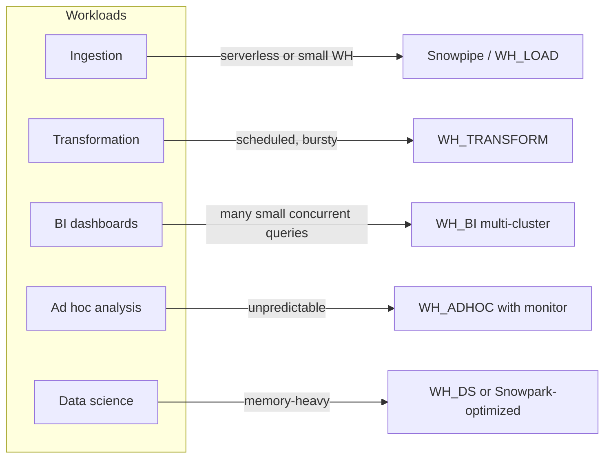
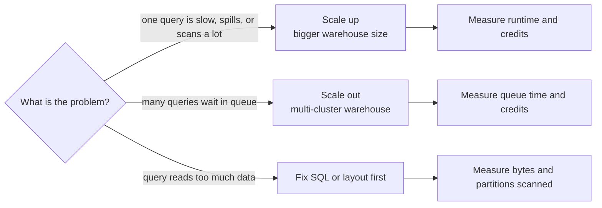
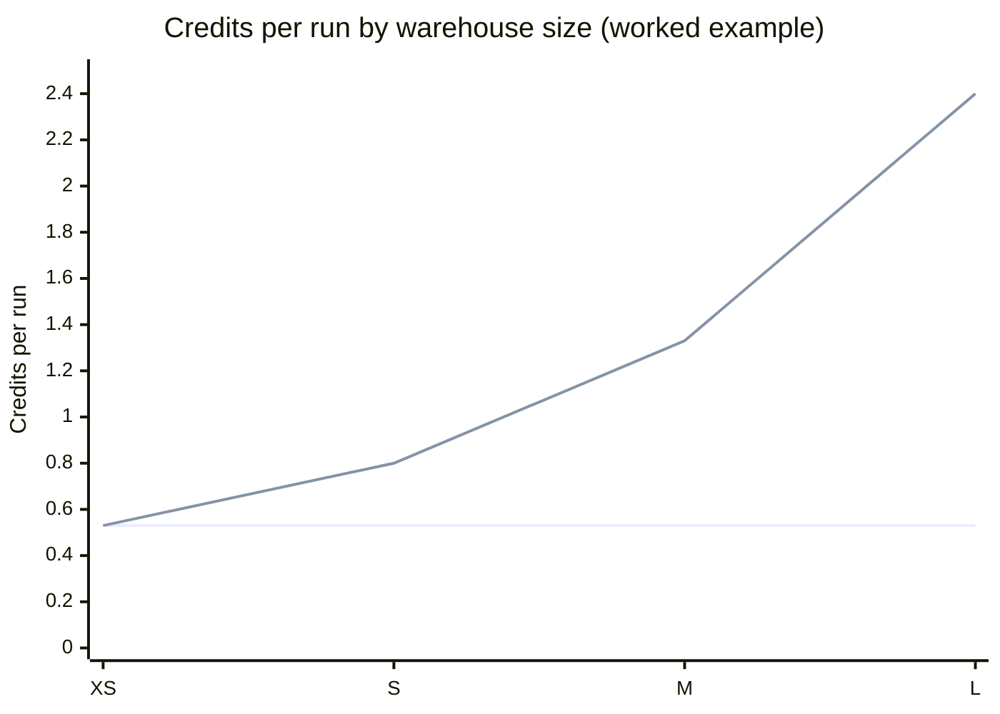
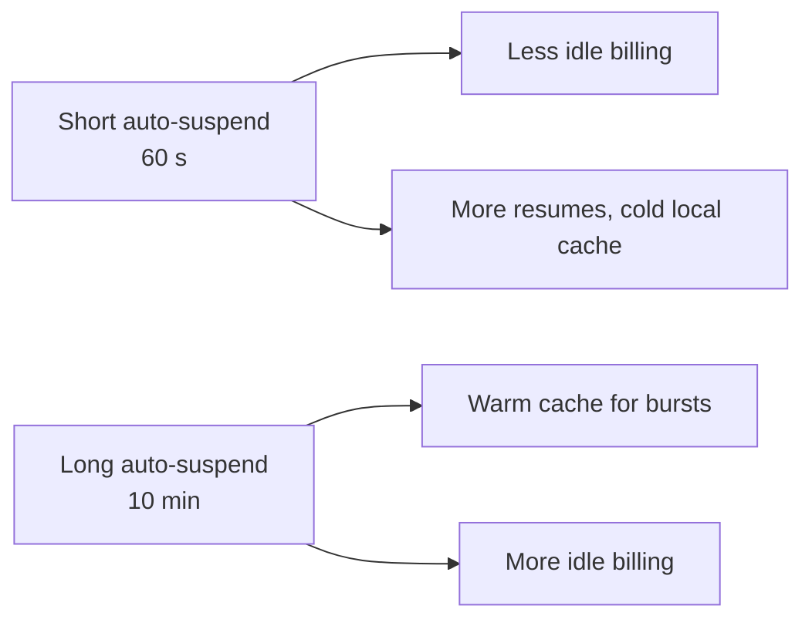

# Compute, Workloads, and Cost Architecture

## Workload Classes Before Warehouse Count

Classify workloads by latency, concurrency, schedule, ownership, security, and service objective before choosing warehouse boundaries. Typical classes include ingestion, transformation, interactive analysis, BI serving, and administration. One warehouse per query is rarely a useful operating model; one warehouse for every workload forever may also create contention and opaque spend.



## Isolation Options

- **Shared warehouse:** simple and cost-efficient at low concurrency; risks queueing and noisy-neighbor behavior.
- **Workload-specific warehouses:** isolate ingestion, transformation, and BI; improve attribution but create more configuration and spend surfaces.
- **Multi-cluster scaling:** can address concurrency for supported configurations; it is not a fix for a single bad query.
- **Serverless feature compute:** reduces explicit sizing for selected services; usage and eligibility are feature-specific and still need attribution.

Choose boundaries based on observed contention, ownership, access control, and failure isolation. Name warehouses by purpose and owner, and standardize tags or equivalent attribution where supported.

### Scale up vs scale out



Multi-cluster warehouses are an Enterprise Edition feature. The scaling policy (`STANDARD` favors starting clusters quickly, `ECONOMY` favors keeping clusters busy) trades queueing against cost.

## Performance and Cost Are Coupled

A larger warehouse can reduce execution time for compute-bound queries but increases the cost rate. Shorter runtime may or may not reduce total spend. Queue reduction, concurrency, and one-query latency are different objectives and may require different controls.

### Worked example: does a bigger warehouse cost more?

For standard warehouses, each size step doubles the credit rate: X-Small 1, Small 2, Medium 4, Large 8, X-Large 16 credits per hour. Other warehouse types and generations have different rates; check the current consumption table.

A job takes 32 minutes on X-Small. Two scenarios:

| Size | Credits/hour | Ideal scaling: runtime | Ideal credits | Poor scaling: runtime | Poor credits |
| --- | --- | --- | --- | --- | --- |
| X-Small | 1 | 32 min | 0.53 | 32 min | 0.53 |
| Small | 2 | 16 min | 0.53 | 24 min | 0.80 |
| Medium | 4 | 8 min | 0.53 | 20 min | 1.33 |
| Large | 8 | 4 min | 0.53 | 18 min | 2.40 |



The flat line is a job that parallelizes well: a bigger size buys speed for the same credits. The rising line is a job limited by something else — a single-threaded step, skew, or waiting on a small table: a bigger size burns credits without much benefit. Measure before resizing.

Measure at least:

- execution time and queue time
- warehouse utilization and concurrency
- scanned data, partitions pruned, and spill
- credits or other usage measures by workload and owner
- freshness or latency against the service objective

Resource monitors and budgets are guardrails, not a substitute for ownership, alerts, forecast, and review. Establish thresholds and specify who responds when they trigger.

```sql
CREATE RESOURCE MONITOR rm_adhoc
  WITH CREDIT_QUOTA = 200
  FREQUENCY = MONTHLY
  START_TIMESTAMP = IMMEDIATELY
  TRIGGERS
    ON 75 PERCENT DO NOTIFY
    ON 100 PERCENT DO SUSPEND;

ALTER WAREHOUSE wh_adhoc SET RESOURCE_MONITOR = rm_adhoc;
```

Resource monitors cover warehouses; serverless features are tracked through their own usage views and budgets.

```sql
-- Credits per warehouse over the last 30 days
SELECT warehouse_name,
       SUM(credits_used) AS credits
FROM snowflake.account_usage.warehouse_metering_history
WHERE start_time >= DATEADD('day', -30, CURRENT_TIMESTAMP())
GROUP BY warehouse_name
ORDER BY credits DESC;
```

## Right-Sizing Sequence

1. Establish a representative baseline and result-correctness check.
2. Diagnose queueing versus execution bottlenecks.
3. Reduce unnecessary scans, joins, and repeated work where appropriate.
4. Test size or scaling changes against realistic concurrency.
5. Compare cost and service outcomes, including other workloads.
6. Set an owner, alert, and rollback or re-evaluation condition.

## Cache and Latency

Caches can make repeat queries look much faster than cold runs. Benchmark both realistic repeated use and first-run behavior. Do not retain expensive compute solely for cache warmth without measuring the net benefit and accounting for idle usage.

### Auto-suspend trade-off



Each resume bills at least 60 seconds. For bursty BI traffic a few minutes of auto-suspend can be cheaper than constant resume; for nightly batch, suspend quickly.

## Trade-Offs

| Decision | Benefit | Cost or risk |
| --- | --- | --- |
| Separate warehouses | Isolation, attribution, independent settings | More resources to govern; duplicated idle periods |
| Larger warehouse | More compute for eligible workloads | Higher cost rate; may not fix scans or queueing |
| Auto-suspend | Reduces idle runtime | Resume delay and cache implications |
| Multi-cluster | Concurrency elasticity | Additional usage and policy tuning |
| Serverless | Less direct sizing work | Less direct capacity control and feature-specific metering |

## Decision Checklist

- Is the service objective per-query latency, concurrency, freshness, or a mix?
- Does evidence point to queueing, scanning, compute, or spill?
- Which workload deserves isolation, and what measurable problem does it solve?
- Can usage be attributed to an owner and bounded by an alert or budget?
- How will cost and performance be rechecked as data and usage grow?