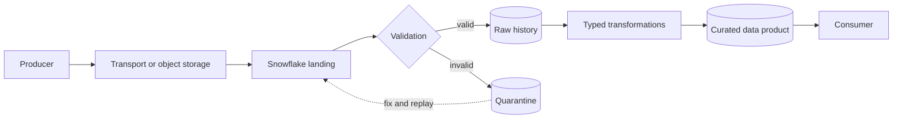
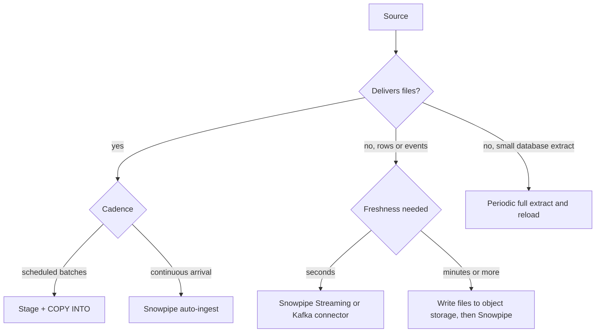
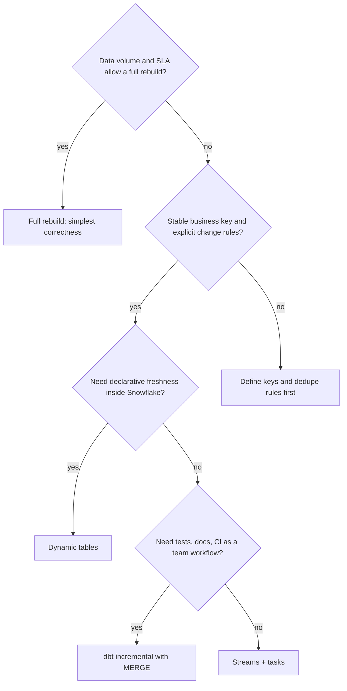
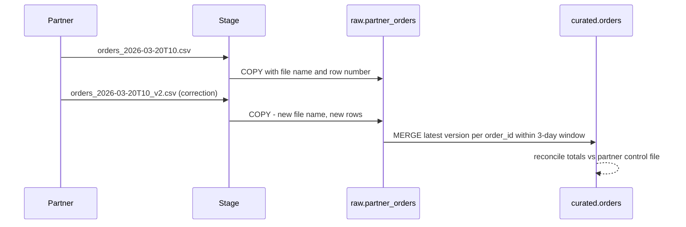

# Data Ingestion and Processing Architecture

## Define the End-to-End Contract

The ingestion design is defined by source semantics and consumer expectations, not by the availability of a Snowflake feature. Record source ownership, schema contract, delivery cadence, volume, freshness, duplicate behavior, late data, correction semantics, replay window, and downstream grain.

```text
Producer -> transport or object storage -> Snowflake landing -> validation
         -> raw history -> typed transformations -> curated data product
         -> consumer
```



Snowflake may own one or more steps, but external systems may still own extraction, event durability, orchestration, or data contracts.

## Select a Loading Pattern

| Need | Candidate | Architectural questions |
| --- | --- | --- |
| Scheduled files and clear batch boundaries | Stage plus `COPY INTO` | How are manifests, retries, and replays handled? |
| Continuous file arrival | Snowpipe | How are missed notifications, rejected files, and freshness detected? |
| Low-latency row ingestion | Snowpipe Streaming or a supported connector | Who owns offsets, ordering, producer retries, and schema evolution? |
| Cross-system workflow and dependencies | External orchestrator with Snowflake execution | Which system owns schedule, retries, and incident state? |
| Simple small dataset with relaxed freshness | Periodic batch load or full rebuild | Is the simpler design cheaper and easier to recover? |

“Real-time” is not a requirement. State a measurable end-to-end freshness objective and identify every stage contributing to it.



## Raw and Curated Contracts

Raw data is useful for traceability and replay, but it should have ownership, retention, access, and classification. Curated datasets should expose stable grain, types, keys, freshness, quality expectations, and change policy. Keeping a raw payload does not make an undocumented consumer contract safe.

## Incremental Processing Choice

Use full rebuilds when the data volume and SLA make them simple and reliable. Use `MERGE` when stable keys and explicit change handling are required. Streams and tasks provide explicit native change processing and scheduling. Dynamic tables can simplify supported declarative SQL pipelines with freshness objectives. dbt adds transformation project structure, tests, lineage, and deployment. An external orchestrator is useful when workflows cross systems.

Avoid two schedulers independently owning the same work. Assign one owner for retries, dependency state, alerting, and replay.



## Reliability and Observability

For every boundary, define:

- expected input and measurable completeness
- idempotency key and replay procedure
- schema validation and quarantine behavior
- freshness and quality metrics
- owner and alert path
- behavior on partial failure
- retained evidence for reconciliation

### Worked scenario: partner files with corrections

A partner drops CSV files hourly. Files can be re-sent with corrections for the last 3 days. Consumers need hourly freshness and exact totals.



Key decisions: keep every file version in raw, choose the latest version per business key in curated, and reprocess a rolling 3-day window so corrections are applied idempotently.

## Trade-Offs

- Lower latency often increases component count, event semantics, and operational burden.
- Flexible raw storage improves replay but can defer schema and privacy problems.
- Native processing reduces external infrastructure but may narrow orchestration flexibility.
- External tools improve cross-platform coordination but add deployments, credentials, and failure boundaries.
- Full rebuilds simplify correctness but can become expensive as data grows.

## Decision Checklist

- What are the source's change and correction semantics?
- What freshness and completeness are promised to consumers?
- What makes retry safe and replay deterministic?
- Which system owns orchestration, quality, and incident state?
- Can each data product be traced to source and validated at its intended grain?