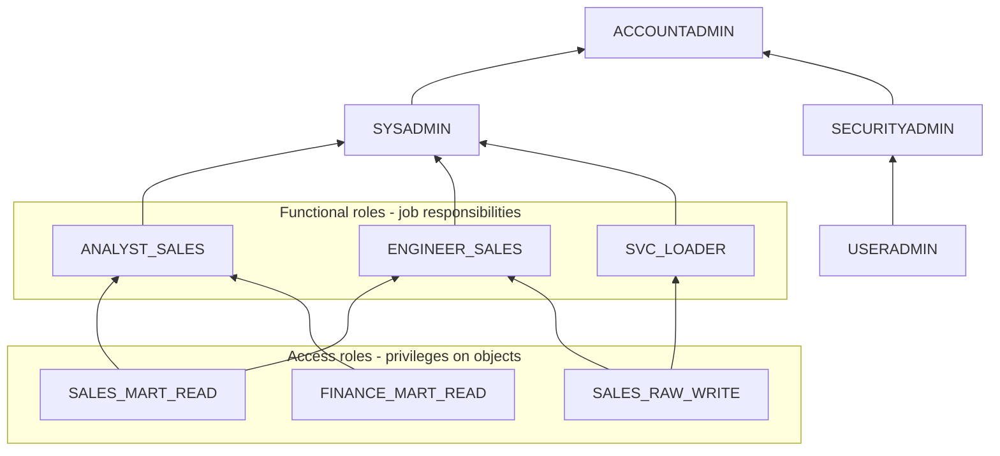
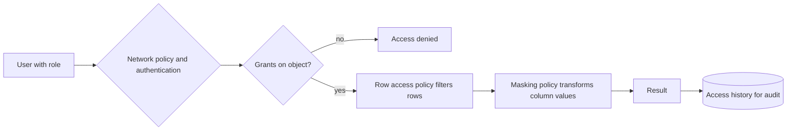
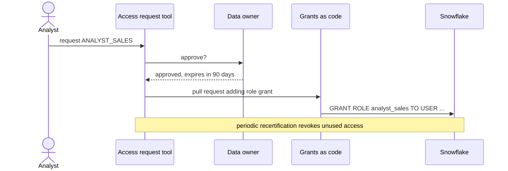

# Security and Governance Architecture

## Begin with Data and Trust Boundaries

Classify datasets and consumers before writing grants. Identify identities, operators, data owners, sensitive attributes, sharing partners, and administrative roles. Define which principals can create, read, change, share, and administer each data product.

## Role-Based Access Model

Use roles to represent job responsibilities and object ownership. Compose roles deliberately, keep administrative roles separate from daily-use roles, and grant the minimum required privileges at the narrowest sensible scope. Parent namespace usage and child object privileges are distinct. Decide how future objects receive grants and who owns grants after deployment.

Managed access schemas can centralize grant administration, which may reduce grant drift; they also require a clear release and ownership process. Test grants under real consumer roles rather than relying on an administrator session.

### Role hierarchy pattern: access roles and functional roles



Arrows point from a granted role to the role that receives it. Users get functional roles; functional roles get access roles; access roles hold object privileges. Roll custom roles up to `SYSADMIN` so administrators can manage the objects they create.

```sql
CREATE ROLE sales_mart_read;
GRANT USAGE ON DATABASE sales TO ROLE sales_mart_read;
GRANT USAGE ON SCHEMA sales.mart TO ROLE sales_mart_read;
GRANT SELECT ON ALL TABLES IN SCHEMA sales.mart TO ROLE sales_mart_read;
GRANT SELECT ON FUTURE TABLES IN SCHEMA sales.mart TO ROLE sales_mart_read;

CREATE ROLE analyst_sales;
GRANT ROLE sales_mart_read TO ROLE analyst_sales;
GRANT USAGE ON WAREHOUSE wh_bi TO ROLE analyst_sales;
GRANT ROLE analyst_sales TO ROLE sysadmin;
```

## Policy Layers

- **Secure views:** curated access interface and selected view protections.
- **Masking policies:** govern sensitive column values based on policy context.
- **Row access policies:** constrain visible rows.
- **Tags and classification:** make sensitivity and ownership discoverable.
- **Audit and access history:** support investigation and evidence.

These controls solve different problems and may be combined. Do not assume one policy protects paths through clones, exports, stages, other views, or broader grants.

For a complete implementation walkthrough combining a secure view, masking policy, and row access policy, see [Security Views](../deep-dives/02_security_views.md).



### Example: tag-based masking and row access

```sql
CREATE MASKING POLICY governance.mask_email AS (val STRING) RETURNS STRING ->
  CASE WHEN IS_ROLE_IN_SESSION('PII_READER') THEN val
       ELSE REGEXP_REPLACE(val, '.+@', '***@')
  END;

CREATE TAG governance.pii;
ALTER TAG governance.pii SET MASKING POLICY governance.mask_email;
ALTER TABLE sales.mart.customers MODIFY COLUMN email SET TAG governance.pii = 'email';

CREATE ROW ACCESS POLICY governance.region_filter AS (row_region STRING) RETURNS BOOLEAN ->
  EXISTS (
    SELECT 1 FROM governance.region_entitlements e
    WHERE e.role_name = CURRENT_ROLE() AND e.region = row_region
  );

ALTER TABLE sales.mart.orders ADD ROW ACCESS POLICY governance.region_filter ON (region);
```

Masking, row access, and tag-based policies require Enterprise Edition or higher. Test each policy under every consumer role, including roles that query through views.

## Identity and Integrations

Separate human and service identities. Prefer supported federation or key-based methods with controlled rotation over embedded credentials. Scope external storage integrations narrowly. Network policies and private connectivity can reduce exposure but may complicate developers, automation, and failover; validate actual client paths and operational support.

## Governance Operating Model

Policies need owners, review cadence, test data, exception process, and change control. Data classification should connect to grants, masking, retention, and sharing. Lineage without ownership or incident procedures is descriptive metadata, not governance by itself.



## Trade-Offs

- Central policy improves consistency but can slow teams without a clear self-service path.
- Domain ownership improves accountability but needs shared naming, classification, and review standards.
- Fine-grained controls reduce exposure but increase testing, policy-debugging, and support effort.
- Strong network isolation narrows attack paths but can hinder integrations and recovery if untested.

## Decision Checklist

- What data classifications and consumers exist?
- Which roles own data and which roles consume it?
- Are grants for existing and future objects intentional?
- Are sensitive fields protected at every access path?
- Can a consumer's permissions be tested automatically and audited?
- Who owns exceptions, policy changes, and periodic recertification?