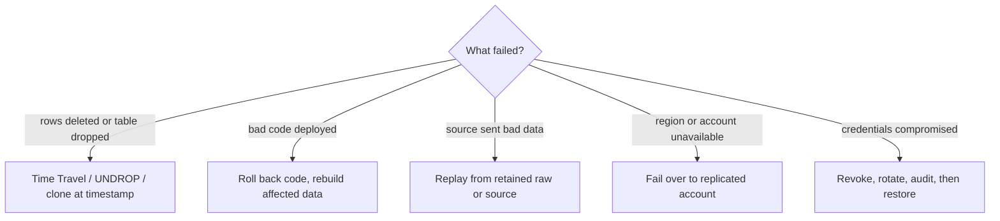
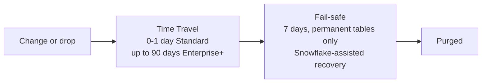
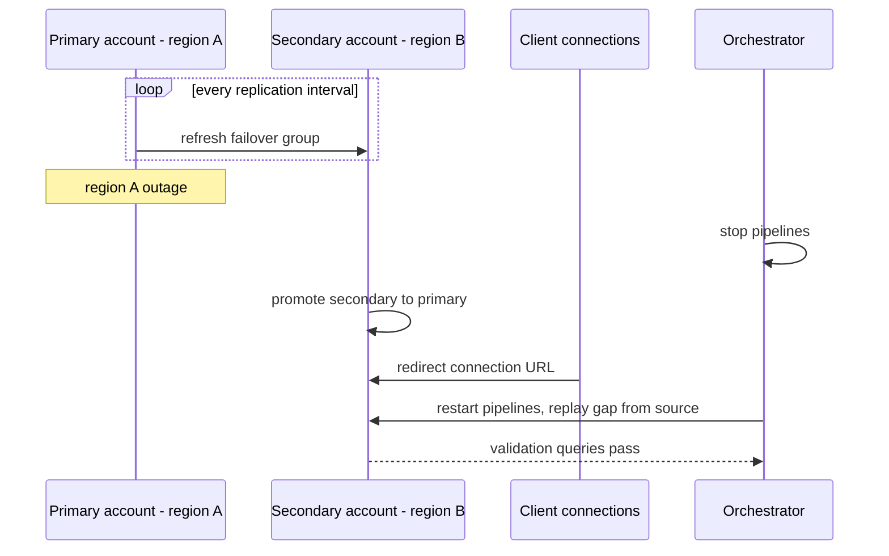

# Availability and Recovery Architecture

## Separate Failure Scenarios

Design recovery by failure class rather than by a feature name:

| Failure | Candidate control | Important boundary |
| --- | --- | --- |
| Accidental DML or DDL | Time Travel, `UNDROP`, restore procedure | Retention and object eligibility |
| Bad deployment | Versioned changes, clone/test, rollback or forward fix | Code rollback may not reverse data side effects |
| Source corruption | Source replay, retained raw data, reconciliation | Warehouse recovery cannot reconstruct data never retained |
| Account or regional disruption | Replication/failover pattern where supported | Application, identity, integrations, and consumer cutover also matter |
| Credential or operator incident | Identity controls, audit, access revocation | Data availability and security response can conflict |



## Set Objectives

Define RPO (acceptable data loss) and RTO (time to resume the service) per data product. Also define which consumers must be restored, who can authorize failover, and how correctness will be verified. “The data is replicated” is not a tested recovery objective.

## Layers of Recovery

- Retention and Time Travel help recover eligible historical states within configured windows.
- Cloning helps isolate testing and investigation but is not an independent backup boundary by itself.
- Provider Fail-safe is not a customer query interface or substitute for an operational backup plan.
- Replication and failover can support account/region continuity for supported objects and configurations.
- Source retention and deterministic transformations are needed to rebuild when platform history is insufficient.

Check current product support, edition, region pairing, object coverage, and costs before designing a recovery promise.

### Data protection timeline for a permanent table



| Table type | Time Travel | Fail-safe | Use for |
| --- | --- | --- | --- |
| Permanent | 0–90 days (edition-dependent) | 7 days | data you cannot rebuild |
| Transient | 0–1 day | none | rebuildable staging, cheaper storage |
| Temporary | 0–1 day, session only | none | session scratch work |

### Examples

```sql
-- Query the table as it was one hour ago
SELECT * FROM sales.mart.orders AT (OFFSET => -3600);

-- Restore a pre-incident copy next to the damaged table
CREATE TABLE sales.mart.orders_restored
  CLONE sales.mart.orders BEFORE (STATEMENT => '<query_id_of_bad_delete>');

-- Recover a dropped table
UNDROP TABLE sales.mart.orders;
```

## Failover Is a System Workflow

A regional failover runbook should include replication health, promotion authority, role and integration readiness, application connection changes, orchestration restart, consumer communication, validation queries, and failback criteria. Test this in a controlled environment and record actual elapsed time.



Account failover with failover groups and client redirect requires Business Critical Edition or higher; database and share replication are available more broadly. RPO is roughly the replication interval plus any un-replayable source gap.

```mermaid
gantt
    title Illustrative regional failover timeline
    dateFormat HH:mm
    axisFormat %H:%M
    section Data
    Last successful replication :milestone, 09:50, 0m
    Outage begins               :crit, 10:00, 5m
    section Response
    Detect and decide           :10:05, 15m
    Promote secondary           :10:20, 5m
    Redirect clients            :10:25, 5m
    Replay gap and validate     :10:30, 30m
```



In this example RPO before replay is about 10 minutes and RTO is about 60 minutes. Measure both in drills.

## Trade-Offs

- Longer retention improves the recovery window but can increase storage cost and sensitive-data persistence.
- Replication can reduce recovery time but adds cost, lag, configuration, and failover complexity.
- Separate recovery accounts improve isolation but make identity, grants, and deployment more complex.
- Rebuild from source may be cheaper than continuous replication but takes longer and depends on source availability.

## Decision Checklist

- Which failures are in scope and which are not?
- What are the RPO and RTO for each consumer-facing data product?
- Which objects, identities, integrations, and applications must be available after failover?
- Can the recovery path be demonstrated with evidence and measured time?
- How are raw data, source replay, and irreversible side effects handled?
- Who approves, performs, validates, and communicates recovery?