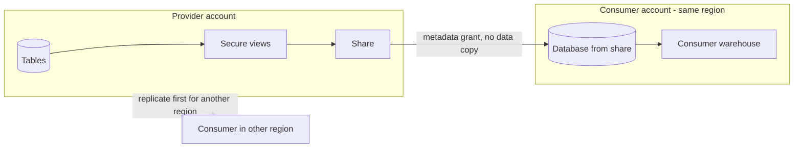
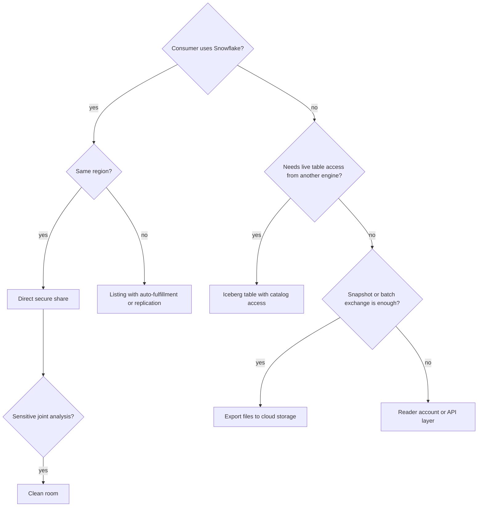
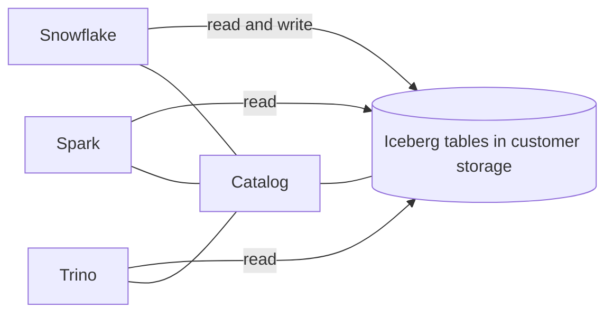

# Sharing and Interoperability Architecture

## Data Products Across Boundaries

Sharing is a provider-consumer contract. Define the dataset, grain, freshness, schema-change policy, support owner, access scope, permitted use, and removal process before selecting a Snowflake sharing feature.

## Common Patterns

- **Secure Data Sharing:** expose governed data to Snowflake consumers without a conventional consumer-managed file-copy pipeline.
- **Listings or Marketplace:** publish discoverable data or applications under supported distribution models.
- **Reader patterns:** provide access for consumers who do not operate the same kind of account relationship; validate current supported model.
- **External tables and Iceberg:** interoperate with data stored or cataloged outside ordinary Snowflake-managed tables.
- **Export and cloud storage:** publish files for consumers using other engines, with explicit lifecycle and access controls.
- **Clean-room collaboration:** analyze across parties under defined privacy and output controls.

Exact feature support and commercial/region constraints evolve. Check current product documentation and legal requirements.

### Secure Data Sharing: no copy, shared storage



The consumer pays for its own compute; the provider pays for storage. Cross-region or cross-cloud consumers need replication or listings with auto-fulfillment.

```sql
CREATE SHARE sales_share;
GRANT USAGE ON DATABASE sales TO SHARE sales_share;
GRANT USAGE ON SCHEMA sales.published TO SHARE sales_share;
GRANT SELECT ON VIEW sales.published.v_daily_revenue TO SHARE sales_share;
ALTER SHARE sales_share ADD ACCOUNTS = partner_org.partner_account;
```

## Choosing the Boundary

| Need | Candidate | Trade-off |
| --- | --- | --- |
| Governed Snowflake-to-Snowflake access with minimal copying | Secure sharing | Consumer experience and provider availability are coupled to shared contract |
| Broad discovery or packaged distribution | Listing/Marketplace | Requires publishing, support, lifecycle, and commercial processes |
| Cross-engine open-table access | Iceberg or external storage/catalog pattern | Adds catalog, metadata, IAM, and consistency ownership |
| Portable snapshot or batch exchange | Exported files | Copies create freshness, privacy, retention, and reconciliation work |
| Joint analysis of sensitive data | Clean-room pattern where available | Requires careful identity, query, output, and legal governance |



### Interoperability through Iceberg



The catalog decides who owns table metadata. See the [Iceberg and external tables deep dive](../deep-dives/iceberg-and-external-tables/README.md).

## Interoperability Questions

- Which system is authoritative for table metadata and schema evolution?
- Is data shared by reference, replicated, or copied into files?
- What freshness and consistency semantics does the consumer observe?
- Who manages identity, cloud permissions, and incident response?
- Can the consumer access all required regions and formats?
- How are contracts versioned and retired?

## Trade-Offs

Sharing by reference can reduce copy pipelines and duplicate storage, but creates stronger dependency on provider availability and contract management. Open formats improve engine choice, but metadata catalogs, permissions, compaction, and concurrent writes require clear ownership. File exchange is broadly compatible but creates duplicate lifecycle and lineage responsibilities.

## Decision Checklist

- Which consumer capability and service objective must be met?
- Is minimizing copies more important than decoupling provider and consumer lifecycles?
- Who owns schema compatibility, support, security, and revocation?
- What data residency or commercial constraints apply?
- How will freshness, correctness, and access be demonstrated end to end?