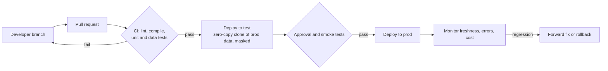
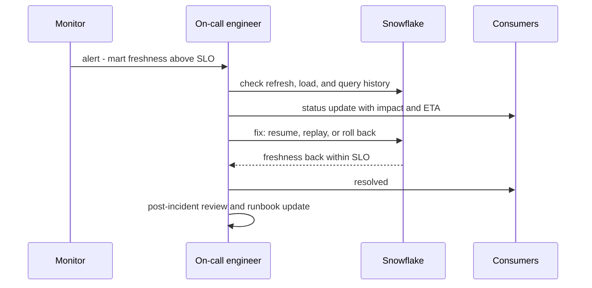

# Operations and Lifecycle Architecture

## Treat Account Changes as Deployments

Snowflake environments contain both data and control-plane objects: roles, grants, warehouses, integrations, policies, schemas, tasks, and application objects. A deployment process should identify which are source-controlled, how secrets are injected, how changes are reviewed, and how rollback or forward-fix behavior works.

## Environment Promotion

Possible patterns include separate accounts, separate databases/schemas, or a hybrid. Promote reviewed code and configuration; do not assume production data should be copied into every environment. If clones are used for realistic tests, define masking, access, retention, and cleanup.

## CI/CD and Infrastructure as Code

Use version control, code review, validation, controlled identities, and repeatable deployment. Terraform or other infrastructure-as-code tools can manage supported resources, but provider coverage and state behavior must be checked. SQL migrations, dbt projects, and account-level configuration may have distinct deployment lifecycles.

| Layer | Typical tool | Changes how often | Rollback |
| --- | --- | --- | --- |
| Account objects: warehouses, roles, integrations | Terraform | rarely | revert and apply |
| Grants and policies | Terraform or SQL migrations | weekly | revert, verify with role tests |
| Schemas and tables | SQL migrations, `CREATE OR ALTER` | per feature | forward fix; data changes are not reverted by code |
| Transformations | dbt, dynamic table DDL | daily | revert code, rebuild affected data |

## Observability and Ownership

For each workload, define:

- service owner and consumer
- freshness, correctness, and availability objectives
- query/load/task monitoring and alert destination
- cost attribution and budget response
- runbook, recovery procedure, and escalation
- change history and schema compatibility policy

## Operational Maturity Path

1. **Ad hoc:** individuals run queries; ownership and cost attribution are unclear.
2. **Repeatable:** code is versioned, workloads have owners, and failures are visible.
3. **Controlled:** deployment, grants, tests, and cost guardrails are automated.
4. **Resilient:** recovery and incident procedures are tested; SLOs and dependencies are explicit.
5. **Optimized:** usage data informs workload placement and continuous cost/performance decisions.

### Incident flow

## Trade-Offs

- More automation reduces manual drift but requires secure deployment identities and platform expertise.
- More account separation improves boundaries but multiplies configuration and operational work.
- More testing improves confidence but requires representative fixtures and controlled data.
- Central platform standards enable consistency but must preserve a practical domain-team path.

## Decision Checklist

- Which objects and data transformations are version-controlled?
- How are secrets and service identities handled in CI/CD?
- How do grants and policies get tested before production?
- Who owns freshness, cost, quality, incidents, and consumer communication?
- What is the safe recovery path for failed code and failed data changes?
- Which operating controls should be automated now, and which can wait for evidence?