# Data Platform Architecture — System Design (Senior Guide)

This guide walks through a production-shaped event platform built around Kafka, object storage, Snowflake, and dbt. Use it for system-design practice, architecture reviews, and interview preparation.

**How to read the numbers:** every figure below — file sizes, latencies, volumes, compression ratios — is a starting assumption for reasoning, not a benchmark. Replace it with measurements from your workload before making a production decision.

**Last verified against Snowflake documentation:** 2026-11-09 (Snowpipe Streaming channel semantics, dynamic table refresh modes). Feature availability varies by edition, cloud, region, and release.

Related material:

- [Data ingestion and processing architecture](03_data_ingestion_processing.md)
- [Compute, workloads, and cost](02_compute_workload_cost.md)
- [Non-functional requirements](Non_functional_requirements_NFR.md)
- [Dynamic tables deep dive](../deep-dives/Snowflake_dynamic_tables.md)
- [Query performance track](../deep-dives/query-performance/README.md)

---

## 1. Problem Statement

Design a data platform handling:

- 1B–5B events per day
- near-real-time + batch analytics
- multiple consumers (BI, ML, product)
- replay and backfills
- schema evolution

### 1.1 Make the assumptions explicit

A senior answer starts by turning vague requirements into numbers that can be challenged.

| Dimension | Assumption for this guide | Why it matters |
| --- | --- | --- |
| Volume | 1B–5B events/day | Drives file count, ingest cost, and table size |
| Average event size | ~1 KB JSON | Drives bytes ingested and storage |
| Peak factor | 3× average | Sizing must survive peaks, not averages |
| Hot freshness SLA | < 5 min for a few operational dashboards | Decides whether a streaming path is needed at all |
| Batch freshness SLA | hourly / daily for most marts | Most data does not need a hot path |
| Replay window | 90 days fully, 2 years for audit | Decides where long-term raw data lives |
| Consumers | BI, ML features, product APIs | Each needs a stable contract and its own compute boundary |
| Late data | up to 72 h | Decides incremental lookback windows |
| Duplicates | producers retry, so at-least-once | Every layer must tolerate duplicates |

### 1.2 Back-of-envelope sizing

```text
5B events/day / 86,400 s        ≈ 58,000 events/s average
peak 3x                         ≈ 175,000 events/s
5B × 1 KB                       ≈ 5 TB/day uncompressed
Parquet compression 5–10x       ≈ 0.5–1 TB/day in object storage
1 TB/day / ~200 MB per file     ≈ 5,000 files/day ≈ 3–4 files/min
```

The last line hides a trap: those files are spread across domains and time partitions. A low-volume domain that flushes every minute produces many tiny files. File size, flush interval, and partition granularity must be chosen together.

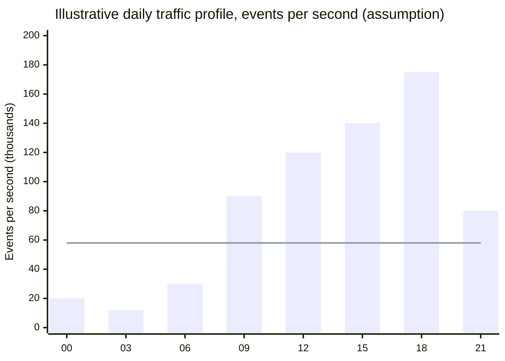

The bars are an assumed diurnal shape; the line is the daily average. Capacity and freshness tests must use the peak, not the average.

---

## 2. High-Level Architecture

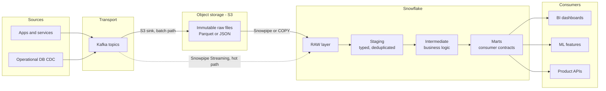

Solid arrows are the default batch path. The dashed arrow is an optional hot path, added only for tables with a real low-latency SLA.

### 2.1 Responsibility boundaries

| Component | Owns | Does not own |
| --- | --- | --- |
| Kafka | Durable transport, ordering per partition, short-term replay | Long-term history, analytics |
| S3 raw bucket | Long-term immutable history, cross-engine access | Query serving, schema enforcement |
| Snowpipe / COPY | File loading, file-level load history | Business deduplication, contracts |
| Snowpipe Streaming | Row-level low-latency ingestion | Long-term replay archive |
| Snowflake RAW | Queryable copy of source truth plus load metadata | Cleaned business entities |
| dbt / dynamic tables | Typed, tested, documented transformations | Transport and file delivery |
| Orchestrator | Batch schedules, retries, backfills, dependency state | Continuous ingestion |

---

## 3. Key Design Principles

### 1. Separation of concerns
- transport → Kafka
- storage → S3
- compute → Snowflake
- transform → dbt

**Why:** each layer can fail, scale, and be replaced independently.
**Cost:** more components, credentials, and failure boundaries to operate.

### 2. Immutable raw layer
- never edit raw content in place
- supports replay
- supports debugging and audit

**Nuance:** "immutable" means raw rows are not rewritten to fix business logic. Controlled operations — gap-filling replays, retention purges, legal deletion — still happen, but through audited, repeatable procedures.

### 3. Replayability
- Kafka → short-term replay (bounded by topic retention)
- S3 → long-term replay (bounded by lifecycle policy)
- Snowflake Time Travel → recent table-state recovery, not a replay archive

### 4. Cost vs latency trade-off
- set freshness per data product, not per platform
- streaming is justified by a measured SLA, not by preference
- the cheapest pipeline is the one that meets the SLA with the fewest moving parts

Streaming is not automatically more expensive per GB; the total cost depends on billing model, volume, transformation cadence, and operations. Compare the full path — ingest, transform, serve, and on-call — for both options.

### 5. Observability first
- every boundary has a completeness and freshness signal
- every failure lands somewhere visible: reject table, DLQ, quarantine, alert
- no silent failures

### 6. Idempotency everywhere
- the same input processed twice must produce the same result
- deduplication keys are designed, not discovered during an incident

### 7. Contracts at the consumer boundary
- marts expose grain, keys, types, freshness, and change policy
- raw and staging are internal; consumers never depend on them directly

---

## 4. Ingestion Layer Design

### Option A — Kafka → S3 → Snowpipe/COPY (recommended default)

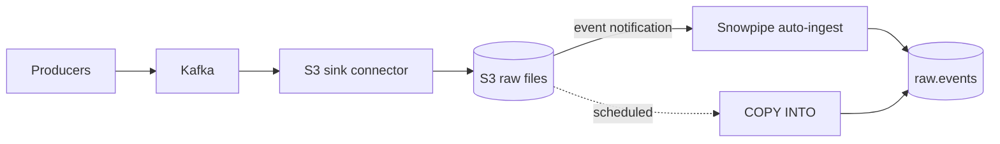

Pros:
- files are a natural, inspectable replay unit
- cheap long-term history, readable by other engines
- Snowflake outages or changes do not stop Kafka consumption
- file-level load history prevents accidental double loading

Cons:
- minutes of latency: flush interval + notification + load
- small-file risk for low-volume topics
- one more connector and bucket to secure and monitor

### Option B — Kafka → Snowpipe Streaming (direct)

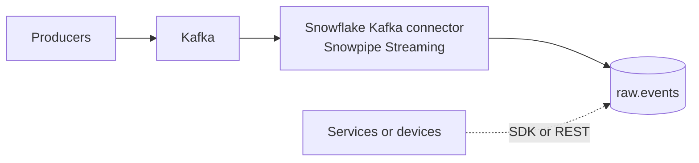

Pros:
- seconds of latency; Snowflake documents ingest-to-queryable latency as low as ~5 s, workload-dependent
- no intermediate files or bucket to manage
- ordered, exactly-once ingestion per channel is possible with offset-tracked channels

Cons:
- replay depends on Kafka retention or a separate archive
- delivery semantics depend on channel type (see table below)
- no file artifact to inspect; debugging uses telemetry and error tables

### Option C — Hybrid: stream the hot path, archive everything

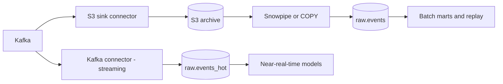

Pros:
- low latency where needed and long replay everywhere
- the archive survives connector or table mistakes

Cons:
- two ingestion paths to reconcile; they may disagree temporarily
- higher operational load; requires a clear source-of-truth rule

### Snowpipe Streaming delivery semantics

| Channel type | Ordering | Delivery | Typical use |
| --- | --- | --- | --- |
| Named channels (offset tokens) | Ordered within a channel | Exactly-once within a channel when offsets are managed correctly | Kafka partitions, CDC |
| Elastic channels | No ordering guarantee | At-least-once | Telemetry, IoT, many independent producers |

At-least-once means downstream deduplication by `event_id` is mandatory. Exactly-once ingestion does not remove duplicates that a producer created before Kafka.

### Option comparison

| Criterion | A: Kafka → S3 → Snowpipe | B: Snowpipe Streaming | C: Hybrid |
| --- | --- | --- | --- |
| Freshness | minutes | seconds | seconds (hot) + minutes (archive) |
| Long replay | strong (files) | limited by Kafka retention | strong |
| Multi-engine access to raw | yes | only via Snowflake or Iceberg tables | yes |
| Moving parts | medium | low–medium | high |
| Debuggability | inspect files | telemetry and error tables | both |
| Good default for | most event analytics | latency-critical tables | large platforms with mixed SLAs |

### Decision flow

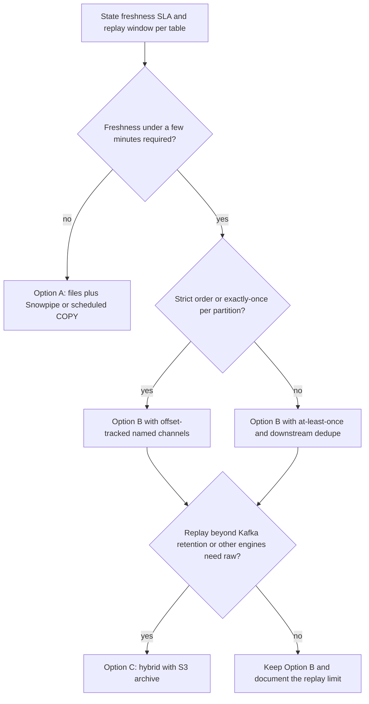

### Decision rule

- Default to Option A.
- Promote individual tables to a streaming path only when their SLA requires it.
- If a streaming table also needs long replay or multi-engine access, add an archive (Option C) instead of giving up replay.

---

## 5. Data Layout (S3)

Example:

    s3://company-raw/events/
      domain=orders/dt=2026-03-20/hour=10/part-00042-<uuid>.parquet
      domain=users/dt=2026-03-20/hour=10/part-00007-<uuid>.parquet
      _manifests/domain=orders/dt=2026-03-20/hour=10.json

Best practices:
- partition prefixes by domain, then date, then hour only where volume justifies it
- immutable files with unique names; never overwrite a key
- write a manifest (file list, row counts) per completed window for reconciliation
- lifecycle rules per prefix for retention and storage tiers
- avoid random folder structures

### 5.1 What S3 partitioning does and does not do

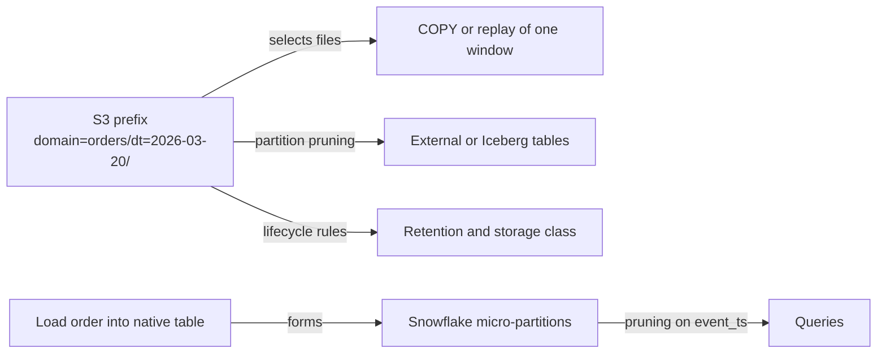

- S3 prefixes help select files for loading or replay, prune external/Iceberg tables, and apply lifecycle rules.
- Native Snowflake tables do **not** inherit S3 folder partitions. Micro-partitions are formed from the order in which data is loaded.
- Loading in time order usually gives good natural clustering on time columns. Late-arriving data and backfills degrade it; measure pruning before adding a clustering key.

### 5.2 File sizing

Snowflake's general loading guidance is roughly 100–250 MB compressed per file. Treat it as a starting point:

| Situation | Consequence | Mitigation |
| --- | --- | --- |
| Many tiny files | per-file overhead, more notifications, more load metadata | flush by size *or* time, coarser partitions for small domains |
| Very large files | less load parallelism, larger retry unit | split files at the writer |
| Tight freshness SLA | smaller files are unavoidable | accept overhead or move that table to streaming |

---

## 6. Raw Layer Design (Snowflake)

Example table:

```sql
CREATE TABLE IF NOT EXISTS raw.events (
    event_id        STRING        NOT NULL,  -- producer-generated idempotency key
    event_type      STRING,
    user_id         STRING,
    event_ts        TIMESTAMP_TZ,            -- source event time, timezone preserved
    event_date      DATE,                    -- derived for pruning and replay windows
    payload         VARIANT,                 -- full original payload
    schema_version  STRING,
    src_filename    STRING,
    src_file_row    NUMBER,
    load_batch_id   STRING,
    loaded_at       TIMESTAMP_LTZ DEFAULT CURRENT_TIMESTAMP()
);
```

Loading with file metadata:

```sql
CREATE PIPE raw.events_orders_pipe
  AUTO_INGEST = TRUE
AS
COPY INTO raw.events (
    event_id, event_type, user_id, event_ts, event_date,
    payload, schema_version, src_filename, src_file_row
)
FROM (
    SELECT
        $1:event_id::STRING,
        $1:event_type::STRING,
        $1:user_id::STRING,
        $1:event_ts::TIMESTAMP_TZ,
        TO_DATE($1:event_ts::TIMESTAMP_TZ),
        $1,
        $1:schema_version::STRING,
        METADATA$FILENAME,
        METADATA$FILE_ROW_NUMBER
    FROM @raw.events_stage/domain=orders/
)
FILE_FORMAT = (TYPE = PARQUET);
```

Key rules:
- minimal transformations: extract only keys needed for pruning, dedupe, and routing
- keep the full payload so new fields are never lost
- keep load metadata to trace any row back to its file or channel
- primary keys are not enforced in Snowflake; deduplication is a pipeline responsibility
- streaming-ingested rows have no file name; record channel/offset or ingest metadata instead

### 6.1 Snowpipe auto-ingest flow

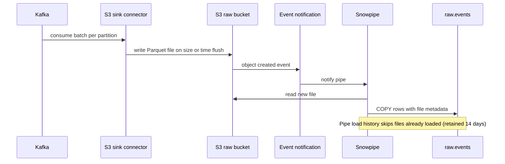

---

## 7. Handling 1B–5B Events/Day

### Key challenges

| Challenge | Symptom | Evidence to collect | First mitigation |
| --- | --- | --- | --- |
| Ingestion throughput | growing Kafka lag, rising load latency | consumer lag, pipe status, load history | scale connector tasks, fix file sizing |
| Cost explosion | credits grow faster than data | metering by warehouse/service, refresh history | incremental models, workload isolation, SLA review |
| Skew | one join or window step dominates runtime | Query Profile operator time, partition sizes | salting, pre-aggregation, isolate hot keys |
| Query performance | dashboards slow, high bytes scanned | partitions scanned vs total, spill | time-range predicates, typed projections, clustering only with evidence |
| Backfills | backfill starves daily pipelines | queueing on shared warehouse | dedicated backfill warehouse and windowed jobs |
| Late data | totals change after publishing | event_ts vs loaded_at distribution | lookback windows, published restatement policy |

### Solutions

#### 1. Micro-batching
- group events into files flushed by size or time
- start near 100–250 MB compressed; reduce only when freshness requires it

#### 2. Time-ordered loading and time predicates
- load in roughly event-time order so micro-partitions align with time
- query with range predicates on `event_ts` or `event_date`
- add a clustering key only when pruning evidence and query value justify its ongoing cost

#### 3. Domain separation

| Design | Benefit | Cost |
| --- | --- | --- |
| One wide `raw.events` table | one pipeline, simple replay | mixed payloads, broad scans if not filtered by type |
| Table per domain/event type | narrower scans, independent ownership and retention | more objects, pipes, and grants to govern |
| Raw shared, staging per domain | simple ingest, clean consumer models | duplication between raw and staging |

The third design is a common compromise.

#### 4. Incremental processing
- dbt incremental models or dynamic tables with a lookback for late data
- avoid daily full refreshes of multi-billion-row tables
- keep a tested full-rebuild path for corrections

#### 5. Workload isolation

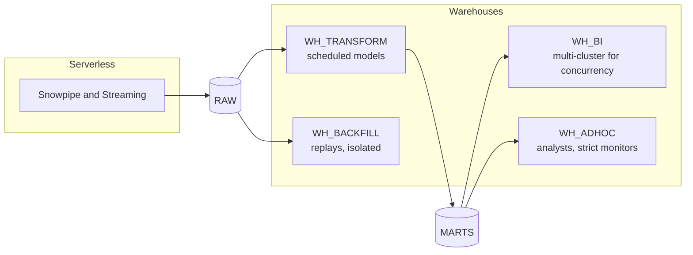

---

## 8. Micro-batching vs Streaming

| Dimension | Micro-batch files (Snowpipe / COPY) | Snowpipe Streaming |
| --- | --- | --- |
| Freshness | minutes: flush + notification + load | seconds, workload-dependent |
| Billing model | serverless file ingestion or warehouse for COPY; check current pricing | throughput-based (credits per uncompressed GB) in the high-performance architecture |
| Replay unit | files in S3 | Kafka offsets or a separate archive |
| Delivery semantics | file-level dedupe via load history; row duplicates still possible | depends on channel type |
| Table layout | batch loads form micro-partitions in load order | service-managed; pre-clustering available for tables with clustering keys |
| Debugging | inspect the file | event-table telemetry and error tables |
| Operational parts | sink connector, bucket, notifications | connector or SDK client, channel/offset handling |

### Qualitative positioning

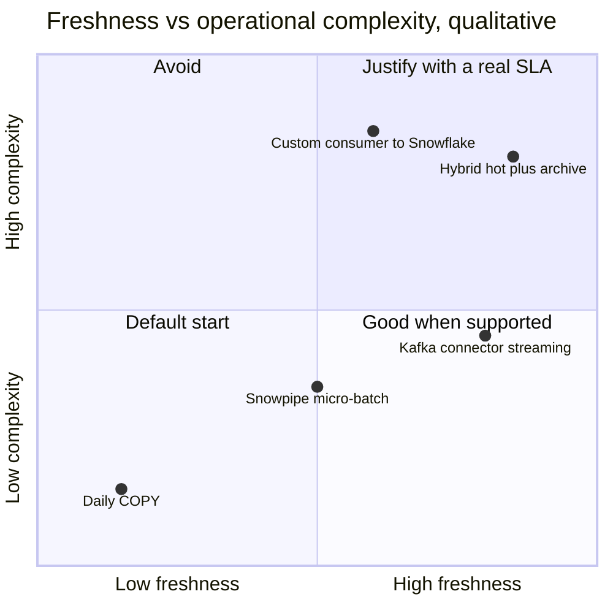

Positions are qualitative and depend on team skills and existing infrastructure.

### Freshness budget

End-to-end freshness is the sum of every stage, not just ingestion:

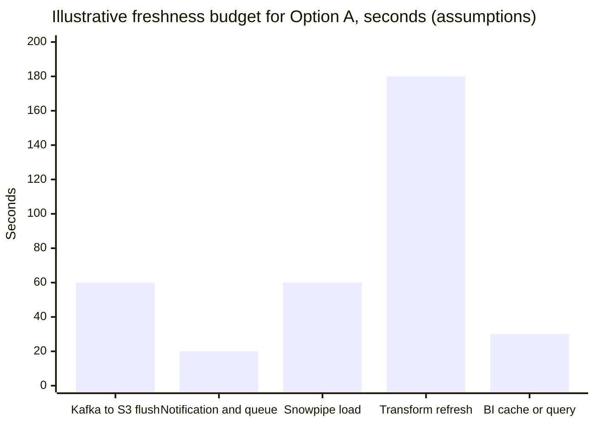

In this example the transformation cadence, not ingestion, dominates. Switching ingestion to streaming would save about two minutes but leave most of the delay in place. Measure each stage before choosing where to invest.

### Senior insight

- Streaming optimizes ingest latency; it does not fix slow transformations.
- Micro-batching optimizes simplicity, inspectability, and replay.
- Choose per table, based on the SLA and measured end-to-end freshness.

---

## 9. Replay Strategy

Must-have for large-scale systems.

| Tier | Horizon | Used for |
| --- | --- | --- |
| Kafka | hours to days (topic retention) | consumer bugs, connector restarts |
| S3 raw archive | months to years (lifecycle policy) | backfills, new models over history, audits |
| Snowflake Time Travel | short retention window | undo a bad DML or drop, not a replay archive |
| Snowflake raw tables | as retained | rebuild staging and marts without reloading files |

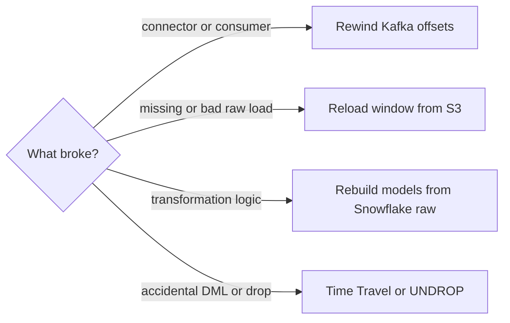

### Safe replay procedure

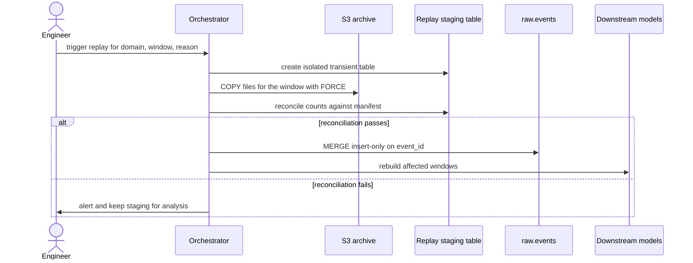

`FORCE = TRUE` reloads files even if load history says they were loaded. Used directly against `raw.events` it creates duplicates. Use it only into an isolated table:

```sql
CREATE OR REPLACE TRANSIENT TABLE raw.events_replay_orders_20260320 LIKE raw.events;

COPY INTO raw.events_replay_orders_20260320 (
    event_id, event_type, user_id, event_ts, event_date,
    payload, schema_version, src_filename, src_file_row, load_batch_id
)
FROM (
    SELECT
        $1:event_id::STRING,
        $1:event_type::STRING,
        $1:user_id::STRING,
        $1:event_ts::TIMESTAMP_TZ,
        TO_DATE($1:event_ts::TIMESTAMP_TZ),
        $1,
        $1:schema_version::STRING,
        METADATA$FILENAME,
        METADATA$FILE_ROW_NUMBER,
        'replay-orders-20260320'
    FROM @raw.events_stage/domain=orders/dt=2026-03-20/
)
FILE_FORMAT = (TYPE = PARQUET)
FORCE = TRUE;

-- Idempotent gap fill: rerunning inserts nothing new
MERGE INTO raw.events AS t
USING (
    SELECT *
    FROM raw.events_replay_orders_20260320
    QUALIFY ROW_NUMBER() OVER (PARTITION BY event_id ORDER BY src_filename, src_file_row) = 1
) AS s
    ON  t.event_id = s.event_id
    AND t.event_date = s.event_date
WHEN NOT MATCHED THEN INSERT (
    event_id, event_type, user_id, event_ts, event_date,
    payload, schema_version, src_filename, src_file_row, load_batch_id
) VALUES (
    s.event_id, s.event_type, s.user_id, s.event_ts, s.event_date,
    s.payload, s.schema_version, s.src_filename, s.src_file_row, s.load_batch_id
);
```

Notes:
- The `event_date` join condition enables pruning; it assumes the date is derived consistently.
- Insert-only gap filling does not correct changed payloads. Corrections need an explicit, audited restatement process.
- `COPY` load metadata expires after 64 days; plan replays of older files explicitly rather than relying on it.

---

## 10. Transformation Layer (dbt)

Layers:

- staging → typing, renaming, deduplication
- intermediate → business logic, sessionization, joins
- marts → consumption contracts

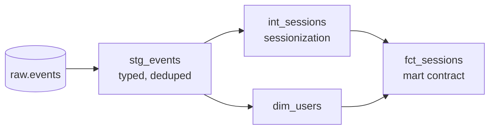

Deduplicating staging model:

```sql
SELECT
    event_id,
    event_type,
    user_id,
    event_ts,
    event_date,
    payload:device.os::STRING AS device_os
FROM raw.events
WHERE event_date >= DATEADD('day', -3, CURRENT_DATE())  -- lookback for late data
QUALIFY ROW_NUMBER() OVER (PARTITION BY event_id ORDER BY loaded_at DESC) = 1
```

### 10.1 Choosing the transformation mechanism

| Mechanism | Strength | Weakness | Fits |
| --- | --- | --- | --- |
| dbt incremental models | tests, docs, lineage, CI, explicit merge logic | needs an orchestrator; you own incremental correctness | most batch marts |
| Dynamic tables | declarative freshness via target lag, Snowflake-managed dependency graph | supported-query limits; refresh mode chosen at creation | near-real-time chains of SQL transforms |
| Streams + tasks | explicit change capture and procedural control | more code to own and monitor | custom CDC-style processing |
| Full rebuild | simplest correctness | cost grows with history | small tables, dimensions, corrections |

Dynamic tables currently document `AUTO`, `INCREMENTAL`, `FULL`, and `ADAPTIVE` refresh modes, plus custom incremental refresh for advanced cases. Set the mode explicitly in production and verify the resolved mode with `SHOW DYNAMIC TABLES`. See the [dynamic tables deep dive](../deep-dives/Snowflake_dynamic_tables.md) and the [official refresh-mode documentation](https://docs.snowflake.com/en/user-guide/dynamic-tables/refresh-modes).

---

## 11. Real-time vs Batch Layer

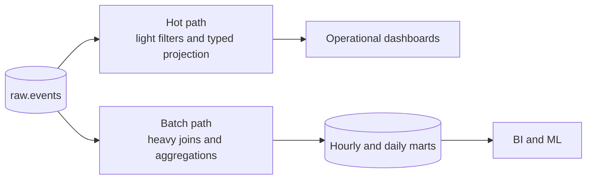

### Near-real-time

- raw + lightweight models
- example target: 1–5 min end-to-end, defined per data product
- small, append-friendly transformations

### Batch

- heavy joins
- aggregations, sessionization, slowly changing dimensions
- latency: hourly/daily

### Key rule

Do not mix heavy logic with real-time workloads. Keep hot models small and on their own compute, and let the batch layer own correctness-heavy logic.

### Reconciliation between paths

When the hot and batch paths report the same metric, define which one is authoritative and when the hot number is replaced. Show the freshness timestamp next to every near-real-time metric.

---

## 12. Data Quality Strategy

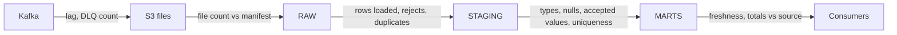

| Check | Layer | Failure action |
| --- | --- | --- |
| Ingestion audit: files expected vs loaded | RAW | alert; replay window |
| Row counts vs manifest | RAW | block downstream publish |
| Duplicate rate by `event_id` | RAW → STAGING | dedupe; alert if above baseline |
| Schema validation | STAGING | quarantine record, alert owner |
| Freshness vs SLA | MARTS | alert consumer-facing channel |
| Business reconciliation (e.g. order totals) | MARTS | stop publish, open incident |

Every check needs an owner and an action. A check that only writes to a log is not a control.

---

## 13. Schema Drift Handling

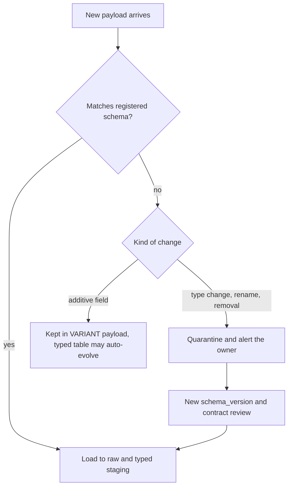

### Additive changes
- usually safe because the full payload is kept in `VARIANT`
- for typed tables, `MATCH_BY_COLUMN_NAME` plus table schema evolution can add new columns

```sql
ALTER TABLE raw.orders_typed SET ENABLE_SCHEMA_EVOLUTION = TRUE;

COPY INTO raw.orders_typed
FROM @raw.events_stage/domain=orders/
FILE_FORMAT = (TYPE = PARQUET)
MATCH_BY_COLUMN_NAME = CASE_INSENSITIVE;
```

Auto-added columns still need review: naming, types, sensitivity classification, and whether consumers should see them.

### Breaking changes
- type changes
- renamed or removed columns
- semantic changes with the same name (the most dangerous kind)

Strategy:
- VARIANT landing so nothing is lost
- quarantine for records that fail the contract
- schema versioning (`schema_version` column) and a schema registry at the producer
- contract tests in CI so breaking changes fail before production

---

## 14. Cost Optimization

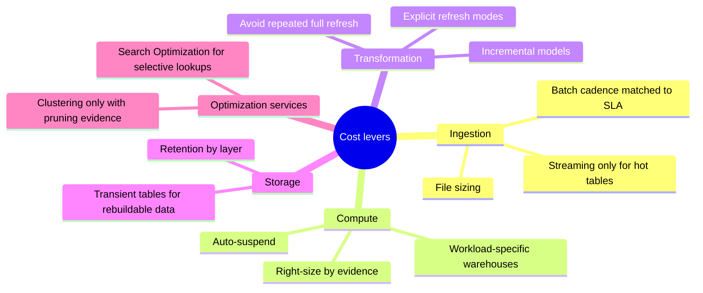

| Lever | Verify with | Hidden cost |
| --- | --- | --- |
| Micro-batching / file sizing | load history, ingest credits | higher latency |
| Incremental models | runtime and bytes scanned per run | late-data and correctness logic |
| Selective clustering | partitions scanned before/after | background reclustering credits |
| Avoid over-streaming | ingest credits vs freshness actually used | lost low-latency option |
| Separate warehouses | queueing, utilization, credits per owner | more idle time and objects to govern |
| Retention per layer | storage by table, Time Travel bytes | shorter recovery window |

---

## 15. Orchestration

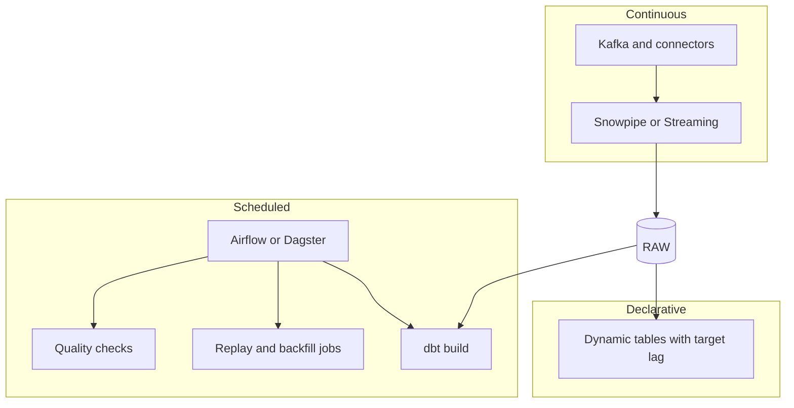

### Kafka
- streaming transport

### Airflow / Dagster
- batch orchestration
- dbt triggers
- replay and backfill jobs with parameters and audit

### Dynamic tables / tasks
- Snowflake-native scheduling for in-Snowflake work

### Important

- Airflow ≠ streaming engine.
- One owner per job: never let two schedulers trigger the same model.

---

## 16. Monitoring

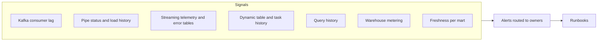

| Signal | Where to read it in Snowflake or Kafka | Example alert |
| --- | --- | --- |
| Kafka lag | consumer group metrics | lag growing for 15 min |
| Snowpipe status | `SYSTEM$PIPE_STATUS`, `COPY_HISTORY` | pending files rising, load errors |
| Streaming health | event-table telemetry, error tables | rejected rows above baseline |
| Refresh health | `DYNAMIC_TABLE_REFRESH_HISTORY`, task history | refresh failed or lag above target |
| Query performance | `QUERY_HISTORY`, Query Profile | p95 dashboard runtime regression |
| Cost | `WAREHOUSE_METERING_HISTORY`, `PIPE_USAGE_HISTORY` | daily credits above forecast |
| Freshness | max `loaded_at` / event time per mart | older than SLA |

---

## 17. Common Bottlenecks

| Bottleneck | Evidence | Fix to evaluate |
| --- | --- | --- |
| Small files | many files with low bytes per load | flush by size, coarser partitions |
| Skewed joins | one operator dominates, uneven partitions | isolate hot keys, pre-aggregate |
| Weak pruning | partitions scanned close to total for selective filters | range predicates, load order, clustering with evidence |
| Full table scans | broad `SELECT *`, function-wrapped filters | narrow contracts, predicate rewrite |
| Expensive merges | MERGE scans the whole target | add date predicate to the join, process windows |
| Remote spill | bytes spilled to remote storage | reduce data shape first, then test larger warehouse |

Use the [query performance track](../deep-dives/query-performance/README.md) for the diagnosis method.

---

## 18. Failure Modes and Runbooks

| Failure | Detection | Immediate action | Recovery |
| --- | --- | --- | --- |
| S3 notifications missed | files in S3 not in load history | `ALTER PIPE ... REFRESH` for recent files | reconcile window against manifest |
| Connector stopped | Kafka lag grows | restart connector | verify offsets and gaps |
| Breaking schema change | quarantine count spikes | notify producer owner | new schema version, replay quarantined window |
| Duplicate load | duplicate rate alert | stop downstream publish | dedupe in staging, rebuild window |
| Bad transformation deployed | reconciliation fails | roll back code | rebuild affected windows from raw |
| Accidental drop or delete | object missing, counts drop | freeze writes | Time Travel / `UNDROP`, then reconcile |
| BI queueing during backfill | queue time on BI warehouse | pause or move backfill | dedicated backfill warehouse |

---

## 19. Anti-patterns

| Anti-pattern | Why it hurts | Better |
| --- | --- | --- |
| Real-time everything | cost and complexity without consumer value | freshness per data product |
| No raw layer | cannot replay or debug | keep raw payload and load metadata |
| No replay strategy | every bug becomes data loss | documented replay tiers and procedure |
| `FORCE = TRUE` into production raw | duplicates | isolated replay table plus idempotent merge |
| Ignoring cost | surprise bills, blunt cuts later | attribution per workload and owner |
| Clustering by default | background credits without proven benefit | clustering only with pruning evidence |
| Consumers reading raw | breaking changes leak everywhere | mart contracts |
| Two schedulers for one job | duplicate or conflicting runs | single owner per job |

---

## 20. Evolution Roadmap

```mermaid
flowchart LR
    P1["Phase 1<br/>Kafka to S3, Snowpipe,<br/>raw plus dbt batch marts"] --> P2["Phase 2<br/>quality checks, monitoring,<br/>replay runbooks, cost attribution"]
    P2 --> P3["Phase 3<br/>streaming hot path<br/>for proven SLA tables"]
    P3 --> P4["Phase 4<br/>Iceberg or sharing<br/>for multi-engine consumers"]
```

Start simple and add each capability when a requirement proves it is needed.

---

## 21. Strong Interview Answer

> I would start by clarifying volume, peak, freshness per consumer, replay window, and late-data rules. By default I would use Kafka for transport, an S3 sink for immutable raw files, Snowpipe to load a raw Snowflake layer with load metadata, and dbt for typed, tested marts. Only tables with a proven low-latency SLA would get a Snowpipe Streaming hot path, with the S3 archive kept for long replay. I would make every stage idempotent with designed deduplication keys, isolate ingestion, transformation, BI, and backfill compute, and monitor lag, load errors, freshness, and credits per owner. I would validate file sizes, freshness budget, and cost with a load test before committing to the design.

---

## 22. Decision Checklist

- Which data products truly need minutes or seconds of freshness?
- What is the replay window, and which tier serves it?
- What is the deduplication key, and where is it enforced?
- How is late data handled, and when are published numbers restated?
- Which compute boundary serves each workload, and who owns its cost?
- What signal proves each stage is complete and fresh?
- What would make us revisit this design?

---

## 23. One-line Summary

Scalable data platform = explicit SLAs + decoupled ingestion + immutable replayable raw + idempotent incremental transformations + isolated compute + strong observability

---

## Official References

- [Preparing data files for loading](https://docs.snowflake.com/en/user-guide/data-load-considerations-prepare)
- [Snowpipe introduction](https://docs.snowflake.com/en/user-guide/data-load-snowpipe-intro)
- [Snowpipe Streaming overview](https://docs.snowflake.com/en/user-guide/data-load-snowpipe-streaming-overview)
- [Dynamic table refresh modes](https://docs.snowflake.com/en/user-guide/dynamic-tables/refresh-modes)
- [Table schema evolution](https://docs.snowflake.com/en/user-guide/data-load-schema-evolution)
- [Micro-partitions and data clustering](https://docs.snowflake.com/en/user-guide/tables-clustering-micropartitions)