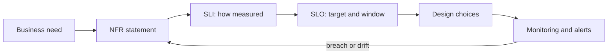
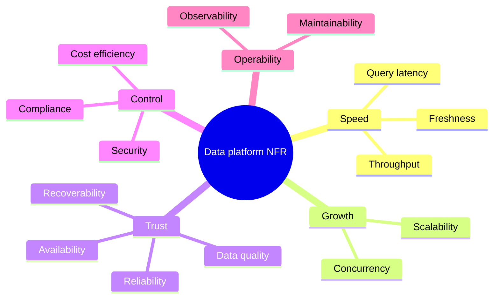
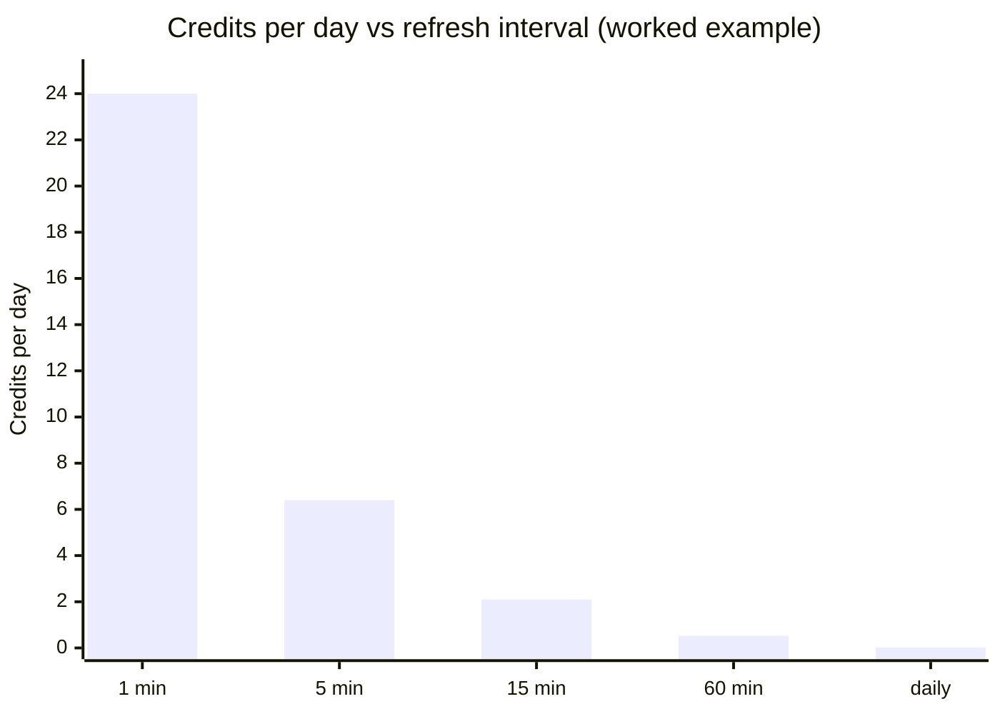
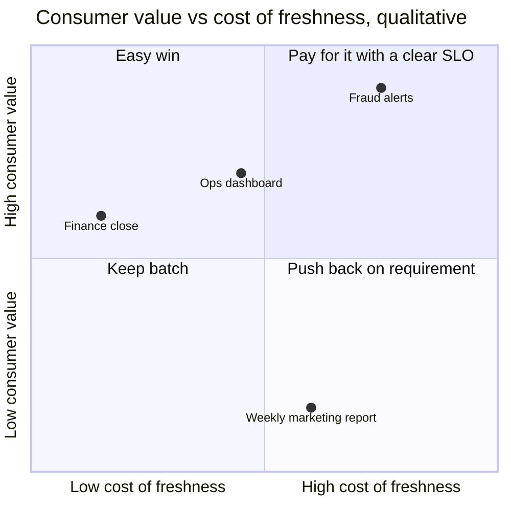
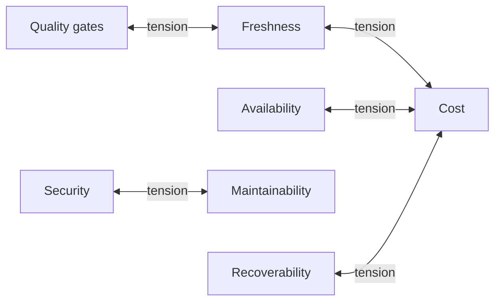
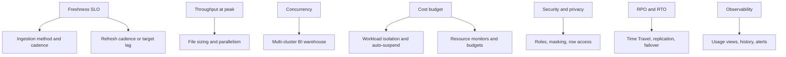
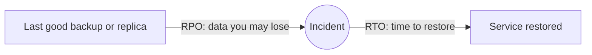

# Non-Functional Requirements (NFR) — Data Platform (Senior Guide)

This guide turns vague quality goals into measurable targets and shows how each target drives Snowflake design choices. Numbers are illustrative; replace them with your own requirements and measurements.

Related: [Data platform architecture](Data_platform_architecture.md), [Compute and cost](02_compute_workload_cost.md), [Availability and recovery](05_availability_and_recovery.md).

## 1. What are NFR?

Non-Functional Requirements define how the system behaves, not what it does.

They cover:
- performance
- scalability
- reliability
- availability
- cost
- security
- observability
- maintainability

### Interview answer

> Functional requirements define what the system should do, while non-functional requirements define how well it should do it — including performance, reliability, scalability, and cost.

### SLI, SLO, SLA

| Term | Meaning | Example |
| --- | --- | --- |
| SLI — indicator | What you measure | minutes between event time and availability in the mart |
| SLO — objective | Internal target for the SLI | 95% of hourly windows fresh within 15 min |
| SLA — agreement | Promise to a consumer, often with consequences | finance mart ready by 07:00 on business days |

An NFR without an SLI is a wish. Write each NFR so that a query or metric can prove whether it is met.

---

## 2. Key NFR Categories for Data Platforms

### 1. Latency and freshness

How fast data becomes available. For data platforms, separate two meanings:

- **freshness:** age of the newest usable data in a data product
- **query latency:** time for a consumer query to return

Examples:
- real-time: seconds
- near-real-time: minutes
- batch: hourly/daily

SLI example: `CURRENT_TIMESTAMP() - MAX(event_ts)` per mart, sampled every 5 minutes.
Snowflake levers: ingestion method, refresh cadence or dynamic table target lag, warehouse size for refresh work.

### 2. Throughput

How much data the system can handle.

Examples:
- 1B events/day ≈ 11,600 events/s average
- MB/s or GB/hour ingestion, measured at peak

SLI example: ingested GB per hour and consumer lag at peak.
Snowflake levers: file sizing, parallel loading, Snowpipe vs Snowpipe Streaming, connector task count.

### 3. Scalability

Ability to handle growth:
- more data
- more users
- more queries

SLI example: runtime and cost per run as data grows month over month.
Snowflake levers: incremental processing, pruning-friendly layout, multi-cluster warehouses for concurrency, workload isolation.

### 4. Reliability

System correctness under failures:
- no data loss
- correct processing
- retry safety (idempotency)

SLI example: reconciled rows vs source manifest, duplicate rate, failed loads.
Snowflake levers: load history, deduplication keys, `MERGE` patterns, replay procedures.

### 5. Availability

The share of time the platform can serve consumers:

| Target | Allowed downtime per 30 days |
| --- | --- |
| 99% | ~7.2 h |
| 99.9% | ~43 min |
| 99.95% | ~22 min |
| 99.99% | ~4.3 min |

Components in series multiply: three components at 99.9% give about 0.999³ ≈ 99.7% end to end. Availability of a data product depends on every upstream dependency, not only Snowflake.

Snowflake levers: replication and failover across regions or clouds (edition-dependent), client redirect, decoupled ingestion that buffers during outages.

### 6. Cost Efficiency

Cost per:
- query
- TB processed
- pipeline or data product
- business unit (attribution)

SLI example: credits per data product per day, credits per 1,000 dashboard queries.
Snowflake levers: warehouse sizing and auto-suspend, refresh cadence, resource monitors and budgets, tagging for attribution.

### 7. Observability

Ability to detect and debug issues:
- logs
- metrics
- alerts with owners
- lineage to find impact

SLI example: mean time to detect (MTTD) a missed load.
Snowflake levers: `ACCOUNT_USAGE` views, load and refresh history, event tables, alerts.

### 8. Data Quality

- accuracy
- completeness
- consistency
- uniqueness
- timeliness

SLI example: failed test count per run; share of rows quarantined.
Levers: dbt tests, data metric functions where available, quarantine tables, reconciliation jobs.

### 9. Security and compliance

- access control
- encryption
- data governance
- residency and retention rules

SLI example: number of roles with access to PII, time to revoke access, audit coverage.
Snowflake levers: role hierarchy, masking and row access policies, network policies, tags and classification, account placement by region.

### 10. Maintainability

- ease of changes
- onboarding new pipelines
- debugging

SLI example: lead time to add a new source; change failure rate.
Levers: conventions, templates, CI/CD, infrastructure as code, small reusable models.

### 11. Recoverability

- **RPO:** how much data may be lost
- **RTO:** how long until service is restored

See section 7.

---

## 3. NFR in System Design Answer

Strong senior answer ALWAYS includes NFR.

Example:

> From a non-functional perspective, I would define SLAs for latency, design for replayability to ensure reliability, separate workloads to control cost, and build observability across ingestion and transformation layers.

---

## 4. Latency vs Cost Trade-off

### Key rule

Lower latency **often** costs more, but not always and not linearly. The real question is: how much does each step of freshness cost, and is it worth it for this consumer?

### Worked example: refresh cadence on a warehouse

Assumptions, chosen to make the mechanics visible:

- X-Small standard warehouse → 1 credit per hour while running
- billing per second, with a 60-second minimum each time the warehouse resumes
- each refresh runs 20 s; `AUTO_SUSPEND = 60`
- the runtime is constant regardless of cadence (in reality, incremental runs on fewer changes may be shorter)

| Refresh interval | Runs/day | Billed time per run | Credits/day |
| --- | --- | --- | --- |
| 1 min | 1,440 | warehouse never suspends | ~24 |
| 5 min | 288 | ~80 s (20 s work + 60 s idle) | ~6.4 |
| 15 min | 96 | ~80 s | ~2.1 |
| 60 min | 24 | ~80 s | ~0.53 |
| daily | 1 | ~80 s | ~0.02 |

What the example teaches:

- Going from 60 min to 5 min costs about 12× more here; going from 5 min to 1 min another ~4×.
- Idle time after each run is a large share of the bill for short jobs. Sharing a warehouse between jobs, tuning auto-suspend, or using serverless features changes the curve.
- Freshness is only worth paying for when a consumer acts on it.

### Streaming vs batch

- Streaming ingestion lowers ingest latency; the cost model depends on the service (for example throughput-based billing for Snowpipe Streaming).
- If transformations still run hourly, streaming ingestion buys little end-to-end freshness.
- Compare total cost of the full path: ingest + transform + serve + operations.

---

## 5. NFR Conflicts

NFRs pull against each other. Name the conflict instead of hiding it.

| Improving | Can hurt | Example |
| --- | --- | --- |
| Freshness | cost, reliability | more frequent runs, less time to detect bad input |
| Availability | cost, complexity | replicated accounts, failover runbooks, double storage |
| Security | maintainability, speed of delivery | more roles and policies to test |
| Cost | freshness, recoverability | longer cadence, shorter retention |
| Data quality gates | freshness | blocking publish until checks pass |
| Flexibility (raw VARIANT) | performance, governance | late typing, harder classification |

---

## 6. From NFR to Snowflake Design

---

## 7. Recoverability: RPO and RTO

| Scenario | Mechanism | Typical RPO / RTO shape | Notes |
| --- | --- | --- | --- |
| Bad DML or accidental drop | Time Travel, `UNDROP`, clone at a timestamp | RPO near zero within retention; RTO minutes | retention depends on edition and table type |
| Bad pipeline logic | rebuild from raw | RPO zero if raw is intact; RTO = rebuild time | requires replayable raw |
| Lost raw load | reload from S3 or Kafka | RPO zero within archive window | requires archive and manifests |
| Region outage | replication and failover groups | RPO = replication interval; RTO = failover runbook time | failover is edition-dependent |
| Data lost beyond Time Travel | Fail-safe | not self-service; Snowflake-assisted | not a backup strategy |

Test recovery. An untested RTO is an assumption.

---

## 8. Example NFR Specification

For the 1B–5B events/day platform in [Data platform architecture](Data_platform_architecture.md):

| NFR | SLI | SLO | Owner |
| --- | --- | --- | --- |
| Ops freshness | minutes since newest event in `ops_mart` | 95% of 5-min samples < 5 min | platform team |
| Batch freshness | finance mart completion time | ready by 07:00 on 99% of business days | analytics engineering |
| Throughput | ingest rate at peak without lag growth | 175k events/s for 1 h | platform team |
| Correctness | raw rows vs manifest | 100% reconciled daily | platform team |
| Duplicates | duplicate `event_id` share in marts | 0 | analytics engineering |
| Dashboard latency | p95 query time on BI warehouse | < 5 s | BI team |
| Cost | credits per day by data product | within monthly budget ± 10% | FinOps + owners |
| Recovery | RTO for bad deploy | < 2 h, tested quarterly | platform team |
| Security | roles with unmasked PII access | reviewed monthly, only approved roles | security |

---

## 9. Measuring NFRs in Snowflake

| NFR | Source |
| --- | --- |
| Freshness | max event/load timestamps per table; `DYNAMIC_TABLE_REFRESH_HISTORY` |
| Load reliability | `COPY_HISTORY`, `LOAD_HISTORY`, `SYSTEM$PIPE_STATUS` |
| Query latency and queueing | `QUERY_HISTORY` (execution, queued, compilation times) |
| Cost | `WAREHOUSE_METERING_HISTORY`, `METERING_HISTORY`, service-specific usage views |
| Security | `GRANTS_TO_ROLES`, `ACCESS_HISTORY`, `LOGIN_HISTORY` (edition-dependent features) |

`ACCOUNT_USAGE` views have latency of minutes to hours; use `INFORMATION_SCHEMA` table functions for near-real-time checks.

---

## 10. Anti-patterns

- "Real-time" without a number
- one SLO for every table regardless of consumer
- availability targets that ignore upstream dependencies
- cost targets without attribution to owners
- recovery objectives that were never tested
- quality checks that log but never block or alert

---

## 11. Strong Interview Answer

> I would turn each NFR into an SLI and an SLO per data product: freshness, completeness, query latency, cost, and recovery. Then I would map them to design choices — ingestion method and refresh cadence for freshness, workload isolation and budgets for cost, replayable raw data and Time Travel for recovery, and policies for security. I would name the conflicts, such as freshness versus cost, show the cost of each step of freshness, and let consumers choose. Finally, I would monitor every SLO with an owner and test recovery regularly.

## 12. Checklist

- Does each NFR have an SLI, a target, a window, and an owner?
- Are freshness targets set per data product?
- Is the cost of tighter freshness quantified?
- Are RPO and RTO defined and tested?
- Do availability targets include upstream dependencies?
- Which NFR conflicts were accepted, and why?