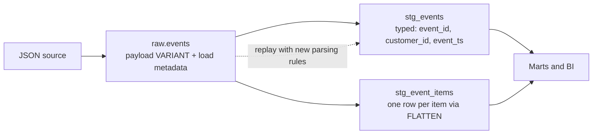
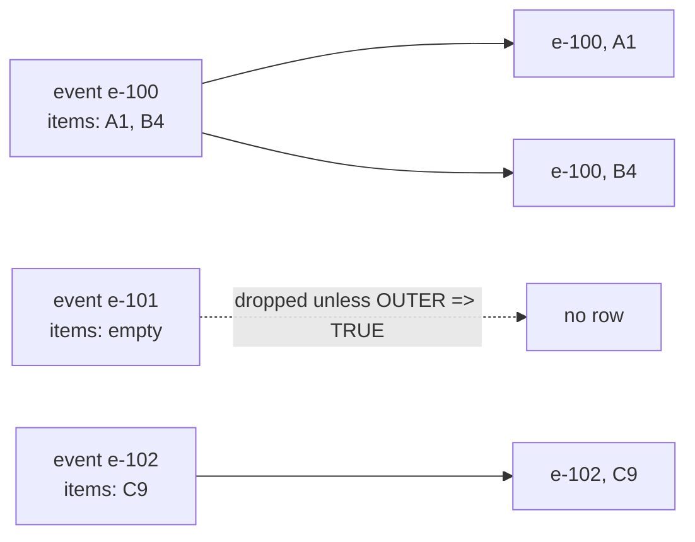
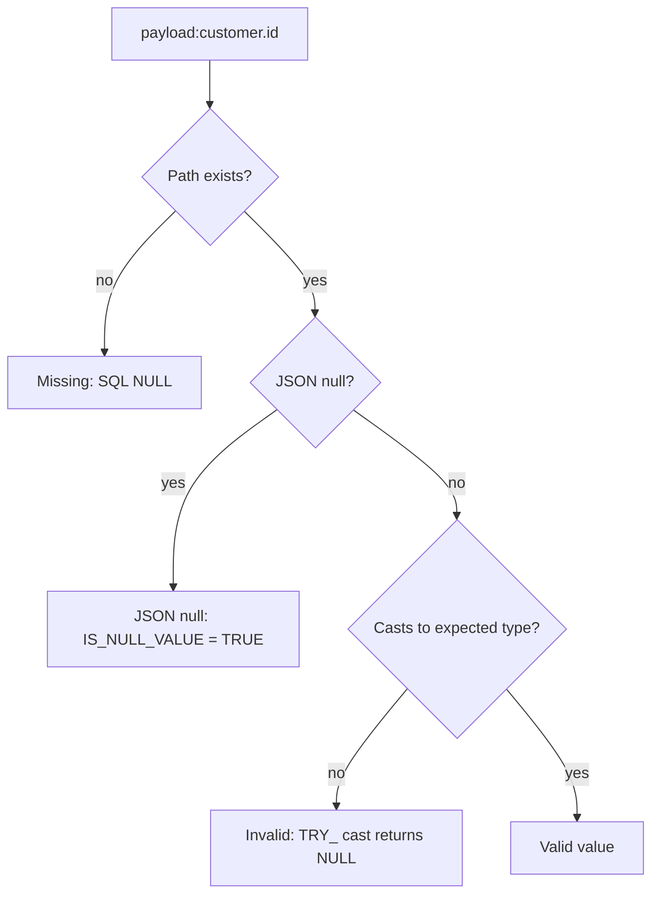

# Semi-Structured Data: `VARIANT`, `OBJECT`, `ARRAY`, and `FLATTEN`

## The Core Choice

Semi-structured storage lets ingestion preserve source payloads whose fields may be nested or evolve. It is useful at raw boundaries, but keeping every field untyped forever makes validation, analytics, governance, and performance harder. A common pattern is to preserve the original payload and create typed, documented projections for fields that become important.



## A Small End-to-End Example

```sql
CREATE TABLE raw.events (
  received_at TIMESTAMP_TZ,
  source_file STRING,
  payload VARIANT
);

INSERT INTO raw.events
SELECT CURRENT_TIMESTAMP(), 'sample.json', PARSE_JSON(
  '{"event_id":"e-100","customer":{"id":"c-7"},' ||
  '"items":[{"sku":"A1","quantity":2},{"sku":"B4","quantity":1}]}'
);
```

Extract scalar values explicitly:

```sql
SELECT
  payload:event_id::STRING AS event_id,
  payload:customer.id::STRING AS customer_id,
  TRY_TO_NUMBER(payload:items[0].quantity::STRING) AS first_quantity
FROM raw.events;
```

Path access returns a semi-structured value. Casting makes the intended SQL type explicit and helps downstream logic avoid depending on implicit coercion.

## Expand an Array

```sql
SELECT
  e.payload:event_id::STRING AS event_id,
  item.index AS item_position,
  item.value:sku::STRING AS sku,
  TRY_TO_NUMBER(item.value:quantity::STRING) AS quantity
FROM raw.events AS e,
LATERAL FLATTEN(INPUT => e.payload:items) AS item;
```

`FLATTEN` emits rows from an array or object. One input event can become zero, one, or many output rows. That cardinality change affects sums and joins: aggregate at the intended grain and retain a stable event or parent key.



### Worked example: inflated totals

If each event also carries `order_total = 100`, then summing it after flattening two items returns 200 for `e-100`. Keep event-level measures at event grain and item-level measures at item grain:

```sql
-- Wrong: event-level measure repeated per item
SELECT SUM(e.payload:order_total::NUMBER(12,2))
FROM raw.events e, LATERAL FLATTEN(INPUT => e.payload:items) item;

-- Right: event grain for event measures
SELECT SUM(payload:order_total::NUMBER(12,2)) FROM raw.events;
```

Use `OUTER => TRUE` when events without array elements must still produce one row with `NULL` item columns.

## Missing, Null, and Invalid Values

These are not always the same condition:

- a path may not exist in a payload
- a JSON field may explicitly contain JSON `null`
- a SQL expression may itself be `NULL`
- a cast may fail or produce a null-like result depending on the conversion used

Create explicit quality checks for required fields. Do not silently convert every malformed payload into a nullable value without tracking the failure rate.



```sql
SELECT
  COUNT_IF(payload:event_id IS NULL) AS missing_or_unreadable_id,
  COUNT_IF(IS_NULL_VALUE(payload:customer.id)) AS explicit_json_null_customer
FROM raw.events;
```

Validate exact null-check behavior against the payload type and current Snowflake semantics. A small fixture with missing, JSON-null, wrong-type, and valid values is safer than relying on intuition.

## Schema Evolution Strategy

When a source adds a field, retaining the raw payload can avoid an ingestion outage. It does not automatically make the change safe for consumers. Establish rules for:

- required versus optional fields
- renames and type changes
- unknown-field retention
- versioned source contracts
- typed curated columns and backward compatibility
- alerting when required fields disappear or change type

Promote a field into a typed projection when it becomes part of a stable analytical contract, join key, access policy, or performance-critical filter.

## When to Keep `VARIANT`

`VARIANT` is useful for raw landing, sparse attributes, exploratory data, and payloads that must be preserved faithfully. Typed columns are usually easier for stable business logic, joins, BI models, quality constraints, and clear consumer contracts. A hybrid design often keeps the original payload in raw storage and exposes typed values in curated models.

## Performance and Governance Considerations

- Filter and project only the fields needed by downstream queries.
- Measure query pruning and scanned data rather than assuming nested paths are free.
- Normalize frequently joined keys and frequently used measures into typed columns where appropriate.
- Classify sensitive nested fields; a broad payload column can hide personal data from catalog and review workflows.
- Apply retention and masking decisions to the data lifecycle, not only to the initial raw table.

## Common Failure Modes

- Flattening nested arrays multiplies rows and inflates measures.
- Implicit casts behave differently across records or fail on late source variants.
- Missing-field changes go unnoticed because every result is accepted as `NULL`.
- Raw payloads accumulate sensitive fields without explicit classification.
- Analysts independently extract the same path with inconsistent names and semantics.

## Decision Checklist

- Is the payload a raw source record or a stable consumer contract?
- Which fields must be typed, validated, joined, filtered, or governed?
- What is the intended output grain after flattening?
- How will missing, explicit null, invalid, and newly added fields be distinguished?
- Can the source be replayed if a parsing or transformation rule changes?