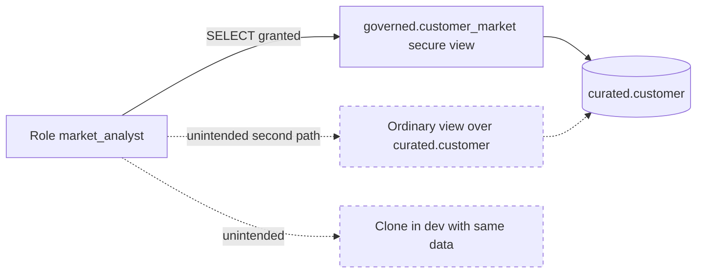

# Secure Views: Use Cases, Behavior, and Design

## What a Secure View Is For

A secure view is a view intended for governed data exposure where the provider wants consumers to query an approved projection without receiving direct access to underlying tables. Secure-view behavior also limits some forms of information exposure through the view definition and optimization behavior. Exact guarantees and restrictions must be checked in current Snowflake documentation.

It is a data interface, not a complete security program. It does not replace least-privilege roles, classification, masking, row access policies, auditing, or review of every path to the data.

## Example: Publish a Narrow Interface

Suppose the base table contains contact details, account identifiers, and internal attributes, while an analytics consumer needs only customer ID and market.

```sql
CREATE SECURE VIEW governed.customer_market AS
SELECT customer_id, market
FROM curated.customer
WHERE is_active;

GRANT USAGE ON DATABASE governed TO ROLE market_analyst;
GRANT USAGE ON SCHEMA governed TO ROLE market_analyst;
GRANT SELECT ON VIEW governed.customer_market TO ROLE market_analyst;
```

The role should not receive broader grants that bypass the intended interface. Test the consumer role directly and enumerate other views, shares, stages, clones, and exports that may expose the same data.



Dashed paths are what reviews usually miss. A secure view protects only the path that goes through it.

### Secure view vs ordinary view behavior

| Aspect | Ordinary view | Secure view |
| --- | --- | --- |
| Definition visible to non-owners | yes, to roles with access | no, hidden from non-owners |
| Optimizer may push filters into the view | yes | some optimizations are disabled to avoid exposing hidden data |
| Can be shared through Secure Data Sharing | no | yes |
| Typical performance | baseline | can be slower; measure |

```sql
-- Test as the consumer, not as the owner
USE ROLE market_analyst;
SELECT COUNT(*) FROM governed.customer_market;      -- expected to work
SELECT COUNT(*) FROM curated.customer;              -- expected to fail
SELECT GET_DDL('VIEW', 'governed.customer_market'); -- expected to fail for non-owners
```

## Common Use Cases

### Governed sharing

Expose a stable, documented projection to another team or an external consumer while keeping base-table privileges narrow.

### Hide implementation details

Provide a contract that can evolve internally while consumers depend on a reviewed interface. This is most useful when ownership and change communication are explicit.

### Restrict columns and rows

Use a view to select columns and apply simple filtering logic. For complex, reusable, or policy-driven restrictions, compare secure views with masking and row access policies rather than embedding all governance in one long query.

## Secure View vs Alternatives

| Option | Useful when | Main caution |
| --- | --- | --- |
| Ordinary view | Internal reuse where view-definition protections are not the requirement | Consumers may have different access to definition and underlying objects; validate actual grants |
| Secure view | A governed query interface or supported sharing pattern needs secure-view semantics | Performance, supported constructs, and information-protection guarantees must be validated |
| Masking policy | Sensitive columns need consistent role- or context-dependent masking | Policy logic and role context require tests across consumers |
| Row access policy | Row visibility is governed centrally by role or mapping logic | Policy complexity and join behavior can affect usability and performance |
| Separate curated table | Strong lifecycle, ownership, or performance boundary is required | Copies data and introduces freshness, storage, and pipeline responsibilities |

## Design and Review Rules

- Select only the columns required by the consumer; avoid `SELECT *` in a governed interface.
- State the intended consumer roles and test with them, not only with an administrator.
- Document filters, null behavior, grain, freshness, and schema-change policy.
- Review whether the secure view is shared externally and whether the sharing model supports the intended use.
- Measure representative queries. Security properties do not guarantee optimal performance.
- Recheck grants after cloning, deployment, ownership transfer, or schema changes.

## Failure Modes

- A consumer has a second grant path to the base table and bypasses the view.
- A view filters incorrectly or changes grain, resulting in misleading analytics.
- A policy is tested only under an owner/admin role and behaves differently for consumers.
- A secure view is treated as masking all sensitive data, while other objects still expose it.
- A view contract changes without consumer impact analysis.

## Decision Checklist

- What data is the consumer allowed to see, and why?
- Is the requirement about reusable logic, definition protection, row access, column masking, or external sharing?
- Can a separate curated table provide a clearer contract?
- Which role tests prove that allowed and disallowed access both behave as intended?
- What performance, compatibility, and change-management costs will this interface create?

For short syntax and object reminders, see [Objects and Table Types](../reference/02_objects_and_table_types.md). For platform-wide policy boundaries, see [Security and Governance](../architecture/04_security_governance.md).