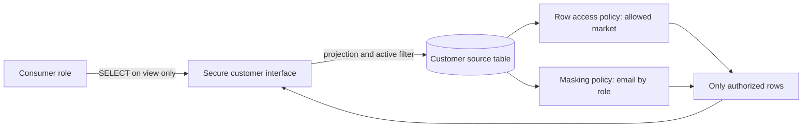
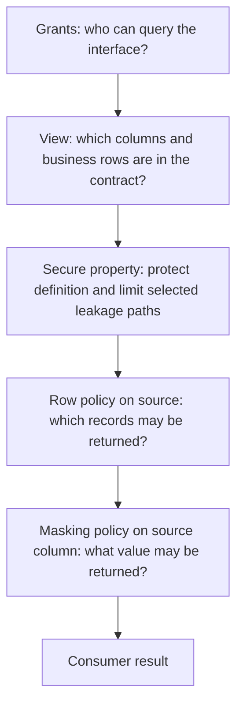

# Security Views: Views and Data Access Policies

This guide shows how four related Snowflake mechanisms solve different data-access requirements:

1. A **view** selects columns and defines a reusable query interface.
2. A **secure view** adds protection for the view definition and limits some information exposure through optimizer behavior.
3. A **masking policy** changes the value returned for a protected column according to the query context.
4. A **row access policy** determines which rows are returned.

They can be combined, but they are not interchangeable. This walkthrough uses one customer table and applies the controls where they protect the intended data paths.

> **Query access is not definition access.** A consumer role can be granted `SELECT` on a secure view and run queries against it, while not being allowed to inspect the SQL that defines the view. For example, `SALES_EU_ANALYST` can query `ANALYTICS.GOVERNED.CUSTOMER_MARKET` and receive the rows allowed by its grants and policies; it does not thereby become the owner of the view or gain access to its underlying `SELECT` statement through the usual view-definition interfaces. The view owner role, and certain highly privileged metadata roles, can still inspect the definition. A secure view therefore hides implementation details from ordinary consumers; it does not hide the results they are authorized to see or replace access-control design.

## Scenario and Desired Behavior

Assume the source contains customer contact and internal data:

| CUSTOMER_ID | MARKET | EMAIL | PHONE | INTERNAL_SCORE | IS_ACTIVE |
| --- | --- | --- | --- | ---: | --- |
| 101 | EU | alice@example.test | +10000000001 | 87 | TRUE |
| 102 | EU | bob@example.test | +10000000002 | 51 | TRUE |
| 201 | NA | casey@example.test | +10000000003 | 72 | TRUE |
| 301 | EU | former@example.test | +10000000004 | 20 | FALSE |

We want these outcomes:

| Consumer | Visible rows | Email |
| --- | --- | --- |
| EU market analyst | Active EU customers only | Masked |
| EU analyst approved for PII | Active EU customers only | Full value |
| NA market analyst | Active NA customers only | Masked |
| Consumer without a granted role | No access to the view |

No consumer should get direct `SELECT` on the source table. The view selects the public columns and active customers; the row policy enforces market access on the source table; the masking policy protects email across governed reads of the source column; the secure-view property adds definition privacy and limits selected information-leakage risks. The secure view is one layer, not the complete security boundary.



The view is the interface. The policies are controls on data returned from the protected table. Grants decide who can query the interface at all.

## Choose the Mechanism That Matches the Requirement

| Requirement | Mechanism | What it does | What it does not do |
| --- | --- | --- | --- |
| Show only needed columns and create a convenient reusable interface | Ordinary view | Defines a query projection and optional business filter | Does not hide its definition from authorized view consumers or centrally enforce column masking across other paths |
| Also protect the view definition and reduce certain information-leakage risks | Secure view | Hides definition details from unauthorized roles and avoids some view optimizations that could expose hidden data | Does not stop access through a separate grant, table, clone, export, or another object |
| Show different values in a sensitive column to different roles | Masking policy | Applies role/context-dependent transformation at query time to the protected column | Does not remove or rewrite the stored sensitive value |
| Show different rows to different consumers | Row access policy | Filters rows at query time according to policy logic | Does not prevent rows from being inserted or prevent visible rows from being updated/deleted |

A normal view is often sufficient when the requirement is only a convenient projection and the view definition is not sensitive. Use `SECURE VIEW` when the additional definition/privacy behavior is actually needed; secure views can be slower because some optimizations are restricted. Do not select the secure option solely because the word “secure” sounds stronger.

## Implementation

### 1. Create a small source table and the consumer roles

The names and sample records below are illustrative. In a real deployment, run object creation under reviewed owner/security roles, use a lab warehouse, and grant only the privileges required by the deployment process.

Dynamic masking and row access policies require Enterprise Edition or higher. The setup and policy DDL also require appropriate privileges to create the database/schema/table, roles, policies, and view. Attaching policies requires the applicable `APPLY MASKING POLICY` and `APPLY ROW ACCESS POLICY` privileges. The view owner role must be able to read the source table and create the view in its schema. In production, delegate these privileges to narrowly scoped owner/security roles; do not use `ACCOUNTADMIN` as the routine execution role.

For the policy steps, use the dedicated `CUSTOMER_POLICY_OWNER` role with permission to create policies in the governance schema, read the entitlement table, and apply policies to the source object. The row-policy subquery reads the entitlement table using privileges granted to the policy owner. In this lab, assume that role is also authorized to alter the protected table. Exact grants depend on whether policy management is centralized or delegated; arrange those grants before running the policy DDL below.

```sql
CREATE DATABASE IF NOT EXISTS ANALYTICS;
CREATE SCHEMA IF NOT EXISTS ANALYTICS.CURATED;
CREATE SCHEMA IF NOT EXISTS ANALYTICS.GOVERNANCE;
CREATE SCHEMA IF NOT EXISTS ANALYTICS.GOVERNED;

CREATE ROLE IF NOT EXISTS CUSTOMER_VIEW_OWNER;
CREATE ROLE IF NOT EXISTS CUSTOMER_POLICY_OWNER;
CREATE ROLE IF NOT EXISTS CUSTOMER_ENTITLEMENT_ADMIN;
CREATE ROLE IF NOT EXISTS SALES_EU_ANALYST;
CREATE ROLE IF NOT EXISTS SALES_EU_PII_READER;
CREATE ROLE IF NOT EXISTS SALES_NA_ANALYST;

CREATE TABLE IF NOT EXISTS ANALYTICS.CURATED.CUSTOMER (
    CUSTOMER_ID NUMBER,
    MARKET VARCHAR,
    EMAIL VARCHAR,
    PHONE VARCHAR,
    INTERNAL_SCORE NUMBER,
    IS_ACTIVE BOOLEAN
);

CREATE TABLE IF NOT EXISTS ANALYTICS.GOVERNANCE.CUSTOMER_MARKET_ENTITLEMENT (
    ROLE_NAME VARCHAR NOT NULL,
    MARKET VARCHAR NOT NULL
);

INSERT INTO ANALYTICS.CURATED.CUSTOMER
    (CUSTOMER_ID, MARKET, EMAIL, PHONE, INTERNAL_SCORE, IS_ACTIVE)
VALUES
    (101, 'EU', 'alice@example.test', '+10000000001', 87, TRUE),
    (102, 'EU', 'bob@example.test', '+10000000002', 51, TRUE),
    (201, 'NA', 'casey@example.test', '+10000000003', 72, TRUE),
    (301, 'EU', 'former@example.test', '+10000000004', 20, FALSE);
```

For a repeatable lab, make the seed step idempotent (for example, recreate a disposable table or use a deterministic `MERGE`) instead of blindly inserting the same rows every run.

The policy attachments and view creation below are one-time setup statements. For another run, use a fresh disposable database/schema or deliberately remove/recreate the dependent objects in dependency order; do not blindly replace a policy that is still attached to an object.

### Alternative 1: Put role-to-market rules directly in the policy

For a small, stable set of roles, the policy can contain one condition per role and market. This is the original, simpler approach:

```sql
USE ROLE CUSTOMER_POLICY_OWNER;

CREATE ROW ACCESS POLICY ANALYTICS.GOVERNANCE.CUSTOMER_MARKET_POLICY
    AS (ROW_MARKET VARCHAR)
    RETURNS BOOLEAN ->
        (
            IS_ROLE_IN_SESSION('SALES_EU_ANALYST')
            AND ROW_MARKET = 'EU'
        )
        OR (
            IS_ROLE_IN_SESSION('SALES_EU_PII_READER')
            AND ROW_MARKET = 'EU'
        )
        OR (
            IS_ROLE_IN_SESSION('SALES_NA_ANALYST')
            AND ROW_MARKET = 'NA'
        );

ALTER TABLE ANALYTICS.CURATED.CUSTOMER
    ADD ROW ACCESS POLICY ANALYTICS.GOVERNANCE.CUSTOMER_MARKET_POLICY
    ON (MARKET);
```

With this design, adding a role or market requires changing the policy definition and deploying the updated policy. Treat this as an alternative to the entitlement-table implementation below: use one approach for this table, not both. The following walkthrough uses the table-backed approach.

### Managing market access with an entitlement table

Instead of embedding a branch for every market role in the row access policy, store the approved role-to-market relationships as data. Each row grants one role access to one market:

| ROLE_NAME | MARKET |
| --- | --- |
| `SALES_EU_ANALYST` | EU |
| `SALES_EU_PII_READER` | EU |
| `SALES_NA_ANALYST` | NA |

In this example, the provisioning role that created the table grants `CUSTOMER_ENTITLEMENT_ADMIN` the ability to maintain entitlement rows and gives `CUSTOMER_POLICY_OWNER` read-only access. Consumers receive no access to the entitlement table:

```sql
GRANT USAGE ON DATABASE ANALYTICS TO ROLE CUSTOMER_ENTITLEMENT_ADMIN;
GRANT USAGE ON SCHEMA ANALYTICS.GOVERNANCE TO ROLE CUSTOMER_ENTITLEMENT_ADMIN;
GRANT SELECT, INSERT, DELETE ON TABLE ANALYTICS.GOVERNANCE.CUSTOMER_MARKET_ENTITLEMENT
    TO ROLE CUSTOMER_ENTITLEMENT_ADMIN;

GRANT USAGE ON DATABASE ANALYTICS TO ROLE CUSTOMER_POLICY_OWNER;
GRANT USAGE ON SCHEMA ANALYTICS.GOVERNANCE TO ROLE CUSTOMER_POLICY_OWNER;
GRANT SELECT ON TABLE ANALYTICS.GOVERNANCE.CUSTOMER_MARKET_ENTITLEMENT
    TO ROLE CUSTOMER_POLICY_OWNER;
```

Seed or update the table through the team's reviewed entitlement-change process. This repeatable `MERGE` adds the sample entitlements without duplicating existing pairs. Run it as `CUSTOMER_ENTITLEMENT_ADMIN`:

```sql
USE ROLE CUSTOMER_ENTITLEMENT_ADMIN;

MERGE INTO ANALYTICS.GOVERNANCE.CUSTOMER_MARKET_ENTITLEMENT AS target
USING (
    SELECT column1::VARCHAR AS ROLE_NAME, column2::VARCHAR AS MARKET
    FROM VALUES
        ('SALES_EU_ANALYST', 'EU'),
        ('SALES_EU_PII_READER', 'EU'),
        ('SALES_NA_ANALYST', 'NA')
) AS source
    ON target.ROLE_NAME = source.ROLE_NAME
    AND target.MARKET = source.MARKET
WHEN NOT MATCHED THEN
    INSERT (ROLE_NAME, MARKET)
    VALUES (source.ROLE_NAME, source.MARKET);
```

`CUSTOMER_ENTITLEMENT_ADMIN` should be granted only to the approved access-management operators or deployment automation. To add a market entitlement, insert a row; to revoke it, delete the exact role-market row. Those changes do not require changing or replacing the row access policy. For example:

```sql
INSERT INTO ANALYTICS.GOVERNANCE.CUSTOMER_MARKET_ENTITLEMENT (ROLE_NAME, MARKET)
VALUES ('SALES_APAC_ANALYST', 'APAC');

DELETE FROM ANALYTICS.GOVERNANCE.CUSTOMER_MARKET_ENTITLEMENT
WHERE ROLE_NAME = 'SALES_APAC_ANALYST'
  AND MARKET = 'APAC';
```

An entitlement only controls which rows the policy allows; it does not grant the role access to the secure view, a warehouse, or assign the role to a user. Keep a change record and review the table as security-sensitive authorization data. Do not attach this customer row policy to the entitlement table itself. A role with no matching row sees no rows under this policy.

### 2. Add a row access policy to the source table

The policy looks up the current row's market and checks whether any role active in the session has a matching entitlement. `IS_ROLE_IN_SESSION` also accounts for the active role hierarchy. The PII-approved EU role is restricted to EU here; its separate masking-policy entitlement reveals email, not additional markets.

Run both statements as `CUSTOMER_POLICY_OWNER`, after its required privileges have been granted.

```sql
USE ROLE CUSTOMER_POLICY_OWNER;

CREATE ROW ACCESS POLICY ANALYTICS.GOVERNANCE.CUSTOMER_MARKET_POLICY
    AS (ROW_MARKET VARCHAR)
    RETURNS BOOLEAN ->
        EXISTS (
            SELECT 1
            FROM ANALYTICS.GOVERNANCE.CUSTOMER_MARKET_ENTITLEMENT AS entitlement
            WHERE entitlement.MARKET = ROW_MARKET
              AND IS_ROLE_IN_SESSION(entitlement.ROLE_NAME)
        );

ALTER TABLE ANALYTICS.CURATED.CUSTOMER
    ADD ROW ACCESS POLICY ANALYTICS.GOVERNANCE.CUSTOMER_MARKET_POLICY
    ON (MARKET);
```

Attaching the row policy to the source table makes the row rule apply when that table is read, including through the view. If the policy were attached only to one view, another authorized path to the base table could avoid that particular view-level rule. A single policy can also be attached to multiple tables or views where appropriate.

The mapping table separates authorization data from policy logic: adding or removing a role-market relationship changes the entitlement rows, not the policy definition. For larger systems, the mapping table can represent other dimensions such as business unit or tenant, but keep the policy predicate and mapping-table ownership tightly governed.

### 3. Add a masking policy to the sensitive column

The masking policy returns the email only when the PII-approved role is active in the session; everyone else with access to the protected column sees a fixed masked value.

Run both statements as `CUSTOMER_POLICY_OWNER`.

```sql
USE ROLE CUSTOMER_POLICY_OWNER;

CREATE MASKING POLICY ANALYTICS.GOVERNANCE.CUSTOMER_EMAIL_MASK
    AS (EMAIL_VALUE VARCHAR)
    RETURNS VARCHAR ->
        CASE
            WHEN IS_ROLE_IN_SESSION('SALES_EU_PII_READER')
                THEN EMAIL_VALUE
            ELSE '***'
        END;

ALTER TABLE ANALYTICS.CURATED.CUSTOMER
    MODIFY COLUMN EMAIL
    SET MASKING POLICY ANALYTICS.GOVERNANCE.CUSTOMER_EMAIL_MASK;
```

Masking is evaluated at query time. It does **not** overwrite the email stored in the table. Attach the policy to the source column when the requirement is to protect that value consistently across query paths; applying it only to one view protects only that view's column.

The row and masking policies above are illustrative. For production, separate policy ownership from table/view ownership where required, review the supported policy context functions and role hierarchy, and test every intended role. Policy behavior is sensitive to which roles are active in the session; avoid assuming that a user's existence or a granted-but-inactive role automatically gives the intended result.

### 4. Create the secure view interface

The interface includes only `CUSTOMER_ID`, `MARKET`, and `EMAIL`, and excludes inactive customers. It deliberately omits phone and internal score.

Before creating the view, grant its owner role namespace access, source-table read access, and permission to create a view in the target schema. Run the `CREATE VIEW` statement under that owner role:

```sql
GRANT USAGE ON DATABASE ANALYTICS TO ROLE CUSTOMER_VIEW_OWNER;
GRANT USAGE ON SCHEMA ANALYTICS.CURATED TO ROLE CUSTOMER_VIEW_OWNER;
GRANT SELECT ON TABLE ANALYTICS.CURATED.CUSTOMER TO ROLE CUSTOMER_VIEW_OWNER;
GRANT USAGE ON SCHEMA ANALYTICS.GOVERNED TO ROLE CUSTOMER_VIEW_OWNER;
GRANT CREATE VIEW ON SCHEMA ANALYTICS.GOVERNED TO ROLE CUSTOMER_VIEW_OWNER;

USE ROLE CUSTOMER_VIEW_OWNER;

CREATE SECURE VIEW ANALYTICS.GOVERNED.CUSTOMER_MARKET AS
SELECT CUSTOMER_ID, MARKET, EMAIL
FROM ANALYTICS.CURATED.CUSTOMER
WHERE IS_ACTIVE = TRUE;
```

The view's active-customer filter is a data-product contract. The row access policy still independently enforces the market restriction, and the masking policy still governs email values.

### 5. Grant access to the interface, not the source

The view owner needs privileges on the source. Consumer roles need namespace access, `SELECT` on the view, and `USAGE` on a warehouse to run queries. They do **not** receive `SELECT` on the source table.

```sql
GRANT USAGE ON DATABASE ANALYTICS TO ROLE SALES_EU_ANALYST;
GRANT USAGE ON SCHEMA ANALYTICS.GOVERNED TO ROLE SALES_EU_ANALYST;
GRANT SELECT ON VIEW ANALYTICS.GOVERNED.CUSTOMER_MARKET TO ROLE SALES_EU_ANALYST;

GRANT USAGE ON DATABASE ANALYTICS TO ROLE SALES_EU_PII_READER;
GRANT USAGE ON SCHEMA ANALYTICS.GOVERNED TO ROLE SALES_EU_PII_READER;
GRANT SELECT ON VIEW ANALYTICS.GOVERNED.CUSTOMER_MARKET TO ROLE SALES_EU_PII_READER;

GRANT USAGE ON DATABASE ANALYTICS TO ROLE SALES_NA_ANALYST;
GRANT USAGE ON SCHEMA ANALYTICS.GOVERNED TO ROLE SALES_NA_ANALYST;
GRANT SELECT ON VIEW ANALYTICS.GOVERNED.CUSTOMER_MARKET TO ROLE SALES_NA_ANALYST;
```

Grant the consumer roles `USAGE` on the intended warehouse separately:

```sql
GRANT USAGE ON WAREHOUSE ANALYTICS_BI_WH TO ROLE SALES_EU_ANALYST;
GRANT USAGE ON WAREHOUSE ANALYTICS_BI_WH TO ROLE SALES_EU_PII_READER;
GRANT USAGE ON WAREHOUSE ANALYTICS_BI_WH TO ROLE SALES_NA_ANALYST;
```

`ANALYTICS_BI_WH` must already exist, or be replaced with an approved warehouse. A role needs warehouse usage to execute the query, but warehouse access does not grant data access.

The SQL is split by responsibility for clarity. In production, delegate view ownership and policy creation/application through the governance process. Do not run every statement as `ACCOUNTADMIN` merely to make the example succeed.

## Test Each Role

Run the checks with the actual consumer role and an approved warehouse. Expected results:

| Active role | Rows expected | Email expected |
| --- | ---: | --- |
| `SALES_EU_ANALYST` | 2, both EU and active | `***` |
| `SALES_EU_PII_READER` | 2, both EU and active | Original email |
| `SALES_NA_ANALYST` | 1, NA and active | `***` |

Example:

```sql
USE ROLE SALES_EU_ANALYST;
USE WAREHOUSE ANALYTICS_BI_WH;

SELECT CUSTOMER_ID, MARKET, EMAIL
FROM ANALYTICS.GOVERNED.CUSTOMER_MARKET
ORDER BY CUSTOMER_ID;
```

Then test each of the other roles in its own session context. Also verify that:

- a role with no grant cannot select from the secure view;
- consumer roles cannot select from `ANALYTICS.CURATED.CUSTOMER`;
- the EU role does not see NA rows, and the NA role does not see EU rows;
- inactive rows do not appear;
- only the PII-approved role sees the original email;
- no other view, share, clone, export, stage, or broader role grant provides a bypass.

As an authorized owner, inspect the grants, policy attachments, and view definition. As a consumer, confirm that secure-view definition details are not exposed through the normal metadata interfaces available to that role. Do not use an administrator session as proof of consumer behavior.

## What Each Layer Contributes



The exact internal evaluation plan is managed by Snowflake; the diagram is a logical explanation, not a promise about physical operator order. Policies can be applied to tables and views, and multiple applicable policies can be evaluated along a query path. Test the combined behavior in the target account and edition.

## Ordinary View or Secure View?

| Aspect | Ordinary view | Secure view |
| --- | --- | --- |
| Select columns / define a reusable query | Yes | Yes |
| View definition visible to roles with appropriate metadata access | Generally visible | Hidden from unauthorized roles through the normal interfaces described by Snowflake |
| Some optimizer behavior restricted to reduce information exposure | No secure-view guarantee | Yes; some optimizations are disabled |
| Performance | Often faster for the same query | Can be slower; benchmark representative workloads |
| Direct table grants or other data paths blocked automatically | No | No |

Secure views are specifically intended for privacy-sensitive data exposure, not for every convenience view. Their definition can still be visible to sufficiently privileged roles and through some organization/account usage surfaces; do not treat the view name or definition secrecy as a substitute for access governance.

## Failure Modes and Common Misunderstandings

- **“The view is secure, so the table is secure.”** False. Secure-view semantics protect the access path through that view. Remove unintended direct grants and inspect alternate objects and copies.
- **“The view filter is the only row control we need.”** A view predicate can be part of the interface, but a row access policy is the reusable policy control when row visibility must be centrally enforced across protected objects.
- **“Masking deletes or anonymizes the source value.”** False. Masking changes query-time output; the underlying value remains stored.
- **“A role was granted, so the policy will see it as active.”** Test role activation and role hierarchy with the real consumer setup.
- **“Administrators see what analysts see.”** Often false. Test both authorized and restricted roles; policy conditions can intentionally produce different output.
- **“Secure view always improves security without cost.”** It restricts selected information exposure but can reduce optimization opportunities and affect performance.
- **“A row access policy prevents writes to unauthorized rows.”** Row access policies filter query results; they do not prevent rows from being inserted or visible rows from being updated/deleted.
- **“Every consumer gets the same result.”** Result depends on active role context, policy definitions, grants, and any other applicable policies.

## Decision Checklist

- Is the requirement a reusable column projection, hidden definition, row restriction, column masking, or a combination?
- Does the consumer have only the intended view grants, and no direct or indirect bypass?
- Should row and column policies be attached to the source table so they cover every read path?
- Which roles should see each row and each sensitive value, including nested role/session behavior?
- Have you tested both allowed and denied access using real consumer roles?
- Does a secure view's privacy benefit justify its performance and compatibility trade-offs?
- Who owns the policies, view contract, grants, tests, and review when data or roles change?

## Official References

- [Working with Secure Views](https://docs.snowflake.com/en/user-guide/views-secure)
- [Understanding Dynamic Data Masking](https://docs.snowflake.com/en/user-guide/security-column-ddm-intro)
- [Understanding Row Access Policies](https://docs.snowflake.com/en/user-guide/security-row-intro)
- [Using Row Access Policies](https://docs.snowflake.com/en/user-guide/security-row-using)

For platform-wide governance and role patterns, see [Security and Governance](../architecture/04_security_governance.md). For short object syntax, see [Objects and Table Types](../reference/02_objects_and_table_types.md).