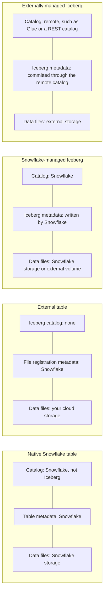
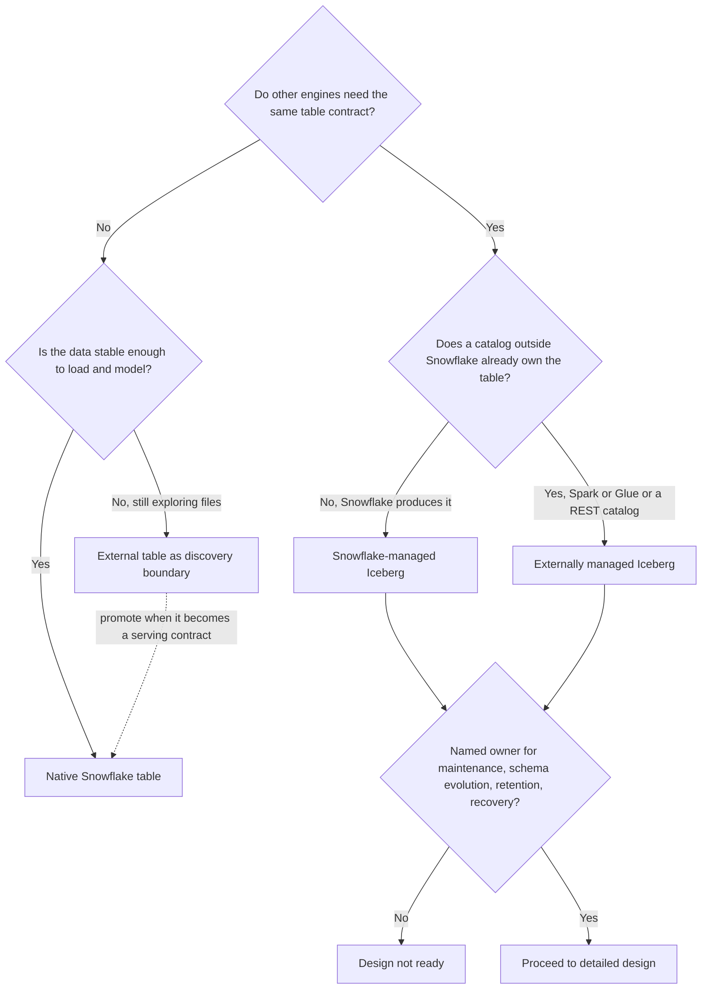

# Iceberg and External Tables

This deep-dive brings together Snowflake's file-query and open-table patterns. The central decision is not which syntax looks newer; it is who owns data, table metadata, lifecycle, and the consumer contract.

## Read in This Order

1. [Table type decision guide](Snowflake_table_type_decision_guide.md) for the four-way decision framework.
2. [External tables](Snowflake_external_tables.md) for file-level access, schema-on-read, partitions, and refresh.
3. [Snowflake-managed Iceberg](Snowflake_managed_Iceberg.md) for Snowflake-owned Iceberg metadata and publishing.
4. [Externally managed Iceberg](Snowflake_externally_managed_Iceberg.md) for remote catalog ownership, refresh, and write boundaries.
5. [Open Catalog](Snowflake_Open_Catalog.md) for catalog roles and Snowflake integration, then review its [cookbook](Snowflake_Open_Catalog_cookbook.md).
6. Use the [externally managed Iceberg cookbook](Snowflake_externally_managed_Iceberg_cookbook.md) for the end-to-end remote-catalog workflows.
7. Finish with [Scenario-Based Architecture Tasks](../../../simple-tasks/09_snowflake_architecture_scenarios/README.md).

## Fast Comparison

| Pattern | Data and metadata ownership | Write/query model | Strong fit | Main trade-off |
| --- | --- | --- | --- | --- |
| Native Snowflake table | Snowflake manages the table and storage lifecycle | Full Snowflake table operations | Snowflake-centered analytics and serving | Simplest Snowflake operation, but not an open Iceberg table contract |
| External table | Files stay in external storage; Snowflake tracks file-level table metadata | Read-only query over registered files | Discovery, validation, and lightweight lake access | File layout and metadata refresh matter; no Iceberg snapshot contract |
| Snowflake-managed Iceberg | Snowflake owns the Iceberg catalog state; data can use Snowflake-managed storage or an external volume | Snowflake-managed table operations; external engines need a supported access/catalog route | Snowflake publishes an open table for other engines | More catalog, storage, lifecycle, and interoperability configuration than a native table |
| Externally managed Iceberg | Remote Iceberg catalog owns metadata; data resides in external storage | Snowflake reads and, in supported REST catalog configurations, can write | Snowflake joins an existing multi-engine Iceberg ecosystem | Catalog compatibility, refresh/commit path, and external lifecycle ownership become critical |

An external table and an Iceberg table can both query files in cloud storage, but they are not interchangeable. An external table registers files and exposes them through a read-only table interface. Iceberg tracks table state through catalog metadata and snapshots, with schema and partition evolution semantics. A stage or a Parquet directory alone does not provide those Iceberg guarantees.

### Who Owns What

Read each column top to bottom: catalog, metadata, files. The further right you go, the more of the stack lives outside Snowflake, and the more operational ownership you must assign explicitly.

## Decision Shortcuts

- Snowflake-only curated serving: start by evaluating a native Snowflake table.
- Unstable partner files that need quick inspection: an external table can be a discovery boundary; promote validated data when it becomes a core serving contract.
- Snowflake owns publishing and another engine needs the same open-table contract: evaluate Snowflake-managed Iceberg.
- Spark or another platform already owns the catalog and table lifecycle: evaluate externally managed Iceberg rather than introducing a second metadata authority.
- If nobody owns catalog maintenance, schema evolution, retention, and recovery, the Iceberg design is not ready.

The first split is about consumers, the second about metadata authority. Syntax only matters after both are answered.

## Refresh Is Not One Generic Operation

- External-table refresh registers or synchronizes staged-file metadata. Automatic refresh depends on correctly configured cloud event notifications; manual refresh is also available.
- Externally managed Iceberg refresh/synchronization follows the external catalog's committed table state and Snowflake's integration configuration.
- Snowflake-managed Iceberg uses Snowflake as catalog authority; diagnose Snowflake write/snapshot state, storage access, and the external-engine access path rather than treating it as an external-table file registration problem.

Always identify the metadata authority and object type before choosing a refresh command. Query-result reuse is a separate concern from file registration or catalog synchronization.

## Open Catalog and Horizon Catalog

Snowflake's current guidance distinguishes the paths. New customers should use Horizon Catalog for external-engine access to Snowflake-managed Iceberg tables. Current Snowflake documentation states that a new customer cannot create their first Snowflake Open Catalog account; existing Open Catalog customers can continue using it and create additional accounts. Open Catalog material remains important for existing deployments and for designs where it is the actual remote catalog authority. Recheck onboarding and feature availability before implementing a production design.

## Current Documentation

Product behavior changes. This material was reviewed against Snowflake documentation on 2026-10-29; verify current edition, region, account, catalog, and cloud-storage requirements before production use.

- [Apache Iceberg tables in Snowflake](https://docs.snowflake.com/en/user-guide/tables-iceberg)
- [Introduction to external tables](https://docs.snowflake.com/en/user-guide/tables-external-intro)
- [External-table auto refresh](https://docs.snowflake.com/en/user-guide/tables-external-auto)
- [Write support for externally managed Iceberg tables](https://docs.snowflake.com/en/user-guide/tables-iceberg-externally-managed-writes)
- [Use Iceberg tables with Open Catalog in Snowflake](https://docs.snowflake.com/en/user-guide/tables-iceberg-open-catalog)