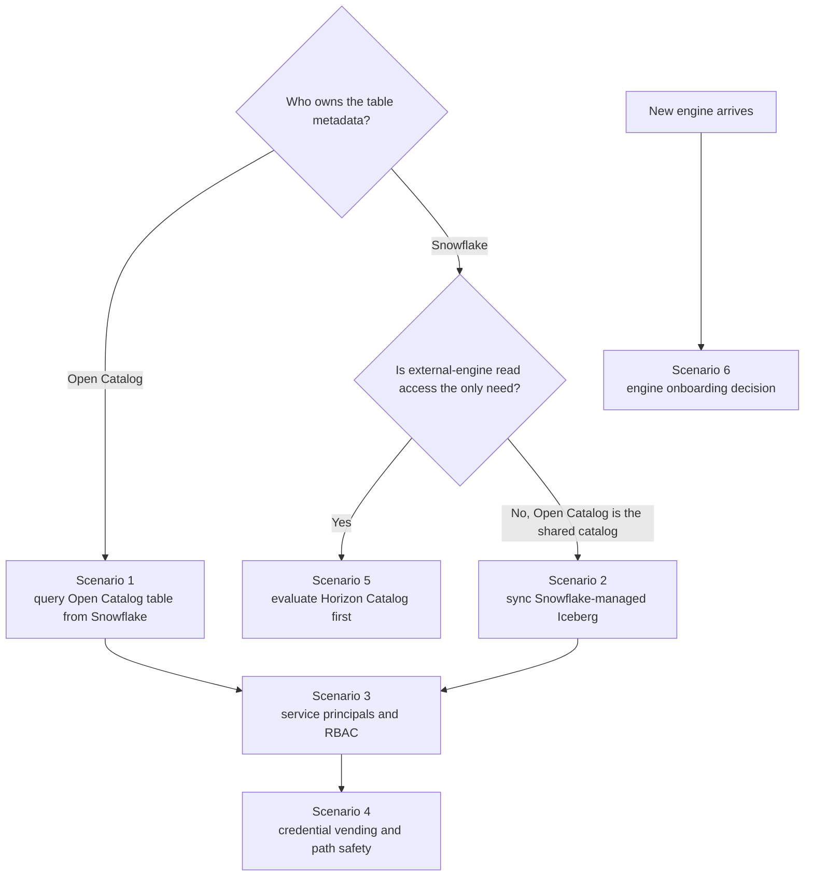
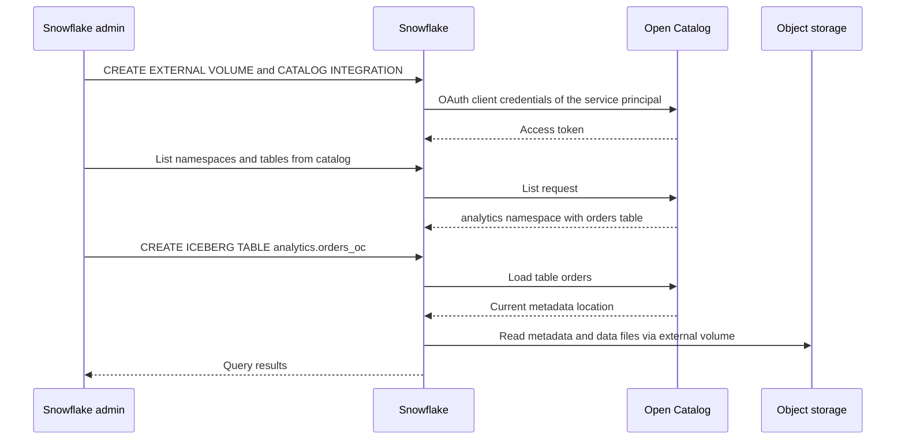
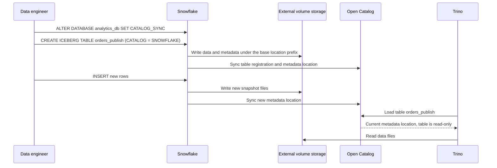
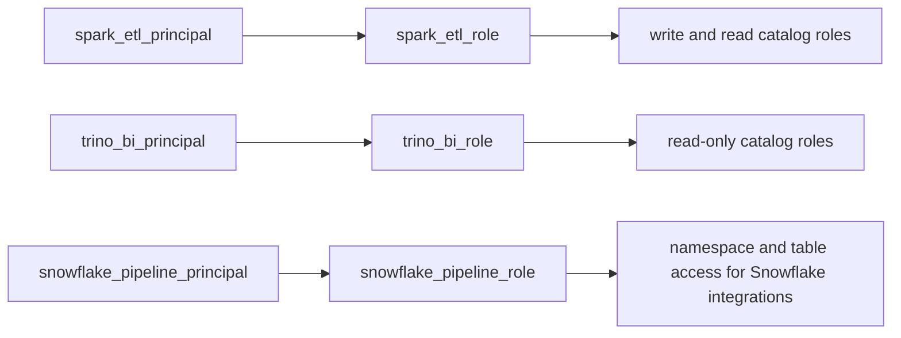
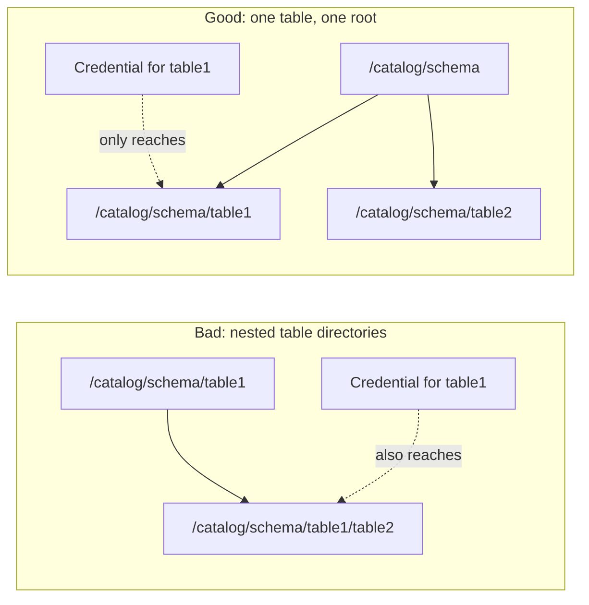

# Snowflake Open Catalog Cookbook

> This cookbook covers existing Snowflake Open Catalog deployments and cases where Open Catalog is the remote Iceberg catalog authority. Current Snowflake guidance recommends Horizon Catalog for new customers whose only requirement is external-engine access to Snowflake-managed Iceberg. Verify onboarding and feature availability before following these recipes.

## 1. How To Use This File

This file is the practical companion to `Snowflake_Open_Catalog.md`.

The theory file explains what Open Catalog is.

This file explains:

- how to use Open Catalog as a query path
- how to use Open Catalog as a sync target
- how to think about service principals and RBAC in operational terms
- when Horizon Catalog is the simpler path

The point is to make Open Catalog concrete enough to design with it.

---

## 2. Scenario Map

This cookbook covers six scenarios:

1. Query an Open Catalog table from Snowflake.
2. Sync Snowflake-managed Iceberg tables into Open Catalog.
3. Design service-principal and RBAC flows for multiple engines.
4. Use credential vending safely with clean storage paths.
5. Decide whether Horizon Catalog is a better fit for external-engine access.
6. Decide how to onboard a new engine.



Scenario numbers in the diagram follow the section headings below. Both Open Catalog paths converge on the same security work: principals, roles, and path layout.

---

## 3. Scenario 1: Query A Table Registered In Open Catalog From Snowflake

Use this when:

- Open Catalog is already the metadata authority
- Snowflake should read an Open Catalog Iceberg table
- Snowflake is joining an external REST-catalog ecosystem

### 3.1 Create the external volume in Snowflake

```sql
CREATE OR REPLACE EXTERNAL VOLUME lakehouse_ext_vol
  STORAGE_LOCATIONS = (
    (
      NAME = 'main'
      STORAGE_PROVIDER = 'S3'
      STORAGE_BASE_URL = 's3://company-open-catalog/'
      STORAGE_AWS_ROLE_ARN = 'arn:aws:iam::123456789012:role/snowflake-open-catalog-access'
      STORAGE_AWS_EXTERNAL_ID = 'snowflake-open-catalog-prod'
    )
  );
```

### 3.2 Create a catalog integration for Open Catalog

```sql
CREATE OR REPLACE CATALOG INTEGRATION open_catalog_int
  CATALOG_SOURCE = POLARIS
  TABLE_FORMAT = ICEBERG
  CATALOG_NAMESPACE = 'analytics'
  REST_CONFIG = (
    CATALOG_URI = 'https://org-account.snowflakecomputing.com/polaris/api/catalog'
    CATALOG_NAME = 'central_catalog'
  )
  REST_AUTHENTICATION = (
    TYPE = OAUTH
    OAUTH_CLIENT_ID = 'my-client-id'
    OAUTH_CLIENT_SECRET = 'my-client-secret'
    OAUTH_ALLOWED_SCOPES = ('PRINCIPAL_ROLE:ALL')
  )
  ENABLED = TRUE;
```

### 3.3 List namespaces and tables before registration

```sql
SELECT SYSTEM$LIST_NAMESPACES_FROM_CATALOG('OPEN_CATALOG_INT');
```

```sql
SELECT SYSTEM$LIST_ICEBERG_TABLES_FROM_CATALOG('OPEN_CATALOG_INT');
```

### 3.4 Register the Open Catalog table in Snowflake

```sql
CREATE ICEBERG TABLE analytics.orders_oc
  CATALOG = 'OPEN_CATALOG_INT'
  EXTERNAL_VOLUME = 'LAKEHOUSE_EXT_VOL'
  CATALOG_TABLE_NAME = 'orders'
  AUTO_REFRESH = TRUE;
```

### 3.5 Query it

```sql
SELECT order_date, COUNT(*) AS orders_cnt
FROM analytics.orders_oc
GROUP BY order_date
ORDER BY order_date;
```

Operator takeaway:

- this is still an externally managed Iceberg pattern from Snowflake's point of view
- Open Catalog is the remote metadata authority



Listing namespaces before registration is a cheap end-to-end test of OAuth, principal roles, and catalog privileges.

---

## 4. Scenario 2: Sync Snowflake-Managed Iceberg To Open Catalog

Use this when:

- Snowflake should remain the producer authority
- external engines should query the table through Open Catalog
- you want a governed publish path out of Snowflake

### 4.1 Set a base location prefix

```sql
ALTER SCHEMA open_catalog
  SET BASE_LOCATION_PREFIX = 'open-catalog-publish';
```

Why this matters:

- synced Snowflake-managed tables need predictable parent storage layout
- Open Catalog access control depends on non-overlapping, understandable paths

### 4.2 Create a catalog integration for Open Catalog sync

```sql
CREATE OR REPLACE CATALOG INTEGRATION my_open_catalog_int
  CATALOG_SOURCE = POLARIS
  TABLE_FORMAT = ICEBERG
  REST_CONFIG = (
    CATALOG_URI = 'https://org-account.snowflakecomputing.com/polaris/api/catalog'
    CATALOG_NAME = 'snowflake_publish_catalog'
  )
  REST_AUTHENTICATION = (
    TYPE = OAUTH
    OAUTH_CLIENT_ID = 'my-client-id'
    OAUTH_CLIENT_SECRET = 'my-client-secret'
    OAUTH_ALLOWED_SCOPES = ('PRINCIPAL_ROLE:ALL')
  )
  ENABLED = TRUE;
```

### 4.3 Turn on sync at database or schema level

```sql
ALTER DATABASE analytics_db
  SET CATALOG_SYNC = 'MY_OPEN_CATALOG_INT';
```

### 4.4 Create the Snowflake-managed table

```sql
CREATE OR REPLACE ICEBERG TABLE analytics_db.open_catalog.orders_publish (
  order_id NUMBER,
  order_date DATE,
  net_amount NUMBER(18,2)
)
CATALOG = 'SNOWFLAKE'
EXTERNAL_VOLUME = 'LAKEHOUSE_EXT_VOL';
```

### 4.5 Validate sync

```sql
SHOW ICEBERG TABLES IN SCHEMA analytics_db.open_catalog;
```

Inspect:

- `catalog_sync_name`
- object visibility in the intended schema

Important operational nuance:

- synced Snowflake-managed tables are read-only in Open Catalog for non-Snowflake engines
- this is a publish path, not a shared multi-writer control plane



Snowflake is the only writer. Open Catalog follows Snowflake's commits, so external readers can lag until sync completes.

---

## 5. Scenario 3: Service Principals And RBAC

Open Catalog is easier to understand if you design principals by workload, not by human team names.

Recommended pattern:

- one service principal for Spark ETL
- one service principal for Trino BI
- one service principal for Snowflake read path
- one service principal for Flink ingestion if applicable

Good access model:

- catalog roles define object privileges
- principal roles group those privileges per workload
- service principals inherit exactly one workload-oriented principal role

Architectural reason:

- this keeps control-plane ownership explicit
- it scales better than ad hoc per-engine manual permissions

Example mental mapping:

- `spark_etl_principal` -> `spark_etl_role` -> write/read catalog roles
- `trino_bi_principal` -> `trino_bi_role` -> read-only catalog roles
- `snowflake_pipeline_principal` -> `snowflake_pipeline_role` -> namespace/table access required for Snowflake integrations



One lane per workload makes reviews simple: to audit what Trino can do, read one lane.

---

## 6. Scenario 4: Credential Vending And Path Safety

Credential vending is useful because Open Catalog can vend temporary storage access to engines.

But do not enable it casually for badly organized storage.

Bad path pattern:

- `/catalog/schema/table1`
- `/catalog/schema/table1/table2`

This is dangerous because access to `table1` can also expose `table2` storage.

Good path pattern:

- `/catalog/schema/table1`
- `/catalog/schema/table2`

Rule:

- one table, one directory root
- directory hierarchy should mirror namespace hierarchy

This is not just neatness.

It is part of the access-control model.



A vended credential covers a path prefix, so nesting one table inside another turns a single grant into two.

---

## 7. Scenario 5: Open Catalog Versus Horizon Catalog

Use Open Catalog when:

- you want a shared REST-catalog control plane
- multiple engines should meet at a neutral catalog layer
- Snowflake should either consume Open Catalog tables or publish through sync

Use Horizon Catalog when:

- the real goal is simpler external-engine access to Snowflake-managed Iceberg tables
- Snowflake should stay the metadata authority
- you want to reuse Snowflake users, roles, policies, and authentication directly

Strong comparison rule:

- Open Catalog = catalog governance product
- Horizon Catalog = Snowflake-native external-engine access path for Snowflake-managed Iceberg

If the question is “how do Spark or Trino read my Snowflake-managed Iceberg tables?”

you should compare Horizon Catalog first against Open Catalog sync.

If the question is “which catalog authority should all engines share?”

you should compare Open Catalog against Glue or Unity-style catalogs instead.

---

## 8. Scenario 6: Engine Onboarding Decision

When a new engine arrives, decide using this sequence:

1. Is Snowflake the metadata authority or only one participant?
2. Does the engine need read only or read/write?
3. Should the engine authenticate against Snowflake identities or Open Catalog service principals?
4. Is the workload better served by Open Catalog RBAC or existing Snowflake roles and policies?
5. Is storage layout clean enough for credential vending?

This prevents random tool-driven architecture.

---

## 9. Practical Anti-Patterns

### Anti-pattern 1: Treating Open Catalog as a synonym for Iceberg interoperability

Wrong mindset:

- "We need Iceberg, so we need Open Catalog."

Correct mindset:

- Open Catalog is one catalog-layer option, not the definition of interoperability itself

### Anti-pattern 2: Using Open Catalog when Horizon is enough

Wrong mindset:

- "Any external-engine access means we need a separate catalog product."

Correct mindset:

- if Snowflake-managed Iceberg access through Snowflake is enough, Horizon may be the simpler answer

### Anti-pattern 3: Ignoring namespace and path discipline

Wrong mindset:

- "We'll clean storage layout later."

Correct mindset:

- layout and namespace shape are part of security and future operability from day one

---

## 10. Short Summary

Open Catalog becomes practical when you can operate these boundaries clearly:

- who owns metadata authority
- which engines connect through service principals
- which paths are query versus sync
- whether Horizon is enough for the use case
- whether storage layout is safe for credential vending

That is the difference between “knowing the feature exists” and actually designing a working multi-engine control plane.