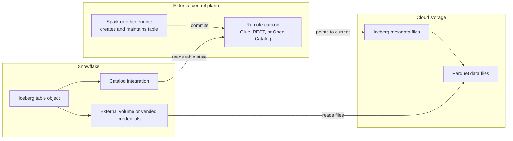
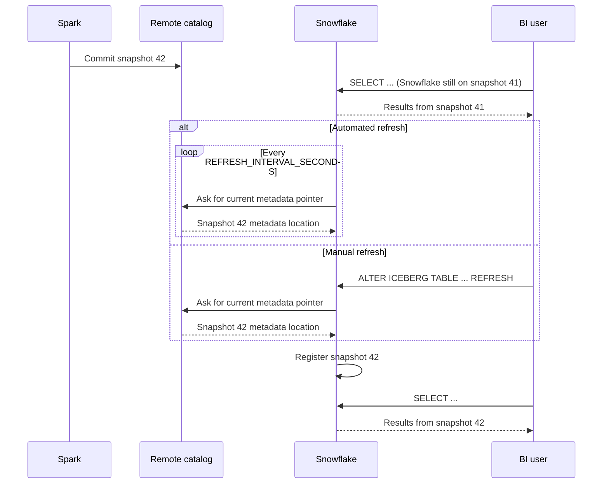
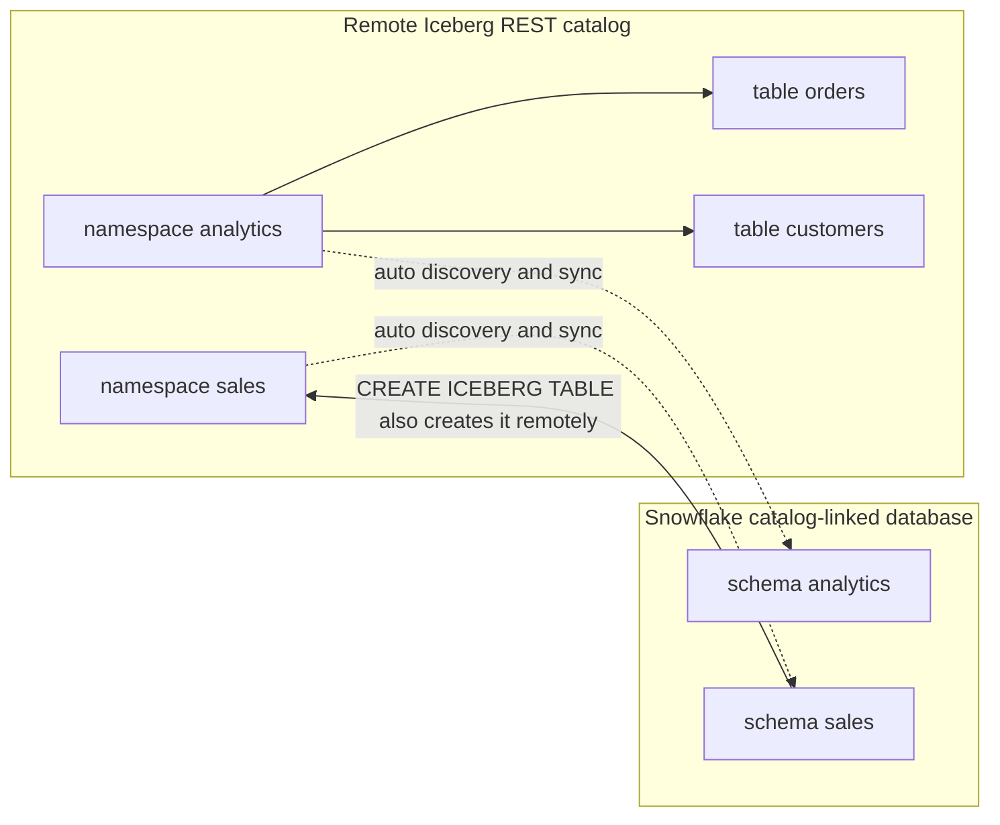
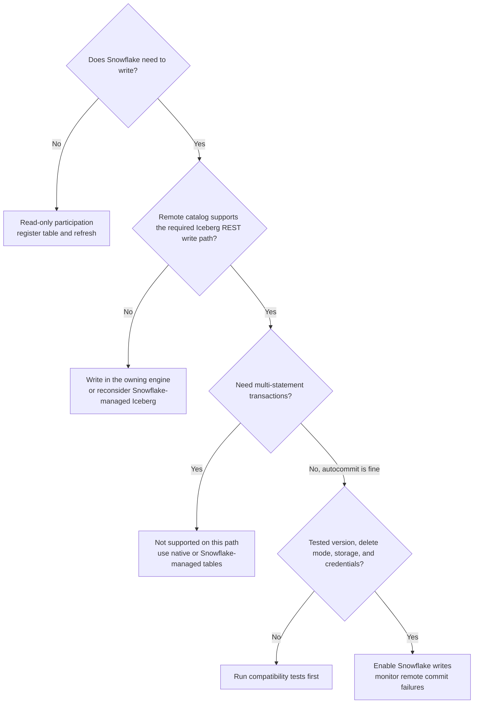
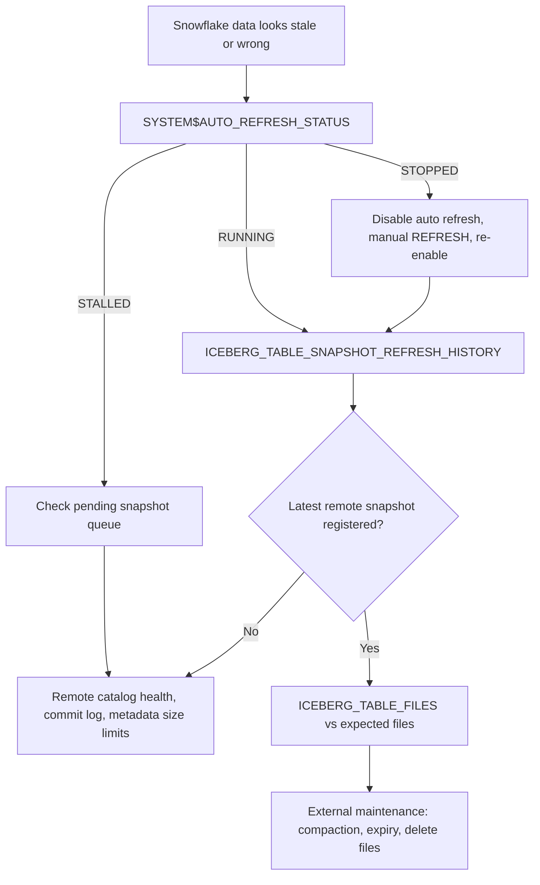

# Snowflake Externally Managed Iceberg

## 1. Why This Topic Matters

Most teams first hear about Iceberg in a simplified way:

- Snowflake-managed Iceberg means open tables in Snowflake
- native Snowflake tables mean warehouse-internal tables

That is not enough.

In real platforms, a much harder question appears:

- what if Snowflake should read and write the table, but Snowflake should not own the metadata control plane?

That is the world of externally managed Iceberg.

This matters when:

- Spark already owns the lakehouse catalog
- Unity Catalog, AWS Glue, or an Iceberg REST catalog is already the system of record
- Snowflake is one engine among several
- you need interoperability without replatforming metadata ownership into Snowflake

At architect level, this is not just a syntax topic.

It is about control-plane boundaries.

---

## 2. What Externally Managed Iceberg Is

An externally managed Iceberg table is an Iceberg table whose metadata is governed by an external catalog rather than by Snowflake.

Snowflake can still:

- query the table
- refresh its view of the table state
- in supported modes, write to the table

But Snowflake is not the source of truth for the metadata pointer.

Mental model:

- Snowflake-managed Iceberg = Snowflake owns metadata control
- externally managed Iceberg = remote catalog owns metadata control

That distinction changes everything:

- refresh semantics
- write semantics
- retention ownership
- troubleshooting responsibility
- what “table lifecycle” even means

---

## 3. What The External Catalog Actually Does

The external catalog is the first architectural layer of Iceberg.

Its core responsibilities are:

- storing the current metadata pointer
- performing atomic metadata-pointer updates
- acting as the system of record for table state

In Snowflake, common external-catalog shapes include:

- AWS Glue
- a remote Iceberg REST catalog
- Snowflake Open Catalog
- Unity Catalog through supported integration patterns

Architectural takeaway:

- if the remote catalog is the system of record, Snowflake is participating in the table ecosystem, not owning it



Snowflake holds a reference, not the authority. Everything Snowflake knows about the current snapshot comes through the catalog integration.

---

## 4. What It Is Good For

Externally managed Iceberg is strong when:

- you already have a lakehouse control plane outside Snowflake
- multiple engines must share one metadata authority
- Spark or another engine creates and evolves tables first
- Snowflake should consume or contribute without becoming the owner of metadata lifecycle

It is weaker when:

- Snowflake is clearly the main platform control plane
- the table exists only for Snowflake consumers
- the team does not want external-catalog operational overhead
- metadata governance outside Snowflake is weak or ambiguous

---

## 5. What It Is Not

Externally managed Iceberg is not:

- just another name for external tables
- the same thing as Snowflake-managed Iceberg with a different syntax
- a free interoperability win with no operational cost
- a good answer when nobody can clearly say who owns the remote catalog

If your team cannot answer:

- who owns the external catalog?
- who runs maintenance?
- who resolves metadata corruption?
- who approves schema evolution?

then you are not ready for externally managed Iceberg.

---

## 6. Core Objects In The Design

The usual architecture includes:

- external cloud storage
- external volume or catalog-vended credentials
- catalog integration
- remote catalog
- Iceberg table in that remote catalog
- Snowflake table object linked to that remote table

### 6.1 Catalog integration

A catalog integration tells Snowflake how to talk to the external catalog.

Representative example shape:

```sql
CREATE OR REPLACE CATALOG INTEGRATION my_rest_catalog_int
  CATALOG_SOURCE = ICEBERG_REST
  TABLE_FORMAT = ICEBERG
  CATALOG_URI = 'https://catalog.company.io/iceberg'
  ENABLED = TRUE
  REFRESH_INTERVAL_SECONDS = 60;
```

Architecture meaning:

- Snowflake now knows where the external metadata authority lives
- refresh cadence can be controlled centrally
- the external catalog, not Snowflake, remains the source of truth

### 6.2 External volume

If the remote catalog does not vend credentials, Snowflake also needs an external volume for data and metadata access.

Representative example:

```sql
CREATE OR REPLACE EXTERNAL VOLUME ext_lake_vol
  STORAGE_LOCATIONS = (
    (
      NAME = 'main'
      STORAGE_PROVIDER = 'S3'
      STORAGE_BASE_URL = 's3://company-lakehouse/'
      STORAGE_AWS_ROLE_ARN = 'arn:aws:iam::123456789012:role/snowflake-iceberg-role'
      STORAGE_AWS_EXTERNAL_ID = 'company-snowflake-prod'
    )
  );
```

### 6.3 Catalog-linked database

A catalog-linked database is a Snowflake database connected to an external Iceberg REST catalog.

It gives you:

- automatic table discovery
- synced namespaces and tables
- the ability to create and drop Iceberg objects through the linked catalog path

Representative example:

```sql
CREATE DATABASE lakehouse_linked_db
  LINKED_CATALOG = (
    CATALOG = 'my_rest_catalog_int'
  );
```

This is not just convenience.

It is a different operating model from manually creating one Iceberg table object at a time.

---

## 7. Zero-To-Practical Mental Model

If you are new to this, use this ladder:

### Level 1: Files

- Parquet files exist in object storage

### Level 2: Iceberg table

- metadata files, manifests, and snapshots turn those files into a table

### Level 3: external catalog

- a remote catalog owns the current metadata pointer

### Level 4: Snowflake registration

- Snowflake registers or discovers that remote table and can query it

### Level 5: optional write path

- in supported modes, Snowflake can also commit changes back to the remote catalog

That is why externally managed Iceberg is not “files in a stage plus SQL.”

It is Snowflake participating in an existing Iceberg control plane.

---

## 8. Read Path: How Snowflake Uses An Externally Managed Table

At read time, Snowflake does not invent table state.

It gets the table state from the external catalog or from refreshed metadata that reflects the remote catalog.

Representative creation in a standard Snowflake database:

```sql
CREATE OR REPLACE ICEBERG TABLE curated.orders_remote
  EXTERNAL_VOLUME = 'ext_lake_vol'
  CATALOG = 'my_rest_catalog_int'
  CATALOG_TABLE_NAME = 'orders';
```

Representative query:

```sql
SELECT
    order_date,
    COUNT(*) AS orders_cnt,
    SUM(net_amount) AS net_amount
FROM curated.orders_remote
WHERE order_date >= '2026-01-01'
GROUP BY order_date
ORDER BY order_date;
```

What matters architecturally:

- Snowflake can query the table as SQL
- but the authoritative snapshot chain lives outside Snowflake's control plane

---

## 9. Refresh: The Most Important Operational Boundary

This is where many teams get confused.

For externally managed Iceberg:

- remote changes do not become visible in Snowflake by magic
- Snowflake must refresh metadata state

### 9.1 Manual refresh

Representative command:

```sql
ALTER ICEBERG TABLE curated.orders_remote REFRESH;
```

Use this when:

- you need immediate sync after remote changes
- automated refresh is disabled
- you are debugging sync problems

### 9.2 Automated refresh

Representative create pattern:

```sql
CREATE OR REPLACE ICEBERG TABLE curated.orders_remote
  EXTERNAL_VOLUME = 'ext_lake_vol'
  CATALOG = 'my_rest_catalog_int'
  CATALOG_TABLE_NAME = 'orders'
  AUTO_REFRESH = TRUE;
```

Representative integration-level refresh interval:

```sql
ALTER CATALOG INTEGRATION my_rest_catalog_int
  SET REFRESH_INTERVAL_SECONDS = 120;
```

Important mental model:

- automated refresh polls the external catalog
- it is not event-driven file discovery like some external-table patterns
- shorter intervals are not free and can degrade performance



End-to-end freshness is producer commit time plus Snowflake refresh lag. A dashboard can be correct for snapshot 41 and still be stale from the business point of view.

### 9.3 Why refresh is architecturally central

In Snowflake-managed Iceberg, Snowflake owns metadata lifecycle.

In externally managed Iceberg, visibility depends on successful sync with the remote control plane.

That means your freshness conversation is partly:

- a catalog sync design problem

not only:

- a SQL query problem

---

## 10. Catalog-Linked Databases: The Serious Platform Pattern

Catalog-linked databases are the cleanest pattern when Snowflake should participate in a remote Iceberg ecosystem at scale.

Why they matter:

- you do not manually register every table one by one
- Snowflake auto-discovers namespaces and tables from the remote catalog
- you can inspect sync status as a system, not only table by table

Representative query flow:

```sql
USE DATABASE lakehouse_linked_db;

SELECT *
FROM analytics.orders
LIMIT 20;
```

Representative diagnostics:

```sql
SELECT SYSTEM$GET_CATALOG_LINKED_DATABASE_CONFIG('LAKEHOUSE_LINKED_DB');
```

```sql
SELECT SYSTEM$CATALOG_LINK_STATUS('LAKEHOUSE_LINKED_DB');
```

These are architect-grade tools because they answer:

- is the linked database configured correctly?
- is catalog sync healthy?
- are there tables discovered but not initialized?



Namespaces appear as schemas without one-by-one registration, and DDL in the linked database flows back to the remote catalog. That two-way link is why naming and case rules must agree on both sides.

### 10.1 Identifier behavior matters more than teams expect

Catalog-linked databases can become painful if case sensitivity is not understood.

Snowflake docs explicitly call out identifier-resolution behavior, especially for catalogs that normalize to lowercase.

Architectural rule:

- naming policy is part of interoperability design
- if one system uses lowercase quoted identifiers and another assumes normal Snowflake casing, your platform will become operationally brittle

---

## 11. Write Support: What Snowflake Can And Cannot Do

This is the most subtle part.

Snowflake supports writing to externally managed Iceberg tables, but only within documented compatibility boundaries.

### 11.1 Core idea

When Snowflake writes to an externally managed Iceberg table:

- it must commit the change to the remote catalog
- Snowflake does not become the metadata owner
- commit conflicts and remote-catalog failures are now part of your operational reality

Representative DML:

```sql
INSERT INTO curated.orders_remote VALUES (1, '2026-03-01', 100.00);
```

```sql
MERGE INTO curated.orders_remote AS tgt
USING mart.orders_delta AS src
ON tgt.order_id = src.order_id
WHEN MATCHED THEN UPDATE SET tgt.net_amount = src.net_amount
WHEN NOT MATCHED THEN INSERT VALUES (
  src.order_id,
  src.order_date,
  src.net_amount
);
```

### 11.2 Two main creation paths

#### Path A: catalog-linked database

Snowflake can create the table in Snowflake and in the remote catalog together.

Representative example:

```sql
USE DATABASE lakehouse_linked_db;
USE SCHEMA sales;

CREATE OR REPLACE ICEBERG TABLE orders_remote (
  order_id NUMBER,
  order_date DATE,
  net_amount NUMBER(18,2)
)
TARGET_FILE_SIZE = '64MB'
PARTITION BY (order_date);
```

#### Path B: standard Snowflake database

You first create the table in the remote catalog, then register it in Snowflake.

Representative example:

```sql
CREATE OR REPLACE ICEBERG TABLE curated.orders_remote
  EXTERNAL_VOLUME = 'ext_lake_vol'
  CATALOG = 'my_rest_catalog_int'
  CATALOG_TABLE_NAME = 'orders';
```

### 11.3 Architecturally important limitations

The write path is not “anything Snowflake SQL can do, therefore it is safe.”

Be explicit about these constraints:

- remote catalog must conform to Iceberg REST requirements for supported write paths
- multi-statement transactions are not supported for externally managed writes in the documented path; Snowflake supports autocommit only there
- some create patterns such as `OR REPLACE` or `CTAS` are limited depending on path and remote catalog
- remote-catalog-specific behavior matters, for example AWS Glue drop semantics

### 11.4 Version and catalog compatibility

Current Snowflake documentation describes write support for externally managed Iceberg tables using specification versions 2 and 3 through supported Iceberg REST catalog integrations. This does not mean every v2/v3 feature or every catalog implementation is supported identically.

Before enabling writes, verify the exact REST catalog, credential-vending or external-volume setup, storage provider, specification version, transaction behavior, row-level delete mode, and any preview or region constraints. Treat compatibility as a tested property of the concrete configuration, not as a general promise based on the Iceberg version number alone.



Most teams should stop at read-only participation. Add writes only when there is a clear reason and every gate above has a tested answer.

---

## 12. Row-Level Deletes, Merge-On-Read, And Maintenance Reality

Externally managed Iceberg is where row-level delete semantics become very real.

### 12.1 Position deletes

Current Snowflake documentation distinguishes row-level delete support by Iceberg version: position deletes are supported for v2 tables, while v3 uses deletion vectors; Snowflake supports position deletes only with externally managed Iceberg tables. Verify exact support for the selected catalog, storage provider, and account configuration.

That means:

- merge-on-read behavior is possible
- reads may need to reconcile delete files with data files
- maintenance quality in the external engine matters a lot

Representative control:

```sql
ALTER ICEBERG TABLE curated.orders_remote
  SET ICEBERG_MERGE_ON_READ_BEHAVIOR = 'DISABLED';
```

Where supported, disabling merge-on-read selects copy-on-write behavior instead of position-delete-driven merge-on-read. Confirm the parameter scope and version support for your table before applying it.

### 12.2 Why maintenance belongs to the external owner

Snowflake docs are explicit:

- for tables using an external catalog, maintenance operations such as expiring snapshots, removing old metadata, and compacting data files belong to the external Iceberg engine and operational toolchain

Snowflake consequence:

- after maintenance, refresh the table in Snowflake

Architectural rule:

- if Spark or another engine owns maintenance, Snowflake consumers depend on the quality of that maintenance

### 12.3 Dangerous failure mode

If position delete files accumulate badly:

- reads slow down
- refresh can fail
- create/refresh operations may break because of excessive dangling deletes

This is one of the reasons externally managed Iceberg requires a serious owner, not just an enthusiastic adopter.

---

## 13. Metadata Retention, Time Travel, And Ownership Boundaries

This is another major difference from Snowflake-managed Iceberg.

For tables that use an external catalog:

- Snowflake uses `DATA_RETENTION_TIME_IN_DAYS` only for Snowflake Time Travel and undrop semantics on the Snowflake side
- when retention expires, Snowflake does not delete Iceberg metadata or snapshots from your external storage

That means:

- external metadata retention remains an external responsibility
- storage cleanup remains an external responsibility
- remote catalog and engine policies drive long-term history behavior

Architect takeaway:

- externally managed Iceberg preserves Snowflake queryability, not Snowflake lifecycle ownership

---

## 14. Externally Managed Iceberg Versus Other Options

### Externally managed Iceberg vs Snowflake-managed Iceberg

Choose externally managed Iceberg when:

- remote catalog ownership is already real
- Snowflake should not become the metadata authority
- multiple engines already coordinate around one external control plane

Choose Snowflake-managed Iceberg when:

- Snowflake should own lifecycle and metadata state
- you still want open table format semantics
- external consumers need a governed Snowflake-controlled publish contract

### Externally managed Iceberg vs external tables

Externally managed Iceberg:

- real table semantics
- snapshots
- schema evolution
- query and optional write participation across engines

External tables:

- file-query access layer
- much lighter semantics
- better for discovery or raw exposure than for lakehouse contracts

### Externally managed Iceberg vs native Snowflake tables

Native tables win when:

- Snowflake is the only engine
- simplest operations matter most
- no external-catalog interoperability is required

Externally managed Iceberg wins when:

- one shared lakehouse control plane already exists outside Snowflake

---

## 15. Good Architecture Patterns

### Pattern 1: Spark owns, Snowflake consumes

Pattern:

- Spark writes and maintains curated Iceberg tables
- Glue or REST catalog owns metadata
- Snowflake queries those tables for BI and ad hoc analysis

Why this is strong:

- one metadata authority
- no duplicate published dataset
- Snowflake participates cleanly as a consumer

### Pattern 2: Multi-engine contract with remote control plane

Pattern:

- one domain team publishes an Iceberg contract through a remote catalog
- Snowflake, Spark, and Trino all query the same table
- Snowflake may also write corrections or enrichment in supported paths

Why this is strong:

- interoperability is real, not imaginary
- control plane remains centralized

### Pattern 3: Catalog-linked database as platform gateway

Pattern:

- remote catalog contains many lakehouse domains
- Snowflake uses a catalog-linked database for synchronized access
- platform team monitors sync and namespace health centrally

Why this is strong:

- scalable participation in a large Iceberg estate
- better than manually curating individual registrations

---

## 16. Bad Architecture Patterns

### Pattern 1: Nobody owns the remote catalog

Result:

- schema drift
- broken refresh
- debugging by guesswork

### Pattern 2: Snowflake is treated like the owner, but is not the owner

Result:

- false assumptions about retention and lifecycle
- production surprises after external maintenance or remote schema changes

### Pattern 3: Catalog sync is ignored as an NFR

Result:

- freshness is discussed at dashboard level
- actual bottleneck is stale catalog sync or bad refresh state

### Pattern 4: Teams choose external catalogs for fashion, not for governance reality

Result:

- complexity without organizational need
- platform split-brain between Snowflake and lakehouse tooling

---

## 17. Operational Cookbook

### 17.1 Register an existing remote table in a standard Snowflake database

```sql
CREATE OR REPLACE ICEBERG TABLE curated.orders_remote
  EXTERNAL_VOLUME = 'ext_lake_vol'
  CATALOG = 'my_rest_catalog_int'
  CATALOG_TABLE_NAME = 'orders';
```

### 17.2 Force refresh after remote changes

```sql
ALTER ICEBERG TABLE curated.orders_remote REFRESH;
```

### 17.3 Turn on automated refresh

```sql
ALTER ICEBERG TABLE curated.orders_remote
  SET AUTO_REFRESH = TRUE;
```

### 17.4 Check auto-refresh status

```sql
SELECT SYSTEM$AUTO_REFRESH_STATUS('CURATED.ORDERS_REMOTE');
```

Use this to inspect:

- whether refresh is `RUNNING`, `STALLED`, or `STOPPED`
- pending snapshot queue
- whether recovery is happening

### 17.5 Check snapshot refresh history

```sql
SELECT *
FROM TABLE(
  INFORMATION_SCHEMA.ICEBERG_TABLE_SNAPSHOT_REFRESH_HISTORY(
    TABLE_NAME => 'ORDERS_REMOTE'
  )
)
ORDER BY REFRESHED_AT DESC;
```

### 17.6 Check linked-database sync health

```sql
SELECT SYSTEM$CATALOG_LINK_STATUS('LAKEHOUSE_LINKED_DB');
```

```sql
SELECT SYSTEM$GET_CATALOG_LINKED_DATABASE_CONFIG('LAKEHOUSE_LINKED_DB');
```

### 17.7 Example write

```sql
MERGE INTO curated.orders_remote AS tgt
USING staging.orders_fix AS src
ON tgt.order_id = src.order_id
WHEN MATCHED THEN UPDATE SET
  tgt.net_amount = src.net_amount,
  tgt.order_date = src.order_date
WHEN NOT MATCHED THEN INSERT (
  order_id,
  order_date,
  net_amount
) VALUES (
  src.order_id,
  src.order_date,
  src.net_amount
);
```

### 17.8 Example incident recovery for stopped auto-refresh

If `SYSTEM$AUTO_REFRESH_STATUS` shows `STOPPED`:

1. Turn off automated refresh.
2. Run a manual refresh.
3. Re-enable automated refresh.
4. Verify that status returns to `RUNNING` and queued snapshots decrease.

Representative commands:

```sql
ALTER ICEBERG TABLE curated.orders_remote SET AUTO_REFRESH = FALSE;
```

```sql
ALTER ICEBERG TABLE curated.orders_remote REFRESH;
```

```sql
ALTER ICEBERG TABLE curated.orders_remote SET AUTO_REFRESH = TRUE;
```

---

## 18. Monitoring And Troubleshooting

### 18.1 Show table state

```sql
SHOW ICEBERG TABLES IN SCHEMA curated;
```

Important fields to inspect:

- `auto_refresh_status`
- whether the table is initialized correctly
- table-level visibility across a schema

### 18.2 Find registered files or refresh history

Snowflake documents useful table functions for externally managed tables:

- `ICEBERG_TABLE_FILES`
- `ICEBERG_TABLE_SNAPSHOT_REFRESH_HISTORY`

These matter when you need to answer:

- what files does Snowflake think belong to this table?
- which snapshot was last refreshed?
- why is Snowflake behind remote reality?

### 18.3 Remote-catalog failures are first-class incidents

Snowflake documents failure modes such as:

- failed commit to external catalog
- ambiguous commit status with no response from remote catalog
- metadata size limits in the remote catalog, for example Glue constraints

Architectural meaning:

- your on-call story must include external-catalog logs and operational ownership
- Snowflake alone cannot explain every failure end to end

### 18.4 Refresh monitoring through event tables

For automated refresh, Snowflake also supports event-table monitoring with `LOG_LEVEL` and refresh lifecycle events.

This is useful when you want:

- stale-table alerts
- refresh-latency monitoring
- visibility into refresh starts, completions, and errors

### 18.5 Troubleshooting flow



Work from Snowflake outward. Once Snowflake has the latest snapshot, the remaining causes usually sit in the remote catalog or the external maintenance toolchain.

---

## 19. Decision Heuristics

Choose externally managed Iceberg when:

- another platform already owns the catalog
- multi-engine interoperability is real today, not hypothetical
- Snowflake should participate without becoming the metadata owner
- you have real operational ownership for remote maintenance and schema governance

Choose Snowflake-managed Iceberg when:

- Snowflake should own metadata lifecycle
- you still need open table format semantics
- you want better Snowflake platform support and simpler Snowflake-side operations

Choose native Snowflake tables when:

- Snowflake is the real center of gravity
- no external catalog is required
- simplest path to reliable analytics matters most

Choose external tables when:

- you only need file exposure or discovery
- you do not yet need full Iceberg table semantics

---

## 20. Interview-Ready Summary

Strong short answer:

> I use externally managed Iceberg when a remote catalog such as Glue, Unity-style REST, or another Iceberg control plane is already the system of record and Snowflake should operate as one engine in that ecosystem rather than the owner of metadata. The key architecture question is not just whether I want open tables, but who owns the metadata pointer, retention, maintenance, and schema evolution. If Snowflake should own those concerns, I use Snowflake-managed Iceberg instead.

Architect takeaway:

- externally managed Iceberg is about shared metadata ownership outside Snowflake
- the hard parts are refresh, sync, maintenance, and operational responsibility
- the right answer depends more on control-plane ownership than on SQL syntax