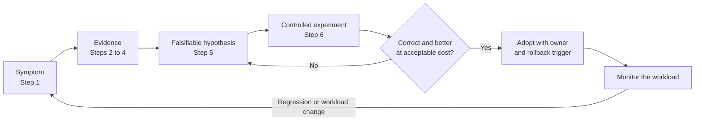
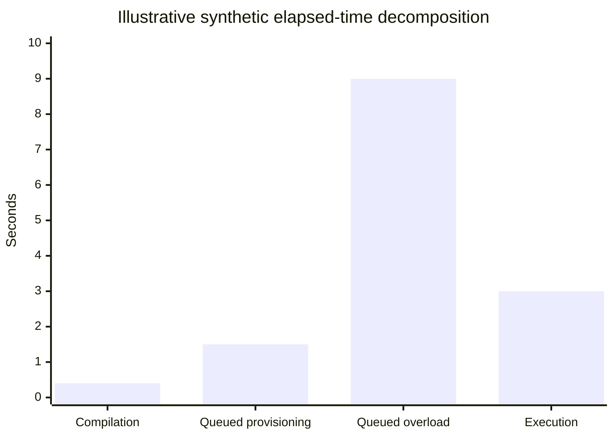
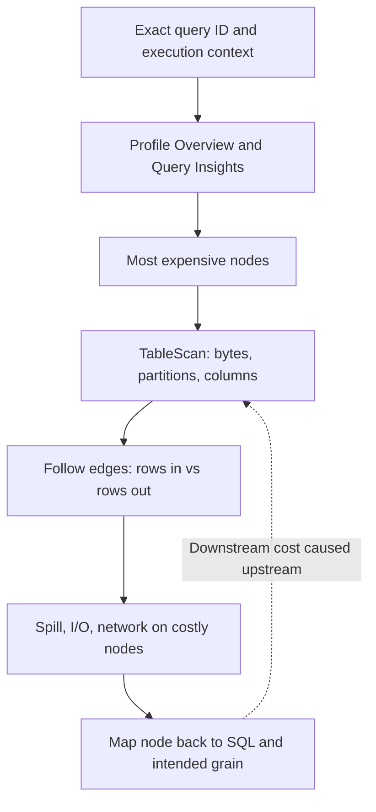
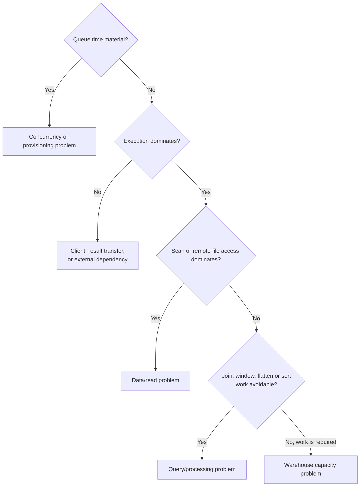

# Execution Plan Analysis: A Senior Diagnostic Method

## Purpose

This guide teaches how to investigate a slow Snowflake query before selecting an optimization. The goal is to identify the dominant work, separate query problems from warehouse contention, preserve result semantics, and verify that a change improved the workload rather than one benchmark run.

A Snowflake Query Profile is a runtime execution profile represented as operator nodes and data-flow edges. It is not merely a static relational plan: the profile reports what happened for a completed execution under a particular warehouse, data state, cache state, role, and concurrent workload.

The loop closes only when the result is correct, the metric moved as predicted, and someone owns the follow-up.

## The Diagnostic Contract

For every investigation, capture:

- query ID, query text or parameterized query hash
- start time, status, user/role, warehouse and size
- database/schema context, query tag, client/driver when relevant
- parameters, data volume, and whether the run was cold or warm
- expected result grain, row count, freshness and latency objective
- baseline elapsed time and cost/usage context

Do not compare runs if the query, data, warehouse, role, concurrency, or cache conditions changed without recording the difference.

## Step 1: Classify The Symptom

Start with total elapsed time, then decompose it. The first question is not “should I resize?” but “where did this execution spend time or wait?”

In this synthetic run, SQL tuning could address only the 3-second execution slice; the 9-second overload queue points first to concurrency handling.

| Symptom | First hypothesis to test | First evidence |
| --- | --- | --- |
| High total latency, normal execution, high provisioning queue | Warehouse was suspended, resuming, or resizing | `QUEUED_PROVISIONING_TIME`, warehouse state/history |
| High overload queue | More concurrent work than the warehouse configuration handled | `QUEUED_OVERLOAD_TIME`, warehouse load history, concurrency by workload |
| Long execution with a large TableScan | Large scan, weak pruning, wide projection, or external reads | `BYTES_SCANNED`, partitions scanned/total, TableScan node |
| Long execution with a high-cost Join/Aggregate/Window/Sort | Large intermediate rowsets, cardinality, sorting, or partition skew | Operator time, input/output rows, spill, plan edges |
| High remote spill | Intermediate work exceeded available local memory/storage capacity or was amplified by the plan | Spill metrics on the expensive operators, row counts, warehouse size |
| Low execution time but slow application | Result transfer, client processing, network, or application work | `BYTES_WRITTEN_TO_RESULT`, client timing, network and application telemetry |
| Performance varies on repeated runs | Cache state, concurrency, data changes, or adaptive/runtime behavior differs | Query History, cache percentage, warehouse load and query profile for each run |

A symptom is not yet a root cause. One signal can have several explanations.

## Step 2: Read Query Profile From The Outside In

1. Open the exact query ID in Query History and confirm execution context.
2. Look at Profile Overview and Query Insights for initial warnings, not final answers.
3. Find the most expensive nodes and note their operator types and percentage of execution time.
4. Start at TableScan nodes: identify tables, columns accessed, bytes, partitions, and extracted VARIANT paths.
5. Follow the data-flow edges forward and compare rows entering and leaving filters, joins, flatten, windows, aggregates, sorts, and result nodes.
6. Inspect spill, local/remote I/O, network communication, and execution-time breakdown on the specific nodes doing the work.
7. Trace each expensive node back to the SQL expression and its intended data grain.

The plan is a graph, not a left-to-right checklist. A high-cost downstream operator may be caused by an earlier scan or row expansion.

## Step 3: Interpret The Main Operators

### TableScan

Check bytes scanned, partitions scanned versus total, projected columns, filters/access predicates, and whether the data is native, Iceberg, or external. A large percentage scanned can be appropriate for a query that intentionally reads most of a table. Compare the observed scan with the query's required data, not a universal target percentage.

### Filter

Verify that the predicate is selective and semantically correct. If the filter is expected to reduce a large input but output rows remain high, check data distribution, type conversions, null behavior, and whether the condition was applied at the useful point in the plan. Snowflake can reorder operations; SQL text order alone does not prove execution order.

### Join and JoinFilter

Compare input and output rows at each join. Output much larger than either input can indicate many-to-many matches, duplicate keys, an incomplete predicate, or a legitimate fan-out that needs to be bounded. A JoinFilter can show dynamic filtering behavior. Never “fix” join cardinality without checking expected semantics.

### Flatten

Treat the output grain explicitly: one input event may become many item rows and then many detail rows. Estimate expansion ratios and check whether aggregates are later double-counting parent-level measures.

### WindowFunction, Aggregate, Sort

Check how many rows enter each operator, the partition/group keys, the need for ordering, and whether wide rows are carried farther than necessary. A window may require repartitioning or sorting; it is not automatically cheaper than a join. An ORDER BY inside a nested query may be unnecessary, but the final presentation order can be a real requirement.

## Step 4: Separate Data, Compute, And Concurrency Problems

- **Data/read problem:** too much data scanned, poor locality, too many columns, or remote file access dominates.
- **Query/processing problem:** joins, window sorts, flatten expansion, repeated calculations, or a complex view graph dominate.
- **Warehouse capacity problem:** the expensive operator needs more compute or memory after reducing avoidable work.
- **Concurrency problem:** the query is waiting for other work; more clusters or workload isolation may help, while a larger single cluster may target a different bottleneck.
- **External dependency problem:** file listing, remote storage access, external functions, cross-region transfer, or client time dominates.

These categories can coexist. Tune the dominant one first and re-measure the others.

## Step 5: Form A Falsifiable Hypothesis

A useful hypothesis predicts an observable change. For example:

> “Promoting the event date into a typed column will reduce partitions scanned for the hourly report; Query Profile should show lower scan bytes and the same result rows. If partitions scanned stay similar, the current layout or predicate may not be the limiting factor.”

Avoid vague hypotheses such as “clustering should make it faster” or “the bigger warehouse should fix it.”

## Step 6: Run A Controlled Experiment

1. Preserve a correct baseline query and expected output.
2. Change one variable at a time: SQL shape, projection, table layout, feature, or warehouse setting.
3. Use representative data and at least several runs if workload variance matters.
4. Record cold and warm runs separately; do not compare a cached run with an uncached baseline.
5. Check correctness, latency, scan, partitions, operator rows, spill, queueing, and usage/cost together.
6. Consider concurrent workloads and whether the change moves cost elsewhere.
7. Record the rollback condition and re-evaluation trigger.

A benchmark that is faster but returns different grain or drops rows is a correctness regression, not an optimization.

## Common Diagnostic Mistakes

- Resizing before separating queue time from execution time.
- Treating partitions scanned/total as an absolute pass/fail threshold.
- Reading one operator's `overall_percentage` as a complete attribution of every overlapping stage.
- Assuming zero or missing metrics mean the work was free; some fields are omitted when zero or unsupported.
- Assuming `GET_QUERY_OPERATOR_STATS` is available for any query at any age; it requires a completed query and sufficient warehouse monitoring privileges, and its documented history window is limited.
- Assuming a warm cache is representative of first-run or changed-data behavior.
- Optimizing one dashboard without identifying its downstream users, SLA, and cost owner.

## Follow-Up Guides

- [Metrics reference](02_metrics_reference.md)
- [Table and storage performance](03_table_and_storage_performance.md)
- [SQL patterns and operator behavior](04_sql_patterns_and_operators.md)
- [Caching](05_caching.md)
- [Optimization features and hidden costs](06_optimization_features_and_hidden_costs.md)
- [Production-shaped cases](07_production_casebook.md)
- [Architecture decisions](08_architecture_decisions.md)
- [Senior interview questions and answers](09_senior_interview_questions.md)
