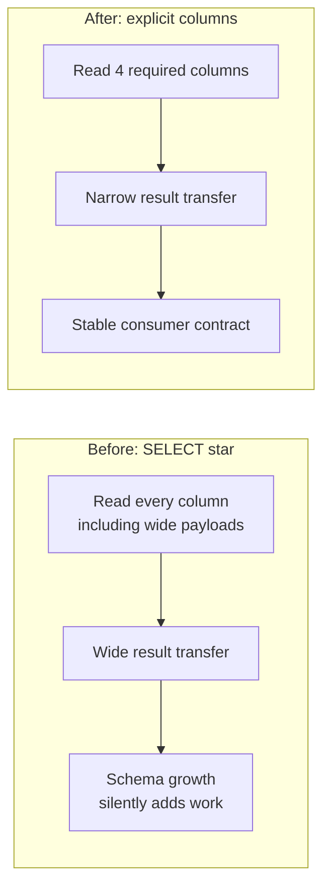
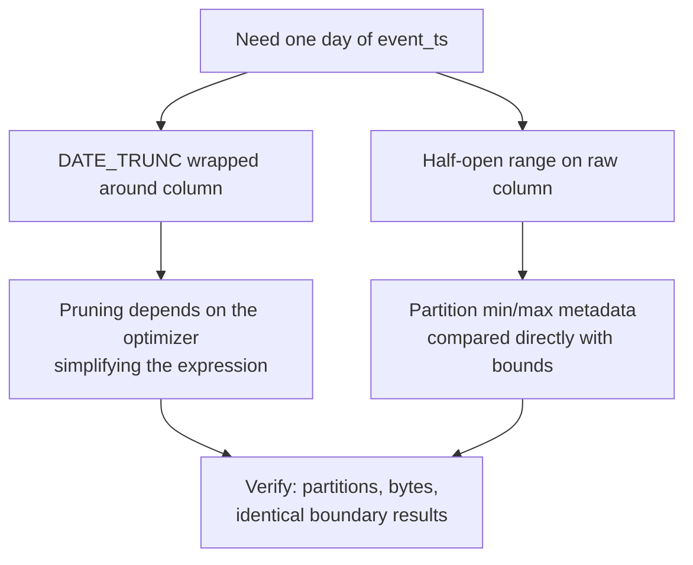
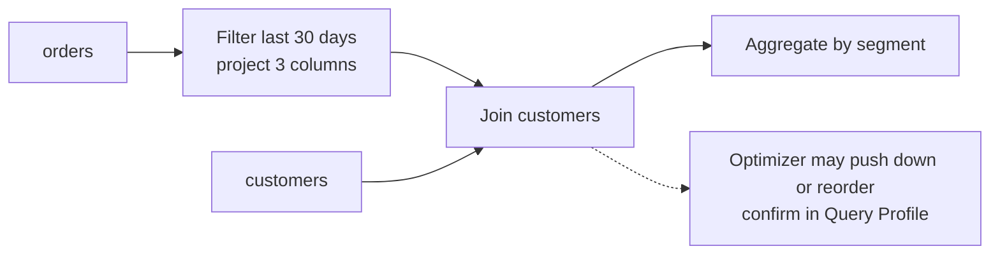
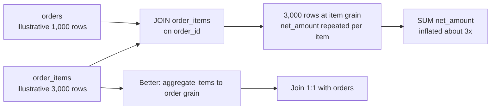
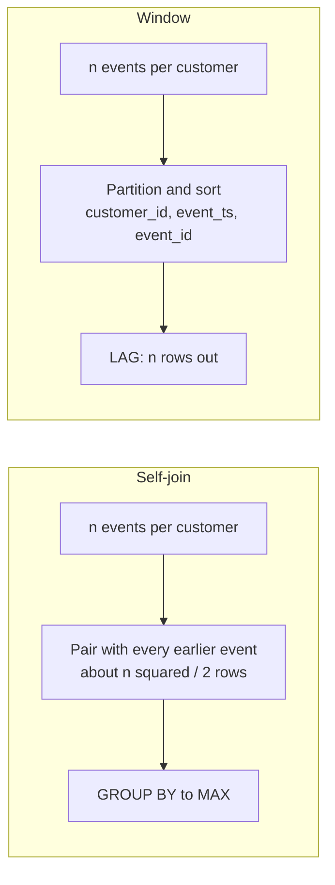
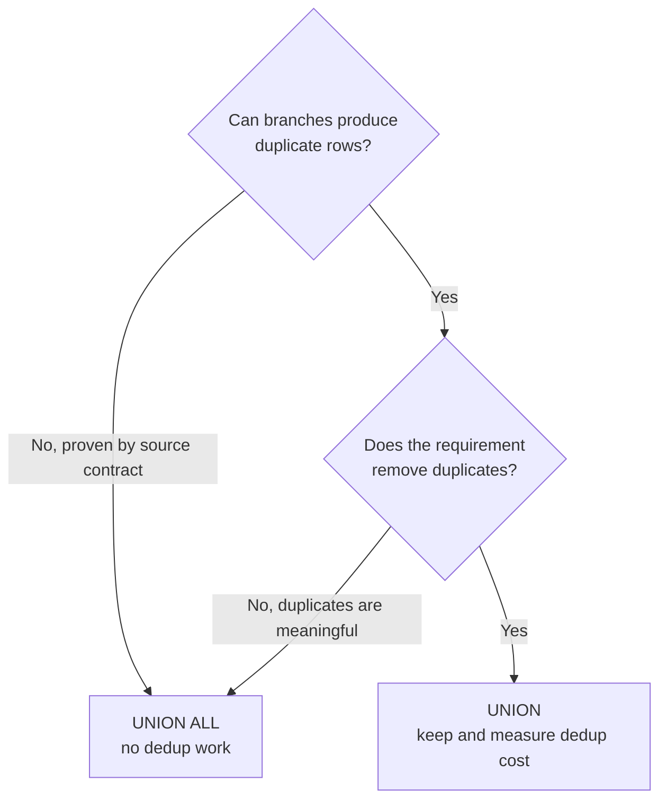

# SQL Patterns and Operator Behavior

SQL tuning is not a contest to write the fewest lines. Snowflake's optimizer can reorder and transform many expressions. Use a rewrite when it reduces required work or clarifies semantics, then verify the actual profile and result. This guide focuses on common query shapes that create unnecessary scans, rows, sorts, or repeated work.

## 1. Project Only Required Columns

**Avoid broad projection in production contracts:**

```sql
SELECT *
FROM analytics.orders
WHERE order_date >= '2026-01-01';
```

**Prefer the consumer's actual column set:**

```sql
SELECT order_id, customer_id, order_date, net_amount
FROM analytics.orders
WHERE order_date >= '2026-01-01';
```

Snowflake uses columnar storage and can avoid reading unused columns from native tables. Narrow projection also reduces result transfer and downstream row width. `SELECT *` can still be appropriate for exploration; avoid freezing it into views, dashboards, or contracts where schema growth silently expands work.



## 2. Write Clear Range Predicates

A function around a filter column can make pruning harder to reason about and may prevent an efficient predicate shape for some expressions.

**Function-wrapped day predicate:**

```sql
WHERE DATE_TRUNC('DAY', event_ts) = '2026-01-15'::TIMESTAMP_NTZ
```

**Equivalent half-open range, when the timestamp semantics match:**

```sql
WHERE event_ts >= '2026-01-15 00:00:00'::TIMESTAMP_NTZ
  AND event_ts <  '2026-01-16 00:00:00'::TIMESTAMP_NTZ
```

The half-open range avoids overlap at day boundaries. Be explicit about timestamp type and timezone. Snowflake may optimize some function-wrapped predicates; this rewrite is a testable hypothesis, not a universal rule. Compare partitions scanned, bytes, and results.



## 3. Filter and Project Before Large Joins When Semantics Allow

Build the narrow input needed by a join:

```sql
WITH recent_orders AS (
  SELECT customer_id, order_id, net_amount
  FROM analytics.orders
  WHERE order_date >= DATEADD('DAY', -30, CURRENT_DATE())
)
SELECT c.segment, SUM(o.net_amount) AS revenue
FROM recent_orders AS o
JOIN analytics.customers AS c
  ON c.customer_id = o.customer_id
GROUP BY c.segment;
```

The SQL text expresses intent; it does not force execution order. Snowflake can push filters and reorder operations. Verify the plan rather than assuming a CTE guarantees an early filter.



The diagram shows intended data flow; the runtime plan is the evidence.

## 4. Validate Join Grain Before Tuning Join Speed

A join can multiply rows when keys are not unique at the intended grain.

```sql
SELECT o.order_id, i.sku, o.net_amount
FROM orders AS o
JOIN order_items AS i
  ON i.order_id = o.order_id;
```

If `net_amount` is order-grain, summing it after the item join repeats it once per item. Aggregate at the right grain or join a deduplicated/aggregated relation. In Query Profile compare each join's input and output rows; large growth is a diagnostic signal, not automatically a bug.

A correct join condition is primarily a correctness requirement. Do not add a date/key predicate solely to encourage pruning unless it is logically valid for every matched row.



Row counts are illustrative and synthetic: the join is fast or slow independently of whether its output grain is correct.

## 5. Treat `OR` Join Rewrites Carefully

A join predicate such as `a.key1 = b.key1 OR a.key2 = b.key2` can be harder for the optimizer and may produce expensive plans. It does **not** mean every such join is necessarily implemented as a Cartesian product.

Possible alternatives include separate joins combined with `UNION ALL`, a normalized key mapping, or an `EXISTS` predicate. Each rewrite has different duplicate and null semantics. Before changing it, define whether a row matching both branches should appear once or twice, make the branches disjoint if needed, and compare output sets as well as operator cost.

## 6. Window Function Versus Self-Join

A window can express row-relative logic without pairing every row with every other qualifying row.

**Self-join for previous event:**

```sql
SELECT a.customer_id, a.event_ts, MAX(b.event_ts) AS prior_event_ts
FROM events AS a
LEFT JOIN events AS b
  ON b.customer_id = a.customer_id
 AND b.event_ts < a.event_ts
GROUP BY a.customer_id, a.event_ts;
```

**Window form:**

```sql
SELECT
  customer_id,
  event_ts,
  LAG(event_ts) OVER (
    PARTITION BY customer_id
    ORDER BY event_ts, event_id
  ) AS prior_event_ts
FROM events;
```

The window form is often a clearer candidate for ordered row-relative calculations. It may still require repartitioning and sorting; a very large or skewed partition can be expensive. Include deterministic tie-breaking and verify null, duplicate, frame, and ordering semantics before comparing.



The window avoids quadratic pairs but still pays for partitioning and sorting; one huge or skewed partition can still spill.

## 7. Reduce Window Input and Partition Width

A window processes rows within its partition and order specification. Filter to the necessary time range and project only needed columns before the window when the business result permits. Do not add a filter before the window if the requested calculation requires older history; that changes the answer.

Use a stable `PARTITION BY` grain. A single hot key may create a disproportionately large partition. Query Profile row counts, sort work, and spill help distinguish skew/partition size from warehouse shortage.

## 8. `UNION` Versus `UNION ALL`

`UNION` removes duplicates; `UNION ALL` preserves all rows. Duplicate elimination requires additional work, but changing to `UNION ALL` is correct only when duplicates are meaningful or already excluded by the source contract.

If the requirement is deduplication, keep it and measure it. If deduplication is unnecessary, `UNION ALL` avoids that work. Compare output multiset semantics, not just row counts.



## 9. Sort Only When The Contract Requires Ordering

An outer result has no guaranteed order without a final `ORDER BY`. Remove sorts from subqueries or intermediate stages when their order is not consumed by a semantic construct such as a window or top-N operation. Keep final ordering when consumers need it, and measure its input row count and spill.

## 10. CTE Reuse Is A Plan Question

CTEs primarily improve readability and structure; do not assume they are always materialized or always recomputed. Repeated references can produce a `WithClause` or repeated work depending on query shape and optimizer choices.

Compare:

- one shared CTE referenced several times
- repeated expressions that the optimizer may simplify
- a temporary/staging table with write, storage, and lifecycle cost

Materialize only when profiling shows repeated expensive work and the added write/read, refresh, storage, and concurrency costs are justified. A CTE is not inherently a performance problem.

## 11. Avoid Repeated Complex View Expansion Without Evidence

A view is a logical interface, not automatically a materialized result. Nested views can hide repeated scans, duplicated joins, or incompatible filters. But “complex views are slow” is too broad: the optimizer can inline and optimize views effectively.

Inspect the expanded plan and repeated TableScan/Join operators. If the same expensive logic is repeatedly consumed and freshness permits, compare a materialized view, dynamic table, pre-aggregated table, or simplified semantic layer. Account for maintenance, storage, and policy behavior.

## 12. Semi-Structured Expansion

Filter the relevant events and payload paths before expanding arrays when that preserves semantics. Then flatten only the path and levels needed. `FLATTEN` changes row grain; multiple nested arrays can multiply rows and amplify joins and aggregations.

```sql
WITH filtered_events AS (
  SELECT event_id, payload
  FROM raw.events
  WHERE event_date >= '2026-01-01'::DATE
)
SELECT
  e.event_id,
  item.index AS item_index,
  item.value:sku::STRING AS sku
FROM filtered_events AS e,
LATERAL FLATTEN(INPUT => e.payload:items) AS item;
```

The optimizer may reorder operations; use Query Profile to check scans and row counts. For repeated analytics, compare typed projections or a managed staging relation against repeated runtime flattening.

## 13. Function And Cast Costs

Scalar functions are not automatically expensive. The important questions are where they execute, how many rows reach them, whether they prevent pruning, whether they invoke external services, and whether they transform the data into the required type.

- Use direct typed predicates when possible; avoid repeated implicit casts on join keys.
- Prefer safe conversion only when the error-handling semantics are intentional.
- Profile UDFs, external functions, and high-cardinality transformations separately; initialization, per-row calls, network, and retries may dominate.
- Normalize frequently filtered `VARIANT` paths when measurements and the data contract justify it.

## Rewrite Review Checklist

- Is the output grain identical before and after the rewrite?
- Are duplicate, null, timezone, ordering, and tie semantics preserved?
- Did the expensive operator or scanned data actually decrease?
- Did a temporary table, materialized view, or dynamic table move work to refresh time instead?
- Did cost, freshness, concurrency, or maintainability regress?
