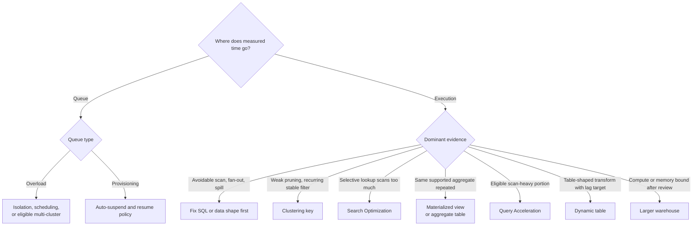
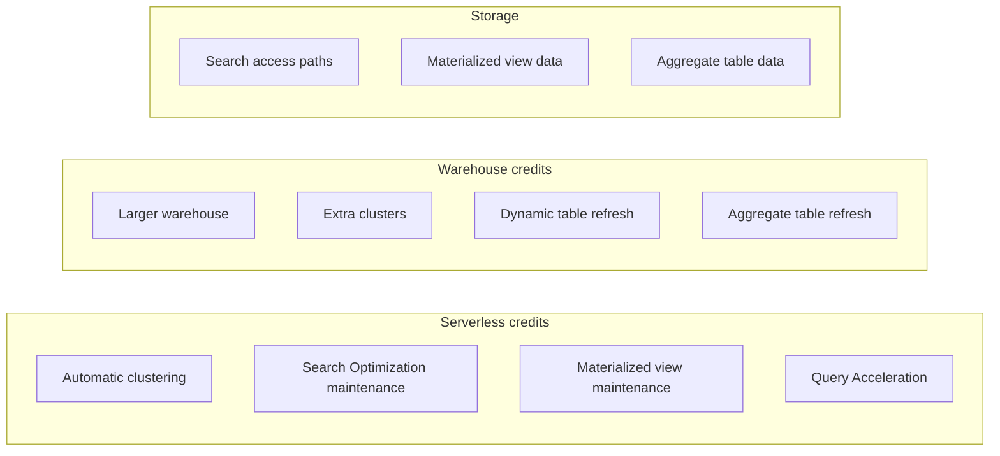
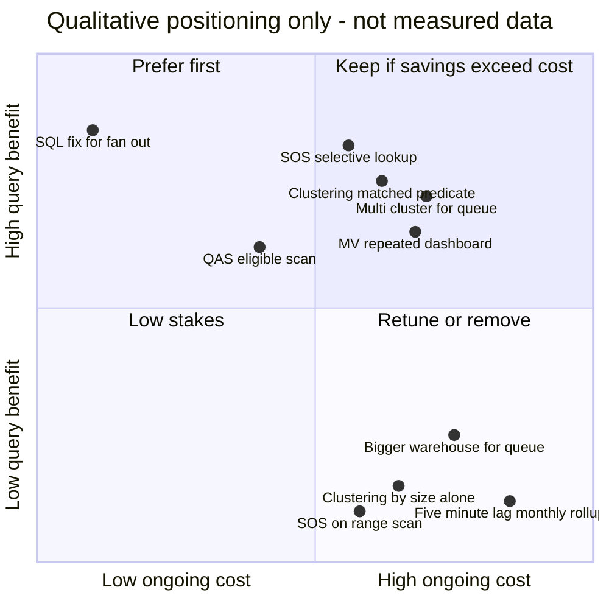
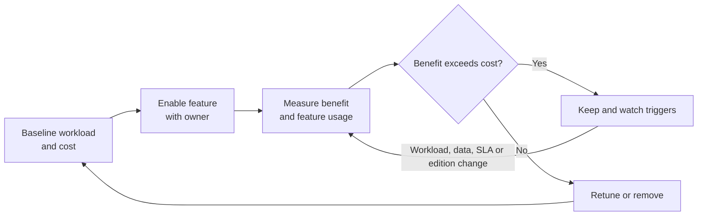

# Optimization Features and Hidden Costs

Optimization features move work to a different place or time. Evaluate their benefit across the full workload: query latency, freshness, concurrency, storage, maintenance, serverless usage, and operating ownership.

## Decision Rule

Before enabling a feature, answer four questions:

1. What measured bottleneck does it address?
2. Which query shapes and tables are eligible?
3. What recurring storage, compute, refresh, or administration cost does it add?
4. Who monitors the feature and decides when to remove or retune it?

A feature that makes one benchmark faster can still worsen total platform cost or operational reliability.

Every leaf is a candidate to test against a baseline, not a final answer.

## 1. Clustering Keys And Automatic Clustering

### What it changes

Snowflake uses micro-partition metadata for pruning. A clustering key can improve data locality for selected dimensions on supported tables, helping repeated filters or joins scan fewer partitions when natural load order is insufficient. Automatic clustering maintains the layout and consumes compute.

### Consider it when

- a large table serves recurring selective predicates on stable dimensions
- Query Profile shows repeated poor pruning for those workloads
- clustering information indicates overlap that can plausibly be improved
- expected workload savings exceed reclustering and storage costs

### Avoid it when

- natural clustering already meets the service objective
- query volume is low or predicates vary widely
- the table changes rapidly and maintenance churn would be high
- the only argument is that a table is “large” or has a high-cardinality column

Measure workload query history, partitions scanned, clustering depth/overlap, table growth and DML, and automatic-clustering usage. Clustering depth is a diagnostic aid, not a standalone pass/fail score. Query performance and cost are the final evidence.

**Example:** A daily report filters a multi-year event table to one tenant and one week, but repeatedly scans most partitions. Compare the current natural layout with a candidate key such as `(tenant_id, event_date)`. For a monthly report that already reads most rows, leave the layout alone unless other queries benefit.

## 2. Search Optimization Service

Search Optimization can improve supported selective lookup patterns by maintaining search access paths. It is often considered for selective point lookups where ordinary pruning leaves too much scan work. It is not a universal index and does not replace good table design.

Evaluate:

- the exact predicate and data type
- query frequency and selectivity
- query-profile evidence before and after enablement
- search-optimization storage/maintenance usage
- supported expressions, join forms, table types, edition, and account availability

A highly selective lookup can be a candidate; broad range scans or unsupported query shapes may not benefit. Confirm eligibility in current Snowflake documentation and test the actual workload.

**Example:** A support tool retrieves a few records by `customer_id`; test Search Optimization if normal pruning scans many partitions. A report that reads every order in a month is a different shape and is not a reason to enable it.

## 3. Materialized Views

A materialized view stores a maintained precomputed result for supported query patterns. It can reduce repeated work for frequently executed queries, but adds storage and refresh/maintenance cost and is subject to eligibility and edition requirements. Materialized views, including those over external tables, require Enterprise Edition or higher; verify current edition and feature conditions.

Compare a materialized view with:

- a native aggregate table refreshed by a pipeline
- a dynamic table with an explicit target lag
- a dbt model or scheduled transformation
- keeping the source query if it is already within SLA

**Example:** A repeatedly queried dashboard aggregate may fit a supported materialized view when consumers need the same calculation. Choose an explicit aggregate table instead when the team needs custom late-data handling, release-controlled logic, or a broader tested data contract.

Measure refresh cost, storage, query rewrite or usage, freshness, and the set of consumers. Do not equate “heavy query” with “materialized view candidate” without a repeated workload and supported definition.

## 4. Query Acceleration Service

Query Acceleration Service can provide additional serverless compute for eligible portions of supported queries. It can be a candidate for scan-heavy workloads with selective filtering where the accelerated work is useful, but it does not repair incorrect joins, excessive output, or an unsuitable table contract.

Evaluate eligibility, query acceleration history, bytes/partitions accelerated, latency, and serverless charges. Compare QAS with query rewrite, clustering, Search Optimization, and a different warehouse configuration. Confirm edition and account availability before recommending it.

**Example:** A selective scan-heavy query may be a QAS candidate if it is eligible and execution-bound. If the same query's elapsed time is dominated by overload queueing, first evaluate scheduling, isolation, or concurrency scaling instead.

## 5. Dynamic Tables

Dynamic tables express a query result and target freshness lag; Snowflake manages refresh behavior for supported query patterns. They can simplify table-shaped transformation pipelines, but a target lag is not a promise that every refresh completes at that exact latency under all conditions.

Hidden costs and risks include:

- frequent refresh work for a target lag tighter than consumer needs
- chained dependencies where upstream lag affects downstream freshness
- refresh failures, target lag changes, and query eligibility restrictions
- compute isolation and attribution across multiple dynamic tables

Inspect refresh history, actual lag, refresh mode, dependency graph, query cost, and business SLA. Compare with scheduled tasks, streams, dbt, and full rebuilds where appropriate.

**Example:** A fraud operations table may justify a tight freshness target; a monthly finance rollup read once each morning may be better on a scheduled refresh. Do not assign both layers the same target by habit.

## 6. Warehouse Size, Multi-Cluster, And Scaling Policy

- **Resize up** when one query's execution is compute/memory constrained after avoidable work is addressed.
- **Multi-cluster or scale out** when concurrent queries queue for capacity and the workload is eligible for that behavior.
- **Separate warehouses** when workload classes need independent concurrency, access, schedule, or cost ownership.
- **Auto-suspend/resume and scaling policy** control idle usage, resume latency, queue behavior, and cost.

A larger single warehouse and additional clusters solve different problems. Benchmark one representative workload and concurrency profile. Track credits/usage and effects on neighboring workloads before rollout.

**Example:** A query with high execution time and remote spill but little queueing is a candidate for SQL/data-shape investigation and a controlled size test. Many short queries with high overload queueing point instead toward workload isolation, scheduling, or eligible multi-cluster behavior.

## 7. Pre-Aggregated Or Materialized Data Products

A curated aggregate table can reduce repeated scans and joins for stable dashboard or reporting workloads. It adds a refresh pipeline, storage, lineage, quality checks, and freshness contract. It may be preferable to an automatic feature when the team needs explicit modeling and release control; it may be unnecessary when workload volume is small.

Define grain, source-of-truth ownership, refresh semantics, late-data handling, and consumers before building it.

**Example:** If five dashboards repeatedly join orders and items to report daily revenue by region, a tested `(order_date, region)` aggregate may reduce repeated work. If only one low-volume query uses it, query-time computation is likely simpler.

## 8. Feature Cost Ledger

| Feature/change | Direct cost | Less-visible cost | Evidence to keep it |
| --- | --- | --- | --- |
| Clustering | Automatic-clustering compute and storage effects | Maintenance churn, DML interaction, ownership | Sustained query savings for recurring predicates |
| Search Optimization | Service storage and maintenance | Configuration drift, eligibility limits | Better latency/cost for measured selective lookups |
| Materialized view | Stored data and maintenance | Refresh load, edition/definition restrictions | Repeated query reduction greater than maintenance cost |
| Query Acceleration | Serverless acceleration usage | Feature eligibility and attribution complexity | Improvement in the intended query group with acceptable usage |
| Dynamic table | Refresh compute | Cascaded lag, refresh retries, monitoring burden | Business-aligned freshness at acceptable refresh cost |
| Larger warehouse | Higher compute rate | Idle spend and competition with other workloads | Lower SLA miss rate or total runtime with controlled cost |
| Multi-cluster | Additional active cluster usage | Scaling policy behavior and cost variability | Lower concurrency queueing for the target workload |
| Aggregate table | Storage and scheduled/incremental refresh | Duplicate logic, lineage, freshness and correction paths | Reused result materially reduces total workload cost |

Serverless usage does not appear on the query's own warehouse, so attribute it separately when judging whether a feature pays for itself.

The same feature lands in different quadrants depending on workload fit; the casebook shows the mismatched versions.

## Removal And Re-Evaluation

Every optimization should have an owner, baseline, success measure, cost measure, and re-evaluation trigger. Remove or retune it when the workload, data distribution, service objective, edition, or account capability changes.

## Official References

- [Clustering keys](https://docs.snowflake.com/en/user-guide/tables-clustering-keys)
- [Search Optimization Service](https://docs.snowflake.com/en/user-guide/search-optimization-service)
- [Query Acceleration Service](https://docs.snowflake.com/en/user-guide/query-acceleration-service)
- [Materialized views](https://docs.snowflake.com/en/user-guide/views-materialized)
- [Dynamic table performance](https://docs.snowflake.com/en/user-guide/dynamic-tables-performance)
