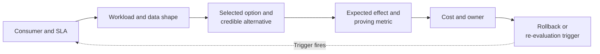
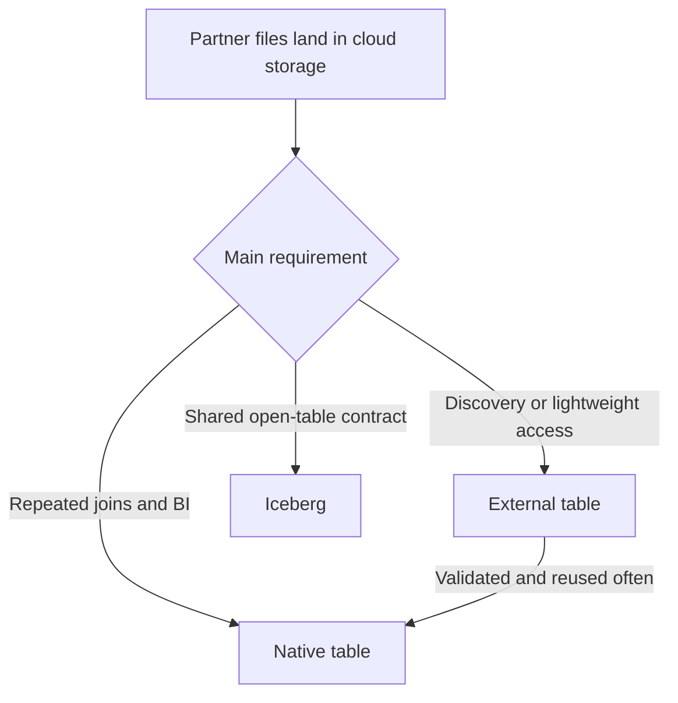
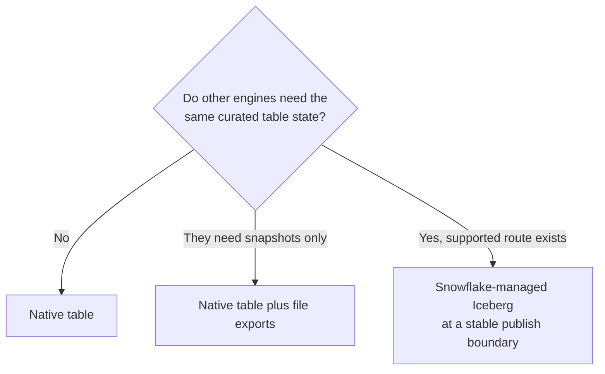
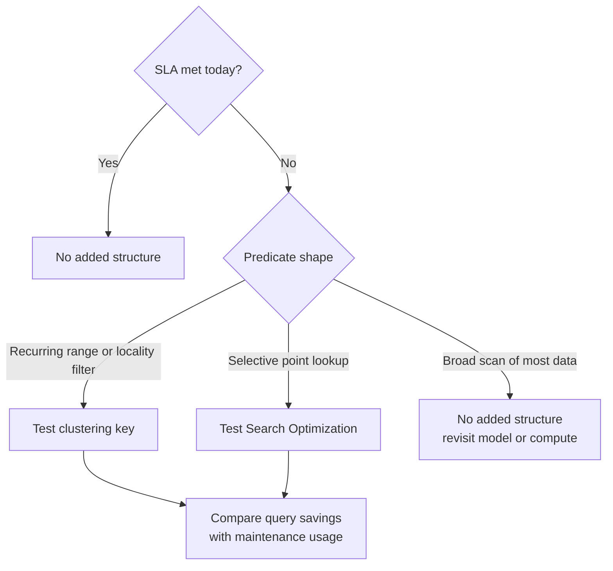
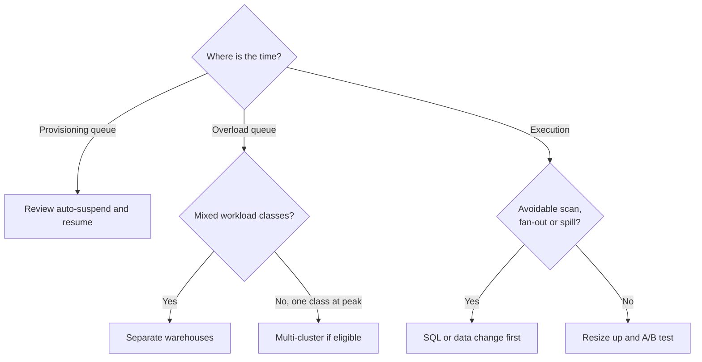
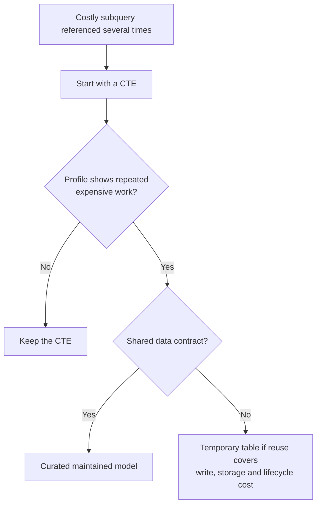

# Snowflake Performance Architecture Decisions

There is no single architecture that maximizes performance for every query and every cost envelope. A sound decision starts with the service objective, workload shape, data contract, and operating capacity. Each decision below gives a default fit, alternatives, evidence to collect, hidden costs, and conditions that would change the recommendation.

## Decision Template

For a real design, record:

- consumer and service objective (latency, freshness, concurrency, completeness)
- data size, growth, mutation rate, and query pattern
- selected option and credible alternative
- expected effect and the metric that will prove/disprove it
- storage/compute/maintenance cost and responsible owner
- rollback or re-evaluation trigger



## 1. Snowflake Native Table Or External Table?

**Scenario:** A partner drops files into cloud storage; Snowflake analysts need fast access.

| Option | Choose it when | Trade-off |
| --- | --- | --- |
| External table | Discovery, profiling, or lightweight file access is the requirement | Read-only; file layout and metadata refresh remain on the query path |
| Native Snowflake table | Data becomes a reliable Snowflake serving or transformation contract | Adds ingestion, storage, replay, and quality responsibilities |
| Iceberg | A real shared open-table contract is required | Adds catalog, metadata, storage, and maintenance boundaries |

**Default:** use an external table as a discovery boundary, then load validated data into native tables if repeated joins/BI need a stable Snowflake serving layer. Do not keep both layers automatically if one is enough.

**Measure:** external bytes/list time and refresh freshness versus native scan, query latency, ingestion cost, and replay success. Include the data completeness SLA.



## 2. Native Table Or Snowflake-Managed Iceberg?

**Scenario:** Snowflake is the transformation authority; a Spark/Trino engine wants the same curated dataset.

- **Native table:** simplest Snowflake-centered serving. Best default when Snowflake is the only required consumer.
- **Snowflake-managed Iceberg:** Snowflake owns Iceberg catalog state; table files can use Snowflake-managed storage or an external volume. Consider when external engines need the same table contract and a supported access route exists.
- **Separate exports:** keep native serving and publish files only when consumers need snapshots rather than shared table state.

**Recommendation:** use native tables until cross-engine table semantics are a concrete requirement. Use Snowflake-managed Iceberg for a stable, versioned publish boundary, not for every staging table.

**Measure:** Snowflake scan/write performance, external-engine behavior, file/metadata layout, egress, storage and maintenance, schema compatibility, and consumer count. Verify the supported external-engine catalog path for the account.



## 3. Snowflake-Managed Or Externally Managed Iceberg?

**Scenario:** Multiple engines need one authoritative Iceberg table.

- **Snowflake-managed:** Snowflake owns catalog state and supported lifecycle operations. Storage may be Snowflake-managed or customer-managed.
- **Externally managed:** a remote catalog owns table metadata and retention; Snowflake participates via a supported integration.

**Recommendation:** let the platform that already owns the Iceberg catalog remain authoritative. If Snowflake is the publishing authority, Snowflake-managed is a candidate. Avoid two catalogs claiming ownership of the same table.

**Measure:** commit/refresh latency, conflict behavior, catalog availability, schema evolution, delete/maintenance support, and recovery ownership. Current externally managed write capabilities vary by catalog, REST integration, table spec version, storage, and account.

## 4. Natural Clustering Or A Clustering Key?

**Scenario:** A large fact table is scanned by recurring date or tenant filters.

- **Natural clustering:** preserve a useful ingestion order and measure pruning first.
- **Clustering key:** consider when repeated query profiles show that overlap blocks pruning and the table/workload can repay maintenance.
- **Model or partition differently:** choose when the workload is diverse or a single key cannot serve the dominant consumers.

**Recommendation:** do not add a key by table size alone. Profile representative predicates, check clustering information, and estimate automatic-clustering cost. Clustering keys are not traditional indexes and can increase maintenance after DML.

**Example signal:** for a date-filtered query, compare `PARTITIONS_SCANNED` with `PARTITIONS_TOTAL`, bytes scanned, and actual selected rows before and after a key change.

**Change the decision if:** the table's natural layout changes, query mix shifts, or maintenance cost outweighs saved query work.

## 5. Clustering, Search Optimization, Or No Additional Structure?

**Scenario:** A customer table is large and filters by date, customer ID, and order status.

- **Clustering:** suited to repeated predicates where locality/range pruning can improve.
- **Search Optimization:** consider for supported selective lookup patterns where normal pruning leaves too much scan.
- **No added structure:** prefer when current latency/SLA is met or the workload is broad.

**Recommendation:** select by predicate shape and evidence, not by high cardinality alone. A month-wide date report and a point lookup by ID are different workloads and may need different designs.

**Measure:** query frequency, selectivity, partitions/bytes scanned, Search Optimization eligibility and usage, service/maintenance cost, and table change rate.



## 6. Query-Time Aggregation, Materialized View, Or Aggregate Table?

**Scenario:** A dashboard repeatedly runs a costly aggregation over the same base data.

- **Query-time:** simplest for low-frequency or already-fast requests.
- **Materialized view:** consider for supported repeated query patterns when automatic maintenance is worth its storage/refresh costs and edition restrictions.
- **Aggregate table:** use when the team needs explicit grain, tests, release control, or a broader stable data product.

**Recommendation:** start from consumer grain/freshness and profile. Pick the least complex option that meets the SLA. Avoid precomputing data nobody consumes.

**Example:** if dashboard users need daily revenue by region, state the grain (`order_date, region`) and compare the baseline query with the maintained aggregate's refresh and read cost.

## 7. Dynamic Tables, Tasks, dbt, Or Full Rebuild?

**Scenario:** SQL transformations need a freshness target, with some workflows extending outside Snowflake.

- **Dynamic tables:** declarative table-shaped transformations with a freshness target and supported query shape.
- **Streams/tasks:** explicit native change-processing and procedural control.
- **dbt:** code review, tests, lineage, docs, and deployment for SQL transformation projects.
- **Airflow/external orchestration:** cross-system dependencies, sensors, retries, and end-to-end operational state.
- **Full rebuild:** often simplest for small datasets and relaxed freshness.

**Recommendation:** choose one system to own scheduling, retries, and incident state. A Snowflake feature can own an internal subgraph while an external orchestrator owns the broader workflow, provided responsibilities are explicit.

**Measure:** actual lag, refresh duration/failures, compute consumption, correctness after late data, and consumer SLA—not just configured target lag.

## 8. Bigger Warehouse, Multi-Cluster, Or Workload Isolation?

**Scenario:** Query latency worsens during a high-concurrency window.

- **Resize up:** candidate for one execution-bound query that needs more compute/memory.
- **Multi-cluster:** candidate for supported workloads with concurrency queueing.
- **Separate warehouses:** candidate when workload classes need independent latency, schedule, ownership, or access.
- **SQL/data change:** first choice when an avoidable scan, fan-out, or spill dominates.

**Recommendation:** diagnose whether time is in queue or execution. Multi-cluster is not a general single-query speedup; a bigger warehouse is not a universal concurrency fix.

**Measure:** `QUEUED_OVERLOAD_TIME`, `QUEUED_PROVISIONING_TIME`, execution time, warehouse load, concurrency distribution, and usage. Compare whole-workload cost and SLA.



## 9. Auto-Suspend And Local Cache Policy

**Scenario:** Interactive queries repeat against the same table, but the warehouse has long idle periods.

- **Short auto-suspend:** saves idle compute; can increase resume latency and lose warm local data cache.
- **Longer running window:** may improve repeat-read latency; costs more during idle periods.
- **Persisted result reuse:** separate mechanism; eligible queries may avoid re-execution even if warehouse local cache is cold.

**Recommendation:** set policy from request arrival patterns, user SLA, and measured cost. Benchmark cold and warm runs separately; do not keep expensive compute running just to preserve cache without evidence.

## 10. CTE, Temporary Table, Or Maintained Model?

**Scenario:** A costly subquery is referenced by multiple parts of a report.

- **CTE:** best starting point for clarity; optimizer behavior is plan-dependent.
- **Temporary/intermediate table:** consider if profile proves repeated work and the materialization can be reused enough to cover write/storage/lifecycle cost.
- **Curated model:** choose when the logic is a shared data contract, not just a local query optimization.

**Recommendation:** do not use “CTEs are always recomputed” as a rule. Check the actual operator graph and compare total pipeline plus consumer cost.



## 11. Window Function, Self-Join, Or Pre-Aggregation?

**Scenario:** A query computes previous-row values, rolling metrics, or latest record per entity.

- **Window:** candidate for ordered row-relative logic with a clear partition and tie-breaker.
- **Self-join:** can remain valid when the relationship is not a simple row sequence or a selective lookup is better.
- **Pre-aggregation:** candidate when consumers repeatedly need a coarser grain.

**Recommendation:** select by semantics and measured partition/sort/join work. Window functions can spill on large/skewed partitions; a self-join can multiply rows. Validate row grain and edge cases.

## 12. External Files, Native Tables, Or Iceberg For A Data Product?

**Scenario:** A growing Parquet feed is queried by Snowflake and an external engine.

**Options:** external table for file discovery; native table for Snowflake operational serving; Snowflake-managed Iceberg for Snowflake-owned open-table publishing; externally managed Iceberg when another catalog owns the table.

**Recommendation:** assign one authority for freshness, metadata, schema evolution, retention, and recovery before selecting the format. External table access is not equivalent to Iceberg snapshot semantics.

**Measure:** file count/sizing, row groups, external bytes, refresh registration, native ingestion/replay cost, Iceberg snapshot/maintenance behavior, cross-region egress, and consumer query latency.

## Decision Record Example

```text
Decision: Keep the finance mart native; publish only the curated ML contract as Iceberg.
Requirement: Snowflake BI needs low-latency joins; Spark needs the same daily contract.
Alternative: Make every staging and mart table Iceberg.
Why rejected: No external consumers for internal models; extra catalog/storage maintenance.
Evidence: Query Profile, measured refresh lag, storage/egress estimate, Spark compatibility test.
Revisit when: Another engine needs an internal model or the BI SLA changes.
```

This is the expected standard for architecture answers: state the fit, alternative, consequence, measurement, and trigger—not just the feature name.
