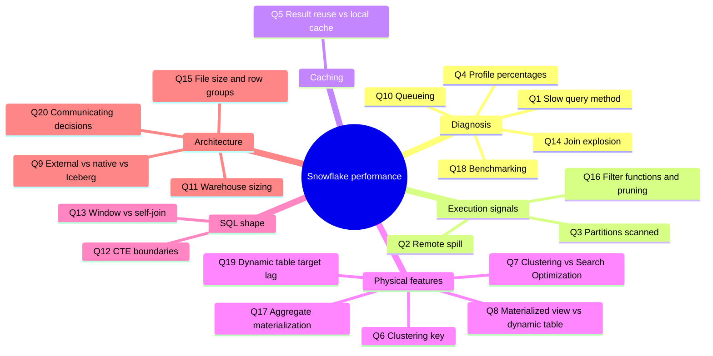
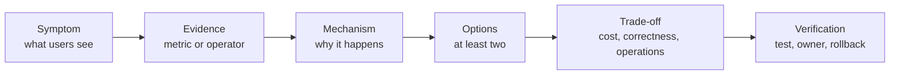

# Senior Interview Questions: Snowflake Performance

These answers model senior-level reasoning. A strong answer starts with workload requirements and evidence, distinguishes symptoms from causes, and names correctness, cost, and operational trade-offs. Do not memorize a tuning slogan as a universal rule.

## 1. How do you investigate a slow Snowflake query?

**Strong answer:** I capture the query ID, exact SQL/parameters, role, warehouse, data state, query tag, concurrency, and whether the run was cold or warm. I split total elapsed into compilation, warehouse provisioning/repair/overload queue, execution, and result delivery. In Query Profile I find expensive operators and trace TableScan bytes/partitions through joins, windows, aggregates, sorts, and spill. I form one falsifiable hypothesis, change one thing, verify identical results, then measure latency, usage, and neighbor workloads.

**Why this is senior:** It avoids resizing first, distinguishes query execution from platform wait, and treats correctness and total workload cost as part of the optimization.

**Follow-up:** How do you compare two runs when cache or concurrency differs? State those conditions; report cold/warm and result-reuse behavior separately.

## 2. What does high remote spill mean, and what do you do?

**Strong answer:** It means an operator spilled intermediate data to remote storage. It often indicates large intermediate state from joins, sorts, windows, or aggregation, but it does not prove the warehouse is the only problem. I identify the exact operator, inspect input/output rows and key skew, reduce unnecessary rows/columns or fix grain, then test a larger warehouse if the remaining operation is memory/compute constrained. I compare remote/local spill, execution time, correctness, and credits.

**Why not “immediately use XL”:** Larger compute can help, but may simply spend more on an avoidable fan-out or incorrect join.

## 3. Is scanning nearly all micro-partitions always bad?

**Strong answer:** No. A selective point/date query that needs 1% of a fact table but scans nearly all partitions suggests a pruning/layout or predicate issue. A full-period aggregate that needs most rows may correctly scan most partitions. I compare scanned partitions/bytes with expected selectivity and output, then inspect predicate type, data distribution, clustering overlap, and Query Profile.

**Follow-up:** What if the filter is selective but pruning remains weak? Check whether the expression is usable for pruning, whether data is naturally clustered, whether a VARIANT path is extracted, and whether a targeted physical optimization is cost-effective.

## 4. How do you interpret Query Profile time percentages?

**Strong answer:** I use Profile Overview, Query Insights, and Most Expensive Nodes to locate likely work, then inspect operator details and graph edges. Operator percentages help prioritize investigation; they are not a license to optimize the largest-looking node without understanding its inputs and consumers. I separately inspect processing, local/remote I/O, network, synchronization, scans, rows, and spill.

**Follow-up:** Can a high percentage alone prove an operator is inefficient? No; it can be expected work required by the query. Compare with input volume, selectivity, alternatives, and SLA.

## 5. What is the difference between result cache and warehouse local cache?

**Strong answer:** Persisted result reuse can return an eligible prior query result without re-running the normal warehouse plan. Warehouse local cache keeps data read from storage on active warehouse compute, but the query still executes and performs processing. Micro-partition metadata/pruning is a third mechanism and is not either cache. I benchmark them separately and record result-reuse setting, warehouse active/suspended state, and cache percentage.

**Follow-up:** Does `USE_CACHED_RESULT = FALSE` force a cold data scan? No. It disables persisted result reuse; it does not clear the warehouse local data cache.

## 6. When would you add a clustering key?

**Strong answer:** Only after repeated important query patterns show poor pruning and the table's natural layout is insufficient. I compare partitions/bytes scanned, overlap/depth, table growth and mutation rate, query frequency, automatic clustering usage, and estimated savings. A key should match stable predicates or joins, not merely a large table.

**Follow-up:** What would make you remove it? Workload change, natural layout becoming adequate, maintenance cost exceeding benefit, or no measurable improvement after a representative trial.

## 7. Clustering key or Search Optimization Service?

**Strong answer:** They target different patterns. Clustering changes data locality and can help repeated range/selectivity patterns when layout is the issue. Search Optimization maintains access structures for supported selective lookups. I inspect the predicate and query profile, verify feature eligibility, estimate maintenance/storage usage, and test the actual query group. High cardinality alone does not choose the feature.

## 8. When is a materialized view better than a table or dynamic table?

**Strong answer:** A materialized view is a candidate for supported repeated query patterns when automatic maintenance and query rewrite can justify storage/maintenance cost. A dynamic table fits a table-shaped transformation with a freshness target and managed refresh. A maintained aggregate table is stronger when the team needs explicit grain, tests, versioned transformation, and ownership. I compare supported SQL, freshness, consumers, maintenance usage, edition, and operational control.

## 9. External table, native table, or Iceberg?

**Strong answer:** External tables are read-only file-access metadata and fit discovery or lightweight access. Native Snowflake tables fit Snowflake-centered operational transformation and serving. Iceberg fits a real open-table contract; Snowflake-managed Iceberg gives Snowflake catalog ownership, while externally managed Iceberg keeps a remote catalog authoritative. I choose by consumer engines, metadata authority, freshness, performance, lifecycle, and recovery—not by “open format” as a slogan.

## 10. How do you diagnose queueing?

**Strong answer:** I compare provisioning, repair, and overload queue time separately from execution. Provisioning points to resume/provisioning latency; overload points to concurrency versus capacity; repair is a resource recovery event. For overload I inspect workload classes and peak concurrency, then consider scheduling, isolation, or eligible multi-cluster behavior. A larger warehouse targets execution capacity and is not automatically the best queue fix.

## 11. When should you increase warehouse size?

**Strong answer:** After a representative profile shows the query is execution/compute/memory constrained and avoidable scans, fan-out, and unnecessary work have been addressed. I run a controlled A/B at realistic data and concurrency, compare duration, spill, usage, result correctness, and impact on other workloads, and set a rollback criterion.

**Follow-up:** Why might larger size not improve elapsed time? Queueing, remote input latency, client consumption, external dependencies, or algorithmic work may dominate.

## 12. Are CTEs an optimization boundary?

**Strong answer:** No. CTEs are primarily a readability and organization construct; optimizer behavior depends on query shape. Repeated references may introduce repeated work or a shared WithClause plan. I inspect the actual operators and compare a temp/staging materialization only if the repeated cost is measurable and reuse pays for write/read, storage, and lifecycle overhead.

## 13. When do you use a window function instead of a self-join?

**Strong answer:** For ordered row-relative calculations such as previous/next value, ranking, or running metrics, a window often expresses the intended grain directly and avoids a broad self-match. But window partitions may require sorting/repartitioning and can spill, especially for skewed large groups. I compare result semantics, tie handling, partition sizes, sort cost, and join cardinality.

## 14. How do you diagnose join explosion?

**Strong answer:** I inspect each Join operator's input/output rows, join keys, and intended grain. I profile key uniqueness and duplicate distributions on both sides, including null/normalization behavior. Then I decide whether the fan-out is intended, whether to deduplicate under an explicit survivorship rule, pre-aggregate, or change the model. I validate row counts and business totals after the rewrite.

## 15. What is the role of file size and row groups for external tables?

**Strong answer:** External-table performance depends on file enumeration, format, row-group parallelism/statistics, path partitions, network/object storage, and metadata refresh. I use Snowflake's current recommendations as starting guidance and benchmark representative data. Small-file overhead, poor path conventions, and untyped value extraction can matter; file sizing is not a universal substitute for choosing native or Iceberg serving.

## 16. How do functions in a filter affect pruning?

**Strong answer:** A function or cast around a column can make pruning harder for some expressions, but the optimizer may simplify or push predicates in some cases. I write clear type-correct range predicates when semantically equivalent, then compare scan bytes/partitions and verify timezone/null behavior. I do not claim every function blocks pruning.

## 17. When do you materialize an aggregate?

**Strong answer:** When a stable, repeatedly consumed grain can avoid significant repeated scan/join/aggregation work and the freshness contract supports maintained output. I define grain, late-data handling, backfill, tests, owner, and refresh. I compare a dynamic table, materialized view, dbt model, scheduled aggregate, and query-time computation with both read and refresh costs.

## 18. How should a team benchmark performance?

**Strong answer:** Use representative data, same SQL semantics, role, warehouse, parameters, and concurrency. Separate result-cache hits, warm local-cache runs, and cold/resume behavior. Repeat runs when variance matters; compare correctness, p50/p95 latency, scan, partitions, spills, queueing, result size, and usage. Record the test and the change so another engineer can reproduce it.

## 19. What is a hidden performance cost of a very low dynamic-table target lag?

**Strong answer:** More frequent or incremental refresh work can increase compute, concurrency, and dependency pressure. A target lag expresses desired freshness, not a hard completion guarantee. I classify consumers by real SLA, inspect refresh history and actual lag, set different targets by layer, and provide fallback/suspension behavior.

## 20. How do you communicate a performance architecture decision?

**Strong answer:** I state the consumer SLA and workload, name the bottleneck evidenced by Query Profile/History, compare at least two viable options, quantify expected query and maintenance cost, identify ownership and failure modes, and define the validation/rollback trigger. The best solution is the simplest one that meets the measured service objective—not the maximum number of optimization features.

## Answer Review Rubric

A strong senior answer:

- distinguishes observation from root cause
- cites at least one relevant metric/operator and explains its limits
- preserves result grain, null, ordering, and freshness semantics
- compares alternatives with performance, cost, security, and operations in view
- names a test and an owner
- avoids universal thresholds and “always resize/cluster/cache” advice

An answer that skips straight from symptom to option is the pattern interviewers probe hardest.
