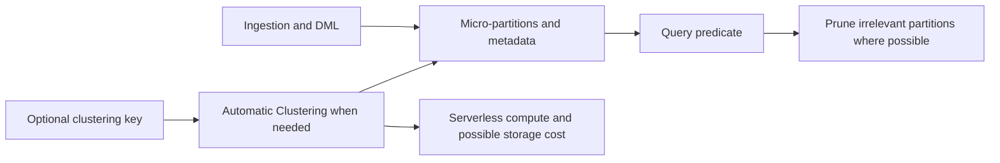

# Snowflake Clustering and Pruning — Detailed Guide

This guide explains how Snowflake finds relevant data, when a clustering key can help, and how to measure its benefits against maintenance costs. SQL examples use hypothetical existing native tables; do not run the `ALTER` statements against production without an approved experiment.

## 1. Start With the Workload

Suppose `ANALYTICS_DB.CORE.ORDERS` contains several years of orders. Two important workloads are:

1. A daily dashboard reads a one-week range for a tenant.
2. A support service looks up one `order_id`.

The first workload may benefit from data locality on tenant/date. The second is a different access pattern and may be better served by [Search Optimization](11_search_optimization.md). Neither feature is necessary if the existing queries already meet their objectives.

```sql
-- Range workload: use identical parameters before and after the experiment.
SELECT order_date, SUM(order_total) AS total
FROM ANALYTICS_DB.CORE.ORDERS
WHERE tenant_id = 42
  AND order_date >= '2026-01-01'::DATE
  AND order_date <  '2026-01-08'::DATE
GROUP BY order_date
ORDER BY order_date;
```

The ranges and numbers used in this guide are illustrative, not expected benchmark results.

## 2. Micro-Partitions and Pruning

Snowflake automatically stores native table data in columnar micro-partitions and maintains metadata about their values. The optimizer can use applicable metadata to skip micro-partitions that cannot contain matching rows. Column pruning also avoids reading unneeded columns.

For example, consider a date filter for January 2026:

| Partition | Illustrative date range | Can date metadata exclude it? |
| --- | --- | --- |
| P1 | 2025-01-01 to 2025-01-31 | Yes |
| P2 | 2026-01-01 to 2026-01-31 | No: it is a candidate |
| P3 | 2025-12-01 to 2026-02-28 | No: its range overlaps |

A candidate partition may still contain no matching rows; metadata has only narrowed the search. Actual pruning depends on the predicate, metadata, data distribution, and optimizer behavior. A low percentage scanned is not a universal target: a report that legitimately reads most of a table should scan broadly.

## 3. Natural Clustering vs a Clustering Key

**Natural clustering** is the locality that results from how data was loaded and changed, without a declared key. Time-ordered ingestion can naturally make date filters efficient; late arrivals, random updates, or merges may increase overlap.

An explicit **clustering key** identifies columns or expressions Snowflake should use to improve locality. Automatic Clustering can rewrite micro-partitions in the background when needed. It is not a primary key, uniqueness constraint, B-tree index, or user-managed static partition. It does not force any particular scan plan.



## 4. When Is It a Good Candidate?

Consider a key when important recurring selective queries repeatedly read too many partitions, the same filter dimensions dominate, and better locality could repay maintenance. Before changing anything:

- Confirm scan work is actually the bottleneck, not queueing, join fan-out, spill, or a broad output.
- Examine natural locality, query frequency, filters, DML rate, data age, and query SLA.
- Estimate whether query savings across the workload can exceed reclustering compute and additional storage costs.

Avoid choosing a key simply because the table is large. Natural clustering may already suffice; infrequent queries, diverse filters, or heavy churn can make maintenance a poor trade-off.

## 5. Choosing Key Expressions

Select dimensions that match important recurring predicates. A candidate for the range workload is `(tenant_id, order_date)`; another workload may justify a date expression or a different order. Test candidate keys against the actual mix, not just one query.

Cardinality matters: a constant or almost-constant value is usually unhelpful, whereas a very high-cardinality raw timestamp or unique ID may be expensive or ineffective as a key. An expression such as `TO_DATE(event_ts)` can reduce timestamp cardinality when it matches the query pattern. Snowflake's guidance generally recommends limiting key expressions and ordering multiple keys from lower to higher cardinality; validate for the specific workload.

```sql
-- Read-only diagnostic for a candidate, even before declaring the key.
SELECT SYSTEM$CLUSTERING_INFORMATION(
    'ANALYTICS_DB.CORE.ORDERS', '(tenant_id, order_date)'
);
```

The result includes average depth/overlap and a partition-depth histogram. Higher overlap can indicate a locality opportunity, but depth is not a universal pass/fail score. Compare like-for-like query profiles and cost before making a decision. A clustering key cannot make a query selective if its business predicate really needs most rows.

## 6. Controlled End-to-End Experiment

**Prerequisites:** use an isolated, representative lab table with realistic row distribution and DML; an appropriate role and warehouse; the required edition and object privileges; an approved cost limit and cleanup plan. Replace the sample identifier with your own lab table. A tiny fixture is useful for SQL syntax but not for measuring pruning.

1. **Baseline:** record the SQL, parameters, selected row count, warehouse size, concurrency, query ID, elapsed and execution time, partitions scanned/total, bytes scanned, and credits or metered usage. Use multiple representative query types and runs. Account for persisted query results and warehouse cache; `USE_CACHED_RESULT = FALSE` disables persisted result reuse, not local warehouse cache.
2. **Inspect locality:** run `SYSTEM$CLUSTERING_INFORMATION` for candidate expressions. Record table size and current DML pattern.
3. **Apply only to the lab table:**

   ```sql
   ALTER TABLE LAB_DB.PERF.ORDERS_LAB
     CLUSTER BY (tenant_id, order_date);

   SHOW TABLES LIKE 'ORDERS_LAB' IN SCHEMA LAB_DB.PERF;
   ```

4. **Wait and observe:** clustering happens asynchronously and may not immediately rewrite every partition. Inspect clustering information and history over time; do not assume completion merely because `ALTER TABLE` succeeded.
5. **Compare:** rerun the same parameterized queries with the same results, warehouse and comparable conditions. Compare scan and execution metrics, latency distribution, and workload credits—not just one warm run. Also test relevant writes and other query groups.
6. **Decide:** retain only if the workload benefit meets its SLA and justifies maintenance, storage, and operational risk. Capture the review date and owner.

## 7. Monitoring and Lifecycle

```sql
-- Requires ACCOUNTADMIN or a role with MONITOR USAGE; object names may be
-- obscured unless the role also has the documented object privileges.
SELECT *
FROM TABLE(INFORMATION_SCHEMA.AUTOMATIC_CLUSTERING_HISTORY(
    DATE_RANGE_START => DATEADD('day', -7, CURRENT_DATE()),
    DATE_RANGE_END => CURRENT_DATE(),
    TABLE_NAME => 'LAB_DB.PERF.ORDERS_LAB'
))
ORDER BY START_TIME;
```

The function reports hourly credits and rows/bytes reclustered. The example uses completed days and does not include today's activity after midnight. Compare initial catch-up separately from ongoing maintenance over a representative period. Rewritten partitions can also increase retained storage during Time Travel and, where applicable, Fail-safe. DML and data growth can change the economics.

```sql
-- Optional operational controls for the lab; neither deletes the table.
ALTER TABLE LAB_DB.PERF.ORDERS_LAB SUSPEND RECLUSTER;
ALTER TABLE LAB_DB.PERF.ORDERS_LAB RESUME RECLUSTER;

-- Remove the lab's key only when the experiment is finished.
ALTER TABLE LAB_DB.PERF.ORDERS_LAB DROP CLUSTERING KEY;
```

Suspending stops automatic maintenance but retains the key; locality can degrade as data changes. Resuming can trigger additional work. Dropping the key stops future key-based automatic clustering but does not restore the former physical layout or undo already incurred costs. Do not remove an existing production key as a test cleanup.

## 8. Common Misconceptions

- **“Clustering guarantees an index seek.”** No: it improves locality for pruning; the optimizer selects the plan.
- **“Every large table needs a key.”** No: measure repeated queries and total maintenance.
- **“Low depth proves success.”** No: the useful evidence is improved workload behavior and acceptable cost.
- **“Reclustering is free after setup.”** No: ongoing writes and retained old partitions can cause recurring cost.
- **“A key helps every filter.”** No: benefit depends on key alignment, selectivity, and data distribution.

## 9. Related Guides and Official Documentation

- [Search Optimization — detailed guide](11_search_optimization.md)
- [Optimization features and hidden costs](06_optimization_features_and_hidden_costs.md)
- [Architecture comparison](08_architecture_decisions.md)
- [Snowflake clustering keys](https://docs.snowflake.com/en/user-guide/tables-clustering-keys)
- [Automatic Clustering](https://docs.snowflake.com/en/user-guide/tables-auto-reclustering)
- [`SYSTEM$CLUSTERING_INFORMATION`](https://docs.snowflake.com/en/sql-reference/functions/system_clustering_information)
- [`AUTOMATIC_CLUSTERING_HISTORY`](https://docs.snowflake.com/en/sql-reference/functions/automatic_clustering_history)
