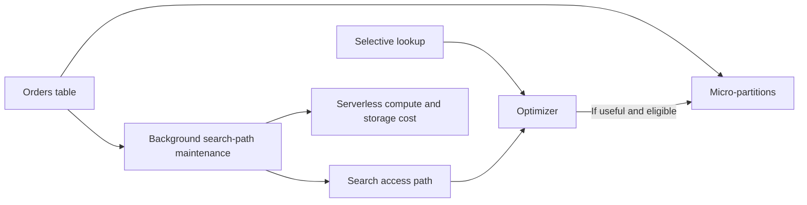

# Snowflake Search Optimization — Detailed Guide

This guide explains Search Optimization Service (SOS), eligible query shapes, configuration, and the evidence needed to justify its cost. Examples use hypothetical native tables; enabling the service builds and maintains additional structures and incurs charges.

## 1. The Problem: Finding a Few Rows in a Large Table

Suppose support frequently looks up one order in a multi-year table:

```sql
SELECT order_id, customer_id, order_date, order_total
FROM ANALYTICS_DB.CORE.ORDERS
WHERE order_id = 'order-123';
```

The answer might be only one row, yet ordinary micro-partition metadata may leave many partitions as candidates if `order_id` values are widely distributed. A small result does not by itself mean little scan work. First verify the actual scan, latency and query frequency in Query Profile.

## 2. What the Service Maintains

SOS maintains a **search access path**: an additional persistent data structure that helps Snowflake identify partitions likely to contain matches for supported predicates. Snowflake maintains it asynchronously as table data changes; the optimizer decides whether to use it for an eligible query. Queries remain ordinary SQL: users do not specify an index hint.



This is not a traditional user-managed B-tree, not a uniqueness constraint, and not a guarantee of faster execution. SOS and clustering can coexist, but this can increase maintenance costs.

## 3. Which Query Shapes Are Candidates?

| Workload | Candidate | Important boundary |
| --- | --- | --- |
| `order_id = 'order-123'` or a small `IN` list | `EQUALITY(order_id)` | Benefit depends on selectivity, distribution, and optimizer choice. |
| Small filtered dimension joined to a large fact table | Equality on the fact/probe-side join column | A small number of distinct build-side keys is important; unsupported join predicates do not benefit. |
| Supported substring search, such as a suitable `LIKE` predicate | `SUBSTRING` on the relevant text column | Eligibility depends on expression and search string; it is not automatic for every pattern. |
| Supported semi-structured path lookup | Explicit configuration of the relevant `VARIANT` path | A whole-table configuration without `ON` does not automatically cover semi-structured columns. |
| Broad report reading a month of orders | Usually not a point-lookup use case | Test natural pruning, clustering, or the data model instead. |

Supported methods also include specialized geospatial and other search capabilities. Check current Snowflake documentation for supported types, functions, predicates, table types, edition, and availability. A selective predicate alone does not prove that the optimizer will choose the access path.

## 4. Search Optimization vs Clustering

| Question | Clustering | Search Optimization |
| --- | --- | --- |
| Main mechanism | Improve data locality for micro-partition pruning. | Maintain an additional search access path. |
| Typical candidate | Repeated locality/range filters on a few stable dimensions. | Supported highly selective point lookups or eligible joins. |
| Changes query SQL? | No. | No. |
| Ongoing cost | Automatic reclustering and possible retained storage. | Initial build, path storage, and maintenance after DML. |
| Guarantee? | No guaranteed pruning or speedup. | No guaranteed optimizer use or speedup. |

The same table can have both if distinct important workloads justify the combined cost. Alternatively, leave both disabled when the service objective is already met.

## 5. Prerequisites and Cost Estimate

For native tables, SOS requires an eligible Snowflake Enterprise Edition or higher account. To enable it, Snowflake documents `OWNERSHIP` on the table and `ADD SEARCH OPTIMIZATION` on its schema; querying the table requires ordinary `SELECT` access, not an SOS-specific query privilege. Confirm current requirements for the actual table type and account.

Use an isolated, representative lab table, a suitable role and warehouse, and an approved budget. The following read-only estimate is best-effort, not a price quote or spending cap:

```sql
SELECT SYSTEM$ESTIMATE_SEARCH_OPTIMIZATION_COSTS(
    'LAB_DB.PERF.ORDERS_LAB',
    'EQUALITY(order_id)'
);
```

The estimate depends on sampling and recent DML. Actual initial build, storage, and ongoing maintenance can differ materially. Record the estimate and assumption about future data growth and churn. The estimation call itself may consume resources; check the current documentation.

## 6. Controlled Configuration and Comparison

1. **Baseline the real workload:** record query IDs, result correctness, parameters, latency distribution, warehouse size, bytes and partitions scanned, query frequency, and metered costs. Test representative existing and missing IDs, not just one favorable lookup.
2. **Estimate and obtain approval:** review the estimate, permissions, table ownership, and expected DML. Do not enable the service on production just to try this example.
3. **Enable only the needed method and column on the lab table:**

   ```sql
   ALTER TABLE LAB_DB.PERF.ORDERS_LAB
     ADD SEARCH OPTIMIZATION ON EQUALITY(order_id);

   SHOW TABLES LIKE 'ORDERS_LAB' IN SCHEMA LAB_DB.PERF;
   DESCRIBE SEARCH OPTIMIZATION ON LAB_DB.PERF.ORDERS_LAB;
   ```

4. **Wait for the access path:** inspect `SEARCH_OPTIMIZATION` and `SEARCH_OPTIMIZATION_PROGRESS` in `SHOW TABLES`; a value of `100` indicates the access path is up to date at that point. Builds and subsequent maintenance are asynchronous. A successful `ALTER` is not proof that a benchmark is ready.
5. **Run the same lookups again:** preserve result correctness, parameters, warehouse, concurrency, and comparable cache conditions. `USE_CACHED_RESULT = FALSE` disables persisted result reuse, not local warehouse cache. Inspect Query Profile and the actual scan, not just elapsed time; a supported query may still use the ordinary access path.
6. **Compare complete economics:** measure query savings over representative frequency against initial build, ongoing maintenance and path storage. Revisit after DML patterns or workload change.

Avoid table-wide enablement by default: `ADD SEARCH OPTIMIZATION` without `ON` configures equality for supported types broadly, and can include subsequently added columns. Explicit columns/methods give a narrower, intentional scope. Changes in SOS configuration can affect how future columns are handled; consult the official enablement guide.

## 7. Semi-Structured and Join Examples

For a supported `VARIANT` path, configure it explicitly rather than assuming whole-table configuration covers it:

```sql
ALTER TABLE LAB_DB.PERF.EVENTS_LAB
  ADD SEARCH OPTIMIZATION ON EQUALITY(payload:user.id);

SELECT payload:event_id::STRING
FROM LAB_DB.PERF.EVENTS_LAB
WHERE payload:user.id::STRING = 'c-7';
```

The example assumes `payload:user.id` contains a JSON string; ensure predicate and payload types match and verify eligibility and profile behavior for the actual data. Configuration is illustrative and incurs charges.

For an eligible join, SOS is generally configured on the large **probe-side** table's join column, not automatically on the small dimension:

```sql
ALTER TABLE LAB_DB.PERF.ORDERS_LAB
  ADD SEARCH OPTIMIZATION ON EQUALITY(customer_id);

SELECT o.order_id, o.order_total
FROM LAB_DB.PERF.ORDERS_LAB AS o
JOIN LAB_DB.PERF.CUSTOMERS_LAB AS c
  ON o.customer_id = c.customer_id
WHERE c.customer_id = 123;
```

The actual plan determines build/probe sides. A small number of distinct build-side lookup values is important; an unselective join may be better served by a regular scan. See the official join documentation for current predicate restrictions.

## 8. Monitoring, Cleanup, and Security

```sql
-- ACCOUNTADMIN or MONITOR USAGE is required; see the documented name visibility rules.
SELECT *
FROM TABLE(INFORMATION_SCHEMA.SEARCH_OPTIMIZATION_HISTORY(
    DATE_RANGE_START => DATEADD('day', -7, CURRENT_DATE()),
    DATE_RANGE_END => CURRENT_DATE(),
    TABLE_NAME => 'LAB_DB.PERF.ORDERS_LAB'
))
ORDER BY START_TIME;
```

The history reports hourly service maintenance credits, not the complete storage or warehouse-query bill. The example covers completed days up to today's midnight. Check storage and account billing separately; distinguish initial build from steady-state DML maintenance.

```sql
-- Lab cleanup: removes all search optimization configuration on this table.
ALTER TABLE LAB_DB.PERF.ORDERS_LAB DROP SEARCH OPTIMIZATION;
```

This removes the search access path; re-enabling later requires a rebuild and can incur new cost. Do not run this on a shared table with other configurations. Clones and replicated databases can also incur search-path maintenance or rebuilding costs; verify their lifecycle before using them as test environments.

SOS is compatible with masking and row access policies, but timing differences can make inferences about protected data easier. Include this risk in security design for sensitive workloads; see Snowflake's documentation on search-optimized tables.

## 9. Common Mistakes

- Enabling SOS because a column is high-cardinality, without confirming a frequent supported selective query.
- Comparing a warm cached run with a cold baseline, or measuring one lookup rather than the workload.
- Assuming a completed DDL statement means the search path is fully built or was used by the query.
- Enabling every column, ignoring initial build, DML maintenance, storage, or a combined clustering/SOS bill.
- Expecting SOS to solve broad scans, incorrect joins, queueing, or output-volume problems.

## 10. Related Guides and Official Documentation

- [Clustering and pruning — detailed guide](10_clustering_and_pruning.md)
- [Optimization features and hidden costs](06_optimization_features_and_hidden_costs.md)
- [Search Optimization Service](https://docs.snowflake.com/en/user-guide/search-optimization-service)
- [Enabling and disabling search optimization](https://docs.snowflake.com/en/user-guide/search-optimization/enabling)
- [Queries that can benefit](https://docs.snowflake.com/en/user-guide/search-optimization/queries-that-benefit)
- [Search optimization for joins](https://docs.snowflake.com/en/user-guide/search-optimization/join-queries)
- [Estimating and managing costs](https://docs.snowflake.com/en/user-guide/search-optimization/cost-estimation)
- [Working with optimized tables](https://docs.snowflake.com/en/user-guide/search-optimization/working-with-tables)
- [`SEARCH_OPTIMIZATION_HISTORY`](https://docs.snowflake.com/en/sql-reference/functions/search_optimization_history)
