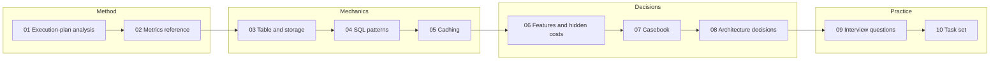
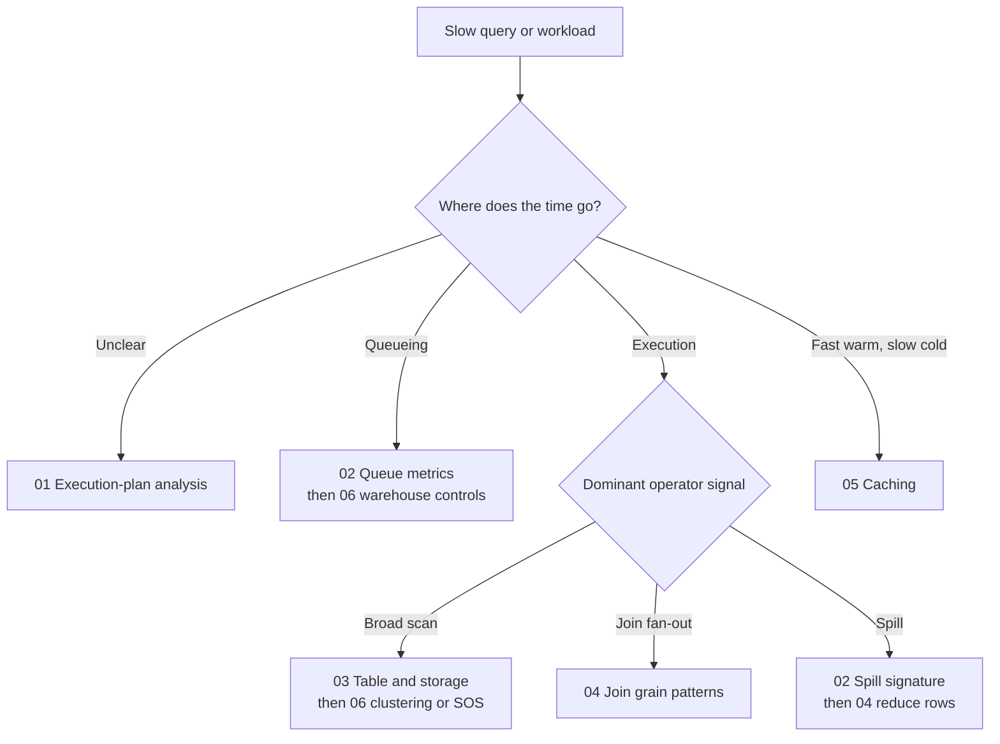

# Snowflake Query Performance And Optimization

This directory is the detailed performance course. It is intentionally split into focused guides so a learner can move from query diagnosis to operator metrics, SQL/table behavior, costed optimization features, production cases, and senior-level design reasoning.

The course does not teach a universal “make Snowflake faster” recipe. It teaches how to identify a measured bottleneck, preserve correctness, choose among alternatives, and explain the performance/cost/operations trade-off.

## Recommended Learning Route

1. [Execution-plan analysis](01_execution_plan_analysis.md): establish the investigation method.
2. [Metrics reference](02_metrics_reference.md): learn what each query- and operator-level metric can and cannot tell you.
3. [Table and storage performance](03_table_and_storage_performance.md): compare native, external, and Iceberg access paths.
4. [SQL patterns and operators](04_sql_patterns_and_operators.md): study query shapes with short bad/better examples and semantic caveats.
5. [Caching](05_caching.md): distinguish persisted result reuse, local warehouse cache, and metadata/pruning.
6. [Optimization features and hidden costs](06_optimization_features_and_hidden_costs.md): choose clustering, Search Optimization, materialized views, QAS, dynamic tables, and warehouse controls by workload evidence.
7. [Production-shaped casebook](07_production_casebook.md): diagnose 16 synthetic cases with metrics, candidate fixes, and trade-offs.
8. [Architecture decisions](08_architecture_decisions.md): compare 12 designs and capture a decision record.
9. [Senior interview questions and answers](09_senior_interview_questions.md): practice defending performance choices and explaining when alternatives are better.
10. Complete [Performance Diagnosis and Design Tasks](../../../simple-tasks/10_snowflake_performance/README.md) before reading the solutions.

The route moves from method, to mechanisms, to costed decisions, then to defending them under questioning.

## Start With The Symptom

| What you observe | First guide |
| --- | --- |
| Long end-to-end time with unclear cause | [Execution-plan analysis](01_execution_plan_analysis.md) |
| Queueing, spill, scan, fan-out, or network metrics | [Metrics reference](02_metrics_reference.md) |
| Repeated filters over native, external, or Iceberg data | [Table and storage performance](03_table_and_storage_performance.md) |
| Large joins, windows, `FLATTEN`, CTEs, or sorts | [SQL patterns and operators](04_sql_patterns_and_operators.md) |
| Fast second run, slow first run, or suspend/resume questions | [Caching](05_caching.md) |
| Considering clustering, SOS, QAS, a materialized view, or more compute | [Optimization features and hidden costs](06_optimization_features_and_hidden_costs.md) |
| Choosing an architecture under SLA and cost constraints | [Architecture decisions](08_architecture_decisions.md) |
| Preparing for senior performance interviews | [Senior interview questions and answers](09_senior_interview_questions.md) |

Triage by where time is spent before choosing a fix; several branches can apply to the same query.

## Evidence Standard

Each recommendation should state:

- the observed symptom and query/workload context
- the metric or operator that supports the diagnosis
- the likely mechanism and at least one alternative explanation
- a candidate SQL, layout, feature, or warehouse change
- a correctness check, expected metric movement, and cost measure
- the condition that would reject, roll back, or revisit the change

Avoid universal thresholds such as “scan under 5%,” “always cluster large tables,” or “remote spill means resize immediately.” Interpret each signal relative to selectivity, data shape, service objective, and cost.

## Further Reading

These practitioner articles can suggest useful questions, but verify feature semantics and current availability against Snowflake documentation before implementation:

- [United Techno: 13 Snowflake performance optimizations](https://www.unitedtechno.com/13-snowflake-performance-optimizations-you-should-know/)
- [SELECT: 16 tips for Snowflake query optimization](https://select.dev/blog/snowflake-query-optimization-16-tips-to-make-your-queries-run-faster)
- [Snowflake official Query Profile and History documentation](https://docs.snowflake.com/en/user-guide/ui-query-profile)
- [`GET_QUERY_OPERATOR_STATS`](https://docs.snowflake.com/en/sql-reference/functions/get_query_operator_stats)
