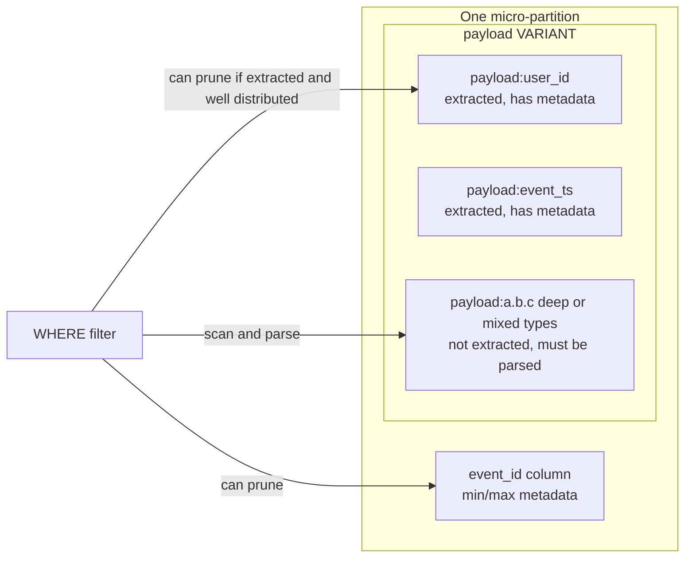
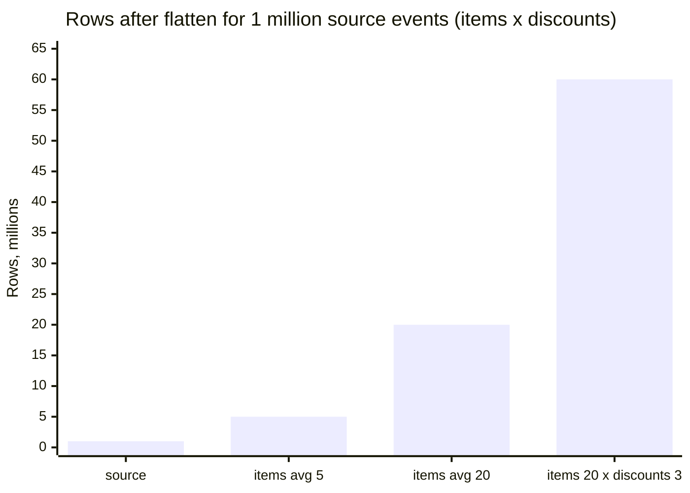
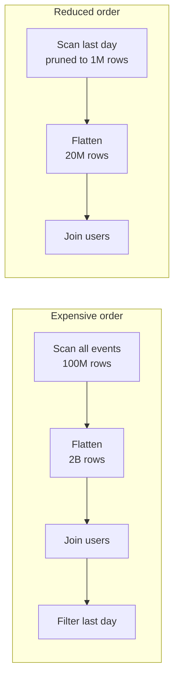

# Snowflake Semi-Structured Performance — Micro-Partitions, Pruning, Flatten Optimization

For foundational guidance on ingestion, path handling, missing fields, `OUTER => TRUE`, and deciding when to project into typed tables, start with [Semi-Structured Data in Snowflake](../reference/01_semi_structured_data.md).

## 1. How Semi-Structured Data Affects Micro-Partitions

### Key idea

Snowflake stores table data in micro-partitions that typically contain 50-500 MB of uncompressed data; the stored size is smaller after compression. Snowflake automatically collects metadata used for pruning, including:

- min/max values
- distinct values
- statistics per column

### What changes with VARIANT

For `VARIANT`, Snowflake can extract eligible semi-structured elements into columnar form and use metadata for pruning, including for some nested paths. Extraction is selective rather than unlimited: the documented default limit is 200 elements per partition per table, and elements with JSON nulls or inconsistent data types can remain unextracted. Deep or unextracted paths may require scanning and traversing the semi-structured value.

High cardinality alone does not prove that pruning will be poor. Data distribution and overlap across micro-partitions matter; an uncorrelated key can appear across many partitions and reduce pruning effectiveness.

### Example

    payload:user_id
    payload:event_ts

If `event_ts` is inside VARIANT:

❌ worse pruning than:

    event_ts TIMESTAMP column

### Why

- structured column → strong metadata
- VARIANT → weaker metadata, especially for deep nesting

### Senior insight

> Frequently filtered values can benefit from typed relational columns, especially when they are stored as strings, contain nulls or mixed types, or are not extracted into columnar form. Confirm the actual scan behavior in Query Profile before changing the model.

---

## 2. Pruning Behavior with Semi-Structured Data

### Good pruning

Works well when:

- field is frequently accessed
- low overlap across partitions
- extracted or well-localized

### Bad pruning

Can happen when:

- the queried element is not extracted into columnar form
- the element contains null values or inconsistent types
- values overlap across many micro-partitions or are poorly correlated with load order
- a filter expression prevents useful pruning

### Example problem

    WHERE payload:user_id::NUMBER = 123

→ may scan many partitions if the element is not extracted or its value ranges overlap broadly. High cardinality or the absence of an explicit clustering key alone is not enough to diagnose the cause.

### Better approach

    user_id NUMBER column in a curated table

OR:

    measured clustering on a suitable typed expression

OR:

    Search Optimization for supported selective lookup patterns

---

## 3. Semi-Structured vs Structured Trade-off

### VARIANT advantages

- flexible schema
- handles schema drift
- fast ingestion

### VARIANT disadvantages

- weaker pruning
- more CPU for parsing
- harder joins
- worse performance for repeated queries

### Senior rule

> Use VARIANT when flexible source preservation is valuable. Promote stable, frequently filtered, joined, governed, or quality-checked fields into typed columns when measurements and consumer contracts justify it.

---

## 4. How FLATTEN Impacts Performance

### Core problem

`FLATTEN` can expand one source row into many output rows. The number of rows emitted is often a major cost driver, but total work also depends on source scanning, parsing, filtering, and downstream joins or aggregations.

### Example

1 row with:

    items = 100 elements

→ becomes 100 rows

Nested:

    items (100) × discounts (10)

→ 1000 rows

### Consequences

- large intermediate results
- more memory usage
- higher compute cost
- possible spill

### Senior insight

> Estimate the expanded row count and downstream work; do not infer cost from the source row count alone.

---

## 5. Common Performance Issues with FLATTEN

### 1. Repeated flatten in every query

❌ bad:

    SELECT ...
    FROM raw_events,
    LATERAL FLATTEN(...)

in every BI query

✔️ better:

    a tested staging table or managed transformation when repeated use justifies its storage, refresh, and maintenance cost

---

### 2. Flatten before filtering

❌ bad:

    FLATTEN(all data) → filter later

✔️ better:

    filter first → flatten reduced dataset

---

### 3. Multiple flatten without control

❌ leads to:

- exponential growth
- skew
- spill

---

### 4. Joining after explosion

❌ big join on exploded dataset

✔️ better:

- filter early
- reduce before join

---

## 6. How to Optimize FLATTEN Queries

### Rule 1 — Reduce the input before expansion when semantics allow

    WITH filtered_events AS (
      SELECT payload
      FROM raw_events
      WHERE event_date = '2026-01-01'
    )
    SELECT item.value
    FROM filtered_events AS e,
    LATERAL FLATTEN(INPUT => e.payload:items) AS item;

This expresses the intended logical shape; the optimizer may reorder operations. Check Query Profile to confirm the amount of data scanned and rows produced.

---

### Rule 2 — Extract frequently used arrays once

Create staging:

    stg_event_items

instead of flattening repeatedly

---

### Rule 3 — Limit flatten scope

Use:

    PATH

instead of flattening full payload

---

### Rule 4 — Avoid unnecessary nested flatten

Only flatten what is needed

---

### Rule 5 — Use `OUTER` only when retaining empty expansions is required

`OUTER => TRUE` can preserve a parent row when an array or object produces no rows, by returning a null-extended row. This changes row counts and can affect aggregates; include it only when that behavior is part of the desired result.

---

### Rule 6 — Consider denormalization

If array is small and frequently used:

→ flatten once → store as table

---

## 7. Join + Flatten — Hidden Complexity

### Problem

Flatten before join:

    raw → explode → join

→ huge dataset

### Better pattern

- filter
- reduce
- then flatten
- then join

### Senior insight

> The order of operations matters more than the operations themselves.

SQL clause order does not dictate execution order, and the optimizer may push filters down on its own. Check the Query Profile: compare rows into and out of the Flatten operator in both versions.

---

## 8. Query Profile — What to Look For

When debugging flatten queries:

### 1. Scan size

- too many partitions scanned → pruning issue

### 2. Row explosion

- input rows vs output rows

### 3. Join nodes

- large build side
- skew

### 4. Spill

- memory exceeded → disk usage

### 5. Time distribution

- where time is spent

---

## 9. Real Case #1 — Flatten Explosion

### Problem

- 2TB table
- flatten items
- query slow

### Root cause

- items array large
- flatten before filtering
- huge intermediate dataset

### Fix

- filter by date first
- then flatten
- optionally pre-materialize

---

## 10. Real Case #2 — Bad Pruning with VARIANT

### Problem

    WHERE payload:event_date = '2026-01-01'

→ scans 70%

### Root cause

- event_date inside VARIANT
- poor metadata

### Fix

- extract `event_date` into a typed column in a curated table
- load in event-date order so natural clustering helps, or test a clustering key if pruning is still poor
- measure partitions scanned before and after

---

## 11. Real Case #3 — Skew after Flatten

### Problem

- join on user_id
- after flatten
- spill happens

### Root cause

- some users have many items
- uneven distribution

### Fix

- pre-aggregate
- filter hot keys
- salting if needed

---

## 12. Real Case #4 — BI Query Too Slow

### Problem

- dashboard runs flatten every time

### Root cause

- no staging layer

### Fix

- create flattened table
- reuse

---

## 13. Senior-Level Summary

- VARIANT → flexible; pruning depends on whether relevant elements are extracted and on their data distribution
- FLATTEN → row expansion can amplify scans, joins, and aggregations
- performance = scan + explosion + join
- reduce the input before expansion when semantics allow, then verify the execution profile
- materialize repeated flatten logic
- query profile is key to debugging

---

## 14. Strong Interview Answer

> Semi-structured performance depends on whether queried elements are extracted into columnar form, their type consistency, and how values overlap across micro-partitions. `FLATTEN` can multiply rows and amplify downstream joins or aggregations. I compare typed projections with `VARIANT`, reduce the input before expansion when semantics allow, and use Query Profile to inspect scans, row counts, joins, and spill before choosing an optimization.