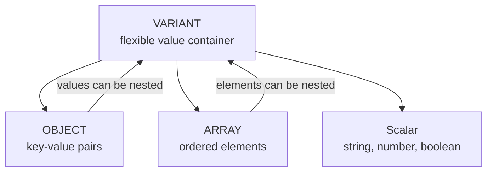
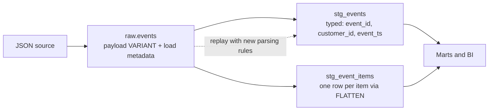
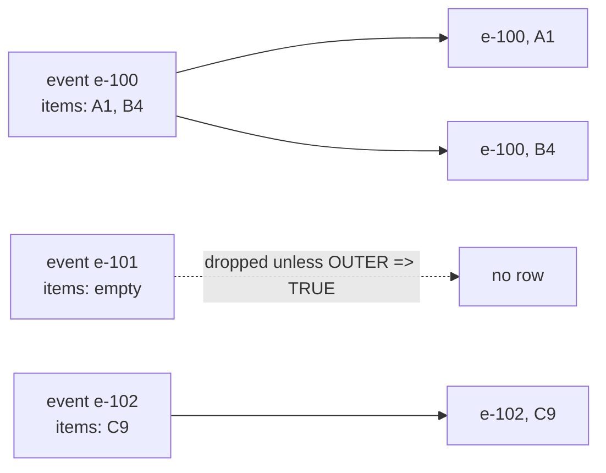
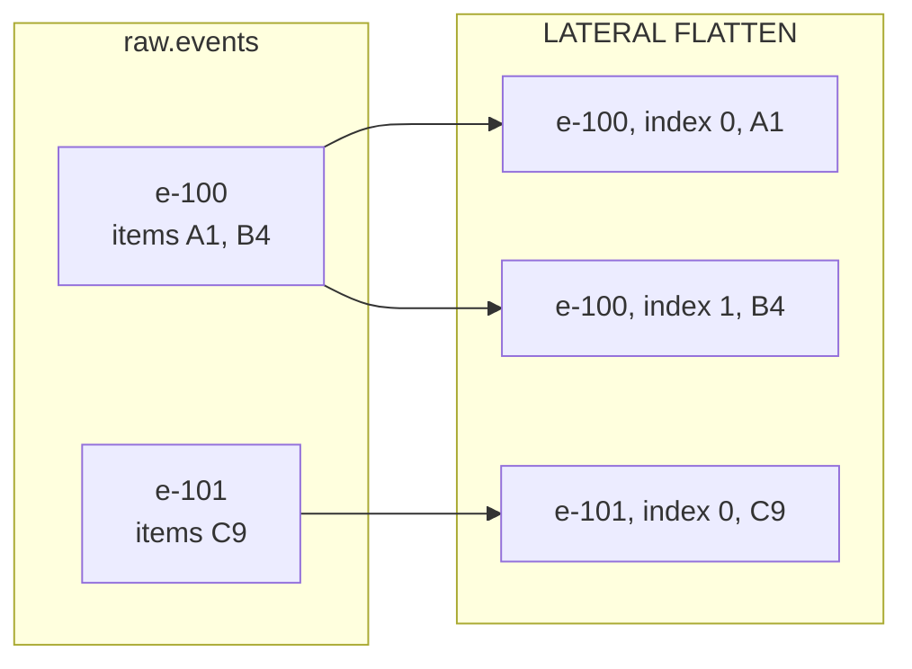
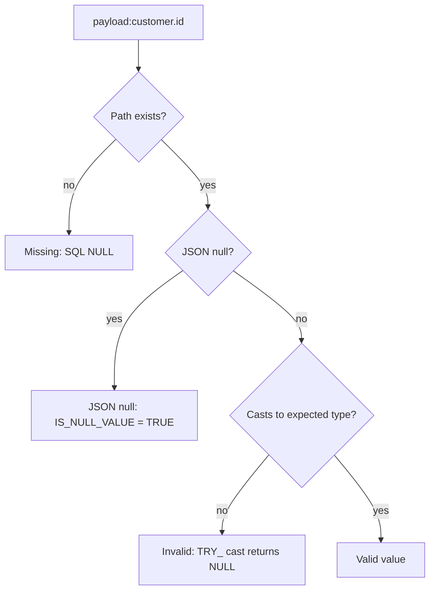

# Semi-Structured Data in Snowflake: `VARIANT`, `OBJECT`, `ARRAY`, and `FLATTEN`

## The Core Choice

Semi-structured storage lets ingestion preserve source payloads whose fields may be nested or evolve. It is useful at raw boundaries, but keeping every field untyped forever makes validation, analytics, governance, and performance harder. A common pattern is to preserve the original payload and create typed, documented projections for fields that become important.

Snowflake's main semi-structured types are:

- `VARIANT`: a flexible container for a scalar, `OBJECT`, or `ARRAY`.
- `OBJECT`: key-value pairs, typically representing a JSON object.
- `ARRAY`: an ordered collection of values.

`VARIANT` can hold values of different SQL and semi-structured types, including strings, numbers, booleans, objects, arrays, and JSON null. A single `VARIANT` value can be up to 128 MB of uncompressed data, but practical limits can be lower because of internal overhead and processing requirements. Avoid treating this as a target payload size; very large records can be hard to process and can increase query costs.

Think of `VARIANT` as the flexible container, with objects and arrays as structures inside it:



`PARSE_JSON` parses JSON text into these structures. `TO_VARIANT` converts a SQL value to `VARIANT`; it does not parse a JSON-looking string into an object:

```sql
SELECT
    PARSE_JSON('{"a":1}') AS parsed_object,
    TO_VARIANT('{"a":1}') AS string_value;
```

In the first result, `a` is a navigable object field. The second result is a `VARIANT` containing a string.

Use `PARSE_JSON` for JSON text, `TO_VARIANT` to wrap a SQL value, `OBJECT_CONSTRUCT` to build an object, and `ARRAY_CONSTRUCT` to build an array:

```sql
SELECT
    PARSE_JSON('{"a":1,"b":[10,20]}') AS parsed_json,
    TO_VARIANT('hello') AS variant_string,
    OBJECT_CONSTRUCT('user_id', 123, 'country', 'PL') AS user_object,
    ARRAY_CONSTRUCT('gold', 'silver', 'bronze') AS labels;
```

`ARRAY_FLATTEN` combines one level of nested arrays into one array value; it does not emit one SQL row per element. Use the table function `FLATTEN` when rows are required:

```sql
SELECT ARRAY_FLATTEN(
    ARRAY_CONSTRUCT(
        ARRAY_CONSTRUCT(1, 2),
        ARRAY_CONSTRUCT(3, 4)
    )
) AS combined_array;
```



## Ingest and Preserve the Source Payload

```sql
CREATE TABLE raw.events (
  received_at TIMESTAMP_TZ,
  source_file STRING,
  payload VARIANT
);

INSERT INTO raw.events
SELECT CURRENT_TIMESTAMP(), 'sample.json', PARSE_JSON(
  '{"event_id":"e-100","customer":{"id":"c-7"},' ||
  '"order_total":100,"items":[{"sku":"A1","quantity":2},{"sku":"B4","quantity":1}]}'
);
```

In production, keep useful ingestion metadata alongside the payload, such as source file/topic, received and loaded timestamps, batch or message identifier, and source schema/version when available. Preserve the original payload when replay, audit, or later reinterpretation matters. If incoming data is JSON text and malformed records must not fail the whole statement, use `TRY_PARSE_JSON` and separately count and quarantine rows where parsing returned SQL `NULL`.

The raw table is a landing and replay boundary, not necessarily the best permanent interface for every consumer.

## Extract Fields and Handle Missing Paths

Snowflake supports path navigation through objects and arrays:

```sql
SELECT
    payload:user_id AS user_id_variant,
    payload:device.os AS device_os_variant,
    payload:items[0] AS first_item_variant,
    payload:items[0].sku AS first_sku_variant
FROM raw.events;
```

The colon accesses a field from the `VARIANT` value, dots navigate nested object keys, and square brackets select an array element by zero-based index. Extracted values are still semi-structured until cast:

```sql
SELECT
  payload:event_id::STRING AS event_id,
  payload:customer.id::STRING AS customer_id,
  TRY_TO_NUMBER(payload:items[0].quantity::STRING) AS first_quantity
FROM raw.events;
```

Explicit casts make the intended SQL type clear for joins, arithmetic, BI, and downstream contracts. Without them, the result remains `VARIANT`; strings may appear quoted and comparisons or coercions can be less predictable. Use the type that matches the producer contract, for example `::STRING`, `::NUMBER`, `::BOOLEAN`, or an appropriate timestamp type.

**A valid path lookup that does not find a key or array element returns SQL `NULL`; a missing field by itself does not fail the query.** The same is true when an array index is out of range. This is useful for evolving payloads, but it can also hide a typo in a path or an upstream schema change:

```sql
SELECT
    payload:customer.id::STRING AS customer_id,
    payload:customer.custmer_id::STRING AS misspelled_path
FROM raw.events;
```

The misspelled `custmer_id` path returns `NULL` rather than raising a missing-key error. SQL still reports a compilation error for invalid SQL/path syntax. A path that resolves to a value of an unexpected type is a separate issue: a strict cast such as `::NUMBER` can fail, while a `TRY_` conversion such as `TRY_TO_NUMBER(...)` returns `NULL` for an unconvertible value.

Object key names are case-sensitive in path lookups. If the payload contains `"Customer_ID"` but the query asks for `payload:customer_id`, the lookup returns `NULL`. For keys containing spaces or special characters, quote the key in the path, for example `payload:"Customer Name"`. Use `GET_IGNORE_CASE` only when case-insensitive matching is an intentional part of the data contract.

Also distinguish:

- **Missing path:** path lookup produces SQL `NULL`.
- **Explicit JSON `null`:** a present JSON field with a null value; use `IS_NULL_VALUE` where the distinction matters.
- **SQL `NULL`:** a SQL-level null, including a failed `TRY_PARSE_JSON` or `TRY_` conversion.
- **Invalid JSON text:** `PARSE_JSON` can fail; `TRY_PARSE_JSON` returns SQL `NULL`, so monitor and quarantine that condition instead of silently accepting it.

Use required-field quality checks so a typo or source-schema drift does not quietly turn a populated field into all `NULL`s.

Useful inspection and construction functions include `TYPEOF`, `ARRAY_SIZE`, `OBJECT_KEYS`, `OBJECT_CONSTRUCT`, and `ARRAY_CONSTRUCT`.

## Expand Arrays with `LATERAL FLATTEN`

```sql
SELECT
  e.payload:event_id::STRING AS event_id,
  item.index AS item_position,
  item.value:sku::STRING AS sku,
  TRY_TO_NUMBER(item.value:quantity::STRING) AS quantity
FROM raw.events AS e,
LATERAL FLATTEN(INPUT => e.payload:items) AS item;
```

`FLATTEN` emits rows from an array or object. One input event can become zero, one, or many output rows. That cardinality change affects sums and joins: aggregate at the intended grain and retain a stable event or parent key.

For an array such as `[{"sku":"A1"},{"sku":"B4"}]`, flattening produces one row per element. `INDEX` identifies the array position and `VALUE` contains that element. For an object, `KEY` identifies the object property and `VALUE` contains its value.



`LATERAL` makes the relationship explicit: for each source row, the table function reads that row's own payload and emits the corresponding elements.



Common columns returned by `FLATTEN` are:

| Column | Meaning |
| --- | --- |
| `SEQ` | Sequence number associated with the input row; do not treat it as a stable business key. |
| `KEY` | Object key for an object element; otherwise typically `NULL`. |
| `PATH` | Path to the element within the input value. |
| `INDEX` | Zero-based array index; `NULL` for object keys. |
| `VALUE` | The current flattened element as `VARIANT`. |
| `THIS` | The element being flattened, useful for understanding recursive and outer behavior. |

### Worked example: inflated totals

If each event also carries `order_total = 100`, then summing it after flattening two items returns 200 for `e-100`. Keep event-level measures at event grain and item-level measures at item grain:

```sql
-- Wrong: event-level measure repeated per item
SELECT SUM(e.payload:order_total::NUMBER(12,2))
FROM raw.events e, LATERAL FLATTEN(INPUT => e.payload:items) item;

-- Right: event grain for event measures
SELECT SUM(payload:order_total::NUMBER(12,2)) FROM raw.events;
```

### Important: `OUTER => TRUE` keeps parents with empty or missing arrays

This is easy to overlook: ordinary `FLATTEN` returns **zero** rows for an empty or missing array, so its parent event disappears from the result. Add `OUTER => TRUE` if the business result must retain that parent as one row with `NULL` item columns.

```sql
WITH events AS (
    SELECT column1 AS event_id, PARSE_JSON(column2) AS payload
    FROM VALUES
        ('e-with-items', '{"items":[{"sku":"A1"},{"sku":"B2"}]}'),
        ('e-empty',     '{"items":[]}'),
        ('e-missing',   '{}')
)
SELECT
    e.event_id,
    item.index AS item_position,
    item.value:sku::STRING AS sku
FROM events AS e,
LATERAL FLATTEN(INPUT => e.payload:items, OUTER => TRUE) AS item
ORDER BY e.event_id, item_position;
```

Expected shape:

| EVENT_ID | ITEM_POSITION | SKU |
| --- | ---: | --- |
| e-empty | `NULL` | `NULL` |
| e-missing | `NULL` | `NULL` |
| e-with-items | 0 | A1 |
| e-with-items | 1 | B2 |

Without `OUTER => TRUE`, only the two `e-with-items` rows appear. Use the outer form only when preserving no-item parent events is required; the null-extended row changes row counts and can affect `COUNT`, joins, and aggregates. When aggregating item data, make sure that this placeholder row is not mistakenly counted as a real item.

`LATERAL` correlates the table function with the current source row. To inspect an unfamiliar payload, use `RECURSIVE => TRUE` temporarily and examine `PATH`, `KEY`, `INDEX`, and `VALUE`; for production transformations, target the specific path and columns needed.

For nested arrays, chain `LATERAL FLATTEN` calls and be explicit about the resulting grain. For example, flattening `items` and then each item's `discounts` produces one row per item-discount pair, not one row per item. Event-level and item-level measures repeat at the lower grain, so aggregate them at the correct grain before joining or summing.

### Worked example: flatten nested arrays

Suppose each order has items and each item can have multiple discounts. First flatten the order's `items`, then flatten the current item's `discounts`:

```sql
WITH orders AS (
    SELECT
        'o-10' AS order_id,
        PARSE_JSON('{
          "order_total": 100,
          "items": [
            {"sku":"A1","discounts":[{"code":"X","amount":5},{"code":"Y","amount":2}]},
            {"sku":"B2","discounts":[{"code":"Z","amount":1}]}
          ]
        }') AS payload
)
SELECT
    o.order_id,
    item.index AS item_position,
    item.value:sku::STRING AS sku,
    discount.value:code::STRING AS discount_code,
    TRY_TO_NUMBER(discount.value:amount::STRING, 10, 2) AS discount_amount
FROM orders AS o,
LATERAL FLATTEN(INPUT => o.payload:items) AS item,
LATERAL FLATTEN(INPUT => item.value:discounts) AS discount
ORDER BY item_position, discount_code;
```

This returns three rows: two discounts for item `A1` and one for `B2`. `order_total` repeats on all three rows if selected. Aggregate order-level measures before or separately from this lower-grain result.

### Other useful `FLATTEN` options and patterns

- `INPUT` is the `ARRAY`, `OBJECT`, or `VARIANT` value to expand.
- `PATH` selects a nested path inside the input when you want to pass the containing payload.
- `OUTER => TRUE` preserves a parent row when an expansion produces no rows; see the example above.
- `RECURSIVE => TRUE` traverses nested structures. It is useful for exploring an unfamiliar payload, but usually too broad for a production transformation.
- `MODE => 'ARRAY'`, `'OBJECT'`, or `'BOTH'` controls which compound values are expanded.

To explore a changing or unknown payload, inspect the paths and keys first:

```sql
SELECT
    e.payload:event_id::STRING AS event_id,
    f.path,
    f.key,
    f.index,
    TYPEOF(f.value) AS value_type,
    f.value
FROM raw.events AS e,
LATERAL FLATTEN(INPUT => e.payload, RECURSIVE => TRUE) AS f;
```

For a dynamic object whose keys represent attributes, flatten the object and inspect `KEY` and `VALUE`. For a known production contract, target the specific object/array path instead of recursively expanding the entire payload.

You can filter flattened elements with ordinary SQL predicates:

```sql
SELECT
    e.payload:event_id::STRING AS event_id,
    item.value:sku::STRING AS sku,
    TRY_TO_NUMBER(item.value:quantity::STRING) AS quantity
FROM raw.events AS e,
LATERAL FLATTEN(INPUT => e.payload:items) AS item
WHERE TRY_TO_NUMBER(item.value:quantity::STRING) > 1;
```

When joining exploded values to relational dimensions, cast the join key to the intended SQL type and reduce the input before expansion where semantics allow. Be aware that the join now operates at the expanded grain.

### Flatten an object with dynamic keys

`FLATTEN` also works on objects. This is useful when the keys are dynamic attributes rather than a fixed schema:

```sql
WITH events AS (
    SELECT
        'e-200' AS event_id,
        PARSE_JSON('{"metrics":{"clicks":10,"views":100,"ctr":0.1}}') AS payload
)
SELECT
    e.event_id,
    metric.key AS metric_name,
    metric.value AS metric_value,
    TYPEOF(metric.value) AS value_type
FROM events AS e,
LATERAL FLATTEN(INPUT => e.payload:metrics) AS metric
ORDER BY metric_name;
```

The output has one row each for `clicks`, `views`, and `ctr`. Dynamic keys are flexible, but if the metric set becomes a stable analytical contract, consider mapping it to typed columns or a documented metric-value table.

### Filter flattened elements and join dimensions

After expansion, each element can be filtered and joined like a relational row. Filter the parent rows before `FLATTEN` when possible; filter child elements with predicates on `VALUE`:

```sql
WITH filtered_events AS (
    SELECT payload
    FROM raw.events
    WHERE payload:event_id::STRING = 'e-100'
)
SELECT
    e.payload:event_id::STRING AS event_id,
    item.value:sku::STRING AS sku,
    product.product_name,
    TRY_TO_NUMBER(item.value:quantity::STRING) AS quantity
FROM filtered_events AS e,
LATERAL FLATTEN(INPUT => e.payload:items) AS item
LEFT JOIN analytics.dim_products AS product
    ON product.sku = item.value:sku::STRING
WHERE TRY_TO_NUMBER(item.value:quantity::STRING) > 0;
```

The filter is a logical expression of the intended work, but SQL clause order does not guarantee physical execution order. Snowflake may reorder operations; use Query Profile to check scanned rows, rows entering and leaving `FLATTEN`, and join size. Avoid joining large dimensions after an unnecessary expansion.

## Missing, Null, and Invalid Values

These are not always the same condition:

- a path may not exist in a payload
- a JSON field may explicitly contain JSON `null`
- a SQL expression may itself be `NULL`
- a cast may fail or produce a null-like result depending on the conversion used

Create explicit quality checks for required fields. Do not silently convert every malformed payload into a nullable value without tracking the failure rate.



```sql
SELECT
  COUNT_IF(payload:event_id IS NULL) AS missing_or_unreadable_id,
  COUNT_IF(IS_NULL_VALUE(payload:customer.id)) AS explicit_json_null_customer
FROM raw.events;
```

Track these checks over time, not just during initial development. A sudden increase in missing paths can reveal a renamed source field even though the extraction query still succeeds. Validate exact null-check behavior against the payload type and current Snowflake semantics. A small fixture with missing, JSON-null, wrong-type, and valid values is safer than relying on intuition.

## Schema Evolution Strategy

When a source adds a field, retaining the raw payload can avoid an ingestion outage. It does not automatically make the change safe for consumers. Establish rules for:

- required versus optional fields
- renames and type changes
- unknown-field retention
- versioned source contracts
- typed curated columns and backward compatibility
- alerting when required fields disappear or change type

Promote a field into a typed projection when it becomes part of a stable analytical contract, join key, access policy, or performance-critical filter.

## When to Keep `VARIANT` and When to Model Tables

Keep the original payload in `VARIANT` when it is a raw source record, fields are sparse or still evolving, or faithful replay is important. Do not equate schema flexibility with a mandate to keep all downstream analytics in `VARIANT`.

Promote values into typed columns or relational tables when they are:

- frequently filtered, joined, grouped, or used in BI;
- stable fields with a business contract, quality rule, or clear owner;
- used for access control, masking, retention, or other governance;
- needed across many queries, where repeated extraction and casting would otherwise be duplicated;
- part of an array whose elements have a meaningful child grain, such as order lines or event items.

For arrays, create a child table/model when consumers regularly need one row per element, joins or metrics operate at element grain, or repeated `FLATTEN` work is costly. Preserve the parent identifier and, where useful, the array index to maintain lineage and deterministic element identity.

Keep data in `VARIANT` and extract on read when the field is rarely used, exploratory, sparse, or not yet stable enough to become a contract. A common production design is **raw payload + typed staging columns + separate child models for repeated array analysis**. This gives the source a replay boundary while providing typed interfaces for analytics.

For example, expose stable event attributes and item-grain rows as separate models:

```sql
CREATE OR REPLACE VIEW analytics.stg_events AS
SELECT
    payload:event_id::STRING AS event_id,
    payload:customer.id::STRING AS customer_id,
    TRY_TO_TIMESTAMP_TZ(payload:event_ts::STRING) AS event_ts,
    TRY_TO_NUMBER(payload:order_total::STRING, 12, 2) AS order_total
FROM raw.events
WHERE payload:event_id IS NOT NULL;

CREATE OR REPLACE VIEW analytics.stg_event_items AS
SELECT
    e.payload:event_id::STRING AS event_id,
    item.index AS item_index,
    item.value:sku::STRING AS sku,
    TRY_TO_NUMBER(item.value:quantity::STRING) AS quantity
FROM raw.events AS e,
LATERAL FLATTEN(INPUT => e.payload:items) AS item;
```

These are views for illustration; a view does not persist the transformed rows. If many workloads repeatedly run expensive extraction or flattening, consider a table or managed transformation and compare its refresh/storage cost with query-time work.

## Snowflake Optimization and Practical Performance

- Snowflake stores table data in micro-partitions and automatically collects metadata that can help prune data. For `VARIANT`, Snowflake can extract some eligible nested elements into columnar storage and use metadata for pruning; this is selective, not a guarantee that every path is extracted or every query prunes efficiently.
- Deep paths, inconsistent types, JSON nulls, and other ineligible shapes can limit extraction. A frequently filtered business field is a candidate for a typed column, but confirm with representative queries and Query Profile rather than assuming that any `VARIANT` path is slow.
- Filter to the relevant time range or source records before expanding arrays when semantics allow. Flatten only the required path and project only the required fields.
- Estimate output cardinality before flattening, especially with multiple/nested arrays. An event with multiple items can become many rows; combining sibling arrays can multiply rows unexpectedly.
- Avoid repeating the same expensive extraction and flattening in many consumer queries. A reusable typed staging/child model may help, but account for storage, refresh, and maintenance costs.
- Use typed columns for stable keys, dates/timestamps, amounts, and frequently joined or filtered attributes where that improves contracts and measured workload behavior.
- Keep query predicates type-aligned; avoid repeated casts or transformations around frequently used filter columns when a typed projection is appropriate.
- Inspect Query Profile for scan volume, rows before/after `FLATTEN`, join expansion, spill, and time distribution. Compare equivalent results on realistic data, and do not infer performance from one cached run.

See the detailed [Semi-Structured Performance deep dive](../deep-dives/semi_structured_performance.md) for micro-partition behavior, pruning, row expansion, Query Profile, and optimization case studies.

## Governance Considerations

- Classify sensitive nested fields; a broad payload column can hide personal data from catalog and review workflows.
- Apply retention and masking decisions to the data lifecycle, not only to the initial raw table.
- Validate required paths and types and track missing/invalid rates. A path typo returning `NULL` is a data-quality failure even though the query succeeds.

## Common Failure Modes

- Flattening nested arrays multiplies rows and inflates measures.
- Empty or missing arrays remove parent rows unless the query explicitly uses the outer form.
- A misspelled or newly removed field path quietly returns `NULL`, which can look like valid empty data unless monitored.
- Implicit casts behave differently across records or fail on late source variants.
- `TRY_` parsing/casting can make a load or query resilient but silently erase bad values unless rejected/null rates are monitored.
- Missing-field changes go unnoticed because every result is accepted as `NULL`.
- Raw payloads accumulate sensitive fields without explicit classification.
- Analysts independently extract the same path with inconsistent names and semantics.

## Reusable SQL Patterns

### Extract scalar fields

```sql
SELECT
    payload:user_id::NUMBER AS user_id,
    payload:device.os::STRING AS device_os
FROM raw.events;
```

### Expand an array

```sql
SELECT
    e.payload:event_id::STRING AS event_id,
    item.index AS item_index,
    item.value:sku::STRING AS sku
FROM raw.events AS e,
LATERAL FLATTEN(INPUT => e.payload:items) AS item;
```

### Explore an unknown payload

Use recursive flatten during discovery, then replace it with explicit paths in the production model:

```sql
SELECT
    f.path,
    f.key,
    f.index,
    TYPEOF(f.value) AS value_type,
    f.value
FROM raw.events AS e,
LATERAL FLATTEN(INPUT => e.payload, RECURSIVE => TRUE) AS f;
```

### Keep parent rows with empty or missing arrays

```sql
SELECT
    e.payload:event_id::STRING AS event_id,
    item.value:sku::STRING AS sku
FROM raw.events AS e,
LATERAL FLATTEN(INPUT => e.payload:items, OUTER => TRUE) AS item;
```

Remember that the null-extended row represents a parent with no matching array elements; it is not a real item.

## Strong Working Mental Models

### How do you work with semi-structured data in Snowflake?

> I preserve the source payload in a raw `VARIANT` column with ingestion metadata, validate required paths and types, and expose stable scalar fields as typed staging columns. I use `LATERAL FLATTEN` for arrays and model repeated child-grain analysis in a separate child relation when justified. I keep raw data for replay, monitor schema drift, and use Query Profile to check pruning and row expansion before tuning.

### Why use `LATERAL FLATTEN`?

> The lateral relationship lets the table function use the current source row's nested value and emit rows for that value. It is a correlated expansion, so one parent row can become zero, one, or many child rows.

### How do you handle deeply nested payloads?

> I inspect a sample with `TYPEOF` and recursive `FLATTEN`, confirm the source contract, then write explicit path extraction and only the required flatten levels. I test missing and null fields, estimate the resulting grain, and avoid sending repeated nested expansion logic to every BI query.

## One-Page Recap

- `VARIANT` stores flexible scalar, object, and array values; `OBJECT` is key-value data and `ARRAY` is ordered.
- `PARSE_JSON` parses JSON text; `TO_VARIANT` wraps a SQL value and does not parse JSON-looking text.
- Use path notation to access fields; cast extracted values to stable SQL types.
- A valid lookup for a missing key or out-of-range array index returns SQL `NULL`, not a missing-key error. Key lookups are case-sensitive.
- Distinguish missing path, JSON `null`, SQL `NULL`, invalid JSON, and failed conversions; measure them as data-quality outcomes.
- `FLATTEN` turns arrays or objects into rows; `LATERAL` ties the expansion to each source row.
- `OUTER => TRUE` preserves parents with empty or missing expansions as a null-extended row.
- Nested `FLATTEN` calls lower the grain and can multiply rows; aggregate measures at their original grain.
- Keep raw payload for replay; make stable, frequently used fields typed; model repeated array elements at child grain when useful.
- Snowflake can use micro-partition metadata for some eligible `VARIANT` paths, but verify actual pruning and row counts with Query Profile.
- See [Semi-Structured Performance](../deep-dives/semi_structured_performance.md) for detailed pruning, flatten-cost, and optimization scenarios.

## Decision Checklist

- Is the payload a raw source record or a stable consumer contract?
- Which fields must be typed, validated, joined, filtered, or governed?
- Should each field remain schema-on-read, become a typed column, or be modeled in a child table?
- What is the intended output grain after flattening?
- Does a missing field return an expected `NULL`, and how will missing, JSON null, invalid, and newly added fields be distinguished and monitored?
- Should parent rows with empty or missing arrays be kept using `OUTER => TRUE`?
- Have pruning, scans, and post-flatten row counts been checked in Query Profile?
- Can the source be replayed if a parsing or transformation rule changes?

## Related Material

- [SQL, Dates, and Semi-Structured Functions](01_sql_dates_and_semistructured.md) — compact syntax reminder.
- For the numbered senior-oriented walkthrough, see [Snowflake Semi-Structured Data — Complete Guide (Senior Cheat Sheet)](../deep-dives/Snowflake_semi_structured_data.md).
- [Data Ingestion and Processing Architecture](../architecture/03_data_ingestion_processing.md) — ingestion contracts and pipeline design.
- For detailed performance behavior and tuning, continue to [Semi-Structured Performance](../deep-dives/semi_structured_performance.md).