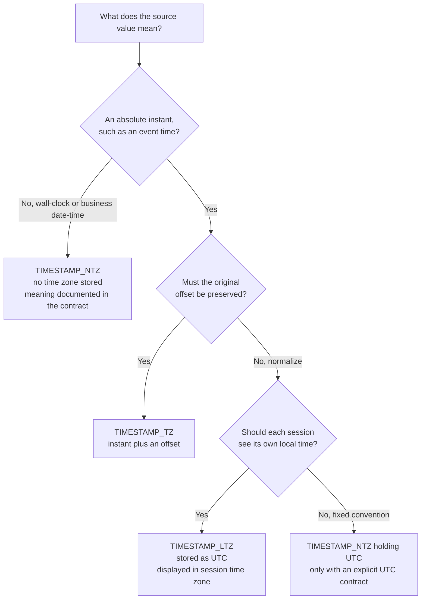
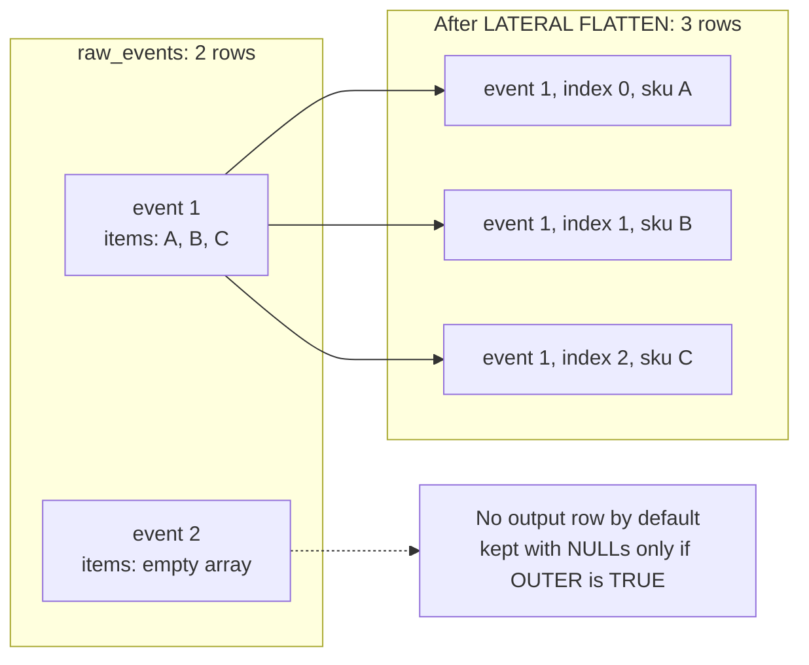
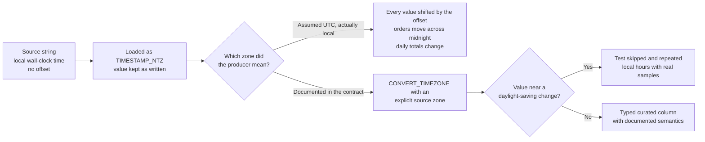

# SQL, Dates, and Semi-Structured Functions

This is a compact reminder sheet. Examples use fictional table and column names.

## Dates and Timestamps

Use the timestamp type that matches the meaning of the source value. A timestamp without timezone information is not automatically UTC.

```sql
SELECT
  DATE_TRUNC('MONTH', order_ts) AS month_start,
  DATEADD('DAY', 7, order_date) AS one_week_later,
  DATEDIFF('DAY', order_date, shipped_date) AS days_to_ship,
  LAST_DAY(order_date) AS month_end
FROM orders;
```

- `DATE_TRUNC` aligns a value to a period boundary.
- `DATEADD` shifts a date or time by a requested unit.
- `DATEDIFF` measures a difference at a chosen unit; it does not calculate elapsed fractional units.
- `LAST_DAY` returns the last date in a calendar period.
- `CONVERT_TIMEZONE` converts between named time zones. Keep source timezone assumptions explicit.

For `TIMESTAMP_NTZ`, timezone interpretation is external to the value. `TIMESTAMP_LTZ` is displayed using the session timezone. `TIMESTAMP_TZ` retains an offset with the timestamp. Validate ingestion and daylight-saving assumptions with representative records.



`TIMESTAMP_TZ` keeps an offset, not a named time zone, so later daylight-saving rules are not carried with the value. An NTZ column is UTC only when the contract says so.

## `VARIANT`, JSON, and Paths

```sql
SELECT
  TRY_PARSE_JSON(raw_payload) AS payload,
  payload:customer.id::STRING AS customer_id,
  TRY_TO_NUMBER(payload:order.total::STRING, 10, 2) AS order_total
FROM raw_events;
```

- `PARSE_JSON` parses JSON and errors for invalid input; `TRY_PARSE_JSON` returns `NULL` when parsing fails.
- `VARIANT` stores semi-structured values. Colon and bracket path notation accesses nested fields.
- `::TYPE` casts a value; use a `TRY_` conversion when bad input should be handled as data rather than aborting the statement.
- `IS_NULL_VALUE` can distinguish a JSON null from SQL `NULL` in relevant contexts.
- `ARRAY_SIZE` returns an array length; `OBJECT_KEYS` inspects object keys.

## Expanding Arrays

```sql
SELECT
  e.event_id,
  item.value:sku::STRING AS sku,
  item.value:quantity::NUMBER AS quantity
FROM raw_events AS e,
LATERAL FLATTEN(INPUT => e.raw_payload:items) AS item;
```

`FLATTEN` turns elements of an array or object into rows. The lateral relationship allows the function to use a column from the preceding row source. Check whether empty, missing, or null arrays should produce zero rows or be retained with an outer expansion pattern.



The grain moves from event to item: any event-level measure now repeats on every item row, and events with empty arrays silently disappear unless the outer form is used.

## Common Null and Conditional Helpers

```sql
SELECT
  COALESCE(normalized_email, source_email, 'unknown') AS email,
  NULLIF(status, '') AS status_or_null,
  IFF(amount >= 0, 'valid', 'review') AS amount_check
FROM staged_orders;
```

- `COALESCE` returns the first non-`NULL` expression.
- `NULLIF(a, b)` returns `NULL` when the values are equal.
- `IFF(condition, true_value, false_value)` is a compact conditional; use `CASE` for multiple branches.

## Window Function Reminder

```sql
SELECT
  customer_id,
  order_ts,
  ROW_NUMBER() OVER (
    PARTITION BY customer_id
    ORDER BY order_ts DESC, order_id DESC
  ) AS recency_rank
FROM orders;
```

Use a deterministic tie-breaker when selecting one row. An omitted or incorrect window frame can change aggregate window results; define it explicitly when the intended behavior is not the default.

## Common Pitfalls

- Do not assume a timestamp without timezone means UTC.
- Do not rely on implicit casts for semi-structured fields used in joins or filters.
- Distinguish missing paths, JSON nulls, and SQL `NULL` when they have different business meaning.
- Validate malformed payload rates instead of silently turning all parse failures into `NULL`.
- Remember that flattening an array changes row cardinality.

A typical production timestamp failure, end to end:



The wrong-zone bug rarely fails a load; it shows up later as daily totals that disagree with the source system.

For the full workflow—ingestion, path handling, `FLATTEN`, typed projections, and choosing `VARIANT` versus relational models—see [Semi-Structured Data in Snowflake](01_semi_structured_data.md). For pruning and query-profile tuning, continue to [Semi-Structured Performance](../deep-dives/semi_structured_performance.md).