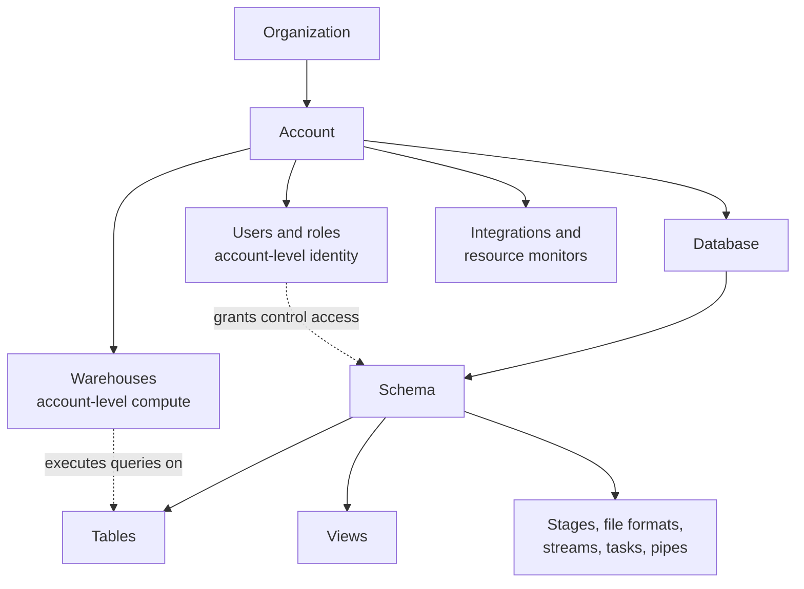
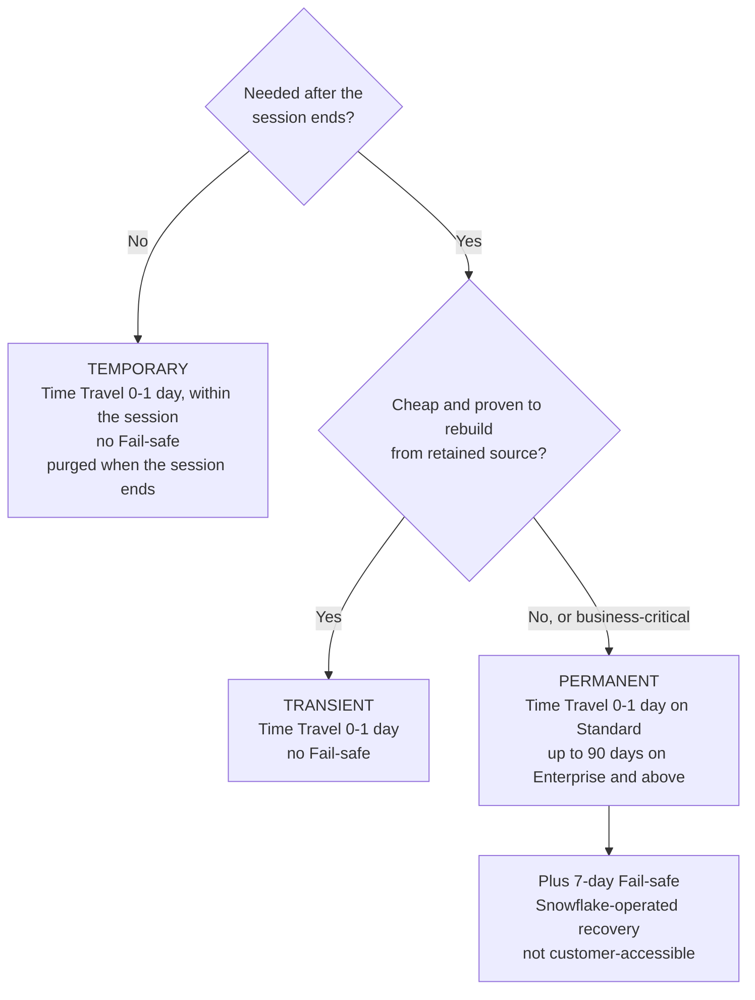
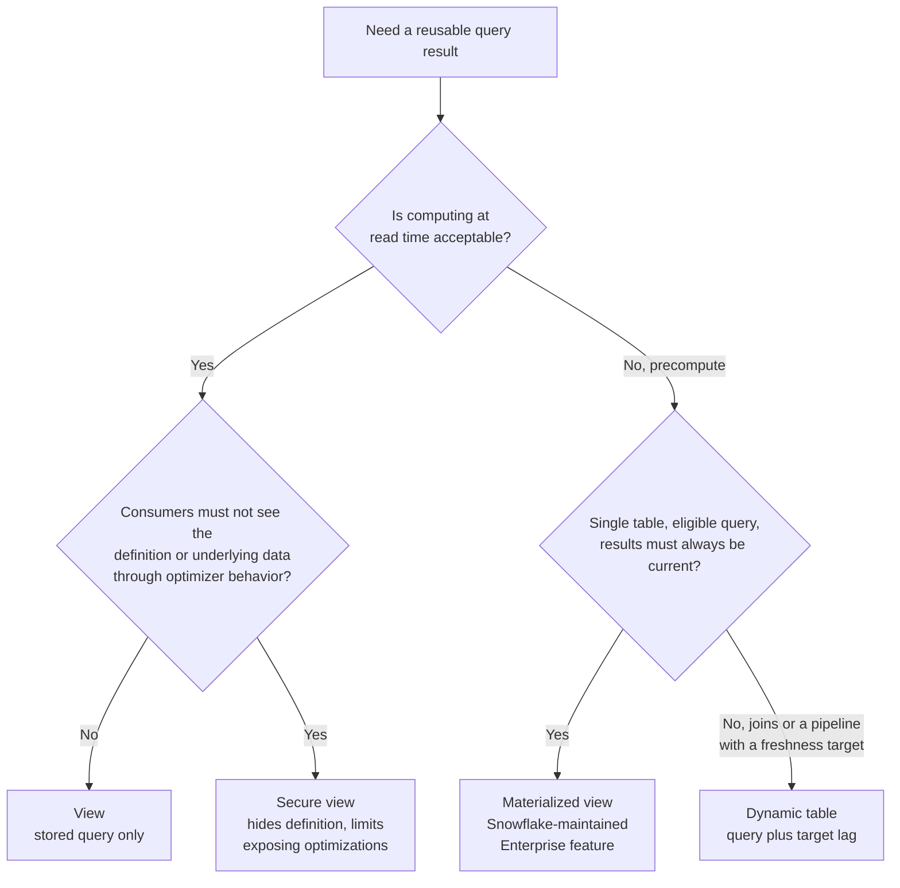

# Objects and Table Types

## Common Object Path

```text
database.schema.object
```

```sql
CREATE DATABASE ANALYTICS;
CREATE SCHEMA ANALYTICS.RAW;
CREATE TABLE ANALYTICS.RAW.ORDERS (
  order_id NUMBER,
  order_ts TIMESTAMP_NTZ,
  payload VARIANT
);
```

Use fully qualified names in deployment code when session context could resolve to the wrong environment. Names organize objects; grants and policies enforce access.



Warehouses and roles sit beside databases, not inside them: moving a table to another database does not change which compute or role hierarchy is used, and dropping a warehouse never drops data.

## Permanent, Transient, and Temporary

| Type | Typical use | Lifecycle and recovery note |
| --- | --- | --- |
| Permanent | Durable business or curated data | Standard durable table behavior; eligible Time Travel and provider recovery characteristics depend on configuration and edition |
| Transient | Re-creatable intermediate or staging data that does not need Fail-safe | Reduced recovery guarantees; keep only when upstream data and rebuild procedures are trustworthy |
| Temporary | Session-scoped scratch data | Automatically removed with the session; unsuitable as a durable pipeline handoff |

```sql
CREATE TABLE curated.customer_daily (...);
CREATE TRANSIENT TABLE work.customer_merge_stage (...);
CREATE TEMPORARY TABLE session_debug_rows (...);
```

Choose by data value, rebuildability, access, and recovery objective, not by table size alone. Retention and recovery details are edition- and configuration-sensitive; verify the current table-type documentation.



The trade-off is storage cost versus recovery: Time Travel and Fail-safe keep changed micro-partitions billable, so a high-churn staging table is often transient, while the curated table it feeds stays permanent.

## Views

```sql
CREATE VIEW analytics.reporting.active_customers AS
SELECT customer_id, region
FROM analytics.curated.dim_customer
WHERE is_active;
```

A view stores a query definition rather than an independently maintained result set. A secure view has additional protections for governed sharing and information exposure; it is not automatically a complete security boundary. See [Secure Views](../deep-dives/02_secure_views.md) before using one for sensitive data.



Moving down the tree trades read latency for background maintenance credits and storage. A secure view can also run slower than a plain view because some optimizations are disabled.

## Cloning Reminder

```sql
CREATE TABLE dev.customer_copy
  CLONE prod.curated.customer;
```

Cloning is efficient for many development and validation scenarios, but grants, sensitive values, retention, and cleanup still need explicit design. See [Recovery Reference](04_processing_and_recovery.md) and [Availability Architecture](../architecture/05_availability_and_recovery.md).